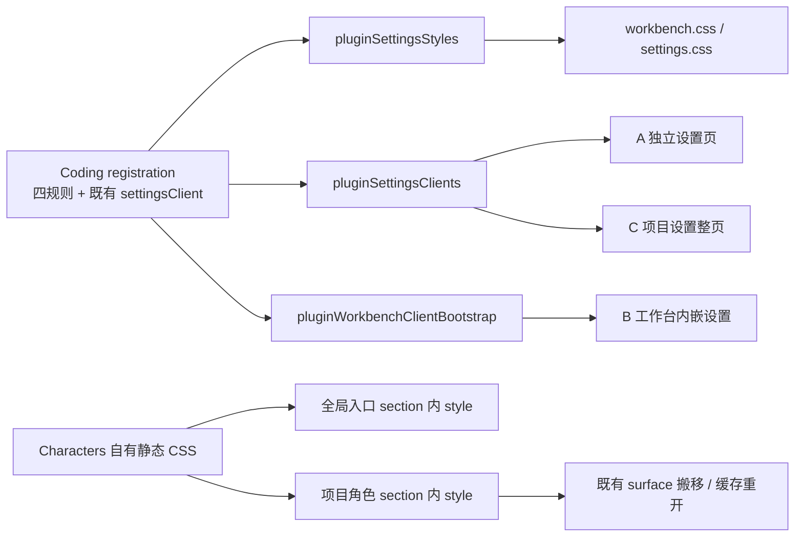

# PG070 完整后继：Coding 登记与 Characters 随内容加载｜开发线2

状态：2026-11-01 根核当前main、全部Open文件及保护#1101具体hunk，并采纳本次独立计划复核的三处验收修正；本页与T-393任务书共同accepted。开发线2为完整后继唯一writer。T393编号用于既有PG070完整后继，不采用先前两份零碎提案，不改变原产品范围。

## 目标、依据与准确基点

本计划覆盖 ESTIMATE 中 **PG070 剩余整行的同一后继**：Coding 四条设置 CSS 和两处设置脚本归登记，独立入口撤 Shelf 重复拼接；Characters 从两张共用 CSS 移到实际 HTML section 内，两入口独立携带自身规则。Coding 与 Characters 一起实现、一起验收；任何一个未闭合，PG070 整行不完成。完成目标是既有功能/交互/持久化保持可用、必要真实浏览器路径验证，非新增 UI、权限、事实或产品语义。

依据为协调 [ESTIMATE](/Users/yijunwang/code/mw-coord/coordination/2026-10-28/ESTIMATE.md) 的 PG070 拆账，以及 [CANDIDATE](/Users/yijunwang/code/mw-coord/coordination/2026-10-28/plans/PG070-next/CANDIDATE.md)、[PLAN](/Users/yijunwang/code/mw-coord/coordination/2026-10-28/plans/PG070-next/PLAN.md)、[REVIEW](/Users/yijunwang/code/mw-coord/coordination/2026-10-28/plans/PG070-next/REVIEW.md)。其冻结副本与 ESTIMATE 对应行见 [authority](/private/tmp/pg070-current/authority)。原“Coding writer 不做 Characters”“仅 Coding 子片”“Characters 后续再做”的分片边界由本次根派单覆盖；section 前放 style 的旧技术描述也不采用。

- 当前本地 `origin/main` **M=`be0c777002509b6eb4e2c2187eb3a5765a5440f6`**，父=`ddc12b8e12b7d17d3a1a103d5dff40b6270746a3`，tree=`d590f0425c15ad2e5aec9cb6690f14f650b9c41a`。未 fetch，不声称刷新远端。
- **T146 #1676 已采用为 M**。实际提交六文件；page-assets 已无 CODING_STYLES import/设置表直拼。不要重做这一步、恢复旧整表或继续标 WAIT T146。其现行 slice 的“交付待双核”只是旧文档状态，后续由根按真实采用更新。
- 父 **ddc12 是 T392 #1720 采用结果**。M 的 `page-assets.ts:1` 已为 `./judgment-rules/styles.js`，`scripts/settings.ts:12` 已为 `../judgment-rules/settings-client.js`；保这些现行路径和既有 Functions 符号/owner，不复制旧 functions 目录。
- 主检出仍停在旧 `08c9933…`，clean；本轮全用 M Git 对象与 [只读副本](/private/tmp/pg070-current/inputs/M)，不用主检出源码替代 M。文件/blob 对应见 [input-index.json](/private/tmp/pg070-current/input-index.json)。
- 沿仓库 [molis-plugin-dev Skill](/private/tmp/pg070-current/inputs/M/skills/molis-plugin-dev/SKILL.md) 及 ui/host 约定复用登记，不新增平台合同。档乙，**full=true** 保留，由根安排 CI/Full；实施与验证遵T-393正式窗口。

## 实际路径与实施 hunk

以下行号按 M。`W` 表示 `/Users/yijunwang/code/goalboard/apps/workbench/src`，`C` 表示 `/Users/yijunwang/code/goalboard/plugins/native/coding/src`。

| 路径 / 当前 hunk | 同一个 writer 的最终改动 |
| --- | --- |
| `C/registration.ts:2,13–22` | 保原 stylesheet/clientFactory/clientUses/git/files，新增 workbench.settingsStylesheet 指向本包四规则常量、settingsClient 指向现有 CODING_SETTINGS_CLIENT_SCRIPT。不改 Manifest/actions，不增公开出口。 |
| 新 `C/settings-styles.ts`；`W/styles/settings.ts:504–507` | 四条 CSS 原值搬入本包私有设置常量，registration 直接导入：details margin-block、summary cursor/overflow-wrap、method-body 全套声明、mw-select max-width。宿主删原四条。不是恢复整张 CODING_STYLES；规则经现有聚合仍进入两共用表，改变的是 owner/装配。级联位置改变要用计算样式验。 |
| `W/scripts/client/initialization.ts:1,125–126` | 删 Coding 专用 import 和 generic bootstrap 后的 Coding 直拼；保 pluginWorkbenchClientBootstrap(undefined,true) 与其它平台脚本顺序。deferClients 只跳过 clientFactory，不跳过 settingsClient，无需改公共聚合。 |
| `W/scripts/settings.ts:7,11,115` | 删 Coding、Shelf 专用 import/拼接，导入既有 pluginSettingsClients()，在原插件脚本区域调用一次。保 request helper 前置及模型/连接器/平台脚本顺序，保 judgment-rules 路径。不按插件 id 写排除名单，不另加绑定注册器。 |
| `W/characters/styles.ts:1–102` | 将角色项目页规则保在 Characters 自己样式模块；从整段拆出全局设置入口所需规则。原 `:88–91` 的 project-link 四规则只供入口；`:80` 的 hint 声明入口与项目页都需要（其余 editor-small 部分只供项目页）。两个常量/必要共用静态片段按实际选择组织，原值与媒体规则不变；不造运行时样式状态或第二份可变注册表。 |
| `W/characters/ui.ts:17–24,33–92` | renderCharactersSettingsEntry 的 `<section class="settings-document characters-settings-entry">` **内部**输出入口静态 style；renderCharacters 的 `<section ... data-characters>` **内部**输出项目页静态 style，覆盖其编辑器、CHARACTER_SOURCE_HTML（:61）、导入 HTML（:90）及确认 dialog（:91）。不放在 section 前，不混入 Module/Coding，不改变对象内容/动作。每次独立生成 section 都自足。 |
| `W/page-assets.ts:16,85–86,98–99` | 删除 CHARACTERS_STYLES import 与 workbench/settings 两表的直接拼接。保 T146 删除结果、T392 judgment-rules import 与其它拼接顺序；不新增 URL，不改两个 CSS 生成函数/加载器的合同。 |
| 现有定向测试 | plugin-styles、project-settings-standalone.e2e、settings-viewport.e2e、characters-window-drafts.e2e 中增加对应业务/样式断言。终端真实路径用现有 security-invariants-plugin-terminals.e2e 的隔离 CLI fixture，必要时仅补终端布局断言；该文件是否交 writer 由根精确求交，不触及安全语义。 |

只读消费者：`W/plugin-workbench.ts:108–115,144–155` 已有 settingsStyles/Clients/bootstrap；`W/project-settings-pages.ts:118` 已有第三入口聚合，通常不改；`W/settings-renderer.ts:103–113` 已接独立页；Host web-goals-read/web-catalog-settings/web-composition 及 Characters/Coding 业务客户端均只读。若真实证据要求改变其中实现，先把具体 hunk 交根纳入窗口，不以整包扩范围。



## 三入口与 Characters 的真实消费合同

**A/C真实执行方式（根采纳计划复核P1）：** 普通顶层Page.navigate会302回工作台，不能据此分别签A/C。沿现有真实URL通过同源iframe载入完整HTTP文档，不加embed=1、不用srcdoc、不手抄HTML、不改生产路由/CSP。先断言HTTP/frame成功、同源URL/path/query正确、body.settings-page与真实目标DOM存在、无data-tab-workspace；由子文档自身脚本绑定后操作，按frame/URL/method/意图计一次目标POST并owner回读及重载持久状态。B仍用正常工作台抽取/缓存/重开。独立复核详见CURRENT-REVIEW。

**A 独立设置页**：settings-renderer:113 的 UI_REQUEST → SETTINGS_CLIENT_SCRIPT；修改后经 pluginSettingsClients 收 Coding、Shelf、Goals 已登记脚本。Coding 方法库/MCP 现有导航生成的 URL、section、动作都不变。删除 Shelf 旧直拼是本片必要项。

**B 工作台设置**：initialization:125 的 pluginWorkbenchClientBootstrap(undefined,true) → 已登记 settingsClient；随后不再有 Coding 专用拼接。settings-directory:119–127 的既有 bindEmbed 和 settings-embed 事件继续作用于抓取/搬入节点，不另加每插件分支。Coding 的 bind(document) + settings-embed（browser/settings/index.ts）保留；方法库 dataset guard 与 MCP 私有 WeakMap 都不是“没有重复执行”的充分证据，要测实际请求和副作用。

**C 项目设置整页**：project-settings-pages:118 已用 pluginSettingsClients；新增登记自然到达。M 的项目设置页主要画 Goals 内容，没有 Coding/Shelf DOM 时应零新增业务POST/副作用、零新增脚本错误；真实出现哪个 owner 的 DOM 就验证它的一次动作/持久化。不能为了凑三乘三矩阵把假 Coding DOM 塞进不存在的页面；A/B 的真实 Coding、Shelf 正控与 C 的真实 Goals 正控及无对应 DOM 反控一起证明三个消费者。

**Characters 两入口**：

- 全局 `/settings/characters` 无项目时，经 Host web-catalog-settings:150–155 调 renderCharactersSettingsEntry；项目上下文则按原规则 302 到项目页。只给入口 project-link 与 hint CSS，不加载角色编辑器、终端 CSS。全局可出现的 settings-document 节点必须自己包含 style。
- 项目角色页由 web-goals-read:39–45 的 projectPluginStages 调 renderCharacters，随隐藏 surface 出现在初始项目 HTML。settings-directory 的 local surface 搬移后样式仍在 section 内，切换/关闭重开不依赖曾访问独立页面。**这里不是新增网络懒加载**，不宣称未打开角色的项目 HTML 零角色 CSS。
- 抓取设置 HTML 时，settings-directory:129–132 按 settings-content → settings-document 等选择节点；:173–199 再 adopt/append。放在 section 前的兄弟 style 会丢失，内部子 style 会随节点保留；当前路径未见清理子 style 的过滤器。web-composition:35 现行 CSP 已允许 inline style，保持原 CSP，不绕过滤器或引入 style-src 放宽。
- 项目角色 section 含 import/source/run/确认弹窗和终端；HOST_SURFACE_CLIENTS（plugin-workbench:170）仍给 Characters 既有 `/desktop/pty-client.js`。保客户端资源与 lifecycle，不把终端基础代码再搬入 CSS 或新建 Characters 插件。inline 样式晚于 head 链接可能改变级联，必须核真实计算样式。

## 一个实现顺序，不拆成两个交付

1. 根正式窗口冻结最终 M，核本文 M 差异与完整写路径。使用根指定独立树；先对照 accepted 原行补同一 PG070 slice 的完整后继段与根分的验收号，不另起总 spec、T393/T394 或两套进度账。该共享 spec/文档由根指定串行写入方式。
2. 在同一差分中迁 Coding 四规则/登记 settingsClient，撤 A/B 的 Coding 与 A 的 Shelf 直拼。先检查公共消费路径和 request helper 顺序，C 原样复用；不动 plugin-workbench 实现。
3. 在同一差分中拆 Characters 入口最小规则、把 style 写进两个 section 内部，再删两共用表直接拼接。保静态原值/媒体断点，当前编辑器、弹窗、终端 HTML 与所有动作保持；不引入全局 loaded 标志、样式 URL 或新存储。
4. 更新同一主题相关测试，给上述实际动作与回读加断言；原 T146 RAC-2590/2591/2592 等断言保持。四条 Coding 规则在成品共享表里仍应各一份（经 settingsStylesheet），不能将它们的存在误判为恢复整张 Coding 样式。
5. 获公共 build/browser 槽后完成下节工程和真实路径验证；发现多监听/抽取丢 style/级联变化先定位原接缝，在同一完整范围修复，不以删除断言、调整产品、单做 Coding 交付结束。
6. 最终资源结算与必要文档差量交根串行，冻结 head/tree、交 scoped diff 和证据。任何必要的资源增长在实测后按既有规则处理，不把本文当放行。CI/Full/推送/采用由根；完整后继全部验收/采用后才关 PG070 剩余整行。

## 必要回归、动作与图

根分配验收号后写入对应测试名/注释；以下不是新 RAC 编号。本轮所有结果均为**未运行**。

| 行为 | 具体证明与现有文件 |
| --- | --- |
| Coding owner / 样式到达 | `tests/plugin-styles.test.ts`：本包登记的四规则与两成品表各一份，宿主原四规则消失；原 CODING_STYLES 整表不回流，coding/git/files 外链和现行 PG070 splitter/served CSS 合同保持。正常生产装配，不仅搜常量名。 |
| A/B Coding 方法与 MCP | 在 `tests/project-settings-standalone.e2e.test.ts` 增独立命名测试块，走现有导航/真实 Host。方法库用隔离目录中的固定方法：展开读取正文，发现→点安装，检查目标 POST `/methods/install` 只一次及随后读取的安装事实；MCP 保存一份隔离无凭据配置，POST `/mcp` 一次、刷新/API 读回同一记录，避免 dataset guard 掩盖重复脚本。原方法/MCP客户端不改。`coding-mcp-settings-client.test.ts` 既有禁用/错误/启用回归保持，不能替代实际三入口证明。 |
| A/B Shelf 与 Goals / C 消费 | Shelf 走现有真实设置控件，POST 其 `/settings` 一次，并读回值/重开保持；不触发真实桌面快捷键或启动外部 CLI。Goals登记正控使用真实rules/planning/adoption DOM及其动作、owner回读；C至少操作真实规则页。guidance由Workbench另拼脚本，保原回归但不能独自证明settingsClient。A/B以有该DOM的真实入口为准，不造假DOM。各入口无 Coding/Shelf DOM 时无新增业务POST/副作用或新增脚本错误，原Shelf binder等正常GET单列，不为绝对零GET改生产。沿现有 standalone、settings-viewport 的完整业务回归，保失败后输入/重试断言。请求计数只数目标 URL/方法/意图，正常 GET 轮询另列，不把合法刷新当双执行。 |
| Characters 全局入口 | 新浏览器上下文直接打开无项目角色入口，验证项目链接、空项目提示、窄屏排版、入口内部 style；抓取/嵌入其 settings-document 后再次核计算样式，不借之前页面残留的 CSS。用既有设置浏览器文件增对应命名块。 |
| Characters 项目生命周期 | `characters-window-drafts.e2e.test.ts` 的公共 fixture：新上下文首开 A 项目角色，编辑/保存并 owner 读回；关角色设置→重开；切到 B 项目首次打开→回 A。每份当前角色 section 内含且只含自己的样式，无依赖先打开全局入口，实际 grid/表单/按钮与持久草稿保持。原跨刷新草稿/CAS 拒绝与确认逻辑断言保持。 |
| Characters 弹窗 / 终端 | 原导入、来源/运行和确认弹窗均实际打开/关闭，核视口内可操作及计算样式。终端沿 `security-invariants-plugin-terminals.e2e.test.ts` 第一条的临时 codex fixture（printf + /bin/cat），验证输出、键盘、重新附着不重启；桌面 .characters-terminal 高 420px、640 以下 350px，xterm 仍有可见区域。全文件执行，保 Shelf 安全断言；不调用真实 Agent/模型/Keychain。 |
| 桌面 / 窄屏与必要图 | 沿 settings-viewport 现有 1024×400、390×500 场景；另用正常桌面视口核全局角色入口、角色列表/编辑器、弹窗、终端。比较迁移前准确 M 与候选的计算样式/关键布局，截图对应上述可操作状态并人工查看。至少交三入口的代表实操图，以及角色入口、项目首开、切项目/重开后的编辑器、弹窗/终端桌面和窄屏图；可复用同张图证明并存状态，不为固定数量凑图。全部放已忽略 `.impeccable/qa/review/pg070-current/`，不新增入库评审组。图与请求/owner 回读绑定，不能只交 DOM/脚本次数。 |

## 工程验证与资源结算

先读过 Workbench/Coding README 开发要求与 PARALLEL-DEVELOPMENT。两 README 的“改动后必跑”去重为 **57 个完整文件**，准确来源/行号在 [readme-required-tests.json](/private/tmp/pg070-current/readme-required-tests.json)，完整文件清单在 [readme-required-tests.txt](/private/tmp/pg070-current/readme-required-tests.txt)。本片定向回归不取消这些要求；根按最终准确头安排运行或逐项核抵确有输入绑定的有效证据，未覆盖的仍报未运行，不机械把旧 T146 结果移署给新头。

本片新增/受影响路径优先执行的完整文件为：

```sh
node scripts/run-tests.mjs --jobs 1 --retries 0 --verbose tests/plugin-styles.test.ts tests/project-settings-standalone.e2e.test.ts tests/settings-viewport.e2e.test.ts tests/characters-window-drafts.e2e.test.ts tests/security-invariants-plugin-terminals.e2e.test.ts tests/coding-mcp-settings-client.test.ts tests/characters-appearance.test.ts
```

该命令不是全部 README 检查，也不是本机 Full；再按上面的 57 文件清单补剩余完整文件。测试代码不因 file-level 通过而省略本片所需的新真实行为断言。沿公共 test-kit/既有浏览器 fixture，保当前断言/超时、等待可操作后严格点击，不靠关动画/延时或 dataset.bound 自证；新测试不深入引入生产包内部，不混 source/dist。

公共 build 槽先整体 `pnpm build`，它包含 workspace build；未出现输入变化不再重复一遍 workspace:build。匹配产物后跑相关文件、`pnpm boundary:check`、对准确 merge-base 的正常 health、test-imports、`git diff --check`，保 plugin-styles 相关门禁与现行公共声明校验。无 Manifest/action/schema/公开 API 变化的预期，不为本片空刷 api/actions 快照；若真实 diff 有合同变化须先回具体范围，而非在生成表里吞掉。

- 所有运行走公共唯一 build/browser 槽，jobs1/retries0；独立 system HOME/CFFIXED/XDG/TMP/Molis Home/文件凭据、指定测试浏览器、finally 清理本次浏览器/profile。无真实 Home4207、个人 Chrome、Keychain、真实账号/模型/MCP。终端只用上述隔离 fixture，不另测真实 Agent 执行。
- 最终 `page-assets:check` 和现行 48 项 served bodies 以准确 base/head 的真实响应量测（资源数量以最终 main 为准）。预计直接变化为 workbench.css、settings.css、workbench.js；**独立设置客户端是在 HTML 内联，不能虚构 settings.js 第四资源**。coding.css、git/files.css 与其它 body 仍逐项核实际值，未变也记录；不以源码字符数当 serving 字节。
- 另量无项目 Characters 入口、项目 HTML（含隐藏角色 stage）以及独立设置页内联脚本的 HTML 响应前后字节，说明 Characters CSS 从可缓存共用资产移入 HTML 的实际成本。不要只报两 CSS 下降、忽略 HTML 增长，也不承诺本轮必定总字节减少。Coding 四规则原值迁移也可能有包装/顺序差。
- 预算/巨型单元快查只按最终合成真实结果由根串行更新。下降照常 update；必要增长先给准确资源/原因/字节与已尝试节省，遵现行一次性放行评审规则；新增资源或单项 >10KB 要用户决定。本文不预申请、不放宽门禁，不改 APPROVED_CEILINGS 或本地 baseline 压绿。推送前由根按既有授权安排 fetch/secrets，当前阶段不运行。
- 工程通过、真实操作覆盖、用户验收和 CI/Full/采用分别报告。最终 Full=true 由根 CI 排；完整后继未实际采用之前不关闭 PG070，不能用 Coding 完成或少量截图替代 Characters。

## 根需要串行交接的具体区域

根集中核在途 metadata 和分号；本轮未 GH 查询，不以旧 CANDIDATE 的 #1676/#1679/#1654 文件名单冒充实时锁。本轮只读保护树 H/tree/status 见 [before.json](/private/tmp/pg070-current/before.json)。

| 区域 | 本轮实际观察 / 窗口要求 |
| --- | --- |
| T392 → page-assets/scripts-settings | T392 已作为 ddc12 进入 M。两个改名 hunk 分别是 page-assets 第一行和 scripts/settings Functions import；本片只删 Characters 拼接、改插件客户端聚合，保 `judgment-rules` 两路径。没有继续等待 T392 整单的理由；不得从旧 CANDIDATE/旧主检出复制整文件。 |
| T141 / T144 settings-plugins | 开始观察 T141 H=`cdcc512e2cbf125c543f8979c345a2cf59146278`；结束该树已推进至 `b6a5b330fa306d831ecc8c87ee01e73c1d2b6cd7`，再次求交仍相同。T144 H=`39a681223ea3d3c86c452a864864107dbaf16afe` 未变；两者结束均 clean，均非释放。对本片源码候选集合加 settings-plugins 的 scoped diff，仅该 **非目标文件**命中；实际 PG070 目标 hunk 无交集。page-assets 对 PLUGIN_TRUST_SETTINGS_STYLES/CLIENT 的 import 保原样，不改 settings-plugins、Home 安装服务、contracts/SDK 或安装安全语义，不设整个 Host/Workbench 锁。 |
| page-assets / scripts/settings / initialization | 是本片实写共享文件，需根核最终在途具体 hunk；当前已知 T392 路径只需保留，T141/T144 未给这些文件新增目标 hunk。若其依赖样式/脚本随后采用改变最终资源，需在最终 M 上重建结算，不等于源文件所有权冲突。 |
| plugin-workbench / project-settings-pages | 是现有只读消费者。前者聚合足够，后者已有 C 入口；不借 PG070 预占保护 #1101 或 PR1c/T402/T403 的实现。只有真实复现显示必要时，向根报精确函数/hunk，不能先改再解释。 |
| README / spec / privileges / 预算 | Workbench README 的 PG070 段（当前约 :166）、Coding README 的设置所有权说明（若需）、现行 pg070 slice 的完整后继与 T146 状态、privileges 的 PG070 行及资源账本由根串行收差量。只关已证完成的整行，不改其它防腐状态、用词迁移或根的在途账；不擅自更新协调文件。 |
| 测试 | plugin-styles 与上述设置/角色浏览器文件是正式窗口需交的精确集合；终端安全文件仅允许布局断言补点，先根求交。已有原业务断言不删、不放宽；不能把占用一个测试文件扩大为整个包阻断。 |

本片无新增事实 owner、平台 schema、权限、动作、资源 URL 或用户选择。剩余动作是根确认最终 M/完整写路径、分配同一个后继及验收号、给唯一 writer 与公共验证窗口；不是重新决定要不要合并 Coding/Characters。

## 本轮交付边界

只读了 Git 对象、方案、相关 README/Skill/实现/测试，并在 `/private/tmp/pg070-current` 写本计划及其输入索引。**未写生产/spec/协调文件或 refs，未 fetch/GH、build/test、合成树、提交或推送**。源码静态可行性有上述调用链支撑；任何浏览器、计算样式、请求次数、持久化、资源字节与 CI/Full 结论均未在本轮验证。

结束回读：[after.json](/private/tmp/pg070-current/after.json)。origin/main 仍为 M，主检出 clean；T144 未变。T141 树已推进到 b6a5b330，重新核本片目标集合仍仅 settings-plugins 这个非目标文件命中；T392 旧候选工作树已在结束回读时不存在，采用结果仍在 M。本线没有改动、删除或清理这些树，不将其它工作树的变化冒记为本线污染或冻结状态不变。

## 根正式交接补充

已核最新main仍be0。21个Open PR完整文件分页没有本片目标交集，唯一保护#1101的page-assets旧hunk为Coding整表删除/旧聚合，当前main已具相应通用聚合；本片只移除Characters直接拼接，不修改保护分支、不采用未合语义。T141当前b6与T144冻结候选的settings-plugins均非本片写路径。资源账本后续按真实合成结算，不算术抵消。独立计划复核三项已并入正文；其余旧只读交付描述保历史来源，不把计划当已实现。准确文件写窗与RAC-2848～2854见T-393。
