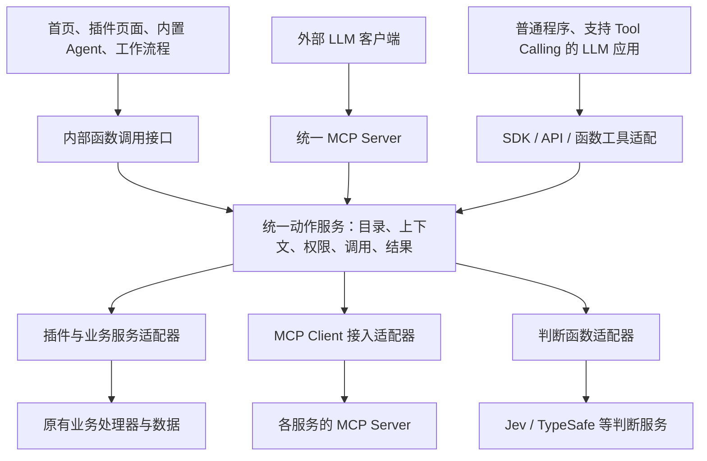

# 统一动作服务：能力接入、函数调用、MCP 与用户流程

状态：现行规范（2026-10-01 合入后梳理确认）。§3「基本合同」是能力注册、发现、调用与授权的现行规则，AGENTS.md 引用；迁移已随 #88、#94、#95 合入 main。下方按日期的迁移记录是历史，未做事项见[统一待办清单](../BACKLOG.md)。原状态句：本地完成，达到本任务内部完整的工程及已覆盖真实路径要求；尚未提交/发布。2026-09-25 启动全量能力迁移，2026-09-28 完成主干复查修复与最终验证。


共同规则见[§3 基本合同](#基本合同注册一次自动发现配置与执行一致)，验收方法见[§6](#6-如何证明方案落地)。

- [消费方迁移合同与复查](consumer-contracts.md)保留查询、工作流、Feed、SDK、Agent 与首页的具体合同，以及当时的约束和反例。
- [按插件和入口的接线验证](migration-verification.md)与[完整迁移目录](migration.md)保留当时覆盖的路径和未验证项。

执行授权：实现本规格的完整架构与产品路径，迁移全部存量插件对外、跨模块及工作流程使用的能力，并清理被替代的实现。以实际调用、持久化结果、生命周期及产品实操为验证证据；完成程度为「内部完整」。进度与逐插件盘点见 [migration.md](migration.md)。

网页自动授权接线：受保护的本地用户入口复用原 Plugin Runtime 安装记录中的实际 grants，为当前项目、当前安装提供的准确动作建立调用上下文；动作声明本身不产生授权。新插件使用新权限无需改 Home 名单。每次发现与调用读取当前授权，撤权、停用或换提供方后拒绝原引用；扩展权限不得借给同权限名称的其他未授权提供方，不改变 MCP、Agent 或后台事件身份。内置插件已有用户授权策略暂按原合同保留，随后随其安装合同收敛，不以此补丁宣称所有手写集合已清完。

目录发现的安装状态读取：一次发现或管理检查只读取一份当前项目安装快照，用它计算本次目录及依赖可用性，避免逐能力重复打开同一项目目录而阻塞首页准备。快照不得跨发现请求缓存，也不得用于实际执行或副作用前检查；执行继续读取当前状态，停用后拒绝此前可用的动作。界面异步加载动作时保持底部操作位置，同内容刷新保留按钮节点及焦点。

首页具体动作执行：插件通过共同目录声明“事项可用动作”查询，按当前对象返回 offer_id、标题、原动作引用和完整输入；执行动作仍是插件已经注册的原能力，不复制业务写入。发现查询输出仅可指向自身提供方的已注册动作。Home 依据真实权限、可用性及输入合同形成选项；点击时固定查询提供方、动作版本/提供方、offer_id 和原输入，重新准备并逐项核对，过期时拒绝而非换动作或参数。Home 不承诺替业务 owner 实现所有副作用去重；底层动作继续负责版本冲突、幂等与恢复，网络结果未知时前端禁止直接再次提交。首批迁移 Inbox 完成/忽略和未知插件实际执行，随后继续迁移导航、问询、授权及动态事件贡献；临时保留项须列明，不能将这一步称为全部首页分支清理完成。

2026-09-25 用户补充：各服务的 MCP 属于动作服务的接入范围；支持 Jev 这类结构化判断函数调用；动作服务本身提供 MCP Server，让常规 LLM 客户端也能使用。此前仅围绕首页按钮抽取动作的边界据此扩大。以下定义完整目标；已实现及未实现部分以 migration.md 的证据为准。

2026-09-25 产品层级决定：去掉 Functions 独立插件，将其判断能力归入内置的系统级动作服务；服务入口与 Character、全局设置放在同一个岛。此决定替代此前保留 Functions 独立页面/导航的建议；已纳入全量实施授权。

2026-09-25 基本要求：插件开发时可注册能力，能力发现与配置选项自动生成；工作流程、函数「可用在哪／已用在哪」等场景必须完整、准确。此项属于首期基础合同和验收门槛，不是后续增强。

## 1. 用户只需要理解什么

**看到一件事 → 选择下一步 → 得到结果。**

首页集中呈现事情和可做的下一步。插件提供具体能力。判断规则帮助选择下一步。工作流程把多步处理串起来。用户可以直接使用默认动作，需要重复处理时再配置规则或流程。

动作服务是产品各入口共用的能力底座，统一接入插件、业务服务、外部 MCP 和判断函数。查询内容、获得判断和执行操作都可以调用；首页展示其中适合当前事情的部分。用户也可以在其他支持 MCP 的客户端连接同一个服务，使用自己授权范围内的这些能力。

例子（目标体验）：首页出现一条客户反馈，用户点「加入待办」，得到待办链接；也可以点「整理为文档」，看到处理进度和生成的文档。后者是说明目标结构的示例，不表示现有首页已经具备该能力。

## 2. 当前混乱的具体来源

以下记录启动重构时的问题与代码依据；已迁移部分的当前状态以 migration.md 和本规格后面的实施记录为准。

| 当前事实 | 对产品和维护的影响 | 方案 |
| --- | --- | --- |
| Host 收集插件 behaviors 和 MCP exports，但首页另有固定动作名单及逐项点击分支 | 能力出现在目录中，不代表能从首页使用；新增能力需要多处接线 | 可面向用户执行的动作有完整定义和处理器，界面根据动作描述呈现 |
| Functions 产出建议动作 ID，实际执行散在页面和 Host 中 | 推荐与执行之间缺少共同的输入、结果和可用性约定 | 推荐引用动作定义，执行再次验证并调用同一处理器 |
| 发布函数与启用场景分开，用户需要跨页面理解绑定关系 | 简单的“改变首页建议”被暴露为内部配置过程 | 首页就地配置「下一步建议」，规则库承担复用和高级编辑 |
| Functions 插件是 TypeSafe 判断；工作流程的 Function 是本地模板替换 | 同一个词代表不同机制 | 用户界面区分「判断规则」「模板转换」「AI 整理」「人工交接」 |
| 首页「问问怎么回事」目前只是打开对象；「说一句」提交未传递文本和可靠事件绑定 | 动作文案承诺与实际结果不一致 | 名称对应真实行为；问询完整携带原对象及用户文本进入 Session |
| Actions 目前只有 contract-only 定位；Execution 模块主要读取历史记录 | 容易把规划中的执行层或历史模块当成现成实现 | 明确本次收敛范围；复用可用的注册、权限和插件处理器，按真实用例实现动作协调 |
| 已有对外 LocalMcpServer 汇总平台及插件工具，Agent Host 另有外部 MCP 连接与工具采用路径 | 内部 Agent 接入了某个 MCP，不代表统一服务或外部客户端能使用它 | 外部 MCP 接入与统一能力目录衔接，内部和外部调用共享核心分发 |
| 工作流程 Host 使用 SUPPORTED / BLANK_START 名单并按插件 ID 分发，函数目的地由固定列表生成 | 新插件注册之后仍可能漏出现在配置中；名称能选中也不证明实际调用已接通 | 插件注册能力及实际消费入口，所有目录和选择器从共同合同与运行状态派生 |

代码依据：

- [行为目录](../../apps/local-host/src/recommendation-catalog.ts)、[首页白名单](../../packages/contracts/src/modules/functions.ts)、[首页点击处理](../../apps/workbench/src/scripts/client/project-home.ts)。
- [判断触发](../../plugins/native/feed/src/application.ts)、[判断服务](../../modules/judgment-rules/src/service.ts)、[判断模型调用](../../modules/judgment-rules/src/provider.ts)、[判断结果投影](../../apps/local-host/src/web-view.ts)。
- [工作流程模板转换](../../plugins/native/workflows/src/model.ts)、[Actions 定位](../../docs/modules/actions.md)、历史 Execution 边界（`modules/execution` 已于 #268 删除）。
- [现有对外 MCP Server](../../apps/local-host/src/mcp-server.ts)、[MCP 目录](../../apps/local-host/src/mcp-catalog.ts)、[协议适配](../../apps/mcp/src/protocol.ts)、[Agent 外部 MCP 接入](../../horizontal/agent-host/src/adapters/prologue-mcp.ts)。现有协议入口的 resources/list 返回空列表，不能把宣告支持 resources 视为内容已经打通。
- 工作流程手写支持名单与分发（`apps/local-host/src/workflows-native-plugin-http.ts`，W5-01-WORKFLOWS 已删）、[函数固定目的地](../../packages/contracts/src/modules/functions.ts)。它们是此次必须替换的扩展障碍。

## 3. 架构中的职责



这些是职责边界，不要求各建一个进程或独立部署服务。先在现有本地应用内收敛模块和接口。

### 服务的两面：接入能力，提供调用

对内，动作服务通过适配器使用插件、已有 API、外部 MCP Server 和判断模型。对外，它提供统一函数调用接口及 MCP Server。MCP Client 和 MCP Server 是两个方向的适配，共享中间的目录、权限和执行逻辑。

同一能力只保留一个规范定义和实际处理器映射；不同入口可以有不同可见范围和名称适配。现有内部直接函数调用不必绕一圈 MCP 网络协议。已有对外 MCP Server 逐步改为调用共同核心，不新增另一套业务执行服务。

Host 的注册表（Kernel registry）只登记动作（R8 删掉了既有的 typed capability）。项目调用继续使用现有 Runtime 生命周期、串行调用和关闭等待；可信身份与业务 Runtime 由 Host 在调用期间关联，不能放入模型参数。相同插件在不同项目的激活允许复用公开能力 ID/版本，注册实例以可信项目作用域区分；全局与项目同名能力不得互相遮蔽。项目关闭或插件停用时撤回对应实例，其他项目不受影响。旧的内部客户端默认没有额外授权；需要权限的能力必须由 Host 调用方显式提供可信上下文。

Host 上只有一个登记口（PG-035，R8 收尾）：动作只走 `registerAction`（进动作服务，按动作声明检查，声明不全是 `actions.definition_invalid`）；typed 的 `register` / `registerCapability`、`HostCapabilityDefinition` 与插件的 `services.capabilities` 已删除，宿主项目客户端 `LocalHost.invoke` 只调动作，没注册的 id 答 `actions.missing`。模型起草 `agent.draft-text.v1` 是第一个转过来的宿主能力：只给插件、要 `model:invoke`，插件经 `services.actions.invoke` 调；宿主为每个项目登记的工作区读取与浏览选择（7 条）也只在动作这一边。agent 宿主的能力已全部转成动作（R8 第 1～4 批，`specs/archive/repository-anti-corruption/slices/r8-agent-host-actions.md`），typed 通道随后整个删掉（同一文件「删 typed 通道」一节）。

### 动作：一项有明确输入和结果的操作

每个可复用能力声明：稳定身份、来源及版本、用户可读名称、适用对象、输入 schema、可用的输出合同、所需权限及处理器。操作可以是查询、判断或写入；界面导航是本地展示能力。能否使用还取决于当前项目启用情况、账号连接、对象状态和权限；不能只检查 manifest 是否声明。

例如「标记已完成」接收待办引用和预期版本，由 Inbox 的业务处理器修改状态，返回更新后的事项引用。「打开消息」返回导航目标，不制造持久任务。「整理为文档」需要明确整理能力与文档写入能力，若涉及多步则由流程组合。

动作目录以已注册且具有执行实现的定义为事实来源。业务校验与数据写入仍由原插件/模块负责。查询可用性只用于展示，执行时必须重新校验。

各服务接入的 MCP 工具，包括列表和查询，都属于同一个动作目录。首页按钮是这个目录的场景化呈现，只有具有适用对象及展示定义的能力才成为首页按钮；接入 MCP 不要求每个工具都生成按钮。

### 基本合同：注册一次，自动发现，配置与执行一致

**一个符合 SDK 合同的新插件，应仅通过自身声明和实现完成接入。不得为它修改 Host 支持名单、工作流程分支、首页动作分支、函数场景枚举或 MCP 工具总表。** 全新交互形式可能需要新增通用扩展点；使用已有扩展合同的普通插件不应再增加宿主特判。

插件需要能够贡献两种不同的内容（现行词见 [GLOSSARY](../../docs/system/GLOSSARY.md) §1：动作、动作目录、消费场景、受众）：

| 贡献 | 声明什么 | 必须兑现什么 |
| --- | --- | --- |
| 提供动作 | 稳定 ID、合同版本、名称与说明、输入/输出类型、适用对象、查询/判断/写入性质、作用域与权限、允许的调用入口；需要时声明通用表单/专用界面及结果呈现 | 可调用的 handler 或受控服务适配；所需的业务校验、结果合同和状态查询 |
| 消费场景（使用判断结果的位置） | 稳定场景 ID、用户可读名称、触发时机、提供的上下文、接受的判断结果类型、如何使用结果、允许推荐或执行的动作范围、配置入口及绑定作用域 | 实际业务触发点读取绑定并调用；结果有真实消费路径；例如新消息到达后使用分类结果，不能只向目录贡献一个标签 |

已发布的判断规则也注册为动作；插件及系统里使用判断结果的位置注册为消费场景。内置功能、可安装插件、生成的插件遵守同一合同。外部 MCP 通过接入适配器贡献已发现工具，不要求用户重复录入工具名和参数；上游没有提供的业务语义不能由系统猜成确定事实。

SDK 提供规范定义、类型辅助和注册入口；manifest 引用同一份定义生成安装时可检查的元数据，运行时兑现对应处理器。开发期检查重复身份、非法 schema、未兑现的能力和场景；激活期再次验证。声明不完整或处理器缺失的贡献不能进入“可调用”目录，给插件开发者明确错误。能力声明不代表实际 grant。

从已经安装的可信声明可以发现暂不可用的动作；真正可执行的目录同时结合处理器兑现、生命周期、权限与连接状态。保留现有按需激活机制，发现过程不通过执行业务动作来探测能力。

所有消费方读取同一个动作目录及统一上下文解析：动作目录页、工作流程步骤选择器、消费场景选择器、Character 动作选择、首页动作及 MCP tools/list。各入口依据权限、输入兼容性和用途作有解释的筛选，不各自复制目录或手写名单。搜索和推荐排序不改变完整目录；分页须能遍历全部授权条目，不能用推荐前几项代替完整发现。

#### 现行合同速查

上面是原则；写一个动作时照下面的字段写。类型都在 `packages/contracts/src/platform/actions.ts`，插件作者经 `@molis-ai/molis-work-plugin-sdk` 取同一份；词以 [GLOSSARY](../../docs/system/GLOSSARY.md) 为准。

| 写在哪 | 字段 | 说明 |
| --- | --- | --- |
| `ActionDefinition` | `capability_id`、`version`、`operation`（`query` / `command`）、`action` | 动作的稳定身份与元数据；`provider_id` 由注册方注入，不由插件写。形状变了按 [CONTRACT-CHANGES](../../docs/system/CONTRACT-CHANGES.md) 升 `version` |
| `ActionMetadata`（`action`） | `title`、`description`、`kind`（`query` / `judgment` / `operation` / `navigation`）、`scope`（`home` / `project`）、`input_schema`、`output_schema` | 输入输出是 JSON Schema，注册时检查 |
| 同上 | `audiences` | 谁能调：`user`、`agent`、`workflow`、`mcp`、`plugin` 的子集。插件要调，必须列 `plugin` |
| 同上 | `permissions`、`subject_kinds` | 调用者必须持有的权限；适用的对象种类 |
| 同上 | `effect` | `read` / `write` / `irreversible`；不写就按 id 推断（`actionEffect`）。`irreversible` 不给插件 |
| 同上 | `scheduling: "concurrent"` | 等模型或外部服务的动作必须声明；返回后 `await caller.beforeEffect()`，再按读取时的版本提交。不声明就是串行，会占住项目队列 |
| 同上 | `authorship: "session"`、`execution`、`plugin: false` | 只能从稳定 Session 调（外部 Runtime 经 MCP）；声明式限额；不给生成插件 |
| `ActionCallContext`（处理器拿到的调用者） | `actor_id`、`project_id`、`audience`、`permissions`、`signal` | 可信身份由宿主给，从不从业务输入读；`ActionExecutionContext` 另带 `beforeEffect()`。被取消、撤权、停用后不再写业务记录 |
| 平台的中止点（中止 `signal` 的地方） | 中止原因 | 中止原因说明为什么停，下游据此区分取消与撤权（例如共用的 OAuth 刷新只在取消时写回轮换的令牌，S-95）。新加中止点时：人离开或调用结束（断开连接、关掉页面、页面请求结束）用 `actions.cancelled`，时限用 `actions.timeout`；撤权、停用、卸载、连接改变用别的原因（`actions.forbidden`、`actions.plugin_unavailable`、检查自己抛的错误）。人离开时调用已失去授权的，按撤权的原因中止，不写成取消。插件自己传进来的 signal 不算平台的原因：平台把它的中止换成 `actions.cancelled`，同样只在调用仍有授权时（`plugin-page-authority.ts` 的 `left`、`connections-service.ts` 的 `ownSignal`；T-218，2026-10-30） |
| 插件 Manifest | `actions`、`action_scenes` | 插件自己提供的动作与消费场景，与运行时注册的是同一份定义 |
| 插件 Manifest | `capabilities.consumes` + `permissions` | 要调的别家动作（`capability_id`）与它们要求的权限，两样都写才可用；`capabilities.provides` 列自己提供的 |

动作合同快照（`tooling/gates/actions/`）与公开 API 快照（`tooling/gates/api/`）会拦下没登记的改动，见仓库根的 `AGENTS.md`。

### 自动匹配：把「齐」与「准」落实为行为

「齐」是当前作用域内符合条件的注册能力与场景都能被发现，不因插件未写入某个宿主列表而遗漏。「准」是能说明输入是否齐全、结果是否匹配、当前是否可执行；不是每个入口显示全部工具。

工作流程根据前一步输出与下一步输入合同判断兼容性。必填参数必须来自前一步、可信项目上下文或用户显式填写；字段映射由合同生成可选项。能验证兼容才允许直接连线，需要转换时呈现明确转换步骤，缺输入时标为待配置。相同的 JSON 形状不等于同一业务对象：事项引用、文档引用、项目作用域和版本约束都参与匹配。第一版支持范围明确的类型匹配及显式字段映射，未知兼容关系显示待配置，不声称能自动理解任意 schema 的语义。

函数详情区分两个问题：

- **可用在哪**：从已注册消费入口反查输入上下文与判断输出是否兼容，列出全部授权范围内的候选场景、触发时机和实际效果。Choice 选项集合、Score 数值及 Noul 概率分别与消费合同核对，不能因为都是判断函数就允许随处绑定。
- **已用在哪**：从实际保存的绑定反查具体项目、规则、工作流程及 Character 引用，显示启用状态、引用版本和可跳转位置。查看范围仍受权限限制。没有绑定就不能宣称“正在使用”。

使用位置来自统一绑定接口和现有配置 owner 的权威记录。可建立可重建的反查索引，但不让每个页面另外维护一份使用关系。新消费入口须兑现绑定查询与更新合同；删除或改绑应立即反映到反查结果。

例如，新插件声明「评价到达时」消费场景并实现真实触发，同时提供「读取评价」「创建处理单」能力：安装并启用后，能力库可发现两项能力，工作流程可选择兼容步骤，符合合同的判断函数在「可用在哪」看到该场景；绑定后「已用在哪」显示具体项目。收到评价时必须实际调用绑定函数并产生规定效果。仅目录里出现名字不算接入完成。

### 生命周期与配置有效性

文字模型统一读取现有 catalog.models 和连接凭据引用。能力发现只读取模型、连接和密文存在状态，不解锁密钥；执行前才解析原密钥，发送前及返回后重新核对配置与连接。一个调用固定所选供应商和模型，停用、删除、断连或改绑期间返回的结果不得继续提交。Jelly 的明确选择失效时保留引用并报未配置，不自动切换供应商。没有模型目录配置的旧环境/文本密钥入口可作为兼容来源，已有目录记录或明确选择时不能用它绕过停用与撤权。文字补全各消费方共用此解析器和协议适配，不复制新模型目录；既有 Home 必须显式绑定或继承可信 Home 上下文。

灵光完整公开能力迁移：列表、读取、创建、修改、单项/批量丢弃、打开/读取对话和发送消息由插件定义动作并在原项目 Runtime 注册；HTTP 与工作流只转调这些动作，不持有另一份业务实现。项目身份由 Host 的项目路由绑定，旧全局 URL 仅在查验目录中的项目后薄转发；query/body 不得覆盖已绑定项目。批量丢弃先校验全部对象，防止跨项目或缺失对象导致前半批被修改。原数据表、灵光/会话/消息身份不改变。

对话调用先校验项目、会话、关联灵光状态及输入，再带所选灵光和有效对话历史调用既有文字模型；正文和历史是材料，不作为系统授权。模型调用传递取消信号，返回后核对会话/灵光快照，变更或取消时不提交过期结果。一个成功回合原子保存用户和 assistant 消息；错误、空结果、超时不制造成功回复。保留历史 stub 记录并明确标为本地记录，新请求在没有模型时显示连接不可用，不再生成冒充回复的占位消息。UI 发送期间防重复提交，失败保留输入，晚返回不能清空新输入或切换后的会话。自动保存串行执行并携带读取版本，冲突时保留草稿且阻止进入依赖该内容的对话。旧 HTTP 路径不另行实现模型或存储逻辑。灵光的复制正文仍是本地 UI 行为，不强行注册为远程业务能力。

工作流存量内容站迁移：Feed、Inbox、Pages、灵光分别拥有内容列表、读取、接收及可选空白创建的动作实现。共享内容合同只定义输入输出与站点角色，不包含插件 ID 名单。工作流通过统一动作目录发现这些角色、调用同一客户端；Host 只组合存储和服务，不判断目标插件。保存和开始实例时固定能力 ID、版本和提供方，已有仅含插件名的链在首次保存或开始时解析；已固定的引用失效时保留并报错，不换成新版本或另一个提供方。已运行实例在下一次推进前固定全部尚未固定的引用并保存，防止后来注册的同名站点改变运行目标。此迁移保留原链、模板/AI/人工交接及历史数据，不代表任意输入输出的通用能力步骤映射已经完成。后者继续沿用同一工作流存储与动作服务扩展，不另起工作流引擎。

这一迁移须用真实存储验证四个存量内容站的交接，并通过正式 Plugin Runtime 注册未知站点，验证自动发现、实际内容写入、项目隔离、撤回/升级后保留引用。权限由可信入口提供；角色声明不能自行授予权限。内容站协议要求完整 schema 与语义版本，声明形状相似但不兼容的动作不能被当成该协议调用。

安装、激活、停用、卸载、升级、连接/断连、授权变更、规则发布和绑定变更都更新共同目录或使用关系。复用既有运行时事件与连接状态传播，界面刷新和 MCP 重新发现读取一致的事实；协议支持时通知目录变化。无变化通知的外部 MCP 在建立/重建连接及重新发现时刷新，不能承诺跨服务零延迟感知。

编辑器显示的当前状态须区分可使用、需要配置和已失效。在保存/启用配置及实际调用时重新检查版本、权限、输入和作用域，防止编辑途中状态改变后仍写入“可运行”配置。草稿可保留未完成连接，必须明确标记未就绪。

已保存流程或函数绑定引用的能力失效时，保留原引用和具体原因，标记受影响步骤不可执行并提供修复入口；不能悄悄删除引用、换成同名能力或让整个流程看起来仍然有效。重新授权/恢复连接后重新校验；兼容恢复可继续使用，合同不兼容时要求显式修复。已经运行的步骤遵守既有运行与恢复合同，目录更新不改写历史执行结果。

### 外部 MCP 接入

通过已有 MCP Client 能力连接服务，发现工具并保存来源连接、工具名和 schema 版本的映射。规范身份包含连接/服务命名空间，避免同名工具冲突。导入的能力依照项目和调用者授权选择性开放，不能因为本机某个 Agent 已连接就自动向所有外部客户端开放。

已保存服务上次提供的工具（不含凭据）跨重启保留在目录中，重连前显示不可用及原因；不会为恢复目录而自行启动进程或发起连接，已移除的服务不带回。

调用时选择确定的账号连接，校验当前工具定义及连接状态，再转发到上游。保留上游错误、文本/图片/资源引用和可用的结构化结果；只有上游承诺了输出 schema 才据此验证，不能凭空声称任意 MCP 都有同样强的输出类型。上游支持的能力和限制须透传或给出明确适配说明。

外部 MCP 工具一律按外部写入登记（调用记录、写入前复查），不依据服务自称的只读/破坏性提示降级为查询；资源读取（resources/read）按协议本身登记为查询。服务连接中的远程 MCP 与 Coding 配置的外部 MCP 都进入同一目录。

账号凭据由服务端连接层持有；下游客户端的身份与上游账号授权分别校验，不把下游 token 直接当上游凭据。工具描述、只读提示及模型建议都不是授权来源。外部 MCP 接入需防止将本服务重新导入为自身上游造成循环调用。

### 函数调用与 Jev 判断

统一调用概念是 `invoke(能力标识, 输入, 可信调用上下文) → 结果`，同时提供目录查询、能力描述和必要的持久任务状态查询。示例名字仅解释架构，不是本轮冻结的 API。

三类能力使用同一调用形式：查询插件内容；调用已发布判断函数；修改业务对象。普通程序可以直接调用 SDK/API，LLM 应用可以将目录转换为自身的 function/tool schema，由其宿主执行模型提出的调用并将结果回传。仅有聊天文本接口的裸模型不会因此自行连接 MCP。

Jev 官方定义为：输入 state 和有类型的问题，返回 Choice、Score 或 Noul 等结构化判断。现有 Functions 的 TypeSafe provider 已采用相同的 System One 请求形状。方案将这类函数作为一等能力，通过内部调用及 MCP 都可使用；保留选择、概率、置信度和实际可取得的版本/用量信息。函数定义和版本由系统级判断模块维护，可沿用现有 modules/judgment-rules 的业务实现；统一目录引用它，不再复制一份规则。该模块的存在不要求保留 Functions 插件。

已发布规则可以得到稳定的可发现描述；数量较多时可通过 list/describe/invoke 按需发现，不要求把所有规则全文塞进模型上下文。发现结果与实际执行应用相同权限。每条规则独立导出 MCP tool 或使用通用 invoke 工具，是协议展示策略，不改变规则和执行事实来源。

“函数调用”在本方案中指有输入输出合同的能力调用，不默认包含运行任意用户 JavaScript。是否提供代码编排运行环境，应另有真实场景再决定。

参考：[Jev 官方介绍](https://docs.typesafe.ai/introduction)。核对日期为 2026-09-25；借鉴调用形态，不绑定某个模型厂商或承诺任意判断结果都正确。

### 对外 MCP Server 与内容访问

复用现有服务入口和已公开工具名称，逐步让 tools/list 与 tools/call 都来自统一目录与调用核心。首个实现闭环使用现有本地传输；需要跨机器接入时再补 HTTP 传输和部署身份，不把部署方式变成新的业务架构。

外部客户端建立自己的可信连接和项目作用域，不要求冒充内置 Runtime Session，也不依赖私有 Session metadata 才能使用内容。一个客户端的项目切换不能改变另一客户端的作用域。查询、判断和写入权限可分别限定，沿用授权范围执行。

“能用这里的内容”包含实际搜索、读取和获取结果，不只列出工具名。首期用稳定查询工具暴露授权内容和来源引用，兼容主要使用 tools 的客户端。MCP resources 在确有读取实现时提供；不能只返回桌面本地文件路径或页面跳转，让外部客户端无法取得内容。大内容通过分页或可授权读取的资源引用返回，富媒体保留相应类型。

外部客户端不必打开首页即可使用服务。首页专用导航不作为外部可执行业务能力；长任务通过运行引用和状态/结果查询表达，不把“已启动”返回成“已完成”。

### 判断：决定推荐什么，不取得执行授权

保留现有 Functions 的选择、概率和评分能力。它接收明确选取的对象内容及规则，返回判断；不隐式读取整个项目，也不自行调用业务动作。

首页的场景策略把判断映射为当前可用动作，并保留规则引用以说明推荐来源。Functions 可继续被其他场景独立调用，不强制所有判断都输出动作。

默认动作由对象类型和状态确定，不需要先配置模型。AI 判断是可选增强；失败时保留可用的基础动作。用户规则造成的推荐应能查看来自哪条规则；不把模型内部推理包装成解释。

### 执行：所有入口得到一致的业务结果

动作服务承担上下文绑定、输入检查、权限检查、处理器调用及结果返回。复用 Kernel 的注册/调用机制、现有 MCP 连接设施和 Plugin Runtime 的身份、生命周期与授权事实；输入输出 schema 等规范元数据补在共同定义上，不建立另一套平行注册体系。

MCP 适配从实时授权目录生成工具，调用时重新读取目录并通过同一核心执行；客户端参数与 `_meta` 不提供身份、项目或权限。对象合同直接导出；标量或数组输入使用 `input` 对象包装，输出使用 `result` 包装，并保留 schema 的局部引用语义。标准客户端可以取得结构化结果和对应文本。别名冲突必须明确失败，不能覆盖另一能力。

判断场景在异步结果返回后重新核对绑定、权限，以及提供方和消费方是否还是同一次注册；升级或重新加载不能把旧结果送入新的实现。公开能力版本与一次运行期注册身份各自承担兼容性和并发检查，不把运行期身份写成用户配置。

导航和即时操作尽量直接返回结果；只有需要跨刷新或重启继续追踪的操作才建立持久运行记录。运行记录引用实际业务结果，不能替代原插件的数据。现有 Actions 文档仅定义个人/外部操作请求，尚未实现；后续须更新其定位或明确下属关系，不能把所有查询、MCP 协议和判断能力都塞进持久 Action Request。不恢复旧 Claim/Run 体系。

已有用户点击或已授权自动规则可触发执行，不为所有写操作一律加确认。权限不足、缺必填信息或具体操作确需额外决定时，返回明确待办项。

外部写入超时且结果不明时，先核对结果再决定重试；长任务恢复遵循处理器实际支持的能力，不能承诺任意操作都可自动重跑。规则版本、对象版本改变后须重新核对建议，不能把旧判断当作当前授权。

### 工作流程与 Agent：组合已有动作

工作流程拥有顺序、分支、人工停点和每次实例进度；插件继续拥有业务对象。流程中的可执行步骤应能说明“对什么做什么”，插件可以作为视觉分组，但不能只选一个插件名就当作步骤定义完整。

现有模板交接保留并明确称为「模板转换」。AI 整理、判断条件和人工交接分别描述各自职责。Functions 可以参与流程的条件判断，模板转换不会因为改名就变成模型调用。

Agent 根据任务上下文选用可用工具；对已纳入动作体系的操作走相同执行入口。Agent 的自由编排和工作流程的预设步骤可以并存，各自保留过程记录。

### 基本合同复核：情境、对象、撤销、后台任务、到期提醒、效果与作者（2026-10-08）

状态：复核结论，逐条对照 main（4d59cd4d）的代码；缺口各自指向路线里的切片，不在这里改代码。

2026-09-30 之后，情境驱动的动态交互、助理、插件生成几条线陆续往 `packages/contracts/src/platform` 与 `packages/kernel` 里加了八类合同，没有按上面的基本合同单独复核（体检 N-04）。本节补上：先把基本合同拆成八条可核对的条款，再逐类合同逐条核对，最后列缺口。每个合同的全链路（定义、注册、发现、调用、授权、执行、返回，加停用、卸载、升级、撤权）另见 [PLUGIN-PLATFORM 的合同台账](../../docs/platform/PLUGIN-PLATFORM.md)；各入口的统一调用路径见[调用链](../../docs/system/CALL-CHAINS.md)。

**八条条款**（出处是上面「基本合同」「动作」「生命周期与配置有效性」「执行」各节）：

| 编号 | 条款 |
| --- | --- |
| C1 | 注册一次：插件只靠自己的声明和实现接入，不改 Host 名单、工作流分支、首页动作分支、函数场景枚举、MCP 工具总表；已有扩展合同的普通插件不再增加宿主特判 |
| C2 | 兑现：每项声明要有处理器和结果合同，使用能力的一侧要有真实触发；声明不完整或处理器缺失的不进入可调用目录 |
| C3 | 声明同源并早检查：Manifest 引用 SDK 的同一份定义；开发期和激活期都检查重复身份、非法 schema、未兑现项 |
| C4 | 声明不是授权：权限在调用时按可信上下文重新核对；客户端参数和 `_meta` 不提供身份、项目或权限 |
| C5 | 发现不执行：目录来自注册表，不靠运行业务动作探测；排序与推荐不改变完整目录 |
| C6 | 一处读取：所有消费方读同一注册中心，不另写名单、不另复制目录 |
| C7 | 生命周期同步：安装、停用、卸载、升级、授权变化都更新共同目录和使用关系；失效的引用保留并说明原因，不换成同名能力 |
| C8 | 入口一致：同一能力从各入口进来，权限、错误、事件一致；写入前复查 |

**逐类核对**（满足 / 部分 / 缺 / 无关）：

| 合同 | C1 | C2 | C3 | C4 | C5 | C6 | C7 | C8 |
| --- | --- | --- | --- | --- | --- | --- | --- | --- |
| 情境片段推荐（`fragment_offer_choices`） | 部分 | 部分 | 部分 | 满足 | 满足 | 满足 | 部分 | 满足 |
| 对象（对象上下文读取器、事项动作、`result_subject`） | 满足 | 满足 | 部分 | 满足 | 满足 | 满足 | 满足 | 满足 |
| 情境判断与布局（`packages/kernel/src/contextual.ts`） | 满足 | 部分 | 无关 | 满足 | 满足 | 满足 | 部分 | 满足 |
| 撤销声明（`undo`） | 满足 | 部分 | 部分 | 满足 | 满足 | 满足 | 部分 | 满足 |
| 后台任务回报（`background_job`） | 满足 | 部分 | 部分 | 满足 | 满足 | 满足 | 部分 | 满足 |
| 到期提醒 | 部分 | 满足 | 满足 | 满足 | 满足 | 满足 | 部分 | 满足 |
| 效果（`effect`） | 部分 | 满足 | 满足 | 满足 | 满足 | 满足 | 无关 | 满足 |
| 作者（`authorship`） | 满足 | 部分 | 满足 | 满足 | 满足 | 部分 | 无关 | 满足 |

**依据**

- **情境片段推荐**：定义在 `packages/contracts/src/platform/action-fragments.ts`，注册时由 `packages/plugin-sdk/src/source-declarations.ts` 的 `fragmentOfferDeclarationProblems` 检查选项形状（唯一标识、意图、结果方式、说明、目标动作版本）。生产方是 Goals、灵光、Pages、Todo，另有搜索这个平台提供方；消费方是 `packages/kernel/src/contextual.ts` 的 `fragmentCandidates` 和 `apps/local-host/src/contextual/`，候选完全从动作目录推出，这两处没有任何插件名单（C1 的主体满足）。选项的目标动作要在同一次注册里、范围相同，注册时由 `inspectActionCrossReferences` 检查（W3-05）；调用者看不到目标（受众、权限）时，使用时才在候选上标「原执行能力尚未注册或当前授权不可访问」（C2、C3 部分）。选择只准备输入，不执行；目标动作不是只读的一律按 `record` 呈现，不可撤回的不提供（C4）。意图是封闭的九项（`FRAGMENT_INTENTS`），增加一项要改合同，这属于通用扩展点而不是宿主特判。`defineFragmentOffersAction` 当时没从插件 SDK 导出（C1 部分），已随 W2-03 补上（见下面 G1）。用例 `tests/contextual-fragment-offers.test.ts`、`tests/contextual-interaction.test.ts` 不涉及停用、撤权、升级（C7 部分）；消费方只有工作台的情境条和助理卡片，它们读同一份目录，没有第二套（C6）。
- **对象**：读取器由 `defineSubjectContextAction` 声明（`packages/contracts/src/platform/action-subjects.ts`），事项动作由 `defineSubjectOffersAction` 声明，都已从插件 SDK 导出；注册时 `inspectActionDeclarations` 要求输入输出与规范 schema 逐字相同。21 个插件加宿主自己有读取器，消费方有搜索的打开核对、`@` 引用、放置、助理的工作对象；用例 `tests/system-search-lifecycle.test.ts` 覆盖停用、重新启用、重启。缺口是 C3：注册时接受三种输出形状（现行的、没有 `project_id` 的、没有 `open` 的），后两种是历史取值，`tests/assistant-work-continuity.test.ts` 还在用其中一种，与 AGENTS.md「合同读写都只认现行取值」不符（G3）。声明了的 `result_subject`，注册时检查它是对象、id 与版本的位置在输出合同里（W3-05）；没声明时，`actionResultSubject` 按输出里「带 id 和版本的记录」推断，是一条按形状猜的路径，2026-10-10 决定保留，写成明文规则（`docs/platform/PLUGIN-DEVELOPMENT.md` 与 `actionResultSubject` 的注释），平台不检查猜得对不对（G6）。
- **情境判断与布局**：`packages/kernel/src/contextual.ts` 含候选过滤、意图先验、规则打分、判断状态文字和布局（`CONTEXTUAL_THRESHOLDS`、`intentPriors`、`ruleScores`、`judgmentState`、`planContextualLayout`），唯一消费方是 `apps/local-host/src/contextual/`。它不引入插件名单，Home 的规则与底栏用同一份候选（`tests/contextual-dock-parity.test.ts`）。判断本身由宿主内的评估器经 TypeSafe 连接和 Prologue 完成，不是注册的判断能力加消费场景（C2 部分）；这是系统自用的排序，不会进用户的判断函数库，需要时另起一项。按 N-03，情境排序属平台产品服务、代码位置不变；内核 README 原来写着「不负责：业务状态机、提供方实现、界面」，与这里的内容不符，要改 README 而不是搬代码（G4）：W3-04 第一个 PR 已改 README，并加了 `pnpm health:check` 的规则 K1–K5（`scripts/gates/kernel-contextual.mjs`）守住两半的边界。
- **撤销声明**：`ActionMetadata.undo`，注册时要求是命令、不是不可撤回、路径格式正确。生产方是 Pages（两处）、Todo（单项与批量、整理）、灵光的 `lingguang.create`；消费方只有助理：`directEligible`（`apps/local-host/src/assistant/assistant-authority.ts`）要求撤销命令此刻在同一提供方可用、人没设成每次确认，`AssistantService.undo` 以人的身份执行。注册时还检查撤销命令在同一次注册里、是同范围的命令、输入字段对得上、位置在输出合同里（W3-05），谁能用它（受众、权限）仍到使用时按调用者核对；记忆自己的撤销是 `memory.changes.undo` 这条独立的动作，不是 `undo` 声明。用例 `tests/assistant-undo.test.ts`；插件开发 Skill 没写（G7）。
- **后台任务回报**：`ActionMetadata.background_job`，唯一生产方是炼金术士（`plugins/native/alchemist/src/studio/shared/contracts/actions.ts`），消费方是助理的 `AssistantJobs`（prologue-adoption §6.0o）：作业是工作图根下的一步，宿主挂等待，按 15 秒起翻倍、最长 5 分钟的间隔读状态查询，6 小时未结束步骤记为失败（视图 `unknown`）。注册时检查状态查询在同一次注册里、是同范围的查询，任务标识、状态查询的输入与状态的位置都在合同里（W3-05）；跟踪途中撤权，下一次看就被拒（每次都按这项工作此刻的授权核对，S-27），不再跟进；提供方停用时读不到，连续 5 次后不再跟进（SDK 的上限），停用这一种没有单独的用例（C7 部分）。用例 `tests/assistant-business-gateway.test.ts`。
- **到期提醒**：`packages/contracts/src/platform/due-reminders.ts`，注册时要求 Home 范围、只读查询、输入输出规范 schema 相同（C2、C3 满足）。唯一生产方是 Todo 的 `todo.reminders.window`，消费方是 `AssistantService.sweepReminders`，每分钟问一次、每个提醒只告知一次。`defineDueRemindersAction` 和它的辅助函数已从插件 SDK 导出（G1，W2-03）；`docs/platform/PLUGIN-DEVELOPMENT.md` 原先举例「日程的提前提醒」，读起来像有第二个生产方，代码里没有，已改成只有 Todo 在用（G5，W2-03）。用例 `tests/assistant-reminders.test.ts` 不涉及停用或撤权。
- **效果**：`ActionMetadata.effect` 与 `actionEffect`：声明优先，没声明就按能力 id 里是否含 delete、trash、purge、remove 等词推断（`IRREVERSIBLE_ID`）。推断决定一个动作是否对生成插件开放（`actionReachesAudience`：声明了 `plugin` 受众，或对 `agent` 开放且没有 `plugin: false`，撤不回的除外），也是情境推荐、能力网关（读与写分开的工具）、助理免确认资格的依据，所以只减少暴露、不扩大权限（C4）。名字推断对 `delete_preview` 这类会误判，要用 `withActionEffect` 显式声明，它已从插件 SDK 导出（G1，W2-03）。
- **作者**：`authorship: "session"` 由 Goals 的命令声明（`plugins/native/goals/src/action-contract.ts`），含义是 Runtime 只能在稳定 Session 里调用，Session 成为所写记录的作者。检查只管 MCP 来的外部 Runtime：`authorizeMcpActions` 发现客户端没有稳定会话，就在调用上下文里标出 `runtime_session_missing`，动作服务在派发处拒绝（`mcp.runtime_identity_missing`），直接调用与经包装动作发起的嵌套调用一样；助理和其他入口不看这个标记，助理用 `audit_actor_id: assistant:<work_id>` 自带作者。这个会话 id 来自 MCP 调用的 `_meta`，只做审计作者，不是身份或权限，而 C4 现在的措辞是「`_meta` 不提供身份」，需要写明这一点（G8）。同一条合同在不同入口得到不同的拒绝，原先判 C8 为缺（G9）；2026-10-10 用户决定保持并写清含义：它只管外部 AI 工具，助理与内置 Agent 的作者由 Molis Work 自己记，页面上的作者是本人，所以 C8 改判满足，G9 关闭（含义写在合同 `ActionMetadata.authorship` 的注释里）。用例只在 `tests/mcp-goal-events.test.ts` 里覆盖了 MCP 一侧。

**缺口与去向**

| 编号 | 缺口 | 去向 |
| --- | --- | --- |
| G1 | 插件 SDK 缺 `defineFragmentOffersAction`、`defineDueRemindersAction`、`withActionEffect`，以及成果库的 `defineArtifactPreviewAction`、`defineArtifactPinAction`、`defineArtifactCompareAction`、`defineArtifactContinueAction`、`defineArtifactReferrersAction` | 已补（W2-03）：这些和它们的绑定、判断辅助函数都从插件 SDK 导出，`tests/plugin-sdk-exports.test.ts` 保证以后合同里新增的 `define…`/`bind…`/`with…` 辅助函数要么导出、要么写明不给插件用的理由。上面逐类核对的评级是补之前的结果，下次复核时重评 |
| G2 | 注册时不做交叉校验：撤销目标、后台任务状态查询、片段和事项选项的目标动作 | 已做（W3-05）：`inspectActionCrossReferences`（插件 SDK）在 Manifest 解析和内核注册时检查，规则见 `docs/platform/PLUGIN-DEVELOPMENT.md`；“同一提供方”按“同一次注册”算。引用声明之间的语义一致性（BL-128）没有收进去。上面逐类核对的评级是做之前的结果，下次复核时重评 |
| G3 | 对象上下文接受两种历史输出形状 | 建议作为兼容清单的新项：确认没有生产方后删除，同步改用例 |
| G4 | 情境排序与布局放在内核，内核 README 没写；按 N-03 代码不搬 | 改内核 README 与边界规则；W3-04 原本是搬出内核，按 N-03 要重估。**已做（W3-04 第一个 PR）**：README、规则 K1–K5、账目；情境排序的子入口与安全不变量 S-13 的缺口在第二个 PR 也做了 |
| G5 | 手册举例「日程的提前提醒」，读起来像有第二个生产方，代码里只有 Todo 一个 | 已改（W2-03）：手册只说今天 Todo 在用 |
| G6 | `result_subject` 未声明时按输出形状推断 | 已定（2026-10-10）：保留猜、写成明文规则（`docs/platform/PLUGIN-DEVELOPMENT.md`、`actionResultSubject` 的注释）；声明了的，注册时检查它是对象、位置真在输出合同里（W3-05）。内置声明里写明位置的 28 个（Jelly 13、Todo 9、Pages 6），其余靠猜 |
| G7 | 插件开发 Skill 没写撤销、后台任务、到期提醒、片段推荐、页面操作卡 | 与 W1-12 的回放工具一起补；Skill 的改动在全量回归之外做。W3-05 的注册规则也一并补：W6-03（用 W1-12 的回放验证），BL-130 |
| G8 | 基本合同对 `_meta` 的措辞要补上「只给审计作者」 | 本节落地后改「基本合同」那一句 |
| G9 | `authorship` 只在 MCP 入口检查 | 建议并入 W3-01（调用标识）：把检查移进内核，或登记成入口规则；合同有变化，先问用户。W2-08 已把 MCP 无会话客户端的拒绝移到动作服务派发处（嵌套调用也拒），助理与内置 Agent 仍不检查，2026-10-10 决定保持这一点、写清含义。**已关闭（W3-01 B）**：合同 `ActionMetadata.authorship` 的注释、本节「作者」条与 CALL-CHAINS 已写明，检查位置与行为不变 |

**文档同步**：「生命周期与配置有效性」一节里「没有模型目录配置的旧环境/文本密钥入口可作为兼容来源」一句已与「不留兼容」的口径不符，归 W1-02 改写，这里不动。

## 4. 用户流程与可观察状态

### 产品层级：系统岛与项目工作区

这是桌面/浏览器工作台既有视觉体系内的信息架构调整，模式为 Operate。用户进入系统岛是为了管理跨项目可复用的角色、能力与应用设置；回到项目后直接使用这些能力处理工作。

目标结构：

```text
系统岛（同一组固定入口）
  Character     角色如何工作、偏好采用哪些能力
  能力          连接服务、使用/定义能力、对外接入、查看调用
  全局设置      应用偏好、通用模型与运行环境

项目工作区
  项目首页、Feed、Inbox、Pages 等业务插件
  当前项目的能力范围与规则使用情况
```

用户已确定同岛和系统服务层级；服务入口的可见名称暂建议为「能力」，内部架构继续称「动作服务」。保留既有岛式导航的样式、图标与当前项反馈，在 Character/全局设置所在组加入固定宿主入口。当前底部卡片还有市场和账号，它们的位置不在本轮自动重排范围。导航依据见 [immersive-shell](../../apps/workbench/src/immersive-shell.ts)。

系统服务随应用可用，无需安装 Functions、无需进入某个项目才能管理，不参与插件市场的安装/卸载或项目插件开关。可以禁用具体连接、规则和对外暴露范围；不能通过卸载旧插件意外移除系统调用能力。运行时独立于是否打开此管理页面。

**全局管理不等于全局共享数据和权限。** 服务连接、可复用判断定义可在系统层管理；每次调用仍明确绑定调用者、项目、账号和授权范围。跨项目复用的是能力定义，业务内容按原权限隔离。无项目时允许管理定义与连接，执行需要项目内容的操作时明确选择项目。

### 「能力」入口中的四项任务

| 页面 | 用户来做什么 | 核心内容 |
| --- | --- | --- |
| 能力库（默认） | 找到能用的能力，了解输入输出，试用或管理规则 | 按查询/判断/操作筛选，显示来源、可用状态、适用范围；判断函数在这里创建、试跑、发布、查看被哪里使用 |
| 服务连接 | 接入和维护提供能力的服务 | MCP/API/判断模型连接、账号、连接状态、可用工具；复用现有凭据和连接存储 |
| 对外接入 | 让其他 AI 客户端使用能力 | 统一 MCP Server 连接方式、已授权客户端、项目/能力范围、接入测试与撤销 |
| 调用记录 | 找回结果，理解失败，继续未完成工作 | 来源入口、项目、能力、实际结果或持续任务状态；按授权过滤，不创建与业务历史竞争的新事实 |

首页不把服务目录铺成新的仪表盘。能力库以可搜索的目录和选中项详情为主，先回答“这个能力干什么、现在能否使用”；连接配置、类型签名和调用细节按任务进入。内部日志复用现有事实，简单查询/判断可保留必要调用摘要，只有持续任务需要持久运行状态。

Functions 原编辑器作为能力库中「判断能力」的编辑界面继续发挥作用；规则、试跑、版本、使用位置和模型连接都能从同一详情路径到达。删除的是独立插件身份和分散入口，已有判断定义、发布版本、记录及绑定保留。

现有全局设置的 MCP/Connectors 管理逐步归入「服务连接／对外接入」，旧入口跳转到唯一管理页，不保留两份独立配置。共享账号凭据仍只有一个存储 owner。通用模型、Runtime、界面与语言等保留全局设置；能力配置引用相应供应商或账号，避免重复填写 Key。Feed 的来源订阅与捕捉规则仍在具体业务场景中配置，连接账号与订阅内容各有职责。

Character 可选择偏好或允许采用的能力及规则，并引用统一目录；Character 的选择不能扩大项目或调用者权限，也不复制 MCP 账号配置。本轮不要求重写 Character 业务实现或改变其存储。

### 管理入口的状态与交互

- 首次进入：内置能力已能发现；未连接外部服务时给出「连接服务」，不要求先创建判断函数。
- 已连接：按来源查看真实可调用能力，进入详情试用时明确输入、项目和结果；只读与有副作用的试用清楚区分，不另造“试跑”名义绕过权限。
- 断连/缺权限/版本变化：对应能力显示具体原因与修复入口；受影响能力不可调用，其他能力继续可用。
- 判断编辑：草稿、试跑、发布状态明确；项目启用位置可查看，旧版本引用不会被无提示改写。
- 外部接入：先限定授权范围，再生成适合客户端的接入配置；连接成功后可做读取验证，对外撤销与删除上游账号互不冒充。
- 离开系统页后返回原项目工作，保留原工作上下文。窄屏沿现有导航折叠方式保留系统入口；键盘焦点、可访问名称、当前项及错误反馈随正式高保真切片验证。

### 日常使用首页

1. 打开一件事，看到原内容、当前状态和少量下一步；「更多操作」保留其他可用动作。
2. 点击动作。能直接做的就做；缺材料时就地补充；打开类动作进入明确目标。
3. 即时操作显示新状态；耗时操作显示处理中并允许返回其他工作。
4. 完成后给出结果和可打开的位置；失败说明哪个步骤失败及可采取的恢复操作。刷新后仍能找回持久任务的实际状态。
5. 「问问这件事」把对象引用、必要上下文和用户文本交给明确关联的 Session；无关联会话时创建或让现有会话入口按既定规则承接，不能随机打开另一条事件的 Session。

### 调整建议

在首页的「下一步建议」中配置：对哪类事情、按什么判断、推荐哪些动作。提供符合当前场景的规则模板；预览一条真实或示例内容，展示“会推荐什么”。保存启用后明确显示生效范围为当前项目。

底层可以继续保留草稿、发布版本和场景绑定，但普通用户应能完成一次连续的配置操作。复用已发布规则时支持直接选择。系统「能力库」中的判断能力详情管理复用、版本和使用位置，首页配置可进入同一编辑器并返回当前事情。

### 设置自动处理

“推荐给我”与“按规则自动执行”是明确不同的用户选择。首页建议默认只推荐；用户在规则/流程中明确设置自动处理范围、动作和触发条件后才自动执行。现有 Feed 自动入箱行为按原授权保留，迁移不得扩大权限。

用户能看到规则最近处理了哪件事、结果是什么、哪里需要人处理；关闭规则后不再启动新的处理，已开始的操作按其真实取消能力处理。

### 接入服务及外部 LLM

用户连接某个服务的 MCP，选择账号和适用项目，然后能查看其可用查询与操作、缺少的权限和连接状态。首页仍按事情展示少量合适操作；高级能力目录供配置和排障使用。

用户在其他支持 MCP 的客户端连接 Molis 的统一 Server，选择或绑定授权项目后，可以要求“读取这些反馈、判断哪些需跟进、建立待办”。客户端经同一服务依次完成查询、判断和写入，并得到实际事项引用；结果在应用内同样可见。这里是目标用户旅程，不代表各示例接口现已实现。

## 5. 抽取与迁移边界

保留：插件业务数据与处理器、现有 Functions 判断能力、项目身份与权限、Artifact 引用、现有手动操作、已配置规则与历史记录。

替换：Functions 独立插件及其市场/导航/设置入口、首页手写分发的动作定义来源、同一操作的重复适配、与统一目录割裂的 MCP 工具接入/导出、对普通用户暴露的场景绑定配置、Function 同名异义的展示。

Functions 迁移须先让系统模块接管现有编辑、存储、判断和调用入口，再移除插件注册及依赖。旧 function_key、发布版本、项目绑定和判断历史保持可解析；旧 MCP 工具名和页面地址可作兼容转接，转到同一系统实现，不能保留第二套插件执行事实。确认调用方迁移完成后再删除插件包；不是运行卸载流程或删除用户函数库。

必须迁移全部存量插件的对外、跨模块及工作流程能力，无论其是否在当前项目启用或显示。保留插件原有业务数据 owner；无需为了注册能力机械改换其 native/app kind。复用现有运行时，不新增微服务或通用可视化编程引擎。MCP 查询纳入共同调用体系；是否显示为首页按钮另行按场景判断。

实施顺序（阶段结束不代表整体目标完成）：

1. **能力底座与自动发现闭环**：选一个现有内容查询、一个状态修改、一个已发布判断函数及一个真实外部 MCP 工具，建立统一定义与分发；再用一个宿主事先不知道名称的插件验证声明、处理器与消费入口自动注册。工作流程和函数场景选项必须来自同一发现接口。由内部函数调用和现有 MCP Server 调用，核对相同作用域下的输入输出及权限一致。
2. **系统岛产品切片**：先做可交互高保真切片，覆盖系统岛入口、能力详情、判断编辑、服务连接和对外接入的核心路径与关键状态；据此接入真实服务，把 Functions 能力迁入系统层，再移除独立插件入口及重复配置。切片验证后继续范围内工作，不默认新增审批轮次。
3. **首页使用共同能力**：用打开、完成、忽略接入统一调用及结果反馈，再接入判断建议与就地配置。先接通完整路径，再删除对应旧分支；既有函数身份及历史保留。
4. **外部客户端实操**：通过标准 MCP 客户端完成搜索/读取、判断和写入的连续任务，验证无需内置 Session 私有上下文也能正确工作；核对系统入口设置与实际授权一致。
5. **多步与持续运行**：工作流程和内置 Agent 复用同一能力；用一条真实耗时路径确定运行记录与恢复要求，再扩展。

切换以单个动作/场景为单位，每次只有一个执行路径；迁移期用兼容适配复用原处理器，禁止新旧两路同时产生副作用。行为等价且数据兼容时可退回旧入口；新增持久数据的回滚需在实施 spec 中明确，不能删除运行事实来回滚界面。

## 6. 如何证明方案落地

Pages 全量业务迁移沿用原文档库与 Artifact owner：文档查询/编辑、文件夹、模板、导入预览/提交、AI、提取和发布在插件内声明并实现动作，HTTP、工作流内容协议与旧 MCP 名称薄转发。Host 只绑定当前项目、Store、模型与发布端口。导入保留原请求身份及事务；编辑增加 version 条件更新，提取的源文档与新知识页一并提交。AI 返回候选正文，缺模型拒绝，不再生成占位回复；生成前后检查文档版本及取消，旧 MCP translate_new 通过共同 AI 和创建动作组合保留新建语义。现有编辑器仍由用户确认候选后写入。旧公开 MCP 名称保留兼容范围，不保留另一套业务实现。Inbox 生成、项目上下文采纳等跨模块 Pages 消费也列入迁移清单，未转接前不得宣称 Pages 全量完成。跨库发布的部分成功恢复须单独验证，不以同步函数返回代替崩溃恢复证明。

已核对现有目录、判断、执行及工作流程边界。正式验证结果持续记录于 migration.md，不将设计或声明视为完成。

后续实现的验收以用户结果为准：

- 新用户不配置 Functions 就能打开事项、完成和忽略；同一事项从不同入口操作后状态一致。
- 新增一个符合现有展示模式的动作，注册定义和处理器后首页无需新增按动作 ID 分支；专用输入界面允许由插件声明提供。
- 未安装、未启用、权限不足和对象已失效时，查询和执行都遵守当前约束；旧推荐无法绕过执行检查。
- 推荐和自动执行界限清楚；判断失败不触发意外写入，界面仍提供可用操作。
- 真实执行后看到真实结果；导航不伪装执行，启动成功不伪装任务完成。
- 「问问这件事」传递正确文本和对象上下文；长任务刷新后可追踪，部分成功和结果未知不盲目重跑。
- 现有规则、数据与历史在逐项切换后仍可使用；用户看到的 Function 术语不再指代两种相反机制。
- 同一个查询、判断和写入从内部函数接口、内置 Agent、外部 MCP 客户端调用，遵守相同业务合同与授权边界；界面不是服务运行的依赖。
- 外部 MCP 的同名工具不冲突，断连/停用/定义改变会影响实时可用性；上游凭据不出现在工具目录、参数或下游返回中。
- 外部客户端可真正读取授权内容与结果；两个客户端的项目上下文不会相互污染，缺少权限时不能从其他调用入口绕过。
- Jev 类判断保持结构化结果与不确定性；判定成功不等于业务动作已执行，模型结果不替代授权。
- MCP 工具目录、错误及必要内容类型在标准客户端实测；不以 tools/list 成功代替 tools/call 与结果读取验证。
- Functions 从项目插件导航、市场及插件设置中退出；系统服务与 Character、全局设置同岛，未选择项目时仍可管理系统能力。
- 迁移前已有的规则、版本、绑定、判断历史及 MCP 调用继续有效；旧页面跳转到新入口，系统能力不受项目插件开关或旧插件卸载影响。
- 同一账号、MCP 连接和判断配置只在一个管理位置编辑；全局服务入口不会扩大跨项目或外部客户端的数据权限。

**自动注册与发现是首期必须通过的业务验收：**

- 使用宿主未内置 ID 的测试插件，按正式安装/激活路径注册查询、操作与判断消费入口；不修改宿主白名单或任何配置页面代码，即可在能力库、兼容的工作流程选择器、函数「可用在哪」及授权 MCP 目录发现它。测试通过公共接口调用真实 handler，不能只比较 JSON 清单。
- 在工作流程选择该插件能力，完成必要输入映射并运行，验证实际业务结果和后续步骤收到的数据。缺必填输入、业务引用类型不匹配或作用域错误时，不能启用为可运行流程。
- 从函数详情绑定新插件场景，产生一条真实触发事件，验证指定函数版本被调用、结果被消费及「已用在哪」正确；改绑、停用、删除后检查目录、实际触发和反查一致。
- 分别覆盖安装后发现、停用/卸载、断连/恢复、权限撤销、schema 不兼容升级及重启恢复；受影响配置显示准确原因，旧页面不能绕过调用检查，历史引用不会丢失。验证目录多页时没有遗漏授权条目。
- MCP 工具动态增加、移除及两个服务同名工具能被正确发现和调用。来源缺少业务语义时显示所缺配置，不能自动伪造可用场景或输入映射。
- 声明了能力却未提供处理器、场景没有真实消费实现时，正式注册/激活路径给出具名错误；不能“注册成功”后让用户首次运行才发现从未接线。
- SDK、插件开发文档与生成插件模板在正式迁移中同步更新；新插件的验收包含能力注册、发现、场景绑定和真实执行。迁移中的旧插件适配必须明确覆盖范围，不能以新插件样例通过宣称所有旧插件已自动接入。

验证命令：定向包 typecheck/build；`node --import tsx --test --test-concurrency=1 tests/action-service.test.ts` 验核心合同与实际调用；后续按改动增加插件注册、MCP、工作流程及产品实操验证。最终运行受影响包构建、边界检查和相应回归。具体结果记录在 migration.md。

已定产品边界：移除 Functions 独立插件，系统级动作服务与 Character、全局设置同岛；查询、判断、执行和双向 MCP 接入共用底座。暂建议新入口名为「能力」，名称仍可调整。首页是否也允许启动完整流程，以及具体函数签名、MCP 导出粒度和传输部署在实施切片中细化。

### 精确动作选择的验收标准

`action_tools`（Character、Agent 一轮、Coding 会话）里的精确引用只写动作身份、版本和提供方，不授予权限：动作服务按目录精确匹配提供方，每次调用都复查当前授权。所以提供方 id 不设字符表，平台做出的每一种 id 都要能被选中，外部 MCP 的 `system.connectors#mcp:<连接>`、`<插件>#mcp:<服务>` 就含 `#`，服务 id 还可以含任何字符（BL-354）。

1. **EXR-01** `parseExactActionReferences` 接受平台做出的每一种提供方 id，含 `#mcp:` 与服务 id 里带空格、中文、斜杠的外部 MCP 提供方；经 Character 内容解析（`parseCharacterContent`）同样通过。
2. **EXR-02** 点不出任何提供方的 id 一律以 `actions.reference_invalid` 拒绝：空白、含控制字符、超过 512 个字符、不是字符串。
3. **EXR-03** 动作 id 的字符表、版本为正整数、至多 100 项、不许重复，仍照旧拒绝（同一错误码）。


各插件、MCP、Runtime 与 Goals 的逐项接线和回归见[迁移验证记录](migration-verification.md)。

## 插件受众的派生规则（2026-09-27，插件创作台 v3 加入，owner 线程不在线，经用户授权）

为让生成插件使用平台与已安装插件的能力，而不必逐个提供方改受众，只加两处，不改变任何现有调用方看到的内容：

- **新字段**：`ActionMetadata` 新增可选 `effect: 'read' | 'write' | 'irreversible'` 与 `plugin?: false`。
- **推断规则**（`actionEffect`）：未声明 `effect` 时，query/navigation 视为读；能力 id 以动词段含 delete / trash / purge / destroy / erase / wipe / reset / uninstall / remove 的视为不可撤销；其余视为写。
- **受众规则**（`actionReachesAudience`）：`ActionService` 的目录与调用检查改用这条规则。
  - 带 `agent` 受众的动作对 `plugin` 受众同样可见、可调用，除非它不可撤销，或声明了 `plugin: false`。
  - 显式带 `plugin` 受众的不可撤销动作也不给插件。
  - 其他受众完全不变。
- **调用授权不变**：插件调用仍由宿主传入的 `allowed_actions`（安装时用户授予的精确引用）限制。

提供方若认为某个写动作不该给插件，写 `plugin: false`；若某个名字像删除的动作其实可撤销，写 `effect: 'write'`。测试：`tests/action-plugin-audience.test.ts`。方案：`specs/archive/plugin-builder/work-items/studio-v3/spec.md` §6。
