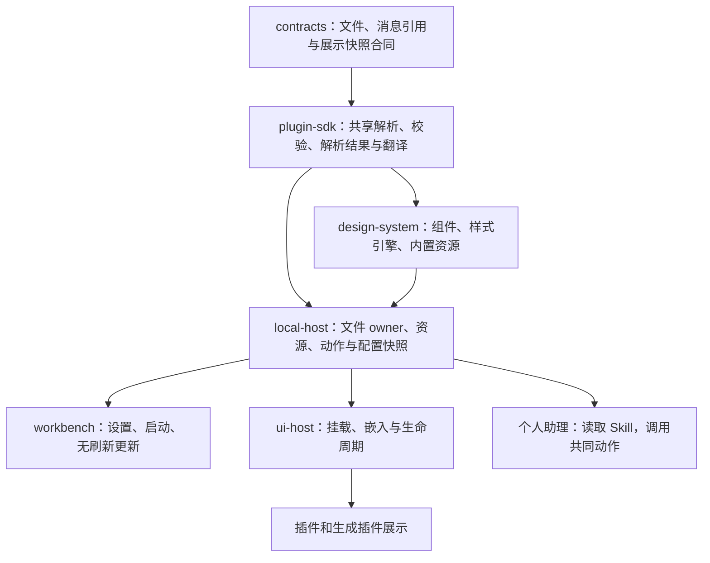

# 字体、皮肤与语言系统实现方案

状态：实现方案提案（2026-10-12），未执行。本轮只读代码并写文档，不修改源码、依赖、生产手册或真实 Home。[需求书](spec.md)是唯一需求来源，本文件说明技术落点、接入与切换方案，不改变 FSS 验收标准。

代码依据为本地 `main` 的 `9da1808334da`，不是远端最新版本。当前检出与 `origin/main` 已明显分叉，且同机有多条防腐开发线；实际开发须以当时整合后的基线复核本文点名的接口。本文的类型、目录与动作名均为提案，现行事实以链接的代码为准。

架构复核修订（2026-10-12）：收紧公开入口与加载范围，补齐文件提交、入口语言兑现、资源缓存及发布转换的边界；缩小用户方案校验的执行范围。复核也只读对照了本机缓存 `origin/main @ 2b84e9b9ff47` 的 SDK、Design System 和 Skill 登记接点，未更新检出或把该缓存当作远端最新状态。

## 1. 核心选择

采用 **JSON 定义文件 + 单份解析校验 + 现有组件渲染器 + Host 管理配置 + 每个文档的展示控制器**。

文件承载字体方案、皮肤值、组件外观规格和语言文案。控件行为、业务布局、身份、授权与可靠写入仍由代码负责。不把程序序列化进 JSON，不生成任意 CSS/JS，也不引入新的通用配置框架、数据库或 workspace 包。

三个明确取舍：

- 皮肤有一个入口文件，可推荐字体；语言由入口独立选择，皮肤不引用或约束语言。公共默认值可以补齐定义，但只允许引用同一规格版本的一个固定基线，不做任意多级继承。
- 作者与平台共用的解析、语义解析和文件校验放在公开 SDK；contracts 只定义数据合同，Design System 保留真正的组件和样式语法。外部作者只安装 contracts 与 SDK。
- 配置在 Host 中有独立的文件 owner，按文件操作、应用操作、资源、动作接缝拆成小模块；不增加统管字体、模型、浏览器、插件与文件的 `Manager` 或巨大 `Service`。

依据：[架构](../../docs/system/ARCHITECTURE.md)、[包边界](../../docs/system/PACKAGE-BOUNDARIES.md)、[代码防腐](../repository-anti-corruption/spec.md)、[合同变化](../../docs/system/CONTRACT-CHANGES.md)。

## 2. 现行代码怎样拆成文件与引擎

| 现行入口 | 移到文件的内容 | 保留或替换的代码 |
| --- | --- | --- |
| [typeface.ts](../../packages/design-system/src/typeface.ts) | 系统字族列表、离线字体声明、角色字重/字号/字距与后备，成为字体方案/资源数据 | 保留基于已解析字体角色的 CSS 输出；字体路径与实际字节读取由 Host 资源适配器负责，删除写死的字体值与终层默认覆盖 |
| [palette.ts](../../packages/design-system/src/palette.ts) | 面、字色、操作/状态、形状、抬升和动效值，成为 Soft Workbench/Folio 皮肤文件 | 组件仍使用受支持的语义变量；令牌渲染读已解析定义，不保留第二份常量表 |
| [visual-foundation.ts](../../packages/design-system/src/visual-foundation.ts)、[page-assets.ts](../../apps/workbench/src/page-assets.ts) | 现行风格的值与可定制规则归皮肤/共同规格 | 保留一次结构、响应式、交互与可访问性样式；收敛多套旧皮肤和重复 Coss/Primitive/Typeface/终层拼接，不追加另一张完整主题表 |
| [plugin-components.ts](../../packages/design-system/src/plugin-components.ts)、[原语目录](../../packages/design-system/src/primitives/catalog.ts) | 名称/说明的消息引用、分组、能力、状态/变体、可定制属性与标本描述，归同一个共同规格文件 | 保留组件 kind 到真实实现、标本操作到可信函数的绑定；Builder 的组件列表由文件投影，不再单独维护元数据数组 |
| [i18n.ts](../../apps/workbench/src/i18n.ts)、[EN 词典](../../apps/workbench/src/i18n/en.ts) | 中文/英文文案改为按主人组织的语言 JSON | 语言匹配、完整消息参数处理与格式化成为 SDK 纯工具；Host 保留请求级语言上下文，Workbench 使用可更新文字绑定，删除集中 import 词典与中文原文查表 |
| [preferences.ts](../../packages/design-system/src/preferences.ts)、[语言路由](../../apps/local-host/src/web-server.ts) | Home 级皮肤/字体选择单独保存；设备明暗/密度/终端偏好保留；语言偏好仍属入口 | 替换为读取同一快照的启动与更新控制器；语言切换改为更新偏好及当前 DOM，保留无 JS 的站内跳转入口，正常有 JS 路径不跳转 |

共同规格只定义系统实际实现过的组件及可定制项。新增一种交互仍需实现组件；JSON 不能凭一个新 kind、选择器或事件名制造执行能力。目录投影、标准板和 Builder 均核对文件声明与真实实现，无实现的条目不能展示为可用。

## 3. 模块边界与依赖



上图表示运行数据流；实际 import 方向按下表与包边界规则执行。跨 App 与 Plugin 的通信走公开合同和注入端口，插件不 import Host、Workbench 或另一插件实现。

| 位置（新增位置均为提案） | 职责及禁止承担的事 |
| --- | --- |
| `packages/contracts` 的现有 `platform/ui`、`platform/plugin` 等子路径 | UI 中定义文件形状、资源/版本引用、`TextRef` 与展示快照，Plugin 中只补实际需要的资源声明；纯类型/声明式 schema，不做 I/O 或运行解析，不预先增加另一套合同子路径 |
| `packages/plugin-sdk/src/ui/` | 共享文件解析、有限 resolver、消息工具与浏览器绑定，公开为可在 Node/浏览器使用的 `@molis-ai/molis-work-plugin-sdk/ui` 入口。只依赖 contracts，无 Node 内建模块、私有 Design System、Home 或模型依赖 |
| `packages/design-system` | 保留 render helper、组件行为、固定选择器/状态映射、一次结构样式；内置规格/皮肤/字体资源置于包的 `resources/`，由公开资源描述交给 Host；不读用户配置文件 |
| `apps/local-host/src/interface/` | `files` 管版本文件与原子提交，`assets` 管导入/路径/实际字体，`selection` 管选择/撤销/幂等，`snapshots` 管可重建投影，`actions` 管授权接缝，`preview` 管可信验收。使用函数与小组合对象，文件 owner 不导出私人存储实现 |
| `apps/workbench` | 设置与标准板入口、首屏快照、设备偏好、文字绑定、显示状态；不直接写 Home、SQL 或调用私有模型客户端 |
| `apps/desktop` | WebView 与菜单栏胶囊接入同一展示客户端；原生菜单/连接提示接收可信文字投影。Rust 不另建皮肤引擎、译文表或模型入口 |
| `packages/ui-host` | 注入已准备的展示客户端/快照，挂载释放、嵌入的来源与版本校验；不解释皮肤业务或保存第二份选择 |
| 现存插件与 Builder | 使用语义角色、消息引用与公开上下文，保留业务事实/数据绑定；不持有平台方案库，不烘焙一次预览的外观 |

Host 中的 `interface/` 是平台配置的现有 App 边界内模块，不是另一个业务 Store，也不让 `LocalHost` 类实现文件管理规则。Host 装配只创建端口并注册动作。除一个实际需要的字体解析依赖外，不预设新的第三方框架。

公开字段及校验 schema 在合同包集中定义；SDK 复用合同类型/schema，组件名单从共同规格与真实代码绑定核对，不再维护三套独立的字段/组件常量表。沿用已有类型和 schema 工具，不为此新建代码生成器或改造全仓 schema 系统。JSON 里的组件描述是元数据，可信代码绑定才决定执行能力。

现有 [SDK 根入口](../../packages/plugin-sdk/src/index.ts)导入 `node:crypto`，不能直接给浏览器使用。新的 `/ui` 是为真实环境边界增加的窄入口，服务端也从它取同一份工具；无需新增 workspace 包，也不顺手拆 SDK 的其他出口。SDK 不输出私有组件 CSS：平台消费方由 Host 注入共同样式，外部自绘界面读取公开角色，渲染适配器留在各自边界。

浏览器工具采用可类型检查的模块和现有打包路径，不新增几百行未检查的 JS 模板字符串。依赖方向、公开出口、无 Node polyfill 和入口的实际消费，在落地时用 `boundary:check`、API 快照与真实两包外部样例证明。

## 4. 文件格式、示例与持久化

### 4.1 格式边界

统一 UTF-8 JSON，`format_version` 表达格式版本，`id/revision` 表达定义身份；不把二者当同一个版本。缺省行为、允许字段/状态、数值单位和引用规则明确，未知字段拒绝，不容忍历史格式。JSON 读取还需在进入普通解析器前拒绝重复属性名，不能让重复颜色或消息键被 `JSON.parse` 的后值静默覆盖；这项检查只有 SDK 一份实现，不再自制整套配置语言。

文件不收 CSS 文本、任意属性名、选择器、函数体或外部加载 URL。颜色为受限色值；尺寸/圆角/阴影为带明确语义的数值或结构；组件规则只引用共同规格允许的属性和角色。编译器把它们输出到已知变量/状态，用户不能重写行为、触控下限或权限。

以下是字段片段提案，用于说明可写文件，不是已发布 schema 或完整皮肤。

```json
{
  "format_version": 1,
  "id": "user-blue-garden",
  "revision": 1,
  "spec": { "id": "molis-interface", "revision": 1 },
  "name": "蓝绿工作台",
  "recommended_font": { "id": "rounded-interface", "revision": 1 },
  "light": {
    "colors": { "action": "#3c5bd7", "paper": "#ffffff", "focus": "#b74834" }
  },
  "dark": {
    "colors": { "action": "#8faaff", "paper": "#1f302c", "focus": "#f1a593" }
  },
  "shape": { "control_radius_px": 10 },
  "components": {
    "button": {
      "primary": { "background_role": "action", "foreground_role": "on-action" }
    }
  }
}
```

省略的角色由准确引用的共同默认规格补齐，解析后得到完整快照，再校验浅深色和状态。禁止从“某台机器当前默认样式”补值；这样导出和重新导入才可复现。

```json
{
  "format_version": 1,
  "id": "rounded-interface",
  "revision": 1,
  "name": "圆润界面",
  "roles": {
    "interface": {
      "families": [
        { "asset": { "id": "rounded-latin", "revision": 1 } },
        { "asset": { "id": "rounded-cjk", "revision": 1 } }
      ],
      "weight": 400,
      "size_px": 14,
      "line_height": 1.5
    },
    "code": {
      "families": [{ "system": "ui-monospace" }],
      "weight": 400
    }
  }
}
```

`rounded-latin/cjk` 是示例引用，未表示字体已经选定或存在。系统字体为明确字族名，文件字体为受保护资源身份；不能把模型给的文件路径直接拼成 URL。

```json
{
  "format_version": 1,
  "owner": "workbench",
  "locale": "en",
  "direction": "ltr",
  "revision": 1,
  "messages": {
    "common.cancel": { "text": "Cancel" },
    "common.items": {
      "plural_arg": "count",
      "forms": { "one": "{count} item", "other": "{count} items" }
    }
  }
}
```

消息参数用声明的占位符，复数选择用标准地区规则，译文始终作为文本输出，不 eval、不接受 HTML。共有词由 Workbench 提供，插件词归自己的 owner；键本身可带分组，不再同时维护一个重复的 namespace 字段。消息身份是 owner 与稳定键，插件绑定还包含可信安装作用域，不能把所有词典合成一个可被同名键覆盖的平面 Map。SDK 只实现这套受限消息规则，不自制完整 ICU 模板语言。

### 4.2 发行物与 Home

推荐以下职责划分，目录为提案：

```text
发行物 / 每个拥有定义的包
  resources/interface.json               共同规格（Design System）
  resources/skins/soft-workbench.json     内置皮肤
  resources/skins/folio.json
  resources/fonts/*.json                 内置字体方案
  fonts/*                               实际已允许分发的字体
  resources/locales/{zh,en}.json          Workbench 或各插件自己的文案

Home/interface/
  state.json                            库成员/准确引用、选择、提交版本与必要结果
  skins/<id>/<revision>.json             已保存的定义版本
  fonts/<id>/<revision>.json
  locales/<owner>/<locale>/<revision>.json
  assets/<resource-id>/...               已导入字体/素材及元数据
  drafts/<draft-id>/<revision>.json       用户/助理草稿修订，state 指向当前版
```

内置资源随包声明的 `files` 和发行物资源描述发布；Host 从公开资源描述定位，不从另一包 `src/` 猜路径，也不扫描全仓或磁盘字体目录。复用 [安装器](../../apps/local-host/src/installer/home-release.ts) 的依赖文件复制机制，验证干净安装后文件仍在，而非只在源码树运行。

用户和助理编辑草稿/导出工作文件；保存为受管版本后保持该版本不变。手工编辑外部文件并重新加载时，owner 分配新 revision，不要求用户手算版本；已应用版本及其资源继续可恢复。`state.json` 管已提交库成员、版本引用和必要操作结果，文件管定义正文；目录中“存在一个版本文件”不能单独证明它已提交。它不复制令牌/译文，也不再建第二份目录索引。

采用“先准备不可变版本/资源，最后原子提交 state”的写入点；保存只加入库成员，应用才修改选择，草稿修订也只在提交时推进对应引用。不能先覆盖旧草稿/正式文件正文，再等待提交 state。多个异步调用会在同一进程交错，单一宿主本身不能防止丢失更新。长时间解析、字体和浏览器工作在提交之外；`beforeEffect()` 返回后，短提交中同步重读 state，先核对原请求及同键输入，再检查新写入所需版本，合并变更后用 Storage 公开的 [atomicWriteFileSync](../../packages/storage/src/adapters/atomic-write.ts) 原子替换。该段不再 await，不另造文件事务、跨进程锁或任务调度器。

内部提交版本、外观选择版本和每个草稿版本分开：保存别的草稿不让当前外观的 expected revision 冲突，通知只发布真正变动的维度。幂等结果按可信操作者、操作和 request_id 隔离，校对同键输入；它与库/选择效果同次提交，动作诊断日志不能替代它。只保留复用结果、撤销和未决任务需要的引用，不复制模型轮次、截图或调用日志。

`revision` 只表达对应 owner 的版本，不授予权限；资源/定义来源与可信身份来自装配和调用上下文。先用文件满足目前的小型个人配置库，若实际规模让短提交超出预算，再按测量拆分存储，不提前建设通用版本库或数据库。

若写入/返回中断，先按原请求重读提交结果，再报告已提交、未提交或无法确认，不盲重发或把不确定写入宣称为失败。取消、冲突或未提交的准备版本不进入库；临时目录的清理只删未被当前选择、保存版本、草稿、预览或恢复引用保护的文件，不引入自动历史压缩。备份把 state 与引用定义/资源当一个一致组，登记到 [Home 数据表](../../docs/system/HOME-DATA.md)，普通卸载保留。

### 4.3 导入、导出与定义身份

首期导出一个数据目录：皮肤入口、所需字体方案/可分发资源和依赖说明，不为它新增压缩包或插件包框架。依赖采用包内相对引用或明确的内置资源身份，导入时整体解析并重新绑定 Home 资源；缺资源或许可不明则保留引用/问题，不能伪造完整导入。

内置身份与用户定义分开保护；名称不充当写权限。新导入即使与本库 id/revision 重名，也不能覆盖既有正文；默认分配本地身份并重写包内引用。更新已有方案必须明确目标与 expected revision。运行解析只接受受管目录/资源引用，外部工作文件经用户选定的导入/重新加载进入，首期不做全盘监听或“改任意文件立即执行”。

## 5. 启动与无重启切换

### 5.1 单份解析结果

SDK 的外观 resolver 只接收共同规格、准确皮肤/字体、资源元数据与当前入口偏好；消息 resolver 只接收本次挂载需要的 owner 语言文件及地区。两者是无 I/O 的有限函数，共同输出一份文档级 `UiEnvironmentSnapshot`：外观来源/有效模式/变量/配方/face 后备，以及已加载文案范围/地区/方向/问题。一个消费入口不意味着一个统管所有配置的 resolver。

快照只投影当前选择、所需字体和平台共有文案；插件挂载时按可信安装作用域加载自己的消息包，同页重复挂载复用，最后一个绑定释放后可释放缓存。插件拿到自己及公开共有文案，不能拿到完整皮肤库、所有语言或所有安装的词典。规格板/Builder 通过专用只读投影取得共同目录，不把目录和全部样张塞进每个业务页面。

优先级固定为：共同规格默认值 → 所选皮肤 → 所选或推荐字体 → 当前入口的明暗/密度/语言与硬性可访问性规则。语言只增加必要字形后备，不把选定字体或皮肤替换掉。服务端与浏览器用同一 resolver/消息逻辑，不能各实现一份默认值链。

首屏由 Host 读取当前有效选择，向 Workbench renderer 注入快照和已验证变量。客户端只处理设备明暗与后续更新。基础 CSS 不再在最后声明 Soft Workbench 的具体值；根变量及受控配方由单一控制器更新，避免后加载的 Typeface/craft-finish 又盖回去。减少动态效果、响应式布局与触控下限保留在结构/行为层。

Host 不能读取浏览器 localStorage。启动投影因此携带所选皮肤的浅深色与必要密度值；一个很小、可类型检查的引导在首次绘制前读取设备偏好并选中对应分支，复用同一选择规则。后续控制器接管它，不能先显示默认 Soft Workbench 再异步换成用户方案；字体尚未加载时使用文件声明的后备。

### 5.2 准备、提交、更新

1. 读取所选文件与资源，解析结构/引用/语义，核对校验记录对应的准确版本。新的草稿先完成必要真实渲染校验。
2. 发起入口准备本次所需的 FontFace、配方和已挂载 owner 的语言表，实际资源失败则保持原版并报告；字体加载中可以显示声明后备，不宣称目标 face 已完成。准备结果绑定外观来源、当前文案/规格/资源版本及该文档本次更新序号；过期异步结果不能盖回较新的选择。纯确定切换复用同版本有效校验，不重新调用模型或重复浏览器全套验收。
3. Home 级外观应用在短提交前调用 `beforeEffect()`，核对 revision/身份/授权，原子保存选择和 request_id 结果。语言只更新入口偏好，保留现有 Cookie 作为该维度的权威选择，不再同时创建另一份语言选择 owner；明暗/密度仍使用其现有设备存储。
4. 文档控制器在一次同步更新中切换变量/规则、消息投影与绑定属性，再发布改变事件；不让消费者在两种有效快照中间读取。保留原 DOM 节点、输入值、事件、草稿与执行会话，不以重新 mount 或整页 HTML 替换完成切换。较晚返回的片段/状态用当前文案重新投影，新增挂载先绑定当前快照，不能把请求发出时的语言重新插回页面。
5. Host 通知 Home 级 revision 变化，各窗口读取权威快照；同入口语言变化经同源通知同步。通知只携带失效信号/版本，不授予写权限。窗口隐藏后恢复时先重读，再更新展示。

跨窗口选择更新使用每个文档至多一个 Host 订阅及入口侧同源通知；可用 SSE 传输外观选择/资源失效，但它只投影 owner 状态，不另存事件事实，不建立 Durable Outbox 或永久回放流。当前没有通用 Home 外观 SSE，不能宣称已存在。生命周期复用 [UI Host](../../packages/ui-host/README.md) 的挂载/可见性机制，断线重读本页所需快照，不每个插件建连接、重复抓全集或短轮询。

页面内更新登记一个有 owner 的 `molis-work:ui-environment-changed` 事件，载荷为版本和改变的维度；跨模块事件按 [DOM 合同](../../packages/contracts/src/platform/dom-events.ts) 登记。iframe 使用 UI Host 的可信绑定窗口/Origin/安装和版本检查接收快照，拒绝陌生来源，不凭插件上报的身份接入。

提交成功和每个页面更新成功分开反馈。其他窗口准备字体失败时保持最后可用展示、明确滞后并允许重新准备；不为它再提交 Home 选择，也不声称全 Home 已同时绘制成功。恢复默认外观不需要模型，内置有效定义来自同一个文件格式。

没有所有窗口 prepare/ack 的全局屏障。设置结果记录 Home 是否保存，发起文档记录自己是否更新；其他文档的状态在其本地可观察，不另存一份“全窗口已应用”的 Home 表。语言变化只使相关文案投影失效，库中新增未选方案也不重载插件。

### 5.3 字体策略、预览与恢复

`state.json` 明确保存“跟随皮肤推荐”或“固定准确字体引用”，并允许独立的等宽覆盖；不能仅存一个字体 ID，再凭是否等于旧推荐推断用户意图。换皮肤由 selection 同时解析该策略，明确使用新推荐才改变它。撤销核对当前 revision 与原应用结果，不能覆盖之后的手动设置。

默认预览在受控视图/iframe 中使用临时组合；用户明确选择当前工作台预览时，由该文档控制器叠加临时展示引用，并更新它已经绑定的嵌入，不写 Home 选择或入口 Cookie。关闭时读取最新权威选择再恢复，避免把预览期间其他入口的新修改退回旧版。

启动失败按已保留的有效版本引用恢复展示，再退到发行物基线；不静默改写用户所选引用。应急恢复入口使用同份内置定义的固定投影，不加载自定义规则，能够从工作台固定入口及 App 原生菜单打开；外观恢复与语言恢复分别调用共同动作，保留自定义库和工作内容。可恢复性不能依赖故障中的设置页、当前字体或模型。

### 5.4 缓存与卸载边界

[现行资源缓存](../../apps/local-host/src/web-assets.ts)按 locale/path 保存，不能直接套到会变化的定义响应。结构 CSS/JS 保持与选择无关；定义/字体由准确资源版本缓存，快照缓存键包含其实际来源、发行版本和安装代次，不以文件名或当前 locale 作为全部身份。Home 的读取/缓存均由同一个 owner 管理，重启重建即可，不做另一套持久快照库。

插件卸载/重新安装与语言资源更新使其投影失效并释放绑定；校验记录也核对相关 renderer/共同规格的现行发行版本。字体仅保留已引用 face，预览取消或失去引用时释放自己的 FontFace/object URL，不能长期积累所有试过的字族。资源读取使用明确的缓存/权限头，现有 304、CSP 与 iframe 来源限制不因动态加载被放宽。

## 6. 语言切换需要的实际改造

仅把 EN 转 JSON 无法无刷新更新。现有 `L()` 返回字符串，已经写进 DOM 后没有可更新关系；需要让消息引用在渲染和客户端挂载时保留下来。

推荐公开 `TextRef`：owner、消息键与参数，和一个文档级 `t/observe` 客户端。owner 的可用范围由 Host/当前安装绑定，平台共有词须显式引用，不能凭语言文件自称取得另一安装的身份。原生 render helper 为可翻译的文本/属性输出受控绑定标记；客户端文字用同一 helper 登记绑定，语言变化只改文字节点、placeholder、title、aria-label 等，不能覆盖 input.value、正文或把译文当 innerHTML。绑定随原 UI lifecycle 释放，不让一个全局 Observer 永久持有被卸载节点。

绑定值使用强类型参数并安全序列化。列表/日期/计数等动态显示保留原数据，由 `Intl` 的地区格式和受限消息规则重算。操作类型、危险等级、状态和值都来自合同，删除依靠中文动词识别危险操作或拼“已完成”的代码。

`createWorkbenchLocale` 的请求级上下文保留，改读本次已解析消息投影；`WebLocale/WEB_LOCALES` 改由已验证语言描述驱动，不在业务中枚举两种语言。新的 translator 只认现行稳定键；中文键及整个 EN 聚合在切换时删除，不保留“稳定键查不到再查旧中文表”的运行分支。

平台/插件的界面描述采用消息引用，ActionView、菜单与工具目录向消费者投影为当前语言的显示字符串；动作标识、参数、业务值和模型原始回执不改变。相关公开元数据形状改变要遵循 API/合同版本流程，不偷偷在原版本下改变字符串含义。

语言包通过包/安装的资源声明发现。新增声明为 `ui` 资源的一部分，由 Plugin SDK 的同一 Manifest 解析路径校验；Host 限定在准确安装/创作构建根内加载，不在 `en.ts` 增加插件 import。内置、Runtime 安装、Builder 发布副本使用同一资源解析合同与各自现有路径端口，不新增扫描器或宿主插件名单。Home 用户覆盖须明确目标 owner/安装和 locale，文件不能自称属于别的安装、覆盖平台共有词或改变授权；多个安装的同名消息不互相污染。

入口语言写入与 Home 选择分开：直接设置调用共同确定操作准备消息，入口 HTTP 适配器才发送 Set-Cookie；收到响应后客户端更新并通知同源页面。助理工具调用不带浏览器响应，不能在 Host 内仅改一份变量就报告 Cookie 已保存。它通过现有助理卡片/请求通道向宿主已绑定的当前文档交付语言操作，该文档调用同一入口适配器，再回报自己的更新结果；交付前/窗口关闭时只报告待入口执行或未执行，不伪报全部成功，不另建窗口注册中心与持久语言表。

可信文档上下文由入口/调用通道注入，不能直接相信助理业务输入里的页面或入口 ID。当前缺少相应贯通时，它是这项语言动作必须补的接缝；无 UI 上下文的 MCP 返回明确不可用，Home 外观动作仍按独立权限执行。失去回执先由文档读取 Cookie/当前快照核对，重启不重复盲发；Cookie 只管语言，传输意图与回执不成为第二份语言选择。

Cookie 保存明确语言或“跟随系统”策略；后者按入口提供的系统/浏览器语言匹配已登记语言，不再写死中英分支。JSON 消息包按 owner 分开；可选语言清单从这些描述聚合，不能因为某个插件有一份新译文就把整个平台标为正式支持。每个 owner 的查词顺序固定为所选地区包、可用基础语言包、该 owner 的默认语言；缺词作为问题可观察，必要默认文案缺失则拒绝登记。全链都使用稳定键，不出现裸键或回查旧中文词典。

绑定同时更新 `lang/dir`，布局使用支持方向的逻辑属性；Intl 保留既有时区、单位等实际设置，只重算展示。系统操作状态通过类型与消息引用呈现，不为了翻译改变原始回执。

### 6.1 macOS 原生接点

桌面覆盖不能只检查主 WebView。[胶囊](../../apps/desktop/src/capsule-shell.ts)仍内联固定字体/令牌，[Tauri 入口](../../apps/desktop/adapters/tauri/src/main.rs)的 `CapsuleLocale` 写死中文/英文提示，`sync_capsule_locale` 会重新 navigate 胶囊；这些都必须改到同一文件投影和无重载更新路径。

主窗口、胶囊及内容窗口各自消费同一入口偏好和 Host 展示快照。原生菜单、托盘 tooltip 与断线提示经受信 IPC 获得已翻译的有限字段，原地更新菜单项；校验发送窗口、字段、长度与版本，不接收任意脚本、动作或模型自称的窗口身份。Rust 只做系统菜单装配与当前投影缓存，不维护另一份翻译规则。

Host 尚未启动时，原生启动/恢复提示读取随发行物从同一 owner 语言文件提取的最小资源；它是可重建发行投影，不是手写第二套词典。WebView 中的可定制字体/配色走共同控制器，系统绘制的菜单保留 macOS 的原生显示规则。新增或更新语言后，正常运行的原生文字也更新，不能再以两值枚举限制它。

## 7. 插件与 Builder 接入

### 7.1 原生、外部和嵌入

原生插件现有 `mw-*`/语义变量继续成立。删除局部字体/配色/状态硬编码，使用公开字体角色、TextRef 与客户端绑定；布局和内容专用规则保留。SDK 浏览器入口消费宿主注入快照，不需要加载私有 Design System 或自己读 Home。

字体/皮肤改变由变量及有限规则生效；需要测量的编辑器/终端只重测展示参数，不重启进程或改正文。iframe 主动握手后接收当前快照及更新。插件停止、隐藏、卸载按现有生命周期释放绑定，恢复时读取当前值。

建立实际入口适配清单，含主区、岛、设置、侧栏、浮层、恢复页和已安装生成插件。检查复用既有翻译扫描及 UI 审计接缝，增加 JSON 词典登记/owner/参数与真实加载验证，不另造第二份插件名单。合法正文格式、图表素材不作为硬编码违规。

### 7.2 Builder

- `PLUGIN_COMPONENTS` 的目录投影改由共同规格文件产生，名称/说明来自消息引用；共同规格增加组件就同时更新标准板和候选板，真实 renderer 仍校验该 kind 有实现。
- Host 在设计、体验、界面和复查输入中提供准确规格版本、可用角色/字体与当前预览组合。更新 [挂载章节](../../apps/local-host/src/plugin-builder/skill.ts)，不能只在未被读取的手册末尾添规则；控制正文大小，重用资料引用，不把整份所有皮肤/语言库塞进 prompt。资料引用必须由现有读取/挂载工具兑现，裸本机路径不是模型已取得正文的证明；需要的定义投影及校验结果在当前运行中实际可读。
- 生成结果只记录布局、组件、语义与插件自己的语言资源；共有文案归平台。代码阶段只能使用公开 SDK/合同，禁止生成私有包 import、硬编码外观和第二套翻译运行时。
- [生成插件渲染器](../../packages/design-system/src/plugin-component-client.ts) 接收 `UiEnvironmentClient`，固定按钮/错误/日期/状态改为共有消息，生成标题/提交名/列名使用插件 TextRef。保存业务输入和 selection，更新绑定而非重建 `.pc-view`。
- 扩展现有设计校验与 [浏览器验收](../../apps/local-host/src/plugin-builder/browser.ts) 的环境参数，使它读取实际文件组合。现行验收直接写 `data-resolved-theme`，需要改为调用同一个 prepare/apply 接口，避免检验绕过真正的字体/语言加载。

### 7.3 已安装生成插件与存量文字

外观跟随可以在共同 renderer 内完成；专属标题、提交名和列名现在保存为字符串，完整国际化不能假装只换宿主语言表就完成。

采用显式离线转换：枚举由旧合同明确认定的界面元数据，保留部件 ID、操作绑定、业务 schema 和源码，生成消息键与语言资源，形成新版本发布候选。不得按任意字符串搜索替换；验收步骤里的界面标签引用一起调整，用户正文/业务值保留。英文含义或字段性质不确定的项进入人工核对，不杜撰完成，也不用模型重写业务代码。

候选由原发布 owner 走现有 Builder 发布/打包/验收、签名及 Plugin Runtime 的显式升级路径，不能原地改已签名包、只重写指纹或借宿主身份重签第三方发布。发布版本不等同于动作合同版本，只有动作 schema 实际改变才升对应动作版本。其他 UI/Manifest 形状按各自合同规则处理，业务数据仍由原 owner 管理。

新旧发布合同不能长期混读；旧字段读取只在这次维护转换中存在，不搬进 SDK、Runtime 或启动 loader。真实 Home 安装切换需独立维护授权和一致备份，开发先用隔离 Home/发布副本。缺发布权限或不能自动转换的安装必须明确列为阻塞，不能用静默旧格式分支或“仅新插件支持”降低完整覆盖目标。

## 8. 个人助理 Skill 与动作

推荐内置 `molis-interface-design` Skill，发布正文与少量文件格式/字体/校验参考；Soft Workbench/Folio 是数据与风格参考，入口不复制 schema 或规则。Skill 可用现有 `methods` 读取机制，不在本任务顺便改名整个 Skill 合同。所引用资料由当前工具实际返回；助理依靠结构化投影读写文件，不获得 Home 的任意写权限。

新增系统定义登记，使 Skill owner 与真实系统动作 provider 的身份一致；沿用 [AgentDefinitions](../../apps/local-host/src/agent-definitions/agent-definitions.ts)、[系统指令登记](../../apps/local-host/src/agent-definitions/builtin-instructions.ts) 和 `assistant.methods.read`。当前 [builtinAgents](../../apps/local-host/src/agent-definitions/builtin-agents.ts) 只从插件目录补 methods，需要增加系统 Skill 的正式资源登记，不把外观伪装成一个可停用的业务插件。

推荐由**现有个人助理轮次中的模型**按 Skill 生成结构化草稿，再调用确定性动作。首期不另建“皮肤生成 Agent”或内层模型调用：用户的 send/request_id、对话、预算、取消与恢复都沿用原助理/Prologue。将来确有独立批量生成场景再定义有界推理动作，不先预留通用 AI 工厂。

拟议动作族（正式名称待合同发布时固定）：

| 动作职责 | 输入/效果 | 调度与授权 |
| --- | --- | --- |
| 读取规格、库、当前组合与资源可用性 | 只读投影及准确版本 | 配置读取权限，用户/Agent；插件仅可获公开展示快照 |
| 保存/修订草稿、管理版本、导入/导出 | 定义/受保护引用、expected revision、request_id；不改当前选择 | 写入或导入权限；文件/字体等待可并发，实际提交前 `beforeEffect` |
| 校验并准备预览 | 草稿与资源版本、目标范围；返回 Host 自己保存的校验/预览引用 | 确定性校验与真实浏览器资源预算，不信任输入的 `passed: true` |
| 应用、撤销、独立恢复 | 准确选择/校验引用、当前 expected revision、request_id | 可撤销效果，同一 owner 原子提交；普通切换不调用模型 |
| 读取/修改入口语言 | 可信入口上下文、明确语言或跟随系统 | 入口偏好权限，不把入口 ID/actor 从模型参数拿来授予写权限 |

上表是职责，不预建每一种命名动作。只声明设置/助理/Builder 的实际调用需要，语言兑现沿 §6 的入口接缝执行。每个动作把 `effect`、audiences 与权限说清：只读/临时预览不写正式选择，应用/恢复为可撤销写入，定义移除与外部导出按真实效果判定；不能依动作名含有 reset/remove 就误判为不可撤销，也不能给普通插件个人配置写权限。

动作只登记一次，设置、助理、工作流与获授权 MCP 从共同目录消费；HTTP 只转换传输，不复刻业务逻辑。用 `ActionDefinition` 与 `actionRegistry` 的 Home 系统上下文，不新增 typed capability、不强造项目。系统 Skill 随真实 provider 可用性发现，不另建技能索引、Agent 或模型入口。新的登记接点要过 §12 的门禁，不能为避开计数塞进首页或助理的大处理器。

“先看看”只保存草稿/预览；“直接换成”可完成已授权应用，无重复确认。模型看到文件格式、当前版本、实际资源与问题，不自动读取私人正文或字体目录。未发生的保存、加载、校验和应用不能被 Skill 报成成功。

## 9. 字体与真实渲染校验

共享 SDK 校验结构、引用、允许值、完整角色、消息键与参数；Host 校验实际文件、资源范围/内容及权限；真实渲染测量字形、溢出、焦点、触控与相关状态。三者按不同职责调用同一规则源，不再重复解析已验证的结构。模型审美意见与确定校验分开。

执行范围分为三层，避免把产品回归搬到每次换肤：

- 产品/组件/SDK 发布时，验证正式皮肤、语言及所有声明入口，证明 renderer 与共同规格可用；这是工程及产品验收。
- 新建或修订用户定义时，做结构/资源检查，并在共同规格的真实状态、字体样张及可信代表组合中验证相关明暗/密度/语言；规则预先由平台定义，不能让模型删掉失败项。它不启动所有已安装插件、不消费私人正文，也不证明任意自定义插件业务页面全部通过。
- 选用已有组合时，核对当前资源、必要校验的准确依赖，准备并更新本次文档；增加新字体/语种等影响测量的组合，补相关检查。不存在“所有皮肤 × 全部字体 × 所有插件 × 每个窗口”的穷举证书体系。

字体元数据解析建议仅在 Host 资产边界使用 [fontkit](https://github.com/foliojs/fontkit)：其公开资料列出 TTF/OTF/WOFF2、字符映射及字形度量。当前仓库未依赖它，此处是候选选型；版本、依赖体积与受限解析验证后才可引入。用有界 worker 解析真实格式/字重/字符覆盖，不手写 WOFF2 解码，不将库放进 SDK 或浏览器全局包。

浏览器用 FontFace 实际加载已登记资源，文件 face 使用受控内部字族名，校验文字来自已发布语言及样张，不把“CSS family 名字存在”或仅 `document.fonts.check` 当实际覆盖证明。系统字族无法可靠确认时标为未知并报告后备；圆润首批正式方案要有实际可分发的中英字形策略，不能只依赖某台 Mac 的圆体。

真实浏览器能力从现有 Builder 的生产 driver 抽出最小执行端口，放在 Host 的独立 UI 验证模块：只管隔离页面、可信步骤、截图与测量，不做公开 SDK 浏览器管理框架。Builder 保留自己的步骤解释；外观预览提供共同状态与可信示例，两者复用执行器与取消/清理。缺浏览器或耗尽预算时返回未验证，不能只用 schema 代替真实检查，也不在写动作期间等待无界浏览器任务。

用户预览留在工作台受控视图/iframe，自动测量使用隔离示例并调用生产渲染/更新路径。执行脚本、选择器、URL 与启动参数由可信 driver 持有，模型仅选择已实现状态。报告关联定义、资源、规格、renderer 发行版本及覆盖范围，不能由模型或普通输入自称通过。必要检查未完成、阻断或准确依赖变化时拒绝应用；不因无关草稿/词典变化作废全部报告。

校验结果留在该草稿/定义的必要结果中，通过准确引用复用，不新建中央证书库、永久截图仓库或签名/哈希证据链。报告字段与既有 Builder 验收共享可复用的形状；每个入口再保留自身可观察的应用结果，不能用一张测试页的截图宣称所有窗口更新成功。

资源读取只接受已登记的 opaque 引用，Host 将它解析到准确发行物/安装/Home 的受管路径，拒绝越界、符号链接逃逸、错误类型与过期预览作用域。字体 HTTP 读取沿现有本机地址、Origin 与授权边界；不能开放一个收任意路径的资源代理。实际传输路径和字节归 §12.2 的资源登记与预算决定，不以换路由名称躲过冻结。

对已完成必要检查且版本相同的组合，切换核对权限、资源与相关 revision 即可。组合需要的检查按上面的层次判定，不为每次点击重跑 Builder 全套业务验收，不以默认组合的报告宣称未知字体/语种已经适配。内置基线的必要检查随发行物产生，恢复它不要求现场再启动 Chrome。

## 10. 开发手册的技术落地

共同文件格式与 SDK API 是用法的权威入口；资料引用它们，不维护第二套 palette/语言键/组件白名单。变更同步 [DESIGN](../../DESIGN.md)、[UI Platform](../../docs/platform/UI-PLATFORM.md)、Design System/SDK README、[插件手册](../../docs/platform/PLUGIN-DEVELOPMENT.md)及 [molis-plugin-dev](../../skills/molis-plugin-dev/SKILL.md)相关实际挂载章节。

把固定石墨/铜色、字重和圆角放回 Soft Workbench 与字体数据，把可读性、焦点、键盘、触控、语义和布局留作共同要求。说明 CSS 角色、TextRef、资源声明、文件加载/更新、后备、内容边界、入口作用域与错误恢复。SDK 的可运行样例仅装公开两个包，覆盖三项切换及语言文字绑定。

制作 Skill 随产品发布并登记，不安装到用户外部 Runtime 全局目录。验证 clean release 的资源与 Skill 存在、实际模型请求携带正确正文/版本；手册存在和文件存在仅是局部证据。

## 11. 开发与切换顺序（仅属于本方案）

| 阶段 | 产出与依赖 | 合入/切换条件 |
| --- | --- | --- |
| A：合同与共享文件工具 | 在现有 UI/Plugin 合同定义 JSON/TextRef/快照/资源协议，SDK `/ui` 及共享工具；从现有值提取完整基线文件 | 不加入空占位 API 或读取双轨；真实 Host/浏览器消费者、无 Node polyfill 的两包样例成立；先核对 §12 的资源门禁决定 |
| B：基线与真实切片 | Host owner、首屏、共同组件/规格板、Soft/Folio、字体、单插件和 Builder 切片 | 在隔离 Home 的真实工作台验证，保留当前业务与布局，CSS 不依赖新尾层压旧层；切片不宣称全平台完成 |
| C：全入口与文案转换 | 现存插件、嵌入、稳定键/绑定、目录/状态、生成插件发布副本和公开 SDK | 各包可在开发分支独立准备，最终整合后一次切换现行 translator/renderer；不合入已改稳定键却仍用旧 EN 的半成品 |
| D：自定义与助理 | 文件编辑/导入/库、校验/预览、应用/撤销/恢复、系统 Skill 与实际 prompt | 原助理轮次完成真实制作；无模型、无资源、并发、取消及重启路径成立 |
| E：整体交付 | 全量共享核心回归、实际所有入口、发行物文件/Skill、手册与存量维护准备 | 工程、真实产品、真实模型、用户视觉分别记录；真实 Home 维护先准备副本/差异再按已有授权执行 |

语言数据与调用点按主人准备，切换之前做同一行为的完整对照：中文/英文含义、参数、状态不变。切换之后删除 EN 聚合、中文键读取和被替换的样式/默认值，不长期保留 fallback adapter。该顺序放在本文件，需求书仍只定义目标、范围和验收。

发行升级也要核对已选及库中定义：旧 revision 只要仍是现行格式、角色/组件仍受支持，就可以继续作为数据引用，不因新软件版本自动重写。确有格式或规格不兼容时，先在副本中列出受影响引用、转换候选与缺口，按维护授权原子切换并保留备份；不在启动 loader 增加旧格式读取/自动补字段。定义保留与代码兼容是两个问题，不能把“文件还在”宣称为升级后可用。

回滚分两种：产品内撤销只在现行格式内恢复准确引用，不删除方案；代码/发行物回滚必须搭配已验证的配置/发布副本备份，不能承诺旧程序读取新合同。真实 Home 的恢复属于独立维护操作，不在本轮执行。

## 12. 防腐约束、具体风险与验证

### 12.1 必须沿用的约束

| 防腐要求 | 本方案中的处理 |
| --- | --- |
| 每项事实一个主人 | 文件拥有定义正文，state 拥有已提交引用/选择；入口偏好与插件文字分属对应 owner；缓存/通知/预览不保存第二份选择 |
| 合同最低层、SDK 仅依赖合同 | 复用现有 UI/Plugin 合同，schema 不复制；SDK `/ui` 无 Node 依赖；私有组件留 Design System，不从 SDK 转出 |
| App 装配、平台配置与业务分开 | Host 配置功能拆小模块，LocalHost/renderer/AssistantService 只绑端口；不写插件库或业务表，不导出私人 Repository |
| 注册一次、不点名插件 | 资源从包/Manifest/Runtime 声明发现；动作目录共用，不扩宿主 typed 能力、MCP 工具表或按插件名的皮肤分支 |
| 巨大单元、隐式脚本不增长 | 删除旧叠层与词典大聚合，拆有限函数，不以改基线/巨型例外掩盖增长；浏览器代码类型检查 |
| 不留读取兼容 | 明确转换源文案与发布副本，一次切换现行文件/消息协议；不在启动、查询或换肤时补旧字段 |
| 扩展对应真实消费 | 不预建全局配置/窗口/校验证书注册中心，不引入新的包、永久回放流或穷举组合；字体解析、Browser 复用和窄 SDK 入口对应真实边界 |
| 真实等待与写入边界 | 文件/模型/浏览器等待按 concurrent 与取消处理，真实提交前 `beforeEffect` 和版本检查；不在取消后记成功/失败业务记录 |
| 测试走公开生产链 | parser/resolver、动作、真实 renderer、干净发行物和公开样例都验证；不新加源码/构建混读、深层测试 import 或 fixtures 自证 |

### 12.2 已确认的资源与装配约束

[当前预算表](../../tooling/gates/page-assets.json)冻结的是服务器实际响应字节，当前记录工作台 CSS 1,870,521、设置 CSS 1,321,957、到达 CSS 1,006,082、工作台 JS 1,349,868；不是本轮重新构建实测。它按每个资源只许减小，新增资源也会被拒绝。

本案删除旧叠层/大词典有节省空间，但 JSON 资源、动态字体和新客户端仍需测实际预算。不能把原来 CSS 的体积搬进 HTML 内联或 `/api` 响应，利用门禁暂未量到就宣称通过；方案要同时报告基础 CSS/JS、启动 JSON、语言请求、导入字体和首屏总传输/时间。

具体决定点：

- 新增可加载的资源/字体路径会触及决定 #17；不能直接在 `page-assets.json` 加条目或改上限。先给出统一资源登记/预算方案与实测节省，确需改门禁再由用户决定，本轮不修改门禁。
- 新的系统动作 provider、资源声明、JSON 词典根与原生文字绑定可能触及注册/依赖/静态门禁。沿真实接点登记并验证，不能通过别名调用、分散文件或隐藏路由绕过计数，也不能塞进现存巨大类以求数字不增长。必要门禁调整单列评审决定。
- 真实 Home 的现行生成插件发布文案转换需要维护授权；Folio 的实际圆润字体和分发依据、额外首批语种还需明确。它们不阻止写本方案，但不能在交付时假称完成。

这些是基于现行规则的技术依赖，不是本轮要求用户批准部署、升级或放宽规则。

### 12.3 验证安排

| 验证面 | 要发现的真实错误与需求对应 |
| --- | --- |
| 文件/SDK | 无效格式/引用/配方、重复 JSON/消息键、owner/参数冲突、同名导入误覆盖、字体策略被覆盖、伪路径；Node/浏览器解析一致，实际浏览器只装两包且无 Node polyfill（FSS-01/04/09/16/23/25/26/33/34/37/39） |
| Host owner/动作 | 两个调用准备后同时提交只有一个覆盖成功；草稿保存不误使外观版本冲突；相同键重放/不同输入拒绝、提交后断开再查询、取消/撤权无提交、撤销不覆盖后改、重启保留（FSS-12–15/19/24/27/28/31/32） |
| 浏览器/嵌入 | 实际字体/字重/缺字、明暗/密度/语言、长文/焦点/窄屏；拒绝陌生来源；旧准备/晚到片段不盖回新语言，嵌入/胶囊/原生文字更新，保留 DOM/状态且释放失效绑定（FSS-02/03/05–10/17/18/20/35/36/38） |
| Builder/助理 | 实际 Skill/Prompt 版本进入模型请求，生成语义/消息资源，新增及已安装渲染同源；未验证不能报告成功（FSS-10/11/21/22/29/30） |
| 发行物/作者 | 干净安装资源/Skill 可读、手册真实插件、跨 Home 导入；发布转换保留业务并拒绝无发布权限/签名篡改，renderer 升级不复用旧必要校验；不以源文件存在自证（FSS-09/10/15/25/29/31） |

未来改到 contracts/SDK、装配与多个包需完成共享核心全量；先整体构建，再跑定向与全量，期间不改源码/skills，不并发构建或浏览器批次。失败按 [并行开发规则](../../docs/system/PARALLEL-DEVELOPMENT.md) 用干净基线比对。

下列为未来实现时的检查，不在本轮运行：

```sh
pnpm build
pnpm api:update
pnpm actions:update
pnpm boundary:check
node scripts/check-health-gates.mjs --base origin/main
pnpm test:contracts
pnpm test:security
pnpm page-assets:check
node scripts/run-tests.mjs tests/primitives.test.ts tests/visual-foundation.test.ts tests/i18n.test.ts tests/translation-check.test.ts tests/assistant-methods.test.ts tests/agent-built-plugins-components.test.ts tests/plugin-sample.e2e.test.ts tests/ui-client-lifecycle.e2e.test.ts
pnpm studio:replay
pnpm studio:replay smoke
```

API/动作快照只为有意的合同变化刷新，不刷新健康阈值求绿。页面资源预算需符合 §12.2 后再跑；Builder 章节/设计校验变更须离线 replay 加隔离 Home smoke，Mock/录制数据只证明相应局部。实际产品、真实模型和视觉验收仍按需求书分别留证。

本轮交付仅为方案文档；上述代码改造、迁移、依赖引入、浏览器实操、真实模型、构建与产品测试均未执行。
