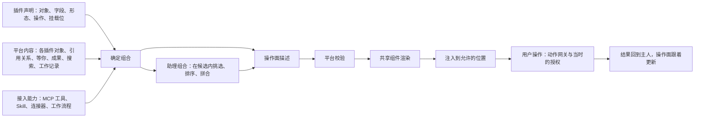

# 智能呈现与操作层（Intelligent UI）

状态：第一片在第 15 批实施中（2026-11-09）。确定组合服务、公共四形态与组件板、基础首页及跨位置消费者已合回 `batch/15`。证据见 §16–17。实际文字及页面授权切换、项目成员接入、整批验证和本人验收待完成，后续三片仍按路线书推进。一层横向的平台能力：插件声明自己的对象能怎样展示、能做什么，以及别人可以把东西放在它的哪里；平台和助理把插件允许的内容、平台里调用方有权看的全部内容、接进来的 MCP 工具与 Skill 合在一起，按此刻的位置、对象和任务组合出最合适的展示与操作面，注入插件允许的位置、对话、项目讨论和其他入口。四片已排进[路线书](../post-anticorruption-roadmap/reference/requirements.md#section-3-3)「智能呈现怎样接进来」（阶段 1～4，11-02 写入）；按轨道：合同归 C1，组合服务归 C3（新的 `horizontal/` 包，用户 11-01 定新的平台服务不进宿主），模型调用归 C2（只经 `horizontal/agent-host`），共享组件与组件板归 D，各插件自己的声明归各自轨道，助理与对话归 A，项目讨论归 `packages/im-ui` 与 `server/src/im` 的主人。设计参考了 Molis-Club 的 Work 产品页各版（附录 A），不复刻。

验收编号见 §14，前缀 `IUI`。

## 1. 要解决的问题

对照 main `885728c79` 的现状：

- 对象离开自己的插件，多半只剩名字或链接。平台已经有「这个对象是谁」（`packages/contracts/src/platform/action-subjects.ts`）、「对它能做什么」（`action-offers.ts`、`action-fragments.ts`）、「它在搜索里怎样列出、在哪打开」（`search-sources.ts`），但没有「它在这里该长什么样、带哪几个操作」的声明。Inbox、目标页、对话、项目讨论、首页、Shelf、等你、通知各写一套，或者只给文字。
- 生成插件的页面布局有 `ui.plugin-presentation`（`packages/design-system/src/plugin-presentation.ts`）：只排插件自己页面上的部件，不管它的对象在别处的样子。
- 助理里的交互卡（补充信息、方案与决定、对象选择、预览确认、结果，见 [ai-interaction-experience](../ai-interaction-experience/spec.md) §5）只在对话里，一次讲一件事。按此刻任务把几个插件的对象、MCP 工具与 Skill 的结果拼成一个操作面，现在没有。
- 同一个对象，在不同位置长得不同、能做的事不同；没有声明的插件（含生成插件和第三方插件）在别处只剩一个名字。

要达到的：用户在哪里、正在做什么，都能用上此刻最合适的展示和操作，不用为找一个操作切到别的页面。插件只要声明自己能展示什么、能做什么、允许别人放什么，组合由平台和助理来做。

## 2. 这一层是什么



- **三类输入**。一是插件声明的呈现与操作能力（§4）。二是平台里的内容：各插件的对象（经它们自己的读取动作）、对象间的引用（Context Ledger）、等你（Attention）、成果与过程项、搜索、工作记录（[观测和采集层](../observation-collection/spec.md)）、目标的要求与证据；只读调用方有权看的。三是接进来的能力：MCP 工具、技能包与 Skill、连接器、工作流程，都经同一个动作目录与授权（[Tool 策略](../prologue-tool-strategy/spec.md)、[MCP 策略](../prologue-mcp-strategy/spec.md)）。
- **两级组合**。确定组合不调模型：按声明和规则给出每个对象在这个位置的默认形态和操作，没有模型、离线、模型失败时都能用。助理组合经 agent-host：在确定组合给出的候选里挑选、排序，把几个插件的对象和外部能力拼成一个面，写一句为什么。
- **输出是一份操作面描述**：结构化数据，不是 HTML 或代码。写的是放哪些对象（引用）、每个用什么形态、显示哪些字段、带哪些操作（每个是一个动作引用，加预备好的输入）、怎样分组、为什么。平台按 schema 和声明校验后用共享组件画；校验不过，退回确定组合。
- **落点**：插件声明的挂载位、对话、项目讨论、首页与 Work Brief、侧栏与 Shelf、等你与通知、搜索、外部 Agent 读到的文本（§8）。插件没有开放的位置不注入。
- **留存**：用户觉得好用的操作面可以保存成视图，交给 [Work Brief](../work-brief/spec.md) 做成生成页面，或交给[插件创作工作台](../plugin-builder-upgrade/spec.md)做成插件；保存走各自主人的流程。

它不是什么：

- 不让模型写任意界面代码。要新的界面，走生成页面与创作台那条有预览、校验和隔离运行的路。
- 不是新的事实来源。显示的都是主人的当前数据。
- 不是绕过授权的捷径。操作面能拿到的，和调用方本来能拿到的一样多。
- 不换掉插件自己的页面。插件页仍由插件提供内容，这一层只往它开放的位置放东西。

## 3. 原则

1. **插件声明，平台组合，助理挑选。** 能展示什么、能做什么由插件说；在哪里、用哪种形态由平台定；此刻最该看到哪几样，由助理在候选里挑。
2. **事实只有一个主人。** 操作面只放引用和主人给出的当前值，不复制、不另存一份；主人那边过期、撤权、删除，操作面如实显示。
3. **操作就是动作。** 每个按钮都是动作目录里的一个动作（MCP 工具、Skill、工作流程的入口同样是），或者打开与定位。预备不写入；执行经动作网关和当时的授权；外发、费用、不可逆后果写在按钮旁（[VUX-56](../visual-ui-experience/spec.md)）。
4. **只在候选之内挑选。** 助理不发明对象、字段或操作，输出要过 schema；失败、超时或没有模型时，退回确定组合，用户看不到半截的面。
5. **插件同等待遇。** 内置、生成、第三方插件用同一份声明，同样被组合；宿主不按插件名分支；插件可以声明某个位置不接受注入。
6. **不打扰。** 可选的推荐不抢焦点、不挡输入；要回答才能继续的，进入等待；被忽略过的同类建议不反复出现。
7. **可解释、可纠正。** 每处组合都能看到「为什么这样放」；用户可以换形态、移走、固定偏好，纠正会被记住，也进入评测。
8. **可测。** 确定组合同样输入同样输出；助理组合记下输入、候选、选择和理由，供[平台评测](../proactive-assistant/spec.md#14-molis-work-的端到端效果评测)读取。

## 4. 插件要声明的能力

写在 Manifest 里，与动作、搜索来源、成果类型的声明并列；生成插件与第三方插件同样写。没有声明的对象由平台兜底：图标、名字、所属插件、「打开」。

### 4.1 对象与字段

- **对象类型**：复用搜索来源的 kind 和打开位置（`SearchSourceKind`、`SearchOpenTarget`），以及动作里的对象引用（`ActionSubject`），不另起一套身份。
- **字段的语义角色**：标题、状态、摘要、正文片段、媒体（图像、截图组、图表、文件）、数值与进度、时间（到期、发生、更新）、人与 Agent（谁做的、谁在做、要谁）、出处（来自哪里、凭什么）、版本、关系（挂在哪个 Goal、对上哪条要求）、子项（数量和前几项）。平台按角色挑组件，插件不写样式。
- **状态映射**：插件自己的状态映射到状态环的几种状态（[status-ring-system](../archive/status-ring-system/spec.md)），另外标出「要你决定」「要你验收」「失败」「部分完成」「过期」。

### 4.2 形态

每种形态要哪些字段由插件声明；没有声明的形态，平台不拿来用。

| 形态 | 用在哪里 | 至少显示 | 常带的操作 |
| --- | --- | --- | --- |
| 名字片 | 正文里的引用、输入框里的引用片、消息里的提及 | 图标、名字、状态 | 悬停或聚焦出速览，点开 |
| 行 | 列表、搜索结果、时间线、记录栏 | 状态、标题、一两项元信息、人与出处 | 一个主操作，更多 |
| 卡片 | 对话、项目讨论、首页、Shelf、等你 | 标题、状态、摘要、关键字段、媒体缩略 | 一个主操作加一两个次操作 |
| 速览 | 浮层或侧栏，不离开当前位置 | 正文或内容的可读部分：文档一节、表格前几行、图像、Diff、截图组 | 打开到准确位置，放进，交给 |
| 活卡 | 进行中的工作：Coding 一轮、工作流程运行、目标进度、等你验收 | 卡片的字段加实时进度、当前步骤、可停止 | 停止、补充、验收、再改改 |
| 嵌入 | 别的插件文档或页面里可以操作的一块：文稿里的数据表、目标进度、待办清单 | 主人给的可交互视图 | 就地勾选、改值，写回主人 |
| 整页 | 插件自己的主区 | 由插件提供 | 由插件提供 |

几种对象合在一起时的组合形态，由平台提供：

- 分组摘要，例如「没用上的 27 条：参数类 12、写过的 8、只有转述的 7」；
- 对比：前后版本、几个候选；
- 证据链：要求，依据（测试报告、截图、检查记录），谁验收；
- 时间线：谁在哪天做了什么；
- 交接卡：做到哪、定过的事、下一步；
- 决定请求：问题、为什么要问、选项、谁问的、什么时候问的；
- 验收卡：交回了什么、看什么、验收与再改改；
- 递来的建议：一条可以放进当前工作的资料，或一个下一步；
- 新能力卡：刚接上的连接或工具现在能做什么。

### 4.3 操作

- 每个操作引用动作目录里的一个动作（`capability_id@version`），写明主操作还是次操作、在什么状态和位置下可用、预备输入从哪些字段来。
- 平台给的通用操作不用声明：打开到准确位置并高亮、在侧栏速览、复制引用、放进（当前文档、输入框、Shelf）、交给（某个插件、助理、成员）、挂到 Goal、提醒我、分享到讨论。各自仍由主人执行，例如「挂到 Goal」由 Goals 落、「放进」由目标插件落。
- 当前不可用的操作不显示；必须让人知道为什么不能做的（没有授权、对象被锁），写明原因与去处。

### 4.4 挂载位

插件声明自己页面上允许别人放东西的位置：在哪（列表顶部、详情侧边、正文段落之间、页头）、接受哪些形态、最多几件、哪些种类不接受。比如：

- 目标页的「证据」位接受成果与报告的卡片；
- 文稿的段落之间接受嵌入；
- Inbox 条目旁接受「对上哪条要求」的名字片。

插件可以声明一处都不开放。

### 4.5 文本形态

给外部 Agent、终端、通知、导出用的纯文本摘要，例如：

```text
读了目标「划线卡片 v1.1」
定过的事：划线只存本地
做到哪：导出做完，兼容旧数据在做
```

和图形形态出自同一份事实。经 MCP 读到的上下文，用的就是这一份。

### 4.6 实时

插件声明哪些状态变化会发出事件，活卡和等你订阅这些事件，不轮询。

## 5. 组合规则

**依据**（按这个顺序收窄）：

1. **位置与空间**：正文里、列表、对话气泡、讨论消息、窄侧栏、浮层、主区、底栏或菜单栏、通知、外部终端、导出文件。
2. **对象的内容**：长短，有没有图像、表格、代码、Diff，有没有状态、版本、子项。
3. **对象和用户的关系**：要你决定或验收、进行中、失败、部分完成、过期、撤权；是你做的、AI 做的，还是成员做的。
4. **此刻的任务**：在写（建议放进来）、在审（对比加验收）、在找（行加定位）、在交接（带上下文的交接卡）、在讨论（卡片加接走）。
5. **用户的偏好与纠正**：固定过的形态、移走过的建议、常用的操作排在前面、密度偏好。
6. **能力与授权**：只用当前可执行的动作、当前连着的 MCP 与已启用的 Skill。

**确定组合**：依据 1、2、3、5、6，从声明里选出形态与操作，结果可重复。

**助理组合**：在确定组合的候选里，再按依据 4 和工作记录挑出几样、排先后、拼成一个面，给出一句理由（例如「这 3 条反馈对上了『手机排版』」）。只能引用候选里的对象和操作，输出过 schema；超出候选的内容一律丢掉并记录。

**纠正**：用户换形态、移走或固定，按调用方和位置记住；同一位置下次先照纠正来。

**性能**：组合不挡页面首屏，先画确定组合，助理组合好了再平滑替换；字段按需取；活卡靠事件更新；对象多时先分组、折叠，不一次画几百张卡。具体预算在 VUX 的性能验收里量。

## 6. 什么时候出现

| 谁触发 | 例子 | 出现什么 |
| --- | --- | --- |
| 用户 | 选中一段文字、一行或几个对象 | 浮条与速览，操作按选中的是什么而不同（选一句给改写，选一行数据给核对出处、做图） |
| 用户 | 输入 @ 或 / | 对象、插件、Skill 与 MCP 工具的候选，选中成为引用片或操作 |
| 用户 | 粘贴一个对象链接、拖一件东西进来 | 链接展开成卡片；拖进文稿成为嵌入或带出处的段落 |
| 用户 | 悬停或聚焦一个名字片 | 速览 |
| 用户 | ⌘K | 行形态的结果，带速览与「打开并定位」 |
| 助理 | 回答里提到对象、交回成果 | 名字片、卡片、验收卡 |
| 助理 | 需要你决定、需要补信息 | 决定请求、补充信息卡（语义归 [ai-interaction-experience](../ai-interaction-experience/spec.md)） |
| 助理 | 干着活，发现手边有用得上的资料 | 递来的建议：「内测记录里有一条：2,140 条一次导完用了 58 秒，要放进这句吗？」 |
| 规则 | 插件内的判断规则命中（Inbox 分拣、Feed 值得收、工作流程拦下） | 判断标签与理由，带下一步 |
| 事件 | 主人状态变化：运行完成、失败、交回待验收、新连接接上、额度用完 | 活卡更新、等你计数、通知 |
| 事件 | 时间到了：到期、日程、定时简报 | 等你、首页卡片、通知 |
| 成员 | 有人在讨论里 @ 你或 @ 某个插件 | 讨论里的卡片、等你 |

节制：

- 同一位置同一时刻只突出少量建议，其余收进更多。
- 用户离开那段上下文，建议跟着收起。
- 被忽略或拒绝的同类建议，在同一对象上不再出现，除非对象变了。
- 减少动态效果时，直接出现最终状态。

## 7. 操作

- **执行**：经动作网关，按当时的授权；等模型或外部服务的动作按 `scheduling: "concurrent"` 的规矩提交；被取消、撤权的不写业务记录。
- **批量**：多选以后同一个操作一次做；部分成功按条显示成功、失败和原因，失败的可以单独重试。
- **就地修改**：嵌入与卡片里的少量字段（勾选待办、改日期、改状态）写回主人，按读取时的版本提交；版本冲突时显示最新值，并保留用户这次的输入。
- **撤销与回执**：能撤销的给撤销；做完的操作收成一行回执，写明对哪个对象做了什么、结果在哪（卡片撤销的语义归 ai-interaction-experience BL-343）。
- **失败与降级**：主人读不到时，显示最后一次读到的值并标出过期，或者只留名字片；撤权以后不再显示内容，只写「没有权限查看」；对象删掉了写「已删除」，不留可点的操作。

## 8. 各位置的呈现

- **插件内部**：
  - 列表、详情、看板、表格、时间线用同一套形态和状态；
  - AI 在插件里的判断写成标签加理由，例如 Inbox 的「要紧 · 对上『手机排版』」、Feed 的「值得收」、工作流程的「先拦下：『兼容旧数据』还没做完」；
  - 对象之间的关系可以看见：目标的要求、依据和验收，反馈对上哪条要求；
  - 别的插件放进来的东西只出现在挂载位上。
- **插件之间**：
  - 文稿里引用或嵌入目标、待办、数据表、图像；
  - 目标页的证据位放测试报告、截图组、检查台结果、Agent 报告；
  - Inbox 条目带出处，以及对上的要求；
  - Feed 条目一步送进 Inbox 或文稿；
  - 工作流程的步骤显示被检查的对象；
  - 首页与 Work Brief 汇总几个插件的卡片。
  - 每一处都是对方的形态加对方的操作，不由放置方另画。
- **对话框与个人助理**（个人助理、Coding 对话、插件里的 AI）：
  - 回答里的对象是名字片或卡片；
  - 交回的成果是验收卡：截图组、看什么、验收与再改改；
  - 进行中的任务是活卡；
  - 多对象给分组摘要；
  - 改动给对比；
  - 输入框里是引用片和附件；
  - 交互卡的语义、Option 和推荐行归 ai-interaction-experience，本书管对象怎么呈现、跨插件与外部能力怎样拼进来。
- **项目讨论（IM）**：
  - 消息里贴的对象展开成卡片；
  - @ 一个插件或助理就能接走，例如「@Coding 一起改了吧」之后出一张「接了」的活卡，做完回到讨论；
  - 讨论可以变成目标，由用户点同意；
  - 话题有状态（讨论中、已有结论、你确认过）；
  - AI 按用户的规则开话题时，带上「你定的规则」；
  - 成员只看得到自己权限内的卡片内容，看不到的写明。
  - 消息、引用与草稿的行为仍归 im-ui。
- **侧栏与 Shelf**：
  - Shelf 里的东西按种类显示缩略（截图组、文档、图表、PDF），并写明来自哪里（来自 Coding、来自助理、你放的），可以拿起来放进任何接受它的位置；
  - 记录栏是时间线：谁在哪天做了什么。
  - 拿起与放下的行为归 [side-shelf](../side-shelf/spec.md)。
- **首页与 Work Brief**：目标卡（进度、继续这个目标）、事件行（例如「夜里两次提交，都过了发布前检查台」「41 条反馈整理好了，3 条要你看」）、等你列表；内容与版本归 Work Brief。
- **等你与通知**：底栏的「等你 N」、菜单栏的胶囊、系统通知用最短的形态，一句话加一个主操作，点进去到对应的卡。
- **搜索**：行形态，带速览与打开定位；结果的来源与权限仍归系统搜索。
- **外部 Agent 与终端**：经 MCP 读到的是文本形态；Agent 交回的结果在工作台里以卡片出现，写明是哪个 Agent、凭什么。
- **生成页面与生成插件**：用同一份声明和组件，生成插件在别处同样能被组合。
- **导出与分享**：报告导出时对象用静态形态，带出处。
- **设置与授权**：插件卡、连接卡写明接上以后能做什么，「试一下」直接给一个真实的下一步。

## 9. 各插件至少要声明的

下表是第一版的最少集合。每个插件开工时按真实对象再核一遍，缺的补上，没有的写明不适用。

| 插件 | 对象 | 别处最常见的样子 | 常带的操作 |
| --- | --- | --- | --- |
| Goals | 目标、完成要求、定过的事、证据、验收 | 目标卡（进度、等你验收）、要求行（状态、依据、谁做）、证据链、交接卡 | 继续这个目标、验收、再改改、交给谁接着做 |
| 待办 Todo | 待办、清单 | 行（勾选、到期）、嵌入清单 | 勾选、改日期、提醒我、挂到 Goal |
| Inbox | 进来的条目、分拣结果 | 行加判断标签与理由、分组摘要 | 交给某插件、记成想法、不用回 |
| Feed | 来源、条目 | 卡片（来源、为什么值得收、反证） | 收进 Inbox、放进文稿、不再看这类 |
| Pages 文稿 | 文稿、一节、一段 | 名字片、一节的速览、带版本的卡片 | 打开到这一段、放进、和上一版比 |
| Dataset | 表、行、汇总 | 前几行的速览、嵌入表、单行卡片 | 追加一行、核对出处、做成图表 |
| Form | 问卷、答卷 | 卡片（回收数、截止）、单份答卷速览 | 发出、存成数据表 |
| PPT | 演示文稿、一页 | 页缩略、单页速览 | 打开到这一页、导出 |
| Images | 图像、一组生成结果 | 缩略、对比、大图速览 | 采用、再生成、放进 |
| Jelly | 日程、笔记 | 日程行（时间、地点）、笔记卡片 | 加到日程、提醒我 |
| 灵光 | 随手记、灵感 | 卡片（去向：已转到某插件） | 转成目标、待办或文稿 |
| Cognia | 知识条目、问答 | 带出处的回答卡、条目速览 | 打开出处、放进 |
| Issues | 问题 | 行（状态、负责人） | 指派、关闭 |
| Coding | 一轮执行、变更集、报告 | 活卡（当前步骤、截图组、交回）、Diff 速览、报告卡 | 停止、补充、验收、交回 |
| Diff、Git | 改动、提交、分支 | Diff 速览、提交行 | 打开到文件这一行、复核 |
| 工作流程 Workflows | 流程、一次运行、检查结果 | 活卡（第几步、拦下的原因）、检查台结果（例如 4/4 通过） | 重跑、放行、查看记录 |
| Schedule | 定时任务 | 行（下一次、上一次结果） | 现在跑一次、暂停 |
| Shelf | 手上的东西 | 缩略加出处 | 拿起、放进、删掉 |
| Files | 文件（退役前） | 文件行、预览 | 打开、放进 |
| 插件创作台 | 在做的插件、方案、试用结果 | 进度卡（已接通 2/3）、安装确认卡（要用到的能力） | 试用、安装、接着改 |
| Alchemist | 场景方案、产出 | 方案卡、产出速览 | 采用、接着做 |
| 文本统计 | 统计结果 | 数值卡 | 放进 |
| 平台：成果库 | 固定版本 | 带版本与出处的卡片 | 打开、引用、放进 |
| 平台：角色与 Skill | 角色、做法 | 「按：我的做法 · 第 1 条」这样的出处标签 | 查看这条做法 |
| 平台：连接与 MCP | 连接、工具 | 新能力卡、连接状态行 | 试一下、断开 |
| 以后的插件（风险、Work Brief、Sessions 重做） | 各自的对象 | 照本节先声明再开工 | — |

### 9.1 第 15 批接入前核查（2026-11-08）

核查固定头 `c1cf6b5d18` 的源码；[Host 登记](../../apps/local-host/src/plugin-registry.generated.ts)与[工作台登记](../../apps/workbench/src/builtin-plugins.ts)一致，共 23 个内置插件。此时全部缺 `Manifest.presentation`、呈现 values 和 overview；17 个插件已有 22 个 subject reader。下表只记录现有读口和缺口去处，不代表已运行、已接页面或本人验收。第 16 批 C 切换后，接入片再核当前目录和安装身份；后续批次归属来自现行路线书，不在此另行认领。

| 插件 | 已实现的 subject kind（源码读口） | 呈现缺口去处 |
| --- | --- | --- |
| Goals | [`goal`](../../plugins/native/goals/src/actions.ts)；要求、证据与验收尚无独立 reader | 15 首片；完整证据链与验收卡归 52 |
| Inbox | [`inbox_entry`](../../plugins/native/inbox/src/content-actions.ts)；读取关联对象时仍经原主人核权 | 15 首片；事项壳不能代替 Feed／Goals 的对象主人 |
| Coding | [`coding_session`](../../plugins/native/coding/src/routes-sessions.ts)；报告、变更集有读动作，尚无独立 reader | 15 首片；活卡与完整交回归 52 等后续片 |
| Feed | [`feed_item`、`source`](../../plugins/native/feed/src/content-actions.ts) | 15/S-2 的归属与计数必须补两种对象的最小声明、values 和概况；完整插件呈现归 52 |
| Todo | [`todo_item`](../../plugins/native/todo/src/search.ts)、[`todo_batch`](../../plugins/native/todo/src/organize-actions.ts)；清单无独立 reader | 52，核定清单粒度 |
| Pages | [`pages_document`](../../plugins/native/pages/src/actions.ts)；节、段无独立 reader | 52，核定节、段定位 |
| Dataset | [`dataset`](../../plugins/native/dataset/src/search.ts)；行、汇总无独立 reader | 52 |
| Workflows | [`workflow`](../../plugins/native/workflows/src/search.ts)；运行、检查结果无独立 reader | 52 |
| Form | [`form`](../../plugins/native/form/src/search.ts)；答卷有查询，单份答卷无独立 reader | 63 其余声明 |
| PPT | [`presentation`](../../plugins/native/ppt/src/search.ts)；单页无独立 reader | 63，核定单页定位 |
| Images | [`image_job`](../../plugins/native/images/src/search.ts)；单图无独立 reader | 63 |
| Jelly | [`jelly_item`、`jelly_note`](../../plugins/native/jelly/src/search.ts) | 63 |
| 灵光 | [`lingguang_spark`](../../plugins/native/lingguang/src/search.ts) | 63 |
| Cognia | [`cognia_material`](../../plugins/native/cognia/src/search.ts)；问答无独立 reader | 63 |
| Issues | 无；[现有列表和详情](../../plugins/native/issues/src/actions.ts)有提交者，未见负责人和处理状态 | 63，不以提交者代负责人 |
| Diff | 无；[现有 state/compare](../../plugins/native/diff/src/actions.ts)读取固定输入或计算差异 | 63，核定固定变更与计算结果的对象身份 |
| Git | 无；[现有动作](../../plugins/native/git/src/actions.ts)读仓库、分支及暂存状态 | 63，核定提交、分支的对象粒度 |
| Schedule | [`schedule_task`](../../plugins/native/schedule/src/search.ts) | 63 |
| Shelf | [`shelf_item`](../../plugins/native/shelf/src/search.ts)，当前 reader 不开放 plugin audience | 52 接挂载；Shelf 自有声明归 63 |
| Files | 无；[现有目录和内容协议](../../plugins/native/files/src/actions.ts)不等于 subject reader | 06-1 退役交 knowledge 与平台资料服务，不给旧包新增呈现 |
| 插件创作台 | 无；[自身页面](../../plugins/native/plugin-builder/src/registration.ts)读取构建和设计；生成设计的 `presentation` 是页面布局 | 67-4，不能把生成页面布局当创作台对象声明 |
| Alchemist | [`alchemist-direction`、`alchemist-idea`、`alchemist-playbook`](../../plugins/native/alchemist/src/studio/server/services/workspace-operations.ts)，仍走现存 Host 特例 | 63 总清单列缺口；场景与产出身份随 BL-377 核定，具体实施批次待定 |
| 文本统计 | 无；[现有 state/count](../../plugins/native/text-stats/src/actions.ts)读固定快照或计算输入文本 | 63 核定独立身份；15 首页按无概况处理 |

排期依据：[52](../post-anticorruption-roadmap/reference/batches/52.md)、[63](../post-anticorruption-roadmap/reference/batches/63.md)、[67](../post-anticorruption-roadmap/reference/batches/67.md)、[06](../post-anticorruption-roadmap/reference/batches/06.md)。平台成果库的 `artifact` reader、角色的 `character` reader 不属于这 23 个插件；Skill、连接和 MCP 的列表／读取动作也不等于通用 subject reader。跨 Skill/MCP 操作面归 61／63，平台对象的具体呈现接点仍待核定。风险、Work Brief 和 Sessions 重做不在现行登记中，按各自批次声明，不补占位插件。

现有组件板使用同一份 `inbox_item` 示例切换三个主人，证明共用 renderer 的显示与交互。IUI-21 补片在原「呈现形态」一节明确标示例，另外用现有只读行显示内置登记状态。工作台从生成的 `BUILTIN_PLUGIN_CATALOG` 投影插件身份、显示名和 `Manifest.presentation.objects` 是否有声明，组件板只按这份投影画一行一个插件。仅有概况的插件仍标明缺对象呈现，去处查本节。该清单只读构建登记，零运行时请求和业务副作用，也不另造资源或插件名单。真实浏览器核对名单与登记一致、中英缺口可读、窄屏可用；生产的 `inbox_entry`、`goal`、`coding_session` 消费与本人验收另验。

清单补片 `651fa2beb1` 已于 `a24be9f003` 合回第 15 批。`tests/presentation-inventory.e2e.test.ts` 的 IUI-21 用例在隔离 Host／测试浏览器通过，1440／390 × 中英文均逐行核对全部 23 项；该头全部缺对象声明，未以示例代替真实登记。依赖构建和固定头健康门禁通过，新增内容仅为同页标记、清单和样式，没有新资源路径。这是清单的定向工程证据；三宽深浅色完整矩阵、生产消费者和本人验收仍按 §16 收口。

## 10. 与现有需求的分工

| 需求 | 那边负责的 | 本书负责的 |
| --- | --- | --- |
| [ai-interaction-experience](../ai-interaction-experience/spec.md) | 对话里交互卡的语义：Option、推荐行、补充信息、方案、确认、结果的生命周期 | 对象在对话里怎么呈现；跨插件、带 MCP 与 Skill 的操作面怎样拼 |
| [context-program](../context-program/spec.md)、[情境动作](../archive/contextual-interaction/spec.md) | 浮条、快速创建、片段动作的声明与准备 | 片段动作出现在哪种形态里，以及和对象形态的组合 |
| [side-shelf](../side-shelf/spec.md) | Shelf 的拿起、放下、材料篮 | Shelf 里东西的形态与出处 |
| [work-brief](../work-brief/spec.md) | 首页与简报的内容、版本、生成页面 | 首页上的对象卡与等你 |
| [proactive-assistant](../proactive-assistant/spec.md) | 什么时候主动提出、做什么 | 提出来的东西长什么样、带什么操作 |
| [项目讨论](../archive/molis-work-im/redesign-v2/spec.md) | 消息、话题、引用、草稿、成员权限 | 消息里对象卡的形态，@ 接走以后的活卡 |
| [系统搜索](../archive/system-search/spec.md) | 来源、权限、排序 | 结果行与速览的形态 |
| [放在哪里](../archive/work-placement/spec.md)、[成果库](../archive/artifact-positioning/spec.md) | 对象放在哪个项目与分区、成果的固定版本 | 放进去以后在别处怎么显示 |
| [status-ring-system](../archive/status-ring-system/spec.md) | 状态环的几种状态与画法 | 插件状态到状态环的映射 |
| [visual-ui-experience](../visual-ui-experience/spec.md) | 版面、几何、动效、文案、性能的验收 | 形态与组合规则；视觉部分在 VUX 验收 |
| [字体、皮肤与语言](../font-and-skin-system/spec.md) | 文字与样式的格式和切换 | 不另定样式，用它的语义变量 |
| [unified-input-voice](../unified-input-voice/spec.md) | 输入框、引用片与附件的行为 | 引用片里对象的形态 |
| [plugin-builder-upgrade](../plugin-builder-upgrade/spec.md) | 生成插件、场景组装 | 生成插件同样写呈现声明；保存的操作面可以交给创作台 |
| [Prologue 的 Tool、MCP、Skill 策略](../prologue-tool-strategy/spec.md) | 工具的发现、选择、授权与健康 | 工具与 Skill 的结果在操作面里怎么呈现 |
| [观测和采集层](../observation-collection/spec.md) | 工作记录 | 读它当组合依据；助理组合的记录交给它 |
| [主线](../work-mainline/spec.md) | 事项的排列、切换与每件事项的工作台状态 | 切换器与列表里事项的形态、「设为事项」「放进事项」这一类操作的呈现 |

## 11. 组件板、开发手册与生成

- **组件板**（`/__ui/catalog`）加一节「呈现形态」：
  - §4.2 每种形态 × 常见状态（进行中、要你决定、要你验收、失败、部分完成、过期、撤权、已删除）× 几个位置（正文、列表、对话、讨论、侧栏、通知）各一张样张；
  - 用真实组件和标明「示例」的数据；
  - 每个内置插件至少一行，没声明的标成缺口。
- **插件开发 Skill** 的[对象呈现章节](../../skills/molis-plugin-dev/ui.md#对象的呈现)写清怎样声明对象、字段、形态、操作和挂载位，以及在组件板上自查。原生与手写签名 app 包说明已补，生产挂载随页面消费片接通。
- **插件创作台**：生成插件时一并生成呈现声明，走同一套校验。

## 12. 合同与落点

要补的平台能力，按路线书「合同先行」排在 M1 之前：

- **Manifest 里的呈现声明**（§4）。复用 `ActionSubject`、`SearchSourceKind`、`SearchOpenTarget`、动作引用、成果的预览动作，不另起身份与打开方式。改合同要 `pnpm api:update`，影响写进 PR（[合同变更流程](../../docs/system/CONTRACT-CHANGES.md)）。
- **组合服务**：一个新的 `horizontal/` 包。
  - 给定调用方、位置、对象或任务，返回校验过的操作面描述；
  - 确定组合在包里完成；
  - 助理组合经 `horizontal/agent-host` 调模型；
  - 宿主只装配。
- **共享组件**：形态与组合形态的组件放在 design-system，插件页面经 SDK 的 `/ui` 取用；浏览器里跨模块的事件照旧在 `dom-events.ts` 登记。
- **挂载位**：由平台在插件页面的声明位置画，插件不接触别人的 DOM。
- **记录**：助理组合的输入、候选、选择、理由与用户纠正，写进工作记录，不记对象正文。

## 13. 分期

1. **第一片**：
   - 合同；
   - 名字片、行、卡片、速览四种形态与组件板一节；
   - Goals、Inbox、Coding 三个插件的声明；
   - 落在插件内、对话、项目讨论、等你四处；
   - 只有确定组合。
2. **第二片**：
   - 活卡、嵌入、证据链、交接卡、决定请求、验收卡；
   - 插件之间（文稿嵌数据表与目标、目标页证据位）、Shelf、首页；
   - Pages、Dataset、待办、Feed、工作流程的声明。
3. **第三片**：
   - 助理组合：跨插件与 MCP、Skill 的操作面，理由与纠正；
   - 外部 Agent 的文本形态；
   - 其余插件全部声明。
4. **第四片**：
   - 生成插件与创作台；
   - 操作面保存成视图或生成页面；
   - 导出形态；
   - 评测接入。

第一片在阶段 1，第二片在阶段 2，第三片在阶段 3，第四片从阶段 3 到阶段 4；每片落在哪条轨道、等什么，见[路线书](../post-anticorruption-roadmap/reference/requirements.md#section-3-3)「智能呈现怎样接进来」。第一片的四种形态和 Work Brief、基础首页要的公共呈现组件是同一套，一起设计。

## 14. 验收标准

| 编号 | 要达到的结果 |
| --- | --- |
| IUI-01 | 插件能在 Manifest 里声明对象类型、字段角色、状态映射、形态、操作与挂载位；声明不合法时装不上并说明哪一项错了。内置、生成、第三方插件走同一份校验 |
| IUI-02 | 没有声明的对象在任何位置都有兜底：图标、名字、所属插件、打开；不出现空白或原始 id |
| IUI-03 | 同一个对象在插件内、别的插件里、对话、项目讨论、首页、Shelf、等你、搜索里，用的是同一份声明，状态与字段一致；某个位置不支持的形态按梯度降一级 |
| IUI-04 | 确定组合不调模型，同样的调用方、位置和对象给出同样的形态与操作；没有模型或模型失败时仍然可用 |
| IUI-05 | 助理组合只引用确定组合给出的候选对象和操作；候选以外的内容被丢弃并记下；输出不合 schema 时退回确定组合，用户看不到半截的面 |
| IUI-06 | 每处组合都能看到一句为什么；用户换形态、移走或固定以后，同一位置下次照纠正来 |
| IUI-07 | 操作面上的每个按钮都对应一个已注册动作或打开与定位；执行经动作网关和当时的授权；撤权以后的点击不写任何业务记录 |
| IUI-08 | 外发、费用、不可逆的操作在按钮旁写明后果；预备不写入，点了才执行；重复点击不重复执行 |
| IUI-09 | 卡片和嵌入里显示的是主人的当前值，不另存副本；主人更新以后，其他位置跟着更新（活卡靠事件，不轮询） |
| IUI-10 | 主人读不到、撤权、删除时分别显示过期的最后值、「没有权限查看」、「已删除」，不留可点的失效操作 |
| IUI-11 | 嵌入与卡片里的就地修改写回主人，按读取时的版本提交；冲突时显示最新值并保留用户这次的输入 |
| IUI-12 | 批量操作部分成功时逐条显示结果，失败的可以单独重试 |
| IUI-13 | 插件只在自己声明的挂载位上出现别人的东西；声明不接受注入的位置，什么都不放 |
| IUI-14 | 对话里提到的对象是名字片或卡片，交回的成果是验收卡，进行中的任务是活卡；交互卡的生命周期符合 ai-interaction-experience |
| IUI-15 | 项目讨论里贴的对象展开成卡片；@ 插件或助理接走以后出现活卡，做完回到讨论；成员看不到权限外的内容 |
| IUI-16 | 选中文字、一行或几个对象时，速览和操作随选中的内容而不同；离开那段上下文，建议收起 |
| IUI-17 | 助理组合的操作面能把几个插件的对象和已授权的 MCP 工具、已启用的 Skill 放在一起；没授权或没启用的不出现 |
| IUI-18 | 被忽略或拒绝的同类建议，在同一对象没有变化时不再出现；要回答才能继续的进入等待，可选推荐不抢焦点 |
| IUI-19 | 外部 Agent 经 MCP 读到的对象文本形态，与工作台里显示的出自同一份事实 |
| IUI-20 | 首屏先画确定组合，不等模型；对象很多时先分组、折叠；在 VUX 的性能口径下量过 |
| IUI-21 | [人工] 组件板有「呈现形态」一节：每种形态 × 常见状态 × 几个位置有样张，每个内置插件至少一行，没声明的标成缺口 |
| IUI-22 | 插件开发 Skill 写清怎样声明与自查；创作台生成的插件带呈现声明并通过同一校验 |
| IUI-23 | 助理组合的输入、候选、选择、理由与用户纠正进入工作记录，评测能读到；记录里没有对象正文 |
| IUI-24 | [人工] §9 每个插件逐项核过：声明了、写明不适用，或列为缺口并有去处；不以几个样板插件代替全部完成 |
| IUI-25 | 用户能把一个操作面保存成视图，或交给 Work Brief、创作台；保存以后打开，显示的仍是主人的当前数据 |
| IUI-26 | [人工] 中文与英文、浅色与深色、窄窗口与分屏、键盘与读屏下，各形态都能分辨对象、状态与后果；视觉部分按 VUX 验收 |

## 15. 决策记录

| 日期 | 决定 | 依据与没选的 |
| --- | --- | --- |
| 2026-11-03 | **四种基础形态用「插件领头」**（用户定，定样 [`docs/design/intelligent-surfaces-forms/`](../../docs/design/intelligent-surfaces-forms/README.md) 方案 B）。名字片：插件色块加名字，需要你时带一个状态色点；行：插件色块领头，标题下写时间与谁做的，状态标签在右；卡片：顶上一条插件色带（插件名、时间、状态标签），下面标题、摘要、进度和操作；速览：锚定的浮层，头部用插件色块，手机上是底部弹层。 | 对话、讨论里几个插件的东西混排时最好分。没选：A 状态领头（插件身份要读小字）、C 内容领头（扫「哪件要我管」最慢，行的操作要悬停才出）。做产品时要守住：插件色只在色块与色带里用，状态色只在状态环、色点与状态标签里用，两套颜色在浅色与深色下都要能区分（IUI-26）。九种状态与降级、操作与后果、速览、理由、挂载位、各处同一份事实这些共用部分随原型一起看过，没有要改的。做产品前把原型控件换成 `mw-*` 组件，并在组件板加「呈现形态」一节（IUI-21）。 |
| 2026-11-04 | **定样按组件板实件重做**（用户确认）。版面与方案 B 不变；按钮、标签、分段、状态记号、状态环、进度条和提示条换成组件板的 `mw-*`（共用的 `docs/design/kit/`）。 | 用户 11-04 定：定好的原型都用组件板实件重做，逐份请用户确认。顺手修了英文下行里标签把标题挤没、手机上进度条不显示两处原有毛病，没改版面。 |
| 2026-11-08 | **四形态实件标本按这版继续产品接入**（用户在第 15 批会话确认）。[标本](../../docs/design/intelligent-surfaces-forms/specimens/README.md)保留方案 B，覆盖三宽、双语、深浅色、异常与键盘交互。 | 用户答复「按这版继续」。这是定样确认；真实网关、跨位置更新、挂载位安全、组件板产品实现和最终工作台验收仍须完成，不以标本的模拟数据销账。 |
| 2026-11-08 | **呈现色保持稳定，允许偶尔同色**（用户定）。平台按规范 plugin id 确定地分配语义色，不新增颜色记录。 | 有限色盘无法同时保证任意安装集合都不撞色和每个插件跨设备始终同色。用户选择稳定；图标和名字保留，B 布局不变，准确合同在公共来源 §10。 |

## 16. 第 15 批组件与入口实施边界（2026-11-08）

独立 UI 设计台按当前源码和已定样作只读交接，未跑实物。保留 §15 的方案 B 与基础首页定样，不重新选择方向；新组件板实物和最终工作台仍按 IUI-21／26、WBR-28 由用户验收。S-1 的新字段消费 [组合服务 §14.2](../surface-composition/spec.md#142-s-1-装配缺口与合同合审2026-11-08)，不在 UI 另造同名合同。

公共 D 轨在 `85d54e86e0f10e53c1fb4ec8bd9b4271b8bd4074` 对新增标本合审通过，无 Blocker/P1；复用实际 12 组合、异常截图和减少动效证据，并独立验证键盘疑点。其 P2（名字片聚焦已展开速览时，Enter 未移入）在标本提交 `a79c472c97` 修复：真实 Tab → Enter → Tab → Esc 已通过，同一探针对旧实现稳定失败，原矩阵和其它有效证据未重跑。产品接入须保留这条真实入口回归，不能直接调用 focus 跳过。合审只覆盖标本，最终产品组件、真实动作和跨位置更新仍另验。

| 实施片 | 复用与边界 |
| --- | --- |
| 四形态与组件板 | 唯一渲染入口 `renderPresentationForm` 放 SDK `/ui`，作者与平台共用；样式在 design-system，组件板用同一真实 renderer。复用已有按钮、状态环、徽标、提示、空状态、浮层、底部弹层、菜单与焦点工具。四形态本身与插件色盘须先补标本；不把原型脚本的模拟执行和硬编码配色搬进产品。 |
| 合同补充的状态 | notice 在原操作位给原因及确实可用的去处，不保留失效按钮；对话可混排名字片引用和交付卡；overflow 原处重新 compose 并传 expanded。现有 molisShowMore 是本地 DOM 前 5 项且只多 1 项不折叠，不能替代服务前 6 项的规则。provider 不作为技术字段显示，点击仍固定精确路由；read_at 只用主人真实时间。 |
| 基础首页 | 只按服务给的组绘制，退出旧 Goals 焦点、事件计数和按插件分支的组合。空、首次读失败、旧值、停用、无声明分别呈现。工作记录未交不出「接着做」。首页归平台，Work Brief 只注册卡片，按其 §1.1 最新更正，不实现旧原型里的插件接管。 |
| 入口与插件 | 插件内、对话、项目讨论、等你消费同一 renderer 与值；A 轨对话/输入框、IM 讨论和各插件内容仍由各 owner 落接点。Goals／Inbox／Coding 首批声明后，组件板还须列出其他内置插件的现状与去处，不能以三样板替代 IUI-24。Feed 的 held_in 由真实关联给，混有项目/个人时显示；同步资料不自动算工作。 |

组件可拆独立叶子文件，SDK 导出、样式入口与组件板装配沿现有接点，不扩现有巨大入口。第 15 批在独立工作树开发，最终统一同步 `main` 时接回已合入的安装、取词及页面授权改动，并解决共享入口的重叠。内置 `ui.locales` 和生产页面按实际切换后的路径统一验证。定样与产品运行分别留证。

作者与平台共用的 `presentationOwnerHue(pluginId)` 从 design-system 原样移入公开 SDK `/ui`，design-system 原出口同名重导；Goals／Inbox 不为取得同色而依赖私有设计系统。此五行纯函数搬移已于 2026-11-09 前置窄审通过：保留当前色序、for…of／charCodeAt(0)／无符号取值算法和 canonical id 输入，不增加规范化、参数或 renderer 默认色行为。撤回本次两插件新增的私有依赖，刷新 SDK `/ui` API 快照，按原计划跑边界与构建，最终共享核心 Full 要求不变，不为机械搬移另造镜像测试。

2026-11-08 标本阶段按用户要求等待第 08 批完整推送，先交四形态实件和键盘修复；其后真实组件与组件板已合回 `batch/15`，相关子树已清理。沿用已选 B；标本中的示例状态与交互只证明展示和可操作性。按用户同日后续更正，真实网关、跨位置刷新和产品接入在本批独立实施，最终统一同步时接回实际页面授权与语言切换，不再等待跨批文件交接。

Feed 的归属已有事实来源，不新增个人订阅结构：`SourceRecord.project_id` 属于实际订阅，个人分区由宿主创建并使用公开合同的 `PERSONAL_SPACE_PROJECT_ID`。Feed 在个人分区与普通项目走相同 Runtime 和来源读写。实际 values 读取应按条目的 `source_id` 在授权分区核对来源原记录，由来源的 `project_id` 给 `held_in`，无法核实则不猜；不以 Gmail／GitHub／RSS 等类型或账号身份推断。已提交 v2 金样中同一普通项目的 Gmail 与 RSS 被旧名单分成不同归属，且有 Feed Item 没有 Attention，作为 WBR-24 的反例。此逻辑随 Feed 的实际 values／概况消费者交付，不给将退出的 `HOME_EVENTS` 另造归属合同，也不提前添加无人消费的 helper。

验收沿现有编号：1440／1024／390 × 中文/英文 × 浅色/深色的 12 种组合检查四形态、首页、长内容、状态与后果；窄屏不能照搬四形态原型隐藏行状态标签的规则。实走键盘聚焦名字片到速览、精确打开与返回，挂载位内执行后跨位置更新和真实回执，七项以上混排的原处展开及中途撤权，首次读失败和旧值重试，新项目/停用/部分不可读，后台刷新与切项目/分屏恢复，以及 Feed 真实归属与去重。菜单键盘、Esc 关闭当前浮层并归还焦点、展开后的焦点、读屏与减少动效均按 IUI-26 验证。第二片活卡、完整验收卡和后续生成页面不由第一片模拟销账。

### 首批插件的实际读口与操作（2026-11-09）

按 `b7aec677a3` 的真实 owner 核对。四个插件的呈现读取均落在项目 Runtime：Goals、Inbox、Coding 各一支 values，Feed 一支同时覆盖 `feed_item` 和 `source`；各自一支固定协议 overview。Home 实例维持原职责，不能借它跨分区聚合。处理器只返回请求的对象与字段，项目、安装和权限来自可信调用；组合服务仍先核唯一且同主人的原 subject reader，再选同 scope 的 values，不因较窄的元数据读取权限绕过 reader。

| 对象 | 当前事实与显示 | 概况和真实入口 |
| --- | --- | --- |
| Goals `goal` | 同一个 Goals 读窗取记录与事件状态；标题、状态、更新时间、真实进展摘要或目标自己的 outcome。只有真实验收待决才标「等你验收」。沿 `updated_at:goal_event_cursor` 表达版本。新只读处理器自行在同步 `window.read` 中读取、等待原 ready；不套会额外加载 Home 个人方法且要求同步返回的通用 wrapper。 | 当前可读前五个 Goal；空与有内容用各自稳定词。`goals.create@1` 打开 `stage/create-dialog`，对象沿现有精确打开／速览。没有现成上次成功投影，首次失败按 unreadable，不造旧值缓存。 |
| Inbox `inbox_entry` | Attention 事项壳拥有状态、原因、时间和 revision；标题与来源沿原件权限合批读取，等待后复核事项版本及 origin。有效判断沿现有 recommendations 的绑定和正文版本校验，缺理由就省略。原件只作引用，origin 本身不伪装成 Ledger 去重关系。 | 当前可读 open/in_progress 前五项；无真实开始能力时 start 为空。subject reader 补现有 Inbox 本页的精确打开。停用 Inbox 不把仍归 Feed 的 Attention 算为 Inbox 排除数。 |
| Coding `coding_session` | 本项目 SessionStore 的标题、状态、更新时间，卡与速览可加创建时间；按真实 session 状态映射，沿 reader 的 `artifact:read` 和准确打开。首页不读取 Run 正文、历史和工作区。 | 最新五个未归档会话。现有 `coding.sessions.create@1` 接受空输入，创建空会话而不调模型；当前 Runtime 不可用时不写。创建成功沿返回 session id 打开，不能当作 Run id。 |
| Feed `feed_item`／`source` | 首页声明行；跨位置补名字片与卡片，名字片只用现有标题和真实状态，卡片沿用已有行字段，不新增读口、正文或持久化。此为讨论和 Inbox 原件的必要接入，不代表完整 Feed 呈现已交。其余同项目元数据为更新时间和来源标签。归属依 §16 上文按原来源记录；`SourcesModule.query.get` 也会读退休 tombstone，须核 `sourceDeletedAt`，缺源或已退订则不猜归属。业务 `read_at` 不作旧值读取时间。 | 同分区至多五个可读近期条目或真实来源故障；无开始入口，静态说明同步资料不算已接工作。原 reader 补准确打开：条目开条目，来源走现有 source-workbench，不把来源 id 当条目 id。 |

Inbox 的 `inbox.entry.status@1` 要求目标状态与读取时 revision；当前 `input_from` 不能把同 ref 的 done/dismiss 两种目标表示成两个按钮。本片不增加包装动作、不把当前状态当目标输入，公共形态保留打开／速览，原 offer 仍由现有 contextual prepare／确认／网关准备和执行。首片的真实操作验收不因此取消：最终消费者必须在挂载位通过已登记 placement 或既有 offer 完成真实写入、跨位置更新及回执，并验证撤权后零写；只打开页面不能销账 IUI-07／08。

**Goals 自身舞台的同源状态（2026-11-09 前置窄审）。** 现有 collection 的 status／display_status 已把不同 pending_decisions 合并，不能从它们或译文反推呈现声明中的 pending_acceptance／pending_decision；selected.event_document 也不能为未选中对象提供状态。仅在 `goals.stage.read@1` 的 GoalsStageData 增加闭合必填 `presentation_states: { goal_id, status }[]`，status 为 open／completed／cancelled／pending_decision／pending_acceptance 的闭集，集合恰与本次 collection.goals 的 id 集合一致、每 Goal 一条，不含归档、回收或外项目。由原 `projectGoalDocument`／`buildGoalsDocumentCollection` 已读取的同一事件状态，通过仅舞台调用启用的同步内部 capture 收集，并与 values 共用 `goalPresentationStatus`，不增加逐 Goal 读取。向上只交 id 与派生状态，不把事件正文给 Host，不把状态先塞进通用 collection 再删除。舞台按 id 把该最小投影交给自身树的共用 renderer；旧 status／display_status 仍负责树排序和原行为。通用 collection 读口、GoalRecord 和存储不变，不放宽原额外字段检查。动作依阶段一在现行版本更新并刷新准确快照。

主舞台与 `web-goals-read` 的 refresh／momentum／document 手造舞台数据入口均须接同次集合对应的状态，不能填空数组或把旧 stage_data 状态拼到新 collection；缺匹配不猜 open、不用 selected 的状态覆盖其他 Goal。归档／回收保留原历史展示，不以缺 status 的共享 chip 计为同值。SSC-14／IUI-03 须至少比较两个未选中目标分别处于一般待决与验收待决时的 values 同源字段，选择切换保持、事件变化刷新更新，普通工作状态和 actor／项目边界成立；同时证明通用 collection 仍通过原闭合合同且读取次数未增加。树、画布和文档行为保留，不能只让选中的一个对象状态正确。

各 owner 的稳定词随真实消费者成套接入；业务状态保持原枚举，共用 renderer 为合法状态环补平台词，关闭已登记的 raw 状态文字缺口。这些读口已随首页消费者片合回，固定候选及证据边界见下文“生产首页消费者片交付”；跨位置消费者仍按 §17 继续。

### 四形态组件片开工检查

本片交付功能可用的 SDK 渲染入口与真实组件板。以 §15 已确认的方案 B 和[公共合同 §7](../shared-sources-and-surfaces/spec.md#7-sdk-里共用的校验)为准。名字片、行、卡片与速览按同一声明和值渲染。板上用示例值实际操作组件，产品入口、安装和跨位置更新随各自的后续片接入。

| # | 本片裁定 |
| --- | --- |
| 1 事实主人 | 声明、状态和值归对象插件。S-1 选择组合候选。renderer 只消费可信目录给定的主人显示与局部控件投影。 |
| 2 插件同等待遇 | 作者预览、MLN-23 直接渲染和平台消费共用 SDK `/ui`。不增加 Runtime 装配分支。 |
| 3 能力注册 | 不涉及动作注册。按钮只写局部 DOM key，真正的授权、路由和执行由位置层后续接入。 |
| 4 合同 | 按已合审的三参数形状增加 SDK 导出与类型，更新 `/ui` API 快照。Manifest、values、SurfaceDescription 和现有浮层签名不改。 |
| 5 包边界 | SDK 负责纯字符串和共用控件叶子，只依赖 contracts。design-system 负责样式、重导与板样，工作台复用已有组件板入口。 |
| 6 表与存储 | 不涉及。显示投影和颜色只在本次渲染里使用。 |
| 7 兼容与迁移 | 把现有预览卡、浮层、底部单和实际使用的菜单控件迁到唯一 SDK 叶子。design-system 原入口重导，已有调用方得到原签名与原 HTML。 |
| 8 安全边界 | 本片没有网关、凭据或权限变化。禁止把不可读对象的字段、操作、说明、隐藏属性或路由写入 DOM。所有不可信文本与属性在最后的 HTML 边界转义。 |
| 9 调用次数 | 纯渲染零请求、零目录和零读库。每处复用同一个形态字段选择。速览只生成一份内容，位置层选容器。 |
| 10 升级与数据 | 不涉及持久化或升级。既有调用方的形态和资料没有迁移步骤。 |
| 11 成果与过程项 | 不涉及创建、采用或留存。值里的呈现字段只供显示。 |
| 12 页面、外壳与文字 | 复用组件板一页、已有浮层与焦点工具。插件色按规范 id 稳定取现有语义色，允许同色。日期和数值沿用 SDK formatter 和 owner 语言默认值。状态、后果与控件短句使用已交接的 workbench 现行文字环境和中英平台词包。样式只由组件板接入现有页面，无新资源。 |
| 13 错误 | 不新增错误类或错误码。文字环境沿用 SDK 的缺词与缺上下文处理。 |
| 14 冲突面 | 16 已释放 SDK `ui.ts`、`ui/text.ts`、`ui/text-reader.ts`、`ui/environment.ts` 和 UI 快照，design-system 的 `primitives/overlay.ts`、`primitives/catalog.ts`，以及工作台 `primitive-catalog.ts` 和中英词包的呈现条目。改动限这片接点和独立 renderer、控件、样式、板样叶子及其测试。保留 16 的外观与语言交点。实件标本构建脚本只跟上浮层同源入口。 |
| 15 全局取舍 | 插件与平台选择同一个公开 renderer 和已有控件，避免 Goals、Inbox、Coding 与第三方各画一份。助理继续读同源 `presentationText` 和候选，不获得 DOM 控件或额外权限。公共呈现负责显示，动作、目录、成果、连接和团队事实各走原主人。MLN-23 可不等组合服务使用，S-2 和第 16 批分别接真实数据和文字环境，无须迁移对象或重新定样。 |

本片的源文件限 SDK `ui/presentation-form.ts`、共用浮层控件叶子、必要私有格式读取和 `/ui` 出口，design-system `styles/presentation.ts`、组件板叶子和现有导出接点，以及工作台 `primitive-catalog.ts` 和现有平台词包中的呈现短句。测试走公开 SDK 或真正组件板页面。包开发要求与公开 UI 快照随实际变更同步。

定向验收用 SSC-14 核直接与组合的同形态输出，IUI-08／10 核后果、不可用说明和不可读拒绝，IUI-21／26 核组件板真实渲染、深浅色、窄屏、长内容、语言继承和 Tab → Enter → Tab → Esc。定向用例经机器槽串行执行。板样的工程结果与后续真实网关、用户验收分开记录。

组件实现固定头 `e5217ac45fdb614779a64a8150b9c788b2f5446f` 的 SDK、design-system 和组件板 Host 依赖构建通过。公共 renderer 的五个定向用例通过，包括真实组合和直接取值画同一行、不可读字段截断、一次转义、按主人语言格式化、原浮层入口同源。真实组件板的两个浏览器用例通过，覆盖 1440／1024／390 × 中英 × 浅深色的 12 种显示组合，以及 Tab、Enter、Tab、Esc、菜单归焦和窄屏底部单。读屏和产品真实入口留待消费片实操。[SDK 定向用例](../../tests/presentation-forms.test.ts) · [组件板浏览器用例](../../tests/presentation-forms.e2e.test.ts)

公共 D 在真实组件板上发现三处与 B 定样不符。插件图标改用柔和底色与同色系字形，圆角沿用名字片、控件、卡片和底部单的语义变量，卡片标题与摘要使用和其余字段相同的内容宽度。设计系统定向构建通过，真实组件板用例 2/2 通过。12 种组合实测最低图标对比度为浅色 4.21:1、深色 6.91:1，三个视口内卡片正文分别使用约 777、665、311 px。默认圆角按现有变量取值，皮肤变量优先级在同一页面以祖先变量覆盖验证。[组件板浏览器用例](../../tests/presentation-forms.e2e.test.ts)

构建时发现创作台把固定读取协议当作普通操作 schema。修复固定头 `89e6b03ffd`。设计器展开时明确拒绝生成固定协议，已成形设计仍经沙箱校验并保留合法协议。页面绑定只读取普通操作的 schema。定向四项通过，创作台离线回放和隔离 Home 的 smoke 留主批统一核验。[创作台定向用例](../../tests/plugin-builder-read-protocol.test.ts)

消费片还要处理两点。业务状态标记为 `attention: "stale"` 时补足本地化状态说明，读取过期仍只依据真实 `read_at`。纯展示行仅在需要键盘查看截断内容或有可操作控件时提供 Tab 落点。

公共 D 在 `e5217ac45f` 的真实板发现身份图标对比不足 P1，以及默认圆角、宽卡片正文两处定样偏差；修复后在 `771cc4f9ad` 定向复核通过，三项关闭且无新增 Blocker/P1。本轮复用 12 组合与两项键盘用例，另补看桌面／手机的浅深色四组及速览／Sheet 焦点。最低图标对比度为浅色 4.21:1、深色 6.91:1；圆角和正文宽度按真实 computed 值核实，皮肤变量注入只证明继承，不代表菜单皮肤实操。该结论仍不包含生产消费者、读屏和本人验收。

### 生产首页消费者片交付（2026-11-09）

固定候选 `1af6bd8b6136ee5968b94ef4827fb039fb7cfc6c`（产品最后改动 `e6b6feb451`，随后仅许可记录）于 `f2cf9b4d5834` 合回 `batch/15`。首页 B 消费四 owner 的真实 overview／values，行与速览沿唯一 SDK renderer，保留原生与签包原页／原表单。Coding 原创建返回真实 session 引用，创建成功但打开失败只重试打开。Feed 归属取实际来源分区，缺源和退休来源不猜；同次 ActionView 跨 scope 不混批，每个对象只交付自身形态字段。

新增与修改的定向验证中，四 owner／同源显示／分区／撤权与字段边界 18/18 通过；真实浏览器覆盖 Goals 原表单取消零写、提交一次、三宽中英深浅十二组合与键盘，原生 Inbox／Feed／Coding 精确打开、分屏迟到拒绝、未变化行保焦及旧书签保留。签包真实两个记录能打开准确对象；组件内重复和跨组件“二加一”同 ID 明确拒绝，选择、额外读取与写入为零。签包原表单保持打开／取消零写、提交一次。HTTP Coding 创建后失权的反例证明重试仅打开且仍只有一个会话。测试入口：[组合与分批](../../tests/surface-home-composition.test.ts)、[真实 owner 与授权](../../tests/security-invariants-surface-home-consumers.test.ts)、[签包显示边界](../../tests/security-invariants-surface-home-signed.test.ts)、[首页十二组合](../../tests/surface-home-workbench.e2e.test.ts)、[签包真实浏览器](../../tests/surface-home-signed-workbench.e2e.test.ts)、[原生导航与刷新](../../tests/project-home-start.e2e.test.ts)、[组件歧义反例](../../tests/agent-built-plugins-components.test.ts)。

独立预审发现并关闭签包丢失对象 ID、重复 ID 混合场景漏拒的 P1；复核确认原通用 opaque 包装只保留 Host 已给的 producer，未伪造身份，读取／速览／打开交付前授权尾检保留。最终 `health --base`、diff 检查和实际 Host 资源比较通过。相对 `226ce892a8` 共 51 项资源，无新增：工作台脚本 +27,469 字节（前片 212 + 本片 27,257，在用户批准 28 KiB 内），样式 −14,358，创作台脚本 +1,862（独立评审确认准确选择与歧义拒绝的必要增长）。许可仅覆盖记录的具体增量，后续片继续按整批实际资源核对。

保留的缺口：实际内容变化替换焦点所在行后的保焦 P2，须在 §17 跨位置刷新实操中关闭；当前十二组合不证明所有旧 owner 的英文名称已完成，最终采用第 16 批真实文字接口后再验。桌面／TUI 定向 35/36，唯一失败为基点 `20e3c62453` 同样复现的三项版本登记问题：SDK 合同校验用 `schemaIdentity.version` 尚未登记，`action.surfaces.compose`／`action.surfaces.correct` 两个例外已失效；整批统一验证前处理，不按既存问题豁免。第 20 批实际接口接回、所有跨位置写入与回执、统一验证、Full、公共最终合审、真实 Home 和本人验收不计为本片已完成。

## 17. 跨位置消费者实施输入（2026-11-09）

本节是当前源码核查后的实施边界；IM 存储和历史金样已有下文记录的定向证据，跨位置产品交互尚未完成。插件内、对话、项目讨论和等你仍须在第 15 批交付；首页片通过不能替代它们。沿用已选四形态 B；讨论引用输入和等你弹层增量已按实际组件实物获一骏批准（2026-11-09）。用户同时明确“版本号不升，代码更新”，IM 方案须保持现行版本，不执行此前提出的 v1→v2 升级。其余现有入口的同源接线继续准备，不等待新增界面的决定。

| 位置 | 实际引用来源与接线边界 |
| --- | --- |
| Goals 自身 | 当前读窗给出真实 Goal 引用，直接调用与组合相同的 renderer，按 SSC-14 比较同形态输出。保留树折叠、关系边、坐标、画布操作与文档展开，不为自己画对象伪造跨插件 slot。 |
| Inbox | 自身 `inbox_entry` 的状态及 revision 归 Attention 事项壳；详情原件是独立的 Feed 条目、来源或 Goal，沿原 owner 读口核权。在真实详情声明并使用挂载位，不造尚无事实依据的需求匹配或 Coding 交接关系。判断建议与既有结果区保留。 |
| 对话 | 消费 `AssistantRelations.forWork`、当前 `workObjects` 和 `AssistantMaterial.object` 中的真实引用；result 关系给 `delivery_subjects`。只有对象材料分支换呈现，纯文本、文件、图片、方法及交互卡生命周期仍归原 owner。正文不能创造 subject，同标题多个对象不能任取第一个。 |
| 项目讨论 | 当前消息只含正文及消息引用，没有业务对象引用字段。拟由 IM 自己保存有界、有序的 `ActionSubject` 引用，内容从原 owner 现读；不借 Assistant 的存储当 IM 事实来源。具体存储及新输入实物确认后再实施。 |
| 等你 | `AttentionModule.listSurfaceEntries` 是对象来源，持久 owner 原样保留，浏览器不从状态字符串拼清单。新增行放入现有“等你处理”弹层，保留原提醒；独立后台任务标签及停止能力不替换、不冒充 Attention 清单。 |

跨位置复用首页片实际采用的目录保留、声明投影、显示字段合批和精确导航实现；确需抽取时让首页与新消费者同时使用，不预建无人消费的框架。每次 compose 保留实际 reader、values、声明、scope、安装和 activation，不能事后按 owner 重新发现另一登记。仅补最终显示字段，合批边界沿原合同；文字按[组合服务 §14.6](../surface-composition/spec.md#146-首页取词来源的接线补充2026-11-09公共-c-设计合审通过)绑定实际来源，最终采用第 16 批真实接口。

插件挂载位沿[公共来源与呈现合同](../shared-sources-and-surfaces/spec.md)的 `surfaceSlot` 接线：原 page 凭据确定项目、安装及贡献，子页面只给有界引用和几何／生命周期请求；父页面承载真实组件，不能把 HTML、字段值、操作结果或可读对象数量交给子端。真实点击沿原 framed-area gate 和动作网关；子页面不能用脚本 click、旧代次或其他页面的凭据借本人权限。完整插件页嵌入保留自己的职责，不代替对象形态 slot。

Inbox 的 done／dismiss 继续用原 offer 准备、确认及 `inbox.entry.status` 网关，带真实目标状态与读取时 revision；不为塞进同一 action ref 增加包装动作或改变 `input_from`。真实 placement 仍由原服务核安装、版本与授权。准备和取消零写；成功显示真实回执；提交后失权或断线保留事实、只重试核实，不再执行命令。相关 owner 变化刷新各位置，后台仅标脏；原请求结束不得覆盖新响应。折叠沿组合服务的 slot 规则：对话及讨论超过六项，以 `expanded:true` 在原处重组，保留交付子集、顺序及焦点；Attention 不另加数量截断，长列表在原弹层内滚动，不用本地 DOM 截断替代。

**跨位置速览的操作权限（2026-11-09 修复方案前审通过）。** 普通速览保留原定的跨插件操作；不能借首页 prepare／execute 接口绕过讨论或对话来源权限，也不能全删操作来规避。Assistant、IM、等你各自的原受保护呈现入口承接准备、确认和取消，复用 `prepareSubjectOffers`／`confirmSubjectOffer` 及原网关。真实 peek 读取后，从同一受约束目录取得当前可用 offers、读取版本及真实动作后果；父端只收不透明准备句柄及选项 key／label／consequence，不收任意动作 ref／input。确认提交闭合的准备句柄和选择，沿原来源再次核权，不增加公开包装动作或旁路。

现有 offer 服务没有准备存储，插件 slot 的状态又属于 Plugin Page，不挪用它来冒充工作台页面。普通速览仅增加会话内短寿命句柄表，不建业务表或通用准备框架；每个真实工作台会话至多 4 个准备窗口、5 分钟后失效，关闭／撤权也清理。这两个数是本次内部有界清理取值，不是既有产品规则。保留原工作台会话内部身份和存活检查、actor／项目、work 或 room／message／part、原 IM session／member、原关系与 reader／values／offer source／action 的准确登记 guard；只保存确认所必需的原 offer input，不保存显示正文、旧 HTTP sample、request／response、短请求 signal 或旧 effectGuard。用于保留目录的最初 caller 直接由窗口 signal 创建，不能从短 caller 换 signal。

每次后续请求重新认证并匹配原工作台会话；IM cookie 仍须对应原 IM session。以新请求 signal 创建当前 caller，再合入窗口寿命、原登记及来源检查。准备／确认等待后和最终 effect 前同步检查原来源与版本；交付前继续检查会话、权限、安装、登记及适用的 IM 原消息／引用关系。Attention 的办结会自然移除事项，写前来源条件与写后授权分开，不能拿整张清单相等当永久授权、把本次正常提交都判成结果未知。确认句柄在任何 await 前一次 claim，执行中的窗口 signal 和 guards 保留到 finally；消费不能立即 abort 自己，关闭或撤权仍可取消尚未提交的操作。结果未知保留原请求关联，刷新或重开不得自动换新 request id 执行。

列表与开放速览共用读代次：失效时立即取消旧读取和准备、清除浮层正文与控件，再按原受保护来源读当前 peek；仍可读才恢复并保留逻辑焦点，缺失／撤权／删除则关闭去敏。成功返回空组也要处理，不能只在异常分支清理，更不能关闭后仍把敏感正文留在 DOM。定向反例须覆盖 IM 另一会话／原关系改变、等待中和写前撤权、并发确认一次、取消零写、已提交后失权不重写、Attention 正常办结真实回执，以及开放速览在成功刷新过滤对象和关闭后的去敏。方案前审不替代这些实际证据。

**卡片的放进／交给（2026-11-09 缺口核查及窄前审通过）。** 当前跨位置 renderer 过滤了组合服务已经声明的 `place`／`hand_off`，须补齐消费，不给卡片增加未声明的 peek。原位置受保护 click 核对当前形态、原 reader／values 及读取 revision，复用上述短寿命准备句柄和原来源双权限；不走缺少来源约束的通用 Placement HTTP。放进复用 `placement.describe`／`placement.spaces` 选择有效的其他项目，再调 `placement.link` 建立用途关联，不能描述成移动或复制；交给在本项目当前目录按 `workflow_content.role=receive` 的 station 分组，分别列出具有唯一准确接收动作、原项目安装和同提供方准确 reader 的合法目标，再按所选目标调原 `placement.convert`，保留原转换结果和派生关系。不同 station 可同时存在并供选择，同一 station 有多个提供方时不猜选；不能要求整个项目只安装一个接收插件。界面复用同一准备窗口的目标选项、既有项目用途选择与真实转换回执；不新增公开动作、业务表或另一套放置服务。

实现候选 `815887105c` 的独立复核揭示上版方案“目录唯一 station”会在默认多插件项目隐藏交接入口，主台据原 §4.3“交给某个插件”的目标修正该收窄。每个选项分别绑定其原 receiver／reader／安装／登记和真实后果，只提交不透明 choice；选中一个目标只执行一次该目标。验证保留默认项目的多个合法接收插件，实际选择 Pages 并核原对象保留、新对象、派生关系和回执，同时覆盖同 station 歧义／替换的拒绝；通过删掉其他合法插件才成立的单目标夹具不能代替此正常路径。

`describe` 现会写 `placement_titles`，Home 对象还会记 `belongs_to`。本次准备使用原 PlacementPorts 的私有只读投影，禁用这两类读期记账并复用同一描述逻辑，准备和取消均零写。来源必须固定同一次目录取得的 scope、安装、reader、ref 和原注册 guard；不得让 `readers.find` 另选读者或让 locate 自动跟随已移到其他分区的对象。接收方也保留唯一 station、准确 ref、原登记身份、安装、权限及真实后果；同 ref 原地换 handler 仍须拒绝，guard 贯穿嵌套 receive 的最终写前检查。返回值校验原输出 schema，`item.plugin` 须等于所选 station，新对象种类与该 receiver 同 provider 的准确 reader 声明相合；不能猜 station 作种类或另找 reader 拼回执。

提交前核原 revision 和来源关系，提交后继续核会话、权限、安装及登记，允许本次合法新增 `used_in`／`derived_from`，不因自己的变化把成功判失败。内层已提交、外层记账或回执失败时保留事实和原 request id，报告结果待核实；不能自动重发或提前卸掉 guard。定向验证须覆盖准备／取消的两类记账零写、源 reader 新增／替换及同 station 提供方／handler／后果变化零写、合法 link／convert 的真实回执与跨位置刷新，以及内层成功后失权／断线仅一次副作用、旧确认不可再次执行。前审只确定实现边界，不计这些运行证据已通过。

**IUI-06 消费者缺口（2026-11-09 核查及定样）。** 现行 S-1 已提供纠正写入、冲突和恢复后读取，但工作台尚无换形态／移走／固定入口，确定组合也未填可见的 reason；已有 B、讨论和等你标本未覆盖这一交互，不能以 SCS-10 服务用例替代用户路径。一骏已确认补充实物的 A 案：纠正入口放在更多菜单，按下述已前审合同实施。复用同一个 correct 动作、expected_revision 和纠正事实，不另建偏好存储。现行位置键是本人、项目与位置种类（插件位置另含原插件／slot），讨论不细分消息，因此界面不得声称只影响某条消息。各位置只提供其实际规则支持的形态与排序操作。

恢复也须补成真实能力：现行 form／remove／pin 没有 reset，remove 优先且换形态不会解除移走；不得画一个无真实调用的撤销按钮。直接删纠正会使当前 MAX(revision) 回退，不能借此实现恢复。具体恢复合同已经前审，A 案获得实施授权；真实持久化、重开、并发冲突、撤权零写和原处刷新／保焦仍须验证，定样通过不等于产品完成。

**纠正与恢复方案（2026-11-09 前置窄审及用户定样通过）。** 沿 `surfaces.correct@1` 增 `correction: "reset"`，继续要求 expected_revision，reset 不带 form／position。带 subject 时恢复该对象的默认显示，不带 subject 时恢复这个位置的全部默认显示；不会删除对象、消息引用或办结事项，也不把某对象注入本来没有它的消息。对象恢复会清自己的形态、移走和固定偏好，但仍继承位置统一形态；位置恢复清同本人／项目／位置的全部历史偏好。对象恢复直接反馈，位置整体恢复用简短确认说明范围。采用 A 案原更多菜单，复用现有组件；不采用 B 案行内工具条，常态不增加一排控件。

reset 写入原表的一行，按原 immediate 事务复核 expected_revision，等待后及写点仍核调用控制。修订号取**所有行**的最大 revision，包括 reset 与已失效偏好，不删除这些行使版本回退。令 G 为最新无 subject reset，O 为该对象最新 reset；对象 form／remove／pin 仅保留 revision 大于 max(G,O) 的记录，位置统一 form 仅须大于 G，不受 O 截断；reset 本身不作为有效偏好输出。后续更新原偏好行仍赋新 revision，重开后保持相同结果。本表 correction 是无枚举约束的 TEXT，本次不改建表结构、带版本文件或增加表；动作同版增枚举按当前阶段一公开合同规则更新 API／动作快照，不借用 IM 或 Builder 的存储例外。

不增“隐藏项管理”或从纠正表枚举对象的读取通道。当前真实消息／位置已持有并可验证的来源引用可提供无标题恢复入口；无法确认引用时只保留固定的位置级恢复，返回修订号后沿原受保护来源重新组合。不读出历史标题、隐藏对象数量或用旧卡片作为授权。插件挂载位只用当前原页／原 slot 的可信绑定，不能由任意 slot JSON 修改其他位置；等待、确认后及事务前复核当前人、原来源、页面和渲染绑定。多个对象 pin 到同一 position 时沿原稳定输入次序进入靠前组，不承诺最后点击者独占第一。Attention 当前仅支持行且优先类别／时间，界面仅提供移走／恢复，不显示无效的换形态／固定。

reason 由实际位置规则、纠正及降级结果产生 OwnedTextRef，顶层可以简述真实位置规则，不猜相关性、紧急度或隐藏对象统计。首选卡片却实际降成名字片时不能声称已按卡片显示。定向验证至少覆盖 form→remove→对象 reset→新 pin、位置 form 在对象 reset 后仍生效、位置 reset 后新偏好继续生效、更新既存偏好行与重开、actor／项目／slot 隔离、同一 expected_revision 并发仅一次成功、等待中撤权零写，以及 reset 后旧 revision 不被重新接受。实物的内存反馈只证明设计交互，不计为这些产品验收已通过。

纠正 owner 固定候选 `cfe21726d55b855e1e60cb5e702612aca749971e` 已实现同表 reset、有效偏好截断及确定组合 reason；主台核实际差异与三个定向文件 33/33 结果，独立限定复核无 Blocker/P1。恢复用例覆盖对象继承位置形态、位置恢复、更新原偏好行、旧修订号并发冲突、等待中撤权零写及重开；原用例覆盖 actor／项目／slot 隔离和写点拒绝。测试使用该片同源码、同时含签包在途修改的构建，不是固定纯树全量。仍有非阻塞 P2：reason 目前按位置有效纠正非空判断“沿用设置”，须随消费者收尾区分本次未命中的纠正。A 菜单、原受保护入口、实际刷新保焦及全批验收尚未完成。

IM 的现行权限只证明房间可读，不能推出插件对象可读。本机正向路径必须同时证明受保护工作台 caller、当前 IM session 与该项目持久 owner 相同、owner access 及真实 room/message 归属，等待前后复核两份 authority，才复用原本人动作调用方。其他成员或仅持 IM cookie 的远端请求不能借此权限；现行源码没有为他们提供插件对象授权来源，不按房间角色猜 read 权限。本片不新增团队身份系统；第 20 批的成员接口是插件成员关系，也不能充当这个身份桥。

引用读取分为 IM owner 内部事实与受保护的显示投影。普通 IM 消息、quote、share 传输 DTO 不增加对象引用、数量或“有引用”标志，防止仅有聊天权限的调用方得到业务对象标识；此前方案里“所有消息读口携带 subjects”收窄为 owner 内部读取，正向本人工作台通过下述投影取得显示。受保护请求只收同一真实 room 中至多六个 `{message_id, part: message | quote | share, expanded?}` 视图，不收外部 subjects、actor 或 project。IM owner 沿原消息／quote／share 关系现场取引用，每组至多八项，最多四十八个输入引用；保留各消息组原次序及关系，分别处理六项后原处展开，不能跨消息去重后抹掉某条消息的引用。一次请求共用同一可信目录，按准确 ActionView 合批取值；不逐消息重新发现目录或逐对象读值。IM owner 自己在等待后及消息提交事务内复核 `assertRoom`，返回的 subject 授权 guard 同时复核房间／消息归属、当前工作台与 IM authority，不能只复核对象而把房间检查留给桥自行拼接。

IM 持久化候选为消息中的对象引用 JSON 列，每条至多八项，按 kind/id 去重并保留首次顺序，允许正文为空且引用非空；引用不合法或超限整条拒绝。正文、引用和原 `client_id` 去重指纹同事务；指纹包含有序引用，重试使用同一正文、引用及 client_id，变化则冲突。quote/share 从原消息现读引用，不存对象正文、标题、安装或授权快照。独立引用表只有确需查询时才值得增加。当前 owner 是 `server/server.sqlite`，`database.server_database_baseline` 为 1；此前提出 v1→v2 和旧库升级回放；一骏于 2026-11-09 明确不升版本、代码更新，该升级方案撤回。已核对现有存储，按下文 §17.2 的限定同版本例外实施；未修改真实 Home，也不新增读取兼容或就地补表。

验收沿 IUI-03／07／08／09／10／13／14／15／21／26：同一真实对象在各位置一致；一处实际 status 或 placement 写入后，其他位置与真实回执更新；连点一次、准备取消零写、等待中和写前撤权拒绝、已提交后回执失败不重写；不可读关系另一端不泄漏标题或数量；真实挂载位拒绝伪贡献、遮挡、旧代次和脚本点击，子端无数据泄漏。三宽、中英、深浅及键盘实操分别记录，组件板与模拟原型不算生产验证。

### 17.1 定样与变更决定（2026-11-09）

一骏随后明确选择纠正入口「A：放在更多菜单」，并批准 `format.builder.saved-state` 与 `format.builder.portable` 仅本次可选挂载位字段扩展保持版本 1。IUI-06 可点实物的 24 组布局、8 组核心交互及 8 组补查是定样证据；新合同及实现沿本节和[签包挂载路径](../shared-sources-and-surfaces/spec.md#7-sdk-里共用的校验)继续，仍须实际产品验收。Builder 例外的具体字段、旧数据和签名保护见[合同变更登记](../../docs/system/CONTRACT-CHANGES.md#当前保留机制)。这两项答复不扩大工作台资源许可，原 28 KiB 上限保持。

已向一骏提交讨论引用输入、消息对象卡和原“等你处理”弹层增量的可点实物；使用当前 SDK 四形态、IM 页面和组件板实件，示例数据与反馈，不连接真实 Home。当前八项密度的三宽、中英文、深浅色布局共十二组通过，未发现横向溢出；独立设计预审已关闭结果未知误重试及无真实 offer 的动作提示问题。这些仅是设计证据，不能代替生产权限、持久化或本人验收。

本次提交的提案为：上述新增界面；IM 的 v1→v2 结构变更与连续升级、v1 金样回放；工作台脚本相对批次基点 `226ce892a8` 总增长最多 28 KiB。资源提案的可审阅候选为首页子分支 `6bff9c3800`，真实 Host 下发工作台脚本由 1,014,485 增至 1,041,817 字节（+27,332），样式减少 14,358 字节，无新资源路径；该候选仍有门禁和独立 SSR 修复，最终头必须重新实测并满足许可上限，测量不等于批准。插件创作台脚本另增 436 字节，须依现行规则独立评审。一骏答复“不升版本，其他批准”，并补充“指的是版本号不升，代码更新”：上述新增界面及工作台脚本总增长最多 28 KiB 已批准；版本保持不变，不实施 v1→v2 升级。最终资源实测满足上限后可写本次许可，产品代码按已批界面继续。现有消息表没有可复用的扩展字段，操作回执 `im_receipts.result_json` 不能改作消息事实。随后一骏明确批准：仅为 IM 消息表本次新增 `subjects_json`，给 UPG-01 增加绑定准确旧／新结构的一次性例外；版本保持 1，旧库继续严格拒绝，不自动转换或修改真实 Home，其他库及后续变化仍受原规则约束。

**跨位置最终资源许可（2026-11-09 用户批准）。** 用户明确答复“批准这两项准确增量，继续集成”：相对批次基点 `226ce892a8`，工作台脚本 1,014,485 → 1,063,987 字节（累计 +49,502），插件承载脚本 229,144 → 243,741 字节（+14,597）。这取代此前工作台总增 28 KiB 的上限，仅覆盖本次准确增量，不授权后续增长。真实 Host 测量覆盖 51 个资源路径，无新增或漏测；工作台样式减少 12,728 字节。工作台已有许可合计 27,469 字节，本次补记 22,033 字节；插件承载本次补记 14,597 字节。创作台另增 1,163 字节（连同既有 1,862，累计 3,025）及 Inbox 增 382 字节，经 `ac431e2237` 的限定独立复核确认公共挂载接线的必要性。许可不代表浏览器复验、全批集成或最终合审通过。

### 17.2 保持版本 1 的 IM 实施边界（2026-11-09 用户批准）

由 IM owner 在 `im_messages` 新增 `subjects_json TEXT NOT NULL DEFAULT '[]'`，保留现行 `database.server_database_baseline = 1`。不写 1→2 升级、不新增读取兼容或就地补表；正常打开仍在可写连接前严格比对完整结构。已有旧结构 v1 库必须拒绝且保持原字节，不能偷偷改表、删除或重建真实 Home。新结构的新库和重开路径则验证引用持久化、房间／消息权限及原消息关系。该开发期例外不声称旧讨论数据已转换或可以继续打开。

UPG-01 仅允许 `server/server.sqlite`、版本 1、本次准确基点结构与含该列的准确候选结构这一对差异。沿用现行结构快照计算，不手写伪造快照；不得按库名、版本号或“本批”宽泛放行。其他库、不同旧／新结构、反向变化和以后新增变化继续拒绝。独立评审核对该窄例外与真实建库差异，门禁测试直接证明超出上述范围会被拒绝。最终统一同步若结构基点改变，先核实际差异，不能复用不匹配的许可。

请求在进入原 `mutate` 前校验并归一化有序 `{kind,id}`，复用已有完整请求指纹，不另建幂等机制；消息与引用在原事务中提交。旧回执不能以读取兜底补新字段，旧结构整体拒绝已阻止旧消息／回执进入新读写路径。保留旧库拒绝证据和历史金样；金样中该库的验证应与已批准的拒绝语义一致，不能把旧夹具静默改成新结构、删断言或把整套回放退出当通过。其余库仍须按原合同成功回放，新结构 v1 仍须真实创建、发送、重开、分页、搜索、quote/share、幂等及拒绝路径验证。

存储固定候选 `143d6bf34cb512f7e5b1efb38fd0722f0cc7f3d0` 尚在跨位置子分支，未合回主批。结构快照仅修改 server 一行，版本保持 1；UPG-01 例外绑定准确旧结构 `626a2905680637a9` → 新结构 `2c4efaa24415de5e`，同时限定 owner、库、版本和无升级段。数据库与门禁两份定向用例 14/14 通过：两份历史 SQL 库均在写连接前拒绝，原数据及 WAL 字节不变；非本次结构、反向、其他库、版本与升级段等反例仍拒绝。独立审查对该固定头已实现的存储和限定例外未发现 Blocker/P1，尚不覆盖后续双权限 HTTP 桥。

该子树整体构建后，两份未修改的历史金样 `0.1.0` 与 `0.1.1-dev.1` 均完整回放通过：各拒绝一次旧讨论库并保留原件，其余各完成 438 次读取、56 次写入，签包及独立 Home 库成功，未运行项为空。首次回放因缺少根 CLI 构建产物失败，完整构建后重跑关闭；不把首次失败计为通过。回放只在临时 Home 中保留被拒的旧库并创建当前结构库，未转换旧数据或触碰真实 Home。这一轮仅有普通讨论写入，对象引用的追加证据如下。

后续固定候选 `11b63cdab53895f94427d00535d841b1acde42bd` 修复了跨位置抽取时误截断 Assistant 原路由的问题；修复前 `29b9d28ea9` 的两份金样均在原 Assistant 写入步骤失败，不计通过。修复后整体构建，原两份金样再次完整回放成功，各保持 438 次读取、56 次写入、旧讨论库拒绝一次及无未运行项。新增正向步骤真实创建 Goal、向讨论发送其引用、普通消息读口不返回对象标识，并经受保护呈现读口读回原 Goal 标题。引用顺序、幂等、quote/share、重开与双权限撤销另有定向 HTTP 证据；这次回放不替代整批最终验证、跨位置操作权限修复、签包挂载位及本人验收。

### 17.3 跨位置片开工检查

此片在首页消费者合回后，从同一批次分支切独立子分支实施，目标是上述全部位置的真实读写与恢复路径，不以原型、打开链接或模拟回执代替。新增界面与限定同版本结构变更的授权见 §17.1–17.2；没有其他待定设计，使用唯一 writer，主台串行维护需求与认领板。

| # | 本片裁定 |
| --- | --- |
| 1 事实主人 | 对象事实仍归 Goals／Inbox／Coding／Feed；Attention 事项、Assistant 材料和关系、IM 消息引用各归原主人。IM 只保存引用，不保存对象显示值。 |
| 2 插件同等待遇 | 自身呈现与挂载位消费同一 SDK renderer；实际安装、声明和动作授权约束内置与签包，不给内置插件新增宿主私路。 |
| 3 能力注册 | 复用原 subject reader、values、overview、placement 与 offer／动作网关；不另造启动或写操作包装动作。 |
| 4 合同 | 沿现行 surfaceSlot 及操作面合同；IM 消息接口增加有序引用，在同一批更新全部实际读写调用方及公开快照。版本不升，不保留旧形状读取分支。 |
| 5 包边界 | IM owner 管消息保存与房间权限；各插件管自身声明与事实；surfaces 管确定组合；Host 管可信调用装配；Workbench／IM UI 仅消费相同组件与投影。只为真实复用抽取首页已有接点，不预建第二框架。 |
| 6 表与存储 | 唯一结构变化为 IM 消息列，归原 server 库和事务；不借回执 JSON、正文编码或另一张表保存消息引用。按 §17.2 精确同版本例外执行。 |
| 7 兼容与迁移 | 不新增读取兼容、就地补表或同版本转换。旧结构 v1 拒绝且不写；历史金样保留，拒绝与其他库回放分别证明。 |
| 8 安全边界 | 原 page 凭据决定挂载位项目／安装／贡献；子端不接收受保护值或可读数量。IM 同时核本机工作台与真实 IM session／持久 owner／房间消息权限，等待前后复核；其他成员和远端 cookie 不借本人权限。 |
| 9 调用次数 | 每次组合沿同一目录与准确 ActionView 合批，按各对象最终形态裁字段；保留现有限额和尾检，不逐卡发现，不因切语言重读业务，不调用模型。 |
| 10 升级与数据 | 所有版本保持不变；只更新新建 v1 的结构及准确结构快照。旧库拒绝、新库重开、引用幂等和权限变化分别验证；不动真实 Home。 |
| 11 成果与过程项 | 本片不创建成果或过程项。对象引用、展示投影与 IM 消息各按其原事实用途保存或使用。 |
| 12 页面、外壳与文字 | 已批准讨论输入／消息卡、原等你弹层；保留 Goals 树与画布、原通知及后台任务标签。三宽、中英、深浅、键盘及真实更新后焦点均在最终生产页验证，最终统一同步采用第 16 批真实文字接口。 |
| 13 错误 | 沿原错误模型；引用任一非法或不可读整条拒绝且保留草稿。取消零写，已提交后失权或断线只核实，不自动重做；不可读对象不残留旧标题和操作。 |
| 14 冲突面 | 唯一隔离 writer 串行改公共接点、IM 和插件消费者；主台不并写产品文件。开发中不合 main，最终统一同步实际第 16／20 批接口；不恢复跨批文件锁。 |
| 15 全局取舍 | 插件自身、平台聚合、助理材料和讨论引用消费同一来源及组件；新引用成为后续消费者可用的真实 IM 事实，不复制正文或权限。限定例外不扩成通用豁免系统，后续库变化仍按原门禁处理。 |

按 IUI-03／07／08／09／10／13／14／15／21／26、SSC-14 及当前安全不变量验证真实路径。除相同对象各处一致与原处展开，还须实际写入后跨位置刷新、连点一次、准备取消零写、等待中／写前撤权、提交后回执失败不重写、挂载位脚本点击／遮挡／旧代次／伪贡献拒绝，及 IM 有序引用、quote/share、client_id 重试和冲突、关闭重开。按风险新增的门禁反例只证明本次例外足够窄；不能替代产品持久化与权限验证。整批统一验证、最终公共合审与本人验收仍未完成。

### 17.4 跨位置合回与统一集成准备（2026-11-09）

固定子分支 `9472b33f54` 已在 `e0bf5d0769` 无冲突合回 `batch/15`，合回前后生产与测试源码一致。`3fdac225c4` 的独立复核关闭两项 P1：保留默认项目中多个合法交接目标，只拒绝同一 station 的歧义；原动作已写后交付拒绝保留未知结果并阻止重复执行。原来源／精确目录保留及权限两文件 9/9，跨位置浏览器该文件 4/4，包含真实讨论引用纠正及保焦。Attention 的菜单和速览覆盖三宽、双语、深浅 12 种显示组合；旧 owner 的英文取词仍待最终切换验收。证据见[权限与放置](../../tests/security-invariants-position-offers.test.ts)、[首页实际选目标](../../tests/surface-placement-browser.e2e.test.ts)和[跨位置浏览器](../../tests/surface-cross-positions.e2e.test.ts)。

最后三文件在 `9472b33f54` 的独立窄复核中无剩余 Blocker/P1/P2。同源 Node 24.15 构建的[签包浏览器](../../tests/security-invariants-signed-surface-slots.e2e.test.ts)定向 1/1 通过，办结或忽略后旧行和确认控件移除，保留无敏“已完成”回执。[原生丢回执用例](../../tests/surface-cross-positions.e2e.test.ts)定向 1/1 通过，真实保存仅提交一次，尾检拒绝后读断线，再由原 owner 归档触发 HTTP 200 空读，同一挂载位继续提示到原处核对且不留旧内容或操作。恢复后换语言、改显示标题并重开也未重发。工作台和插件承载的准确增量已按 §17.1 批准。历史金样证据在 §17.2，真实 MiniMax 创作台设计 smoke 见[公共来源与呈现 §7](../shared-sources-and-surfaces/spec.md#7-sdk-里共用的校验)。

[第 20 批 #2000](https://github.com/molis-ai/molis-work/pull/2000) 已合入，采用实际项目成员动作的入口见[组合服务 §14.5](../surface-composition/spec.md#s2-membership-adoption)。截至核对，`main` 仍拒绝内置 `ui.locales`，取词及签包语言接线须接实际切换。一次统一同步后，按实际差异用 `node scripts/affected-tests.mjs --readme-extras` 选定向用例并加原验收，覆盖成员启用、签包原页授权、取词去敏和不重读、真实十二组合、历史金样、版本与快照、视觉与 Host 资源。全部测试、公共 C／D 最终合审、唯一 PR、CI Full 和本人验收按各自结果记录。

**App 装配收口（2026-11-09）。** 第 16 批 C 段已恢复实施，正式切换仍待合入。`main` 的 [#2003](https://github.com/molis-ai/molis-work/pull/2003) 开始逐文件计 App 导入点。用 `85cec22479` 的规则测 `63b777420b`，`surface-home-directory.ts`、`surface-home-display.ts`、`surface-project-read.ts`、`surface-slot-controls.ts` 各新增一个 Host→Workbench 导入点，当前主线也没有这四个点。同步前在独立子分支收回它们，保持一次统一同步的安排。

三处仅使用显示投影的类型，原类型归入 Host 和 Workbench 都已依赖的私有 Design System，与共同呈现参数放在一起。它们仍描述同一 HTTP 结果，不进 `surfaces.compose@1` 的公开返回、SDK 或持久化。首页实际复用的导航排序和舞台选择分别经 Host 已有插件目录／项目舞台装配文件调用原 Workbench 实现，沿用两个既有 App 导入点；适配只给首页所需的顺序和舞台数据，不另转出 Workbench 或复写选择规则。保持双实例来源、精确安装、停用状态、表单与跨位置授权。验收为用 #2003 同一规则确认相对原基点无新增 App 导入点，核构建与改动边界；项目和签包真实导航保留原用例，统一同步后一起验证。最终合入前仍需按实际集成头重测资源和原验收。

固定 `490ca66bfe` 已在 `e9f4f11a01` 合回，合回前后树一致。原始 #2003 计数器在旧头检出四个增长点，在修复头相对 `226ce892a8` 无新增，两个既有装配点均为 1，边清单未改。Node 24.15 离线安装、66 包构建、包边界扫描及差异检查通过。原显示类型文件内容逐字相同，八个现有测试只更新类型 import。既有终端模块的 xterm 导出警告仍在，真实首页与签包导航及资源留到统一集成头验证。

### 17.5 没有呈现声明的对象（IUI-02）

固定 `ccb6f64c1c` 的生产链核查和独立复核发现 P1。若 A 声明类型 K、唯一实际读取器属于 B 而 B 没有呈现声明，组合服务正确归属 B，给出空字段和通用打开候选。现有 SCS-13 用例只证明这一步。非首页会过滤未读到值的候选，首页找不到显示行也会省略，点击和挂载位还要求声明与 values。以没有呈现声明的 Pages 文档为例，原读取器已有真实标题、版本与打开位置，当前路径仍无法展示。修复须显示原主人给的当前名称、图标、主人和合法的打开，不借 A 的字段，不露原始 id。

现有对象上下文协议能按准确引用从原主人读取，但每个调用只接一个对象并可能带最多 32,000 字符正文。搜索条目只支持按游标分页，不能给任意已知引用作通用精确读取；索引不能证明此刻权限与存在。用户于 2026-11-09 明确选择“允许这项窄例外，复用原读取器”，已登记在[组合服务 §8.1](../surface-composition/spec.md#81-一次组合)。缺有效呈现声明的候选去重，从本轮保留的唯一可用读取器各读至多一次。普通 values 仍合批。所有读取共用现有四个在途和整轮一秒截止，沿原目录和 HTTP 请求。直接引用保留原 50 件上限，挂载位继续受声明限制，Attention 沿原列表语义。截止后未证明可读的对象不进入内容、计数或可用操作。

原生与签包使用相同资格：实际唯一且可用的原读取器、只读、不外发、无模型权限并明确免费。缺省成本仍为未知。原生 owner 的既有动作须先核实际处理器，只为已证实的本地无成本读取补声明，更新相应动作快照并在最终合审说明。公共 helper 保持现有成本规则。有效声明的 values 失败或被拒仍按原降级，不重试为无声明。读取只保留本次请求需要的引用、标题、版本和打开位置，立即丢弃正文。组合描述仍只给引用。显示与折叠使用本轮同一证明，打开时重新核原读取器和可达舞台。原作用域、目录与登记、安装、权限、讨论关系和页面绑定继续核到交付。成功但无合法打开位置不给按钮。歧义、撤权、失败或超时不返回旧值或对象数量。此次采用现有协议，批量摘要方案留待另有必要时评估。

**原生成本核查。** 构建目录中 17 个无呈现声明的原生对象读取动作都省略了成本。独立核实际处理器与入口后，Cognia、Images、Jelly 两项、Schedule、Shelf、Lingguang、Todo 两项、Pages、Form、Dataset、PPT、Workflows 共 14 项是现有本地只读，可在各 owner 上补明确免费声明。Shelf 还检查本地工具、模型配置和来源项目是否存在，不执行工具或模型、不读取原成果或启动同步。Alchemist 的三个处理器虽然只查询，实际冷入口会创建运行时、打开或建库并写入同步身份，继续保留未知并拒绝自动读取，沿既有构建期例外边界处理。核查仅证明现行成本事实，实际动作可用性和原对象权限仍由当次调用决定。

验证至少走真实原生和签包入口，含 A 声明但 B 实际读取、真正未声明、真实标题与精确打开、缺省成本及外发／模型／歧义零调用。另核等待时撤权或同 ref 替换去敏、重复引用只读一次、折叠只数已证可读对象、四槽与截止、挂载位子端不收到标题或数量。用户决定已取得，产品实现和验收仍待完成。

## 附录 A：Molis-Club 演示里可参考的组件

出处是 Molis-Club 仓库 Work 产品页的各版。现在的页面在 `app/(site)/work/desk.tsx`（`6e223f8`，2026-11-03）；历史版本是：

- 10-15 起的品牌演示（`app/demos/brand/*/work/`）；
- 10-16「四幕」（`70e3e7c`）；
- 10-24「一个周末」（`22a521e`）；
- 10-30「用起来四个 case」（`dd5a090` 之后的 `cases/*.html`）；
- 11-02 第三轮（`3df9b88`）。

下表只列 Molis Work 现在还没有、或者只有一部分的样子。它们是参考，对应的要求已写在上文，不照着复刻。

| 演示里的组件 | 讲的是什么 | 对应 |
| --- | --- | --- |
| 目标卡：「定过的事」行、三条完成要求、每条的状态与依据（「Agent 报告 · 测试 14/14」「必须由你验收」）、谁做的头像 | 一件事做到哪、凭什么 | §9 Goals、证据链、IUI-03 |
| 要求行里的依据从「还没有依据」变成真实依据，再到「阿哲验收通过 · 真机录屏 0:42」 | 依据和验收落在要求上 | 证据链、IUI-09 |
| Inbox 分拣：AI 把对上要求的几条排到最上面，每条标好下一步（「要紧 · 对上『手机排版』」「记成想法」「以后再看」「不用回」） | 插件里的 AI 判断 | §8 插件内部、IUI-16 |
| 「助理按你定的规则在看」卡：规则原文、命中的标题、已在哪个话题叫上谁 | 规则驱动的判断看得见 | §8 项目讨论、IUI-06 |
| Feed「值得写」卡：为什么现在、反证 | 判断带理由与反面 | §9 Feed |
| 讨论里 @Coding 接走、「接了」、做完交回 | IM 里接走工作 | IUI-15 |
| 讨论的话题与状态：主群、# 话题、「讨论中 · 助理 09:12 发起」→「已有结论 · 你确认 15:12」 | 讨论成结论 | §8 项目讨论 |
| Coding 活卡：步骤 ✓、行内 Diff、手机宽度的预览、Agent 光标、截图闪一下、「交回截图」 | 进行中的工作看得见 | 活卡、IUI-14 |
| 「等你」浮卡：交回 3 张截图、验收与再改改 | 验收卡 | IUI-14 |
| 决定请求卡：「来自 Codex · 23:40」、问题、为什么问、同意与不同意、结果记一笔 | 改了说好的事要你点头 | 决定请求、IUI-08 |
| 文稿里选中一句和选中一行数据，助理给的操作不一样（改短一点、拆成要点 / 核对出处、做成图表） | 按选中的内容换操作 | IUI-16 |
| 「递过来」：干着活，助理递来一条数据，「放进去 / 不用」 | 递来的建议 | §6 |
| Shelf：截图组、图表、PDF 的缩略，「来自 Coding / 来自助理 / 你放的」，拿起放进文稿的槽位 | 带出处的手上之物 | §8 侧栏与 Shelf |
| 新接上 AnkiConnect（MCP）：现在能做什么、试一下 | 新能力卡 | §8 设置与授权 |
| 插件浮层：已装的插件，「你做的」「刚接上」，一句话做一个 | 插件也是可组合的对象 | §9 插件创作台 |
| 创作台：「助理从主群带来」的需求卡、「已接通 0/3」、安装确认卡列出要用到的能力（Feed、模型、项目记忆） | 生成插件的进度与能力 | §9 插件创作台、IUI-22 |
| 项目首页「今天的工作」：目标卡（继续这个目标、1/3 子目标）、事件行（夜里两次提交都过了检查台）、等你 | 首页汇总 | §8 首页 |
| 「这一版有什么」表：改动、来自哪里（反馈 14 条）、走到哪 | 文稿里嵌对象状态 | 嵌入、IUI-11 |
| 研究笔记：逐条核过的结果，「没用上的 27 条：参数类 12、写过的 8、只有转述的 7」；来源浮层标出「转述 · 原帖找不到」 | 分组摘要与出处可信度 | 分组摘要、§9 Cognia |
| 模拟用户卡：人物（年龄、设备、要做的事）、「她卡住的 6 个地方」 | 生成插件产出的卡片 | §9 插件创作台 |
| 交接：「交给谁接着做」列出 Agent（经内置接入 / 经 MCP），「上一位：Claude Code · 14:52」，接手时读到定过的事和做到哪；「本期用量已到上限，19:00 恢复」 | 交接卡、外部 Agent | 交接卡、IUI-19 |
| 角色：「按：我的做法 · 第 2 条」标在 AI 的产出上 | 产出带上依据的做法 | §9 角色与 Skill |
| 外部终端：Claude Code 里「建好目标 · 3 条要求」，换 Codex、OpenCode 接着做读到同一页 | 文本形态 | IUI-19 |
| 同一个助理在 Feed、Inbox、工作流程里判断的事不一样 | 位置决定判断 | §5 |
| 菜单栏的「等你」胶囊 | 最短形态 | §8 等你与通知 |
| 底栏的「等你 N」、插件钮与输入框同一行 | 最短形态 | §8 等你与通知 |
