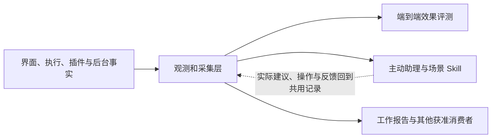

# 观测和采集层需求书

状态：需求已整理（2026-10-27）；2026-11-04 第 21 批完成事实来源盘点、设计稿、评测案例与界面四块定样（[盘点](inventory-2026-11.md)、[设计](design.md)、[评测案例](eval-cases.md)，定样见 §9）；2026-11-05 用户定 D1（证据快照归采集层），合同归第 28 批第一片。**2026-11-14：第 28 批已随 #2059（`4417d2bcd3`）与复核 #2073 合入写入面，第 29 批完成 §2.4～§3 的历史查询、用途与跨项目边界、保留与清理、空间占用及「设置 › 工作记录」四个页签与两个组件板标本**（见 [contract-design.md](contract-design.md) §16～17 与[第 29 批记录](../post-anticorruption-roadmap/reference/batches/29.md)）；**2026-11-15：第 30 批接入评测样本留存、独立预期判定、隔离回放与隔离 Home 可复现评测命令**（合同与设计见 [evaluation-path-design.md](evaluation-path-design.md)），实物与连续工作走查见 [BL-work-records-acceptance](../backlog/BL-work-records-acceptance.md)。功能目标完成程度为**内部完整**：在产品支持且获准的范围内，连续记录用户行为、工作过程、结果与当时条件，并经公开动作供页面、主动助理、评测及其他平台消费者按权限读取与管理。

需求维护：Codex；实施沿用[后续演进计划](../post-anticorruption-roadmap/spec.md)的 C 轨。第 28 批已接入写入面，第 29 批已接入历史查询、记录管理与设置界面；第 30 批已接入评测样本留存、独立判定与隔离回放（`observation.db` v2、`observation.holds.*@1`、`horizontal/evaluation`）。各入口与插件的接入仍由原负责人落实。

## 1 目标与职责

用户于 2026-10-27 提出：平台需要一层横向能力，记录所有用户行为、过程信息和结果，为后续评测及助理的主动式、启发式建议提供支持，命名为“观测和采集层”。本需求承接原[主动助理需求](../proactive-assistant/spec.md) §3.4 的完整工作记录、§15 的采集维护要求及相关验收。

这一层回答“当时有哪些条件，实际发生了什么，结果怎样，哪些信息还不知道”。例如，用户打开资料、改写文稿，助理据此提出建议，用户查看定位后的原文再修改采用：采集层保留这些实际环节与版本；评测判断建议是否正确、有价值；主动助理结合事实、用户配置和 Skill 决定下一步。未使用助理的手动工作也能留下相同标准的记录。

| 能力 | 负责什么 | 产出及边界 |
| --- | --- | --- |
| 观测和采集层 | 授权范围内的事实采集、工作关联、历史证据可用性、覆盖与缺口、通用查询 | 完整工作记录和可观察的变化；不自行给工作评分、推定用户意图或启动业务操作 |
| 端到端评测 | 选择样本、确定预期与判定方法、隔离重评、比较版本、解释效果 | 有方法、版本与来源的评价；共用原始证据，判定不能改写事实；现有要求仍由主动助理需求 §14 维护 |
| 主动助理 | 依照 Skill 与用户配置理解工作、启发式发现机会、选择时机、准备或执行、交付与跟进 | 可纠正的理解、建议与获准的工作结果；使用共用记录，不在助理内部另建通用采集链 |

“横向”表示全平台共用的产品能力，具体包位置尚未决定。业务内容、正式状态和对象身份仍由原插件或服务拥有；采集层只管理自身的观察记录、关联和历史证据可用性，不接管业务表，不建立另一份可编辑业务事实。新接入经公开合同复用既有能力，同一事实不因评测与助理分别使用而重复采集。

本次不指定表结构、协议字段、存储引擎、独立进程或新的搜索索引。集中遥测服务、跨设备采集、团队分析后台、模型训练和默认观察整台电脑不在范围内。当前已有日志、动作记录和版本能力是后续设计的复用候选；尚未按本需求完成覆盖审计，不能视为已经满足完整采集。

## 2 记录哪些事实

### 2.1 连续覆盖工作全过程

信息采集是平台级能力，覆盖用户手动工作、主动与被动助理、插件内 AI、工作流、定时与后台任务，以及 Web、桌面、CLI、MCP 等实际支持的入口。不能只为主动助理挑选少量埋点，也不能把未经过助理的工作排除在 Molis Work 的整体效果评测之外。

采集完整性由平台保障，不依赖某份 Skill 是否运行或主动要求记录。Skill 通过系统数据工具按任务需要读取记录、内容和关联，决定本次工作如何使用它们；停用场景 Skill 不应使其他已获准工作的审计与效果记录失去完整性。实际采集和使用仍遵循各自有效范围。

完整性以能还原一项工作当时的条件、过程与真实结果为标准。已纳入范围的工作应保留完整的关键阶段与语义信息，既包含成功，也包含失败、拒绝、取消、等待、没有行动和没有被采纳。不能只留成功样本、最终摘要或调用次数，再用它们反推整段工作。

首次接入项目、插件或资料来源时，既要了解当前范围内已有的内容、状态、关系和可用版本，也要覆盖之后发生的变化。用户能看见现有资料掌握到什么程度、完整记录从何时开始、哪些历史无法取得。首次读取、重新连接后的补读和批量导入不能被当成用户刚刚创建或编辑了全部内容；记录中断后补回的历史变化应与本次新变化区分。完整采集与每次给模型使用哪些材料分别管理，不能为了接入全量记录让每次判断都读取全部历史。

用户主动导入资料是本期真实操作，应正常记录；原内容形成时间、导入时间以及之后实际发生的修改分别表达。报告可以说明本期引入了哪些资料，但不能因此将资料中已有的历史成果全部算作本期新完成。

### 2.2 信息范围

| 信息范围 | 必须能够回答的问题 |
| --- | --- |
| 用户意图与约定 | 原始请求、后续补充、选中对象与材料、目标和限制是什么；哪些是明确要求，哪些只是系统推断；何时改过 |
| 使用行为与交互 | 用户打开、停留、选择、编辑、保存、比较、采用、拒绝、暂缓、撤销和接管了什么；哪些内容实际进入可见区域，呈现了哪些候选、顺序和默认项；哪些只是准备展示 |
| 插件内容与业务变化 | 工作开始时相关内容和状态是什么；谁改变了什么；引用了哪个版本；变更前后与最终有效状态是什么；跨插件对象如何关联 |
| 检索、上下文与记忆 | 查找范围和查询是什么，返回了哪些材料，哪些进入实际工作上下文；读取是否完整，是否截断、压缩、缺失或过期；用了哪些记忆及其当时版本 |
| 主动判断与 Skill | 因何判断，考虑了哪些可行方向，选用或放弃什么，何时保持安静；实际生效的 Skill 正文、版本、组合、用户覆盖和简明判断依据是什么 |
| 计划与执行 | 一项工作经过哪些步骤、角色与委托；模型实际接收的消息和可获得的输出、工具参数与结果是什么；授权、调用、业务生效各处是什么状态 |
| 中断与恢复 | 何时暂停、取消、失败、超时、重试或恢复；哪些已生效，哪些被拒绝，哪些结果未知；是否重复产生效果 |
| 交付与后续结果 | 向用户交付的确切版本是什么，能否打开和使用；用户采用、修改、丢弃还是另做；后续是否返工、撤销，业务结果是否持续有效 |
| 条件、体验与成本 | 平台、插件、模型和相关配置是什么版本；连接和能力是否可用；等待、执行、呈现耗时及用量是什么；发生了哪些错误与降级 |
| 评测与人工判断 | 样本来自哪里，预期结果、判定规则与版本是什么；谁或什么评测器作出何种判断，依据何在；后续纠正有没有保留 |

### 2.3 工作关联、交互与事实来源

工作记录应能从用户的一次操作或意图，一路关联到助理判断、Skill、执行步骤、工具调用、业务变化、页面呈现、用户反馈和最终结果。多轮、多角色、跨插件、跨入口和跨日接续仍属于同一工作脉络；一次重试与一个新的工作不能混同。真实发生时间、系统收到时间以及延迟到达的顺序需要可辨认。

Skill 的发现、被选用、有效正文进入本次工作上下文，以及对应工具取数、处理与交付过程应可核对。登记或加载了 Skill 不等于实际遵循了做法；效果评测应结合行为与结果判断，不能仅凭日志出现 Skill 名称就宣称由它驱动。

成功的检索和读取同样需要可追溯，不能只记录写入与错误；没有改变业务状态的判断、候选展示和正确不行动也属于工作过程。进入可见区域、停留和用户明确表示已读保持区别，系统不能声称知道用户是否真正理解了内容。

建议与内容联动也属于完整工作链：需要区分卡片实际呈现、选中查看、发起定位、目标加载、目标进入可见区域、精确位置高亮、退化为对象级查看、失败、返回，以及后续明确提交操作。发出了打开请求不能算定位成功，点击卡片不能算采用建议；这些阶段要能关联同一建议、内容版本和该次交互。

同一事实可以供多个用途读取，但要保留其权威来源：界面行为证明用户做过什么、哪些内容实际呈现；平台执行记录证明请求与执行状态；插件事实证明业务结果；助理与评测器提供判断。点击“完成”、工具返回成功、模型说已完成均不能独自证明业务完成。审计结论和报告中的总结不能覆盖原始依据。

### 2.4 当时的内容与版本

为了后续效果评测，必要内容须能按当时的版本取回，包括用户已提交的请求、实际使用的材料、有效 Skill 与提示内容、可获得的模型输出、工具输入输出、交付物及相关变更。只留当前对象链接、长度、哈希或摘要不足以判断历史质量；历史证据不应因正文改写而悄悄变成新内容。保留历史证据也不产生第二份可编辑的业务事实。

图片、文件、音频等实际参与工作的内容适用同样的版本和完整性要求，不把“文本转述存在”等同于原材料可用。浏览器、桌面等能力实际提供给助理的观察和操作结果，在获准范围内也应能与该次工作关联；未获得的观察不能补造。

### 2.5 采集与使用边界

“完整”适用于产品范围内可观察、获准记录的工作信息。凭据只记引用；不要求或伪造模型未提供的内部思考。未发送输入、外部应用与未接入服务的活动遵循明确范围，不把完整采集解释为默认记录整台电脑。用于本机功能的记录不因此自动允许上传到集中评测或共享数据集；评测使用范围、脱敏、导出与删除要求应可设置、可核对。

真实用户工作、演示、Skill 试用、评测回放和系统检查必须能区分。它们都可以有必要记录，但不能默认混入用户成果、日周报、习惯推断或真实效果指标。用户明确将试用候选采用为真实工作时，从实际采用和生效处建立关联，不把试用期间的模拟结果补记成已发生业务。

### 2.6 覆盖、保留与性能

新插件、新入口、新动作和新交互需要纳入同一完整性约定。平台能够按入口、插件、工作阶段和版本查看覆盖情况，标明未接入、暂不可用、丢失、截断、脱敏、到期清除与明确不适用；不能把缺记录解释为没有行为。关键工作链路与结果不得靠随机抽样保留；高频细节如采用汇总或抽样，须声明粒度、比例及因此无法回答的问题，不能称为逐次完整记录。

查询与呈现可以折叠重复记录，但在声明的完整保留周期内应能还原各次关键操作、不同结果及先后关系。采集异常、资源不足与保留策略造成的信息缺口应可见，不能无声丢失后继续宣称审计或评测完整。采集和评测不能明显拖慢用户工作，也不能以记录失败掩盖已经发生的业务效果。

2026-10-27 用户确定：工作记录默认在本地长期保留，不因经过固定天数自动删除；用户可在设置中选择自动清理期限或手动清理。设置清理期限或选择手动清理范围时，说明对历史回溯、报告依据与评测的实际影响；短于已启用报告周期、跨周期比较或评测所需范围时，指出可能失去的依据，不用静默延长保留期代替用户选择。配置保存与重启后保持一致，清理只作用于用户选定的记录范围。

原业务内容与已保存简报按各自主人的保留、删除规则处理，不因清理工作记录而连带删除。清理后无法取得的历史依据应明确显示缺口，不能用当前内容冒充，也不能通过旧观察副本重新纳入后续使用。长期保留不扩大采集或使用授权。

2026-10-27 用户确定容量规则：默认不设固定配额，设置中显示工作记录的实际占用，并允许用户设置、修改容量提醒线。接近或达到提醒线时提示占用与清理入口；提醒线不是存储上限，不因达到提醒线自动删除记录。用户已设置的到期清理规则照常执行，两者分别呈现。占用随新增和清理更新，提醒线保存、重进与重启后保持一致；真实磁盘不足或写入失败仍按上述采集缺口规则呈现，不能把未保存误报为已记录。

记录的有效保留周期、范围、可用体积与清除影响应清楚可查。经批准保留的评测样本应有明确用途与生命周期，不能依赖短期诊断日志是否尚未滚动删除。用户纠正或删除信息后，后续助理理解、报告与评测使用遵循对应设置，并如实标明历史证据的变化与可用性。

## 3 向其他能力提供什么

采集入口接收实际支持的界面、执行系统、插件及后台工作的事实，并保留事实主人、时间、对象与版本及已知关联。调用者、项目与安装身份来自可信上下文，不能接受输入里自称的身份。关联既有对象与执行身份；无法确认属于哪项工作时保留未关联状态，不能凭相似名称合并。助理后来作出的关联推断与用户纠正有自己的来源，不覆盖原始操作。

消费者经公共能力按获准空间、项目、对象、工作、时间范围和版本读取，不直接查其他包的私有库。应支持以下输出，具体接口在阶段 1 结合既有能力确定：

- 按需读取当前可观察状态、阶段变化和连续工作过程；能从结果回到相关意图、材料、执行与交互，也能从操作追到已知结果。
- 取回当时实际使用的内容与版本，并区分未取得、被截断、已脱敏、到期清除或无权访问。已有权威版本可满足需求时复用它，不另存一套内容库；原系统不能保留必要历史时，在合同设计中明确由谁保留以及删除怎样生效。
- 提供获准范围内的变化通知或增量查询，供助理判断时机、报告更新和评测读取。消费者从已处理位置恢复时，能辨认重复与迟到记录；变化信号不是执行授权。
- 查询记录覆盖、来源状态、资料截止时间、缺口及保留影响。无活动、未接入、未获准和暂时取不到是不同结果，不能一律返回空列表让消费者猜测。

采集、读取、用于主动理解、用于评测、导出或上传的范围分别表达。同一记录对一个用途可用，不自动授权其他用途。跨项目查询只聚合调用者当前有权且允许相应用途的记录；不扩大现有系统搜索或插件权限。停用主动助理、场景 Skill 或评测任务，不停掉仍在有效采集范围内的平台记录；停用采集后，消费者须看到记录截至何时。

执行安全规则高于记录完整性的愿望。处理器开始前就被拒绝的动作，只沿用平台规定的最小“未执行”诊断：谁、什么动作、结果与错误码，不保留输入、返回或动作给出的错误内容。取消、撤权或停用后，不借采集之名新增被禁止的业务记录；只能使用既有规则允许的诊断及此前已合法形成、当前仍可使用的证据。完整性说明需要区分“按边界不记录”与“本应记录却缺失”。本需求不增加日志或失败记账的豁免。

评测器的评分、规则和人工修正可作为带来源的下游结果关联到原工作，但其业务事实仍归评测能力；没有评测运行时，采集照常完整。助理的理解与建议同样属于其产出，不冒充采集层已核实的事实。每次提供给模型的只是本次任务需要且获准的内容；全量留存不等于把全量历史塞进上下文。

## 4 随产品维护

统一采集需要伴随产品长期维护。每项已支持能力都应有明确的记录范围、事实负责人、关键阶段、内容与版本约定、使用边界、完整性状态，以及对应验证。新增插件或功能不能等上线后出现评测缺口，再临时决定当初应该记录什么。

新增或调整入口、交互、Skill 生效方式、模型与上下文、动作、后台任务、业务状态或成果交付时，都要同时判断对采集和既有消费者的影响。改变记录含义、删去记录、降低粒度或缩短保留周期是可见的合同变化，不能伪装成无影响的日志整理。

迭代应同步更新记录约定、对应验证，以及受影响的审计、助理、报告和评测口径。历史记录继续标明当时的产品和语义版本；无法比较的范围要明确。合同变更和历史数据处理遵循仓库现行规则，本需求不额外引入一套读取兼容机制。

开发手册需将以上要求作为功能开发与交付的组成部分，给出设计、实现、验证、升级与故障修复时的检查要求。当前未接入的能力与未来接入要求分别标明；文档写了“完整”不代表系统已完整采集。实现时应同步的开发入口见 [开发手册](../../docs/system/DEVELOPMENT-REQUIREMENTS.md)。

## 5 与评测、主动助理的依赖和实施顺序

实线表示事实供给，虚线表示助理工作发生后成为新的记录，不能据此把助理建设当成采集层的前置。评测与主动助理分别依赖采集层，两者没有互为前置的建设依赖：助理不必等待完整评分系统才能实现，评测手动工作也不必等待主动助理出现；要证明主动建议的真实效果，则需要助理实际运行、呈现和用户反馈的证据。

评测标准、代表性案例和助理 Skill／交互设计可以并行准备；这些设计完成不等于真实效果通过。现有单元测试、Coding 专项评测和其他已具备证据的验证继续进行，不因建设这一层而暂停。平台完整端到端结论与依赖历史的主动判断，必须具备所声明路径的真实采集覆盖。

| 阶段 | 交付与依赖 | 完成边界 |
| --- | --- | --- |
| 防腐收尾后阶段 1·C | 盘点当前实际支持的入口、插件、记录与版本能力，明确事实主人、采集范围、公共查询、权限与保留合同；设计给一骏审阅。评测方法与样本设计可同时准备 | 需求和方案，不写采集实现；没有审计依据的能力不能标为已覆盖 |
| 阶段 2·C | 按合同接通第一版：手动界面工作、插件内 AI、助理与 Coding、动作、工作流、定时及后台任务，并覆盖平台实际支持的 Web、桌面、CLI、MCP 入口；让评测和其他消费者实际读取同一工作证据 | 真实路径证明采集、历史读取、缺口、撤权与恢复；若分批接入须逐项公开覆盖，不能将局部称为内部完整 |
| 阶段 3·A／3·C | A 轨让主动助理依照 Skill 消费记录并产生建议；C 轨扩展端到端评测，使用真实建议、呈现、采用、纠正与后续结果；报告与统计复用数据 | 采集通过、评测可用、主动建议有价值分别验收；整体完成按各自需求，不用数据接通代替效果验证 |

排期唯一维护处为[后续演进计划](../post-anticorruption-roadmap/spec.md)及其 reference 中的需求来源、依赖与阶段验收；本文说明依赖与交付边界。范围调整先更新本需求，再同步受影响的消费者；不以采集层统一建设为由重新实现其既有业务能力。

## 6 验收标准与验证

以下标准定义内部完整门槛。第 28 批已接入写入面，并按本表编号写了工程级用例（逐条结论见[批次文件「本次复核整改」](../post-anticorruption-roadmap/reference/batches/28.md#batch-28-audit-2026-11-14)）；读取与保留由第 29 批接入，评测样本留存、独立判定与隔离回放由第 30 批接入；OCL-18 是人工核对。自动化测试必须使用实际接入路径并在测试名或注释中引用对应编号；有真实语义和体验判断的部分以真实工作人工核对。模拟、文档检查与日志字段存在不能代替关键行为、持久化结果和后续可观察结果。

| 编号 | 通过条件 |
| --- | --- |
| OCL-01 | 覆盖手动工作、主动与被动助理、插件 AI、动作、工作流、定时与后台任务及实际支持的入口；同一事实可供多个消费者使用，停用 Skill、主动助理或评测不使仍获准的采集失效 |
| OCL-02 | 首次接入能区分当前内容、历史可得范围与之后变化；断线补读、批量导入及历史形成时间不被误算为本期新创建或完成，真实导入操作及之后修改仍正常记录 |
| OCL-03 | 可从意图、材料、Skill、执行、业务变化、呈现到后续反馈追踪正确工作；多轮、跨日、并行、重试、重复到达、迟到、取消与恢复可区分，未知关联不擅自归并 |
| OCL-04 | 界面行为、执行状态、插件业务事实、助理推断与评测判断保留来源；点击完成、请求成功或模型自述不能单独成为业务完成证据，审计和总结不改写原始事实 |
| OCL-05 | 在获准的完整保留周期内可取回当时请求、实际材料、有效配置及 Skill、可获得的模型与工具输入输出、交付物和业务状态证据；当前正文改变不替换历史依据，文件、图片及音频同样适用 |
| OCL-06 | 成功读取、检索候选与实际采用材料可区分，截断、压缩、缺失和过期可见；能核对 Skill 发现、选用、有效正文进入上下文及其后续行为，加载名称不被视为遵循证据 |
| OCL-07 | 交互记录区分实际呈现、选中、定位请求、加载、目标可见、精确高亮、退化、失败、返回与提交操作，并关联正确对象、版本及该次交互；点击不自动算采用或已读 |
| OCL-08 | 成功、失败、拒绝、取消、等待、不行动、无响应、接管和未知结果均能如实表达；采用后的修改、撤销、返工可接续；无曝光或尚未到观察截止时间不被补成负面反馈 |
| OCL-09 | 可按入口、插件、工作阶段和版本查看采集覆盖、截止时间及缺口；未接入、不可用、丢失、截断、脱敏、到期清除和明确不适用可区分，缺记录不被当成无行为 |
| OCL-10 | 关键工作阶段与结果不随机抽样；高频细节汇总或抽样说明粒度、比例与限制，展示折叠不丢失完整保留周期内各次关键操作、先后和不同结果，不重复计算成果 |
| OCL-11 | 采集、主动使用、评测、导出与上传权限分别生效；跨项目不越权，停用某项用途或撤销相应权限后，相关消费者不能借旧副本继续使用；凭据只留引用，不采集未获准草稿或伪造隐藏思考；提前拒绝与取消后的记录遵守第 3 节安全边界 |
| OCL-12 | 回看窗口、记录保留与样本生命周期分别可查；默认本地长期保留，用户自选期限或手动清理时说明对报告、比较和评测依据的影响，不静默延长保留期，不连带删除原业务／已存简报；默认无固定配额、占用可见、提醒线可持久化且不触发自动删记录，到期清理独立生效，历史不可得时如实标缺口 |
| OCL-13 | 真实工作、演示、Skill 试用、回放和系统检查不混入同一成果或效果口径；模拟候选转为真实采用时，仅从实际采用与生效处关联真实结果 |
| OCL-14 | 评测和主动助理能经公共能力按自身权限读取同一组事实、历史版本、变化与覆盖状态；增量恢复可辨认重复和迟到，不重复采集、越权读取或把变化信号变为自动执行授权 |
| OCL-15 | 在约定代表性工作量下测量采集、查询对交互、执行耗时及存储的影响；超出明确预算或发生采集故障时状态与缺口可查，恢复不重复或错配，已发生的业务效果不因采集失败被隐瞒 |
| OCL-16 | 新增或修改能力时同步维护记录范围、事实负责人、关键阶段、内容和语义版本、使用边界、消费者影响与验证；开发手册能指导接入、升级与故障修复，未接入部分如实登记 |
| OCL-17 | 评测方法、规则、版本、样本来源、判定和后续人工纠正能关联到原始证据；无评测仍能记录工作，重评不覆盖当时事实，评分与采集分别归属 |
| OCL-18 | [人工] 以代表性连续真实工作逐步核对原始操作、内容、执行与结果，含纯手动工作、AI 协助、失败恢复及跨日接续；事实链能支持复查和建议依据，同时交互仍顺畅，不能以记录条数或采集接口返回成功代替完成 |

（2026-10-27 文档整理时）本次文档交付检查链接、spec 索引、归属、迁移对应与差异完整性；`node scripts/check-spec-coverage.mjs` 仅报告编号及测试引用，当时未覆盖的编号是当时尚未实现的事实。后续实现按实际修改的包补齐定向回归、合同与权限拒绝检查、故障恢复、代表性负载，以及隔离 Home 的真实路径；第 28 批已补写入面与对应用例，读取、保留与评测部分见批次文件矩阵。

2026-10-27 文档核对：链接、spec 索引、待办格式、包归属与差异格式检查通过；迁移前后的采集正文及维护要求逐条核对保留，评测 §14.1～14.3 正文未改。编号报告无本次新增重号或串用；17 项自动验收尚无测试引用，1 项人工验收未进行。仅修改 Markdown，未运行构建、功能测试或真实 Home 验收。

## 7 原需求迁移对应

主动助理需求保留原章节入口与已迁出编号的位置，原编号不复用。这里整合共用采集要求，原有产品覆盖不减少。

| 原位置 | 本文承接 | 原需求继续负责 |
| --- | --- | --- |
| §3.4；`PWA-31`、`PWA-34` | §2～3，OCL-01～03、OCL-10、OCL-14 | 助理按授权范围使用记录并纠正工作理解 |
| `PWA-32`、`PWA-33` | OCL-04～06 | 助理输出引用正确依据与版本 |
| `PWA-35`；`PWA-36` 的采集使用边界 | OCL-09～13 | 助理的关注窗口、主动使用范围与缺数据处理 |
| §15 的平台采集维护；`PWA-57` | §4，OCL-16 | 场景 Skill 与助理集成的维护和验证 |
| `PWA-58` 的采集、查询与存储部分 | OCL-15 | `PWA-58` 保留报告消费与生成性能要求 |
| `PWA-73`、`PWA-89` 的通用记录部分 | OCL-06～07、OCL-11、OCL-14 | 原两项保留助理界面与 Skill 的真实集成验收 |
| §14 的评测证据供给要求 | §2～3，OCL-05、OCL-08、OCL-17 | §14 与 `PWA-51`～`PWA-56` 继续定义评测方法、样本、隔离回放和效果口径；未迁成采集层职责 |

## 8 待细化的产品参数

后续设计需要据实际支持能力列出完整接入清单，并确定默认采集范围与告知方式、历史内容和多媒体的实际存储方式、删除和样本留存规则、查询及变化可用的时效、代表性负载与可接受开销。记录的默认长期保留、用户自选清理期限和容量提醒规则已定（§2.6），不再列为待决定；实现须落实这些选择。具体数字应由真实工作与资源测量支持，不能凭空设置阈值或用未定参数缩减已确认覆盖。

主动助理的回看范围、报告周期与生成时间已定为 Onboarding 和设置共用的用户配置；建议质量与打扰程度仍由其需求维护；评测的评分标准、抽样和对照方法由评测能力维护。采集关键过程不随机丢弃，与评测从完整记录中选择代表性样本是两件事。

现行事实归属见 [SSOT](../../docs/SSOT-MATRIX.md)，层与包边界见[系统架构](../../docs/system/ARCHITECTURE.md)和[包边界](../../docs/system/PACKAGE-BOUNDARIES.md)。合同与历史处理遵循[合同变更规则](../../docs/system/CONTRACT-CHANGES.md)；本次不增加读取兼容机制，也不授权真实 Home 迁移或外部数据上传。

## 9 决策记录

| 日期 | 决定 | 依据与没选的 |
| --- | --- | --- |
| 2026-11-04 | **范围告知用「分类清单」**（用户定，定样 [`docs/design/work-records/`](../../docs/design/archive/work-records/README.md) 记了什么·方案 A）。全局设置「工作记录」一节顶上是记录状态（记录中／首次接入在读现有资料／已暂停，含「完整记录从何时开始、早期历史能取到哪里」与暂停入口）；下面五类记录（你的操作、AI 做的事、内容的变化、工作流与后台任务、呈现与反馈）各一行、颜色固定，点开看「记／不记」；再下面是「可以用在哪里」的开关（本机回看始终可用，主动助理、效果评测、导出分别开关，上传这一版没有）；末尾一句「只存在这台 Mac 上」。 | 最短、最好扫。没选 B「用一件最近的真实工作举例」（新用户没有例子可举）、C「底栏常驻标记加首次告知卡」（底栏再多一个常驻东西） |
| 2026-11-04 | **保留与清理用「期限加手动清理」**（用户定，方案 A）。「自动清理」一个下拉：一直保留（默认）、一年、半年、90 天、30 天、不自动清理我自己清；选了期限就逐条列周报、跨两个月比较、评测样本原始记录各要多长、保得住还是会失去，短于所需时提示并给「仍然用」「改回一直保留」，不悄悄延长。「手动清理」打开对话框，按时间（早于／某一段）、项目、记录种类选，先给大小与条数，再列清掉以后会怎样（含原文、Pages 版本、已存简报都还在，评测样本按自己的期限留着）。评测样本单独一块，写明自己的期限。异常状态：清理中（别的功能照常）、一处没清成只重试这一项、清理后提示「到期清除」并能跳到缺口。 | 用组件板已有控件就能做。没选 B 时间轴（影响一眼看到，但要新做时间轴控件） |
| 2026-11-04 | **占用用「数字加分类条」**（用户定，方案 A）。大数字、按记录种类分色的条与图例；「容量提醒」默认不设，设了以后显示「到 N GB 时提醒我」与一条带提醒线的度量条，写明「提醒线不是上限：到了只提醒，不会删记录」；到期清理单独一行。异常状态：接近提醒线、超过提醒线（照常记录，不自动删）、磁盘不足有记录没保存（已发生的操作照常生效，跳到缺口与清理）、正在计算（显示上次的值）。 | 没选 B 增长趋势（估计到线日期可能不准）、C 存储总览一行（工作记录细节藏得深） |
| 2026-11-04 | **覆盖与缺口用「先列缺口」**（用户定，方案 B）。顶上一句总况（几处需要注意、完整记录从何时开始、几处还没接入）；可按入口、插件、后台筛，也可按版本；「需要注意」逐条写来源与记录种类、状态、时间段、原因，点开看影响与处理（看占用、重新连接）；「还没接入」单独一段；完整与不适用折叠，不适用写明「本来就没有这类事，不算缺记录」。九种状态：完整、未接入、暂不可用、丢失、截断、已脱敏、到期清除、不适用、按规则不记（第 28 批清除插件数据后补 `purged`，现为十种，见合同）。 | 先看到要管的事。没选 A 覆盖表（格子多、窄屏要横滚）、C 时间线（看不出是哪类记录） |
| 2026-11-04 | **按组件板实件重做，用户确认**。四个已定方案的原型改用组件板现行样式与控件（`mw.css` 是设置页样式加组件板页内样式的生成快照，图标与状态环取 `renderIconSprite()`、`renderStateRing()`），页面外壳照真实全局设置页；版式和上面四行的取舍不变，只画定下的方案。组件板新增两项：「分类条」与「种类色标记」（颜色取 DESIGN.md 的五种 `--mark-*` 色），由 D 轨先补标本。 | 用户 11-04 定的定样规则：所有已选定、有界面的原型都按组件板实件重做（[开发流程 §5](../post-anticorruption-roadmap/reference/development-workflow.md)）。没选的方案留在提交 `a63034326` |
| 2026-11-05 | **主人留不住历史的内容由采集层存证据快照**（用户定，设计 §9 D1 方案 A）。Pages 正文、默认提示词与 Skill 正文、检索当时的结果、模型实际收到的消息、界面上呈现的候选，这些主人不留历史版本的内容，由工作记录存一份只读快照，相同内容只存一份；快照跟着记录的保留期和手动清理一起删，计入「占用」，也受「可以用在哪里」各用途开关约束。主人已经有固定版本的，记录里只放引用。 | 一处保留、一处删除，主人不用各改一遍；能满足 OCL-05「取回当时材料」。没选 B「各主人补版本历史」（Pages、提示词、搜索、模型运行四处各改，清理也要四处各做）、C「只留摘要与指纹」（复查不到原文，不满足 OCL-05）。代价：用户内容在本机多存一份，已计入占用与清理 |
| 2026-11-19 / 11-20 | **第 63 批 Piece 0 埋点补齐、SIM 实验记忆账本与端侧 RSI 边界（用户拍板，[决定 58](../post-anticorruption-roadmap/reference/decisions.md#decision-58) ②，尚未实施）**：① [第 63 批](../post-anticorruption-roadmap/reference/batches/63.md)先做 Piece 0 硬前置（消费 [62](../post-anticorruption-roadmap/reference/batches/62.md) 窗口 B 上游 `ModelRequestObserved`）——补接 `prologue-run-observation.ts` 当前丢弃的 7 类上游事件（`model-response-repair`、`endedOnPromise`、`memory-context`、`memory-recalled.retrieval.{attempts,cost}`、`steer-*`、`compaction-started`、`run-recovered`），补 `agent.model` 的 `ttft_ms`／`duration_ms`／`prompt_prefix_hash`／`prompt_includes_cache`，打通 `agent.tool`↔`action.call` 双向关联（`run_id` + `tool_call_id` + 可读 `capability_id@version`）并补守 `S-18` 的结构化机器失败分类码 `failure_class`，补全助理 `agent.skill` 阶段并修复 `assistant-round-materials.ts` 16 条材料截断，统一生产与评测漏斗词表并把撤销／返工关联到 `run_id` 与 `conditions.prompts`；② `horizontal/evaluation` 补批量 Trace Bundle 接口（关闭 `BL-evaluation-read-cost`）、Trace 派生工具 Mock 隔离回放、校准混合 LLM 裁判、`tuning`／`validation`／`holdout_ood` 三层 RRSI 门禁，并在 `evaluation.db` 新增 `improvement_experiments`（**SIM 自改进记忆账本**）表；③ 端侧本地 RSI 复用现有 `use: "evaluation"` 用途开关，严守 `S-74` 跨项目授权边界与 `upload: false`（本地不上传）。 | 先把埋点盲区和口径分裂堵上，后续 63A／64／67／68／75／76／83／86／89 才有可对账的 RSI 信号与实验记忆。否掉了：跳过埋点补齐直接扩评测、新增独立端侧 RSI 开关（避免增加用户隐私开关心智负担）、或仅在研发侧保留 RSI 而不在本地复用。 |

四块都挂在全局设置「个人」组「记忆」之后的新分区「工作记录」，四个页签。原型已经用组件板的 `mw-*` 实件画（设置行、条目、开关、下拉、数字框、度量条、数字卡片、提示条、对话框、分段、折叠、状态标记），产品代码照它的构件写。组件板上还没有、要由 D 轨先补标本的两项（原型里标「组件板新增」，按 2026-11-04 的定样规则，见[开发流程 §5](../post-anticorruption-roadmap/reference/development-workflow.md)）：占用里按记录种类分段的「分类条」（Meter 与 Progress 只显示一个数）；记录种类的「种类色标记」（组件板的 Mark 是中性色，五类记录要一眼分开，界面通用规则 11-03）。对照表见[原型 README](../../docs/design/archive/work-records/README.md#对照组件板)。

## 10 第 29 批开工前检查（历史查询与记录管理）

按[需求开发流程第 4 节](../post-anticorruption-roadmap/reference/development-workflow.md#4-开工前检查)（含第 4.1 节平台能力检查与第 15 项五个全局场景）及[平台能力核对报告](../../docs/reviews/platform-capability-audit-2026-11-14.md)逐项回答：

| # | 项 | 回答 |
| --- | --- | --- |
| 1 | 事实主人 | 观测采集层（`horizontal/observation`）只拥有观察记录、证据快照、覆盖登记、记录开关、用途开关、保留期限与容量提醒线。业务对象与版本归各插件／平台主人；读取时如需核对对象与版本是否仍可解析，经宿主回调查询原主人，不在采集层复制业务事实。 |
| 2 | 插件同等待遇 | 读取动作对插件、Agent、工作流、MCP 与本人走同一组动作合同与权限检查；插件记录按同一套五类归属、同一套保留与清理规则处理，不为特定内置插件开私路。 |
| 3 | 能力注册 | 新增 8 个系统动作（`system.observation`）：`observation.records.query@1`、`observation.evidence.get@1`、`observation.coverage.get@1`（只读查询，按受众与用途检查）以及 `observation.settings.get@1`、`observation.settings.set@1`、`observation.space.get@1`、`observation.cleanup.preview@1`、`observation.cleanup.apply@1`（管理面，仅 `user` 非委托会话）。全部同步读写本地 SQLite，不等模型、不声明 `concurrent`。 |
| 4 | 合同 | 在 `@molis-ai/molis-work-contracts/services/observation` 扩展读取与管理动作及类型，成熟度从 `"partial"` 升为 `"implemented"`；更新 API 快照（`tooling/gates/api/contracts/services/observation.txt`）与 `tooling/gates/actions/host-actions.tsv`。既有 `observation.report@1` 无破坏性变更，不加历史兼容分支。 |
| 5 | 放在哪个包 | 服务逻辑全部落在 `horizontal/observation`；组件板两个新标本（`分类条`、`种类色标记`）落在 `packages/design-system/src/primitives/work-records.ts`（导出子路径 `@molis-ai/molis-work-design-system/work-records`）与 `catalog-work-records.ts`；宿主只做动作装配（`apps/local-host/src/observation-host.ts`）与 `/api/observation/*` 经 `bindLocalWebActions` 的薄路由转发（`observation-http.ts`）；全局设置界面落在 `apps/workbench/src/browser/work-records/`。 |
| 6 | 表与存储 | 复用 `<Home>/observation/observation.db` 第 1 版基线的 `records`、`evidence_blobs`、`record_evidence`、`coverage`、`coverage_gaps`、`writer_state`，无需新增表或升库版本；暂停状态、用途开关、自动清理期限、容量提醒线与上次清理摘要存于 `writer_state`（表主人仍为 `horizontal/observation`）。 |
| 7 | 兼容与迁移 | 不加。读取时只认现行取值；清理过的时间段在 `coverage_gaps` 记 `expired`，不从旧副本回填。 |
| 8 | 安全边界 | 扩展 `docs/system/security-invariants/S-observation-records.md`（8～10）与 `docs/system/SECURITY-INVARIANTS.md`：① 跨项目读取遵循 S-74，仅本人非委托会话且经宿主现算的未关闭可读项目集合可跨项目查询或使用 `lookback`，`agent`／`mcp`／`workflow`／`plugin` 或委托会话请求 `all_projects`、非当前项目或 `lookback` 一律拒 `forbidden`；② 用途开关关闭后，对应 `use`（含非本人默认的 `assistant`、`evaluation`、`export`、`upload`）调 `records.query`、`evidence.get`、`coverage.get` 立即拒 `use_disabled`，不能借已拿到的 `record_id` 或 `digest` 读旧快照；③ 管理动作（`settings.*`、`space.get`、`cleanup.*`）仅本人非委托会话可调，其他受众或委托会话拒 `forbidden`。每条均配拒绝测试（`tests/security-invariants-observation-records.test.ts`）。 |
| 9 | 调用次数 | 读取按 `after_seq` 游标与 `limit` 有界分页；全局设置「工作记录」首次进入时并发 3 个只读请求（`settings`、`space`、`coverage`），切四个页签纯本地切换零额外请求，改设置时 1 次写请求、随后刷新占用与覆盖（2 个只读）；点清理时 1 次预览或执行请求，执行成功后刷新（3 个只读），后台不轮询；`bindLocalWebActions` 单请求只解析一次上下文（`tests/call-budget.test.ts`）。 |
| 10 | 升级与数据 | 第 29 批时观测库保持版本 1（第 30 批已升到 2，见 §11）；管理设置存于 `writer_state`，重启后保持；升级说明页（`platform-upgrade-stores.ts`）对 `observation` 库升级失败改为局部阻断 `/settings/work-records`，不阻断工作台与项目其余功能。 |
| 11 | 成果与过程项 | 工作记录与证据快照不进成果库，也不是过程项；手动或自动清理工作记录不删除成果库版本、Pages 历史版本、已存简报或已留存评测样本。 |
| 12 | 页面、外壳与文字 | 全局设置「个人」组在「记忆」后挂「工作记录」（`/settings/work-records`），不出独立整页；按需脚本资源 `/assets/molis-work-work-records.js` 与启动词包入口更新已弹窗获用户批准（[决定 47](../post-anticorruption-roadmap/reference/decisions.md#decision-47)，`tooling/gates/page-asset-allowances/batch-29.json`）；所有中英文文案走 `t("workbench.settings-work-records.*", …)`，数字日期走 `format`，颜色与间距只用语义变量；数据库只存枚举键与数值，不存译文。 |
| 13 | 错误 | 在 `horizontal/observation/src/errors.ts` 的 `observationErrors`（`defineErrorCodes("observation", …)`）新增 `forbidden`、`use_disabled`、`not_found`、`invalid_query`、`store_unavailable`，不建 Error 子类。 |
| 14 | 冲突面 | 合同快照（`tooling/gates/actions/host-actions.tsv`、`tooling/gates/api/contracts/services/observation.txt`）、组件板（`packages/design-system/src/primitives/catalog.ts`）与词包（`apps/workbench/resources/locales/{zh,en}.json`）已在开 PR 前同步 `origin/main` 并重跑生成脚本与资源预算实测。 |
| 15 | 全局最优（五场景） | ① **插件**：所有官方／个人／第三方插件写入的事实按同一套五类规则归类、保留、清理与按权限查询，无需插件额外适配；② **平台**：统一收在 `horizontal/observation` 与 `@molis-ai/molis-work-design-system/work-records`，Host 仅做薄装配与路由，无第二套存储；③ **助理**：主动助理与评测经 `observation.records.query@1`、`evidence.get@1`、`coverage.get@1` 直接按受众与 `use` 调用，无 UI 也能完成增量回看与核查；④ **各类平台能力**：接通动作网关授权、S-74 跨项目规则、升级局部降级与全局搜索 DOM 定位回执，与成果库／过程项／业务表严格分界；⑤ **后续开发**：第 30 批评测、第 32／64 批主动助理直接复用 `after_seq` 游标与证据解封，并顺手收掉第 28 批遗留项（离页循环排空队列、取消不记失败步骤、嵌套子代理请求归属、EC-09、EC-13）。 |

**第 4.1 节平台能力检查：**

1. **别的插件／线会不会也要做？** 会：第 30 批效果评测、第 32／64 批主动助理与简报、工作流、插件与 MCP 都需要按权限查询历史记录、解封当时证据快照与查看覆盖缺口；组件板的「种类色标记」与「分类条」也供多分类占比场景复用。
2. **平台里有没有现成的？** 第 28 批已建 `horizontal/observation` 写入面与 `observation.report@1`；本批在同一平台服务与合同上补齐读取与管理动作，不另起服务。
3. **是不是插件之间怎样协作的问题？** 是跨插件工作事实的统一回看与证据核查问题，通过统一公共动作与 `ObservationSubject`／`ObservationOwnerVersionRef` 解决，不按插件写分支。
4. **第三方插件能不能用同样的方式做到？** 能：第三方插件同样通过动作目录按项目权限调用只读动作，其上报的事实同样进入五类占用、覆盖与保留清理。
5. **助理和 Agent 能不能发现、调用它？** 能：`records.query@1`、`evidence.get@1`、`coverage.get@1` 均登记在动作目录（含 `agent`、`mcp`、`workflow`、`plugin`、`user` 受众），受用途开关与 S-74 约束。
- **结论：现在收进平台**（`horizontal/observation` 公共动作 + `@molis-ai/molis-work-design-system/work-records` 公共部件）。

## 11 第 30 批开工前检查（最小真实评测路径）

按[需求开发流程第 4 节](../post-anticorruption-roadmap/reference/development-workflow.md#4-开工前检查)（含第 4.1 节平台能力检查与第 15 项五个全局场景）逐项回答；合同与实现细节见 [evaluation-path-design.md](evaluation-path-design.md) §1～§5。

| # | 项 | 回答 |
| --- | --- | --- |
| 1 | 需求与验收 | `OCL-12`（样本留存）、`OCL-13`（回放来源隔离）、`OCL-14`（公共读取与缺口）、`OCL-17`（判定依据与复查），`PWA-51`～`PWA-56`，`EC-01`/`02`/`06`/`08`/`09`/`16`/`18`，`BL-328`，`BL-observation-b28-known-limits` ⑤ |
| 2 | 事实主人 | 记录、证据快照、覆盖与留存归 `horizontal/observation`（`observation.db` v2）；样本、冻结预期、运行结论与人工复查归 `horizontal/evaluation`（`evaluation.db` v1）；业务对象归插件 |
| 3 | 依赖与边界 | `horizontal/evaluation` 只依赖 contracts/plugin-sdk/storage；经 `ActionClient` 调 `system.observation` 公开 `@1` 动作（`use: "evaluation"`），不 import observation 内部或插件实现 |
| 4 | 平台能力 | 复用 `ActionService`、`observation.*` 与 `withObservationSource("replay", ...)`；模型调用经 `horizontal/agent-host`，不另起执行核或模型通道 |
| 5 | 公开合同 | `observation.holds.{put,release,list}@1`；新 `services/evaluation`（`system.evaluation` 九个 `@1` 动作）；纯新增，既有 `observation.report@1` 不变 |
| 6 | 库与升级 | `observation.db` 1→2 只加两张空表；`evaluation.db` v1 一次到位；无读取兼容，旧版本仍拒绝 |
| 7 | 身份与项目边界 | 动作从可信上下文取 actor/project/audience；仅本人（非委托）可写；S-74 跨项目经采集层现算可读项目 |
| 8 | 取消与并发 | `samples.put/remove`、`runs.execute`、`reviews.record` 在落库前检查 `signal`/`beforeEffect`；回放外部副作用阻断并记回执 |
| 9 | 安全不变量 | `S-evaluation-isolation` 1～6；`S-observation-records` ⑪；含本人/委托、冻结样本、回放、用途开关、复查不改史、取消零写 |
| 10 | 界面与资源 | 本批无产品 UI；`EVALUATION_OWNER` 用 `label: null`；页面资源增量 0 B，无语言包改动 |
| 11 | 宿主装配 | `apps/local-host/src/evaluation-host.ts` 只注入 home、clock、ActionClient、replay scope，注册 `system.evaluation` 与删项目清理；`MolisWorkLocalHost` 保持 341 行/26 方法 |
| 12 | 隔离 Home CLI | `scripts/run-evaluation.mts` 严拒真实 Home 及父子目录和真实 Home 内 `--json`；默认临时 Home 自删；9 个内置样本；`--verify-reproducible` 双 Home；`--mode live` 默认 Gemini，密钥只进临时文件库 |
| 13 | 门禁 | `table-owners` 0 例外；store/schemas/golden/api/actions/boundary/page-assets/secrets/health 全绿；页面资源 0 B |
| 14 | 路线图与 Backlog | 删除 BL-328 并留墓碑；收口 BL-observation-b28-known-limits ⑤；更新 requirements 中 PWA-51～56、OCL-12/13/14/17、BL-328 行；依赖图 `COL --> EV`、`EV --> PE` 不变 |
| 15 | 用户拍板 | 无新增 UI 或兼容机制；模型系列按用户明确指令默认 Gemini 系列，已记入 [30.md](../post-anticorruption-roadmap/reference/batches/30.md) 偏离说明 |
