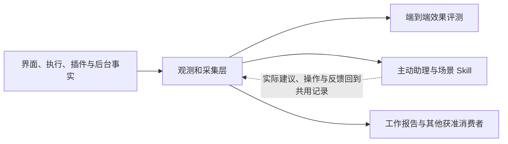

# 观测和采集层需求书

状态：需求已整理（2026-10-27），尚未实现。本次只定义独立需求、迁移主动助理中的共用要求并接入后续演进计划，不开发。功能目标完成程度为**内部完整**：在产品支持且获准的范围内，连续记录用户行为、工作过程、结果与当时条件，供评测、主动助理及其他平台消费者共同使用。文档整理不代表采集能力已实现或现有记录已完整。

需求维护：Codex；实施沿用[后续演进计划](../post-anticorruption-roadmap/spec.md)的 C 轨（平台与 Prologue，Claude 兼管合同评审），当前未启动。各入口与插件的接入仍由原负责人落实。

## 1 目标与职责

用户于 2026-10-27 提出：平台需要一层横向能力，记录所有用户行为、过程信息和结果，为后续评测及助理的主动式、启发式建议提供支持，命名为“观测和采集层”。本需求承接原[主动助理需求](../proactive-assistant/spec.md) §3.4 的完整工作记录、§15 的采集维护要求及相关验收。

这一层回答“当时有哪些条件，实际发生了什么，结果怎样，哪些信息还不知道”。例如，用户打开资料、改写文稿，助理据此提出建议，用户查看定位后的原文再修改采用：采集层保留这些实际环节与版本；评测判断建议是否正确、有价值；主动助理结合事实、用户配置和 Skill 决定下一步。未使用助理的手动工作也能留下相同标准的记录。

| 能力 | 负责什么 | 产出及边界 |
| --- | --- | --- |
| 观测和采集层 | 授权范围内的事实采集、工作关联、历史证据可用性、覆盖与缺口、通用查询 | 完整工作记录和可观察的变化；不自行给工作评分、推定用户意图或启动业务操作 |
| 端到端评测 | 选择样本、确定预期与判定方法、隔离重评、比较版本、解释效果 | 有方法、版本与来源的评价；共用原始证据，判定不能改写事实；现有要求仍由主动助理需求 §14 维护 |
| 主动助理 | 依照 Skill 与用户配置理解工作、启发式发现机会、选择时机、准备或执行、交付与跟进 | 可纠正的理解、建议与获准的工作结果；使用共用记录，不在助理内部另建通用采集链 |

“横向”表示全平台共用的产品能力，具体包位置尚未决定。业务内容、正式状态和对象身份仍由原插件或服务拥有；采集层只管理自身的观察记录、关联和历史证据可用性，不接管业务表，不建立另一份可编辑业务事实。新接入经公开合同复用既有能力，同一事实不因评测与助理分别使用而重复采集。

本次不指定表结构、协议字段、存储引擎、独立进程或新的搜索索引。集中遥测服务、跨设备采集、团队分析后台、模型训练和默认观察整台电脑不在范围内。当前已有日志、动作记录和版本能力是后续设计的复用候选；尚未按本需求完成覆盖审计，不能视为已经满足完整采集。

## 2 记录哪些事实

### 2.1 连续覆盖工作全过程

信息采集是平台级能力，覆盖用户手动工作、主动与被动助理、插件内 AI、工作流、定时与后台任务，以及 Web、桌面、CLI、MCP 等实际支持的入口。不能只为主动助理挑选少量埋点，也不能把未经过助理的工作排除在 Molis Work 的整体效果评测之外。

采集完整性由平台保障，不依赖某份 Skill 是否运行或主动要求记录。Skill 通过系统数据工具按任务需要读取记录、内容和关联，决定本次工作如何使用它们；停用场景 Skill 不应使其他已获准工作的审计与效果记录失去完整性。实际采集和使用仍遵循各自有效范围。

完整性以能还原一项工作当时的条件、过程与真实结果为标准。已纳入范围的工作应保留完整的关键阶段与语义信息，既包含成功，也包含失败、拒绝、取消、等待、没有行动和没有被采纳。不能只留成功样本、最终摘要或调用次数，再用它们反推整段工作。

首次接入项目、插件或资料来源时，既要了解当前范围内已有的内容、状态、关系和可用版本，也要覆盖之后发生的变化。用户能看见现有资料掌握到什么程度、完整记录从何时开始、哪些历史无法取得。首次读取、重新连接后的补读和批量导入不能被当成用户刚刚创建或编辑了全部内容；记录中断后补回的历史变化应与本次新变化区分。完整采集与每次给模型使用哪些材料分别管理，不能为了接入全量记录让每次判断都读取全部历史。

用户主动导入资料是本期真实操作，应正常记录；原内容形成时间、导入时间以及之后实际发生的修改分别表达。报告可以说明本期引入了哪些资料，但不能因此将资料中已有的历史成果全部算作本期新完成。

### 2.2 信息范围

| 信息范围 | 必须能够回答的问题 |
| --- | --- |
| 用户意图与约定 | 原始请求、后续补充、选中对象与材料、目标和限制是什么；哪些是明确要求，哪些只是系统推断；何时改过 |
| 使用行为与交互 | 用户打开、停留、选择、编辑、保存、比较、采用、拒绝、暂缓、撤销和接管了什么；哪些内容实际进入可见区域，呈现了哪些候选、顺序和默认项；哪些只是准备展示 |
| 插件内容与业务变化 | 工作开始时相关内容和状态是什么；谁改变了什么；引用了哪个版本；变更前后与最终有效状态是什么；跨插件对象如何关联 |
| 检索、上下文与记忆 | 查找范围和查询是什么，返回了哪些材料，哪些进入实际工作上下文；读取是否完整，是否截断、压缩、缺失或过期；用了哪些记忆及其当时版本 |
| 主动判断与 Skill | 因何判断，考虑了哪些可行方向，选用或放弃什么，何时保持安静；实际生效的 Skill 正文、版本、组合、用户覆盖和简明判断依据是什么 |
| 计划与执行 | 一项工作经过哪些步骤、角色与委托；模型实际接收的消息和可获得的输出、工具参数与结果是什么；授权、调用、业务生效各处是什么状态 |
| 中断与恢复 | 何时暂停、取消、失败、超时、重试或恢复；哪些已生效，哪些被拒绝，哪些结果未知；是否重复产生效果 |
| 交付与后续结果 | 向用户交付的确切版本是什么，能否打开和使用；用户采用、修改、丢弃还是另做；后续是否返工、撤销，业务结果是否持续有效 |
| 条件、体验与成本 | 平台、插件、模型和相关配置是什么版本；连接和能力是否可用；等待、执行、呈现耗时及用量是什么；发生了哪些错误与降级 |
| 评测与人工判断 | 样本来自哪里，预期结果、判定规则与版本是什么；谁或什么评测器作出何种判断，依据何在；后续纠正有没有保留 |

### 2.3 工作关联、交互与事实来源

工作记录应能从用户的一次操作或意图，一路关联到助理判断、Skill、执行步骤、工具调用、业务变化、页面呈现、用户反馈和最终结果。多轮、多角色、跨插件、跨入口和跨日接续仍属于同一工作脉络；一次重试与一个新的工作不能混同。真实发生时间、系统收到时间以及延迟到达的顺序需要可辨认。

Skill 的发现、被选用、有效正文进入本次工作上下文，以及对应工具取数、处理与交付过程应可核对。登记或加载了 Skill 不等于实际遵循了做法；效果评测应结合行为与结果判断，不能仅凭日志出现 Skill 名称就宣称由它驱动。

成功的检索和读取同样需要可追溯，不能只记录写入与错误；没有改变业务状态的判断、候选展示和正确不行动也属于工作过程。进入可见区域、停留和用户明确表示已读保持区别，系统不能声称知道用户是否真正理解了内容。

建议与内容联动也属于完整工作链：需要区分卡片实际呈现、选中查看、发起定位、目标加载、目标进入可见区域、精确位置高亮、退化为对象级查看、失败、返回，以及后续明确提交操作。发出了打开请求不能算定位成功，点击卡片不能算采用建议；这些阶段要能关联同一建议、内容版本和该次交互。

同一事实可以供多个用途读取，但要保留其权威来源：界面行为证明用户做过什么、哪些内容实际呈现；平台执行记录证明请求与执行状态；插件事实证明业务结果；助理与评测器提供判断。点击“完成”、工具返回成功、模型说已完成均不能独自证明业务完成。审计结论和报告中的总结不能覆盖原始依据。

### 2.4 当时的内容与版本

为了后续效果评测，必要内容须能按当时的版本取回，包括用户已提交的请求、实际使用的材料、有效 Skill 与提示内容、可获得的模型输出、工具输入输出、交付物及相关变更。只留当前对象链接、长度、哈希或摘要不足以判断历史质量；历史证据不应因正文改写而悄悄变成新内容。保留历史证据也不产生第二份可编辑的业务事实。

图片、文件、音频等实际参与工作的内容适用同样的版本和完整性要求，不把“文本转述存在”等同于原材料可用。浏览器、桌面等能力实际提供给助理的观察和操作结果，在获准范围内也应能与该次工作关联；未获得的观察不能补造。

### 2.5 采集与使用边界

“完整”适用于产品范围内可观察、获准记录的工作信息。凭据只记引用；不要求或伪造模型未提供的内部思考。未发送输入、外部应用与未接入服务的活动遵循明确范围，不把完整采集解释为默认记录整台电脑。用于本机功能的记录不因此自动允许上传到集中评测或共享数据集；评测使用范围、脱敏、导出与删除要求应可设置、可核对。

真实用户工作、演示、Skill 试用、评测回放和系统检查必须能区分。它们都可以有必要记录，但不能默认混入用户成果、日周报、习惯推断或真实效果指标。用户明确将试用候选采用为真实工作时，从实际采用和生效处建立关联，不把试用期间的模拟结果补记成已发生业务。

### 2.6 覆盖、保留与性能

新插件、新入口、新动作和新交互需要纳入同一完整性约定。平台能够按入口、插件、工作阶段和版本查看覆盖情况，标明未接入、暂不可用、丢失、截断、脱敏、到期清除与明确不适用；不能把缺记录解释为没有行为。关键工作链路与结果不得靠随机抽样保留；高频细节如采用汇总或抽样，须声明粒度、比例及因此无法回答的问题，不能称为逐次完整记录。

查询与呈现可以折叠重复记录，但在声明的完整保留周期内应能还原各次关键操作、不同结果及先后关系。采集异常、资源不足与保留策略造成的信息缺口应可见，不能无声丢失后继续宣称审计或评测完整。采集和评测不能明显拖慢用户工作，也不能以记录失败掩盖已经发生的业务效果。

记录的保留周期、范围、可用体积与清除影响应清楚可查，满足已启用的最长报告周期、跨周期比较和评测需要。经批准保留的评测样本应有明确用途与生命周期，不能依赖短期诊断日志是否尚未滚动删除。用户纠正或删除信息后，后续助理理解、报告与评测使用遵循对应设置，并如实标明历史证据的变化与可用性。

## 3 向其他能力提供什么

采集入口接收实际支持的界面、执行系统、插件及后台工作的事实，并保留事实主人、时间、对象与版本及已知关联。调用者、项目与安装身份来自可信上下文，不能接受输入里自称的身份。关联既有对象与执行身份；无法确认属于哪项工作时保留未关联状态，不能凭相似名称合并。助理后来作出的关联推断与用户纠正有自己的来源，不覆盖原始操作。

消费者经公共能力按获准空间、项目、对象、工作、时间范围和版本读取，不直接查其他包的私有库。应支持以下输出，具体接口在阶段 1 结合既有能力确定：

- 按需读取当前可观察状态、阶段变化和连续工作过程；能从结果回到相关意图、材料、执行与交互，也能从操作追到已知结果。
- 取回当时实际使用的内容与版本，并区分未取得、被截断、已脱敏、到期清除或无权访问。已有权威版本可满足需求时复用它，不另存一套内容库；原系统不能保留必要历史时，在合同设计中明确由谁保留以及删除怎样生效。
- 提供获准范围内的变化通知或增量查询，供助理判断时机、报告更新和评测读取。消费者从已处理位置恢复时，能辨认重复与迟到记录；变化信号不是执行授权。
- 查询记录覆盖、来源状态、资料截止时间、缺口及保留影响。无活动、未接入、未获准和暂时取不到是不同结果，不能一律返回空列表让消费者猜测。

采集、读取、用于主动理解、用于评测、导出或上传的范围分别表达。同一记录对一个用途可用，不自动授权其他用途。跨项目查询只聚合调用者当前有权且允许相应用途的记录；不扩大现有系统搜索或插件权限。停用主动助理、场景 Skill 或评测任务，不停掉仍在有效采集范围内的平台记录；停用采集后，消费者须看到记录截至何时。

执行安全规则高于记录完整性的愿望。处理器开始前就被拒绝的动作，只沿用平台规定的最小“未执行”诊断：谁、什么动作、结果与错误码，不保留输入、返回或动作给出的错误内容。取消、撤权或停用后，不借采集之名新增被禁止的业务记录；只能使用既有规则允许的诊断及此前已合法形成、当前仍可使用的证据。完整性说明需要区分“按边界不记录”与“本应记录却缺失”。本需求不增加日志或失败记账的豁免。

评测器的评分、规则和人工修正可作为带来源的下游结果关联到原工作，但其业务事实仍归评测能力；没有评测运行时，采集照常完整。助理的理解与建议同样属于其产出，不冒充采集层已核实的事实。每次提供给模型的只是本次任务需要且获准的内容；全量留存不等于把全量历史塞进上下文。

## 4 随产品维护

统一采集需要伴随产品长期维护。每项已支持能力都应有明确的记录范围、事实负责人、关键阶段、内容与版本约定、使用边界、完整性状态，以及对应验证。新增插件或功能不能等上线后出现评测缺口，再临时决定当初应该记录什么。

新增或调整入口、交互、Skill 生效方式、模型与上下文、动作、后台任务、业务状态或成果交付时，都要同时判断对采集和既有消费者的影响。改变记录含义、删去记录、降低粒度或缩短保留周期是可见的合同变化，不能伪装成无影响的日志整理。

迭代应同步更新记录约定、对应验证，以及受影响的审计、助理、报告和评测口径。历史记录继续标明当时的产品和语义版本；无法比较的范围要明确。合同变更和历史数据处理遵循仓库现行规则，本需求不额外引入一套读取兼容机制。

开发手册需将以上要求作为功能开发与交付的组成部分，给出设计、实现、验证、升级与故障修复时的检查要求。当前未接入的能力与未来接入要求分别标明；文档写了“完整”不代表系统已完整采集。实现时应同步的开发入口见 [开发手册](../../docs/system/DEVELOPMENT-REQUIREMENTS.md)。

## 5 与评测、主动助理的依赖和实施顺序

实线表示事实供给，虚线表示助理工作发生后成为新的记录，不能据此把助理建设当成采集层的前置。评测与主动助理分别依赖采集层，两者没有互为前置的建设依赖：助理不必等待完整评分系统才能实现，评测手动工作也不必等待主动助理出现；要证明主动建议的真实效果，则需要助理实际运行、呈现和用户反馈的证据。

评测标准、代表性案例和助理 Skill／交互设计可以并行准备；这些设计完成不等于真实效果通过。现有单元测试、Coding 专项评测和其他已具备证据的验证继续进行，不因建设这一层而暂停。平台完整端到端结论与依赖历史的主动判断，必须具备所声明路径的真实采集覆盖。

| 阶段 | 交付与依赖 | 完成边界 |
| --- | --- | --- |
| 防腐收尾后阶段 1·C | 盘点当前实际支持的入口、插件、记录与版本能力，明确事实主人、采集范围、公共查询、权限与保留合同；设计给一骏审阅。评测方法与样本设计可同时准备 | 需求和方案，不写采集实现；没有审计依据的能力不能标为已覆盖 |
| 阶段 2·C | 按合同接通第一版：手动界面工作、插件内 AI、助理与 Coding、动作、工作流、定时及后台任务，并覆盖平台实际支持的 Web、桌面、CLI、MCP 入口；让评测和其他消费者实际读取同一工作证据 | 真实路径证明采集、历史读取、缺口、撤权与恢复；若分批接入须逐项公开覆盖，不能将局部称为内部完整 |
| 阶段 3·A／3·C | A 轨让主动助理依照 Skill 消费记录并产生建议；C 轨扩展端到端评测，使用真实建议、呈现、采用、纠正与后续结果；报告与统计复用数据 | 采集通过、评测可用、主动建议有价值分别验收；整体完成按各自需求，不用数据接通代替效果验证 |

排期唯一维护处为[后续演进计划](../post-anticorruption-roadmap/spec.md) §3.3、§4、§6；本文说明依赖与交付边界。范围调整先更新本需求，再同步受影响的消费者；不以采集层统一建设为由重新实现其既有业务能力。

## 6 验收标准与验证

以下标准定义未来功能的内部完整门槛，当前尚未按本需求逐项完成实现核对和验收。自动化测试必须使用实际接入路径并在测试名或注释中引用对应编号；有真实语义和体验判断的部分以真实工作人工核对。模拟、文档检查与日志字段存在不能代替关键行为、持久化结果和后续可观察结果。

| 编号 | 通过条件 |
| --- | --- |
| OCL-01 | 覆盖手动工作、主动与被动助理、插件 AI、动作、工作流、定时与后台任务及实际支持的入口；同一事实可供多个消费者使用，停用 Skill、主动助理或评测不使仍获准的采集失效 |
| OCL-02 | 首次接入能区分当前内容、历史可得范围与之后变化；断线补读、批量导入及历史形成时间不被误算为本期新创建或完成，真实导入操作及之后修改仍正常记录 |
| OCL-03 | 可从意图、材料、Skill、执行、业务变化、呈现到后续反馈追踪正确工作；多轮、跨日、并行、重试、重复到达、迟到、取消与恢复可区分，未知关联不擅自归并 |
| OCL-04 | 界面行为、执行状态、插件业务事实、助理推断与评测判断保留来源；点击完成、请求成功或模型自述不能单独成为业务完成证据，审计和总结不改写原始事实 |
| OCL-05 | 在获准的完整保留周期内可取回当时请求、实际材料、有效配置及 Skill、可获得的模型与工具输入输出、交付物和业务状态证据；当前正文改变不替换历史依据，文件、图片及音频同样适用 |
| OCL-06 | 成功读取、检索候选与实际采用材料可区分，截断、压缩、缺失和过期可见；能核对 Skill 发现、选用、有效正文进入上下文及其后续行为，加载名称不被视为遵循证据 |
| OCL-07 | 交互记录区分实际呈现、选中、定位请求、加载、目标可见、精确高亮、退化、失败、返回与提交操作，并关联正确对象、版本及该次交互；点击不自动算采用或已读 |
| OCL-08 | 成功、失败、拒绝、取消、等待、不行动、无响应、接管和未知结果均能如实表达；采用后的修改、撤销、返工可接续；无曝光或尚未到观察截止时间不被补成负面反馈 |
| OCL-09 | 可按入口、插件、工作阶段和版本查看采集覆盖、截止时间及缺口；未接入、不可用、丢失、截断、脱敏、到期清除和明确不适用可区分，缺记录不被当成无行为 |
| OCL-10 | 关键工作阶段与结果不随机抽样；高频细节汇总或抽样说明粒度、比例与限制，展示折叠不丢失完整保留周期内各次关键操作、先后和不同结果，不重复计算成果 |
| OCL-11 | 采集、主动使用、评测、导出与上传权限分别生效；跨项目不越权，停用某项用途或撤销相应权限后，相关消费者不能借旧副本继续使用；凭据只留引用，不采集未获准草稿或伪造隐藏思考；提前拒绝与取消后的记录遵守第 3 节安全边界 |
| OCL-12 | 回看窗口、记录保留和样本生命周期分别可查；保留策略支撑已启用的最长报告与比较需要，删除、纠正、缩短保留及用途改变的影响可见，历史不可得时不能伪装仍可复查 |
| OCL-13 | 真实工作、演示、Skill 试用、回放和系统检查不混入同一成果或效果口径；模拟候选转为真实采用时，仅从实际采用与生效处关联真实结果 |
| OCL-14 | 评测和主动助理能经公共能力按自身权限读取同一组事实、历史版本、变化与覆盖状态；增量恢复可辨认重复和迟到，不重复采集、越权读取或把变化信号变为自动执行授权 |
| OCL-15 | 在约定代表性工作量下测量采集、查询对交互、执行耗时及存储的影响；超出明确预算或发生采集故障时状态与缺口可查，恢复不重复或错配，已发生的业务效果不因采集失败被隐瞒 |
| OCL-16 | 新增或修改能力时同步维护记录范围、事实负责人、关键阶段、内容和语义版本、使用边界、消费者影响与验证；开发手册能指导接入、升级与故障修复，未接入部分如实登记 |
| OCL-17 | 评测方法、规则、版本、样本来源、判定和后续人工纠正能关联到原始证据；无评测仍能记录工作，重评不覆盖当时事实，评分与采集分别归属 |
| OCL-18 | [人工] 以代表性连续真实工作逐步核对原始操作、内容、执行与结果，含纯手动工作、AI 协助、失败恢复及跨日接续；事实链能支持复查和建议依据，同时交互仍顺畅，不能以记录条数或采集接口返回成功代替完成 |

本次文档交付检查链接、spec 索引、归属、迁移对应与差异完整性；`node scripts/check-spec-coverage.mjs` 仅报告编号及测试引用，未覆盖是当前尚未实现的事实。未来实现根据实际修改的包补齐定向回归、合同与权限拒绝检查、故障恢复、代表性负载，以及隔离 Home 的真实路径；在方案中确定可复现命令和性能目标后执行，不提前虚构测试结果。

2026-10-27 文档核对：链接、spec 索引、待办格式、包归属与差异格式检查通过；迁移前后的采集正文及维护要求逐条核对保留，评测 §14.1～14.3 正文未改。编号报告无本次新增重号或串用；17 项自动验收尚无测试引用，1 项人工验收未进行。仅修改 Markdown，未运行构建、功能测试或真实 Home 验收。

## 7 原需求迁移对应

主动助理需求保留原章节入口与已迁出编号的位置，原编号不复用。这里整合共用采集要求，原有产品覆盖不减少。

| 原位置 | 本文承接 | 原需求继续负责 |
| --- | --- | --- |
| §3.4；`PWA-31`、`PWA-34` | §2～3，OCL-01～03、OCL-10、OCL-14 | 助理按授权范围使用记录并纠正工作理解 |
| `PWA-32`、`PWA-33` | OCL-04～06 | 助理输出引用正确依据与版本 |
| `PWA-35`、`PWA-36` | OCL-09～13 | 助理的关注窗口、主动使用范围与缺数据处理 |
| §15 的平台采集维护；`PWA-57` | §4，OCL-16 | 场景 Skill 与助理集成的维护和验证 |
| `PWA-58` 的采集、查询与存储部分 | OCL-15 | `PWA-58` 保留报告消费与生成性能要求 |
| `PWA-73`、`PWA-89` 的通用记录部分 | OCL-06～07、OCL-11、OCL-14 | 原两项保留助理界面与 Skill 的真实集成验收 |
| §14 的评测证据供给要求 | §2～3，OCL-05、OCL-08、OCL-17 | §14 与 `PWA-51`～`PWA-56` 继续定义评测方法、样本、隔离回放和效果口径；未迁成采集层职责 |

## 8 待细化的产品参数

后续设计需要据实际支持能力列出完整接入清单，并确定默认采集范围与告知方式、历史内容和多媒体的保留期限与容量、删除和样本留存规则、查询及变化可用的时效、代表性负载与可接受开销。具体数字应由真实工作与资源测量支持，不能凭空设置阈值或用未定参数缩减已确认覆盖。

主动助理的回看天数、报告默认时刻、建议质量与打扰程度仍由其需求维护；评测的评分标准、抽样和对照方法由评测能力维护。采集关键过程不随机丢弃，与评测从完整记录中选择代表性样本是两件事。

现行事实归属见 [SSOT](../../docs/SSOT-MATRIX.md)，层与包边界见[系统架构](../../docs/system/ARCHITECTURE.md)和[包边界](../../docs/system/PACKAGE-BOUNDARIES.md)。合同与历史处理遵循[合同变更规则](../../docs/system/CONTRACT-CHANGES.md)；本次不增加读取兼容机制，也不授权真实 Home 迁移或外部数据上传。
