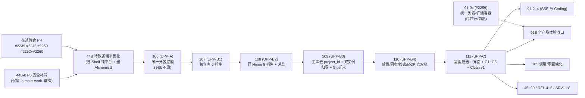

# 特殊逻辑平民化 + 统一工作分区 · 合并实施总纲（Implementation Plan）

状态：已定稿并对齐最新 `origin/main`（`5bfd52b87b`）与在途 PR（`#2239`、`#2245`、`#2250`、`#2252`～`#2260`），对应路线书 [决定 66](../post-anticorruption-roadmap/reference/decisions.md#decision-66) 与批次 [`44B`](../post-anticorruption-roadmap/reference/batches/44b.md)、[`106`](../post-anticorruption-roadmap/reference/batches/106.md)～[`111`](../post-anticorruption-roadmap/reference/batches/111.md)；尚未改业务代码。

配套需求书：[特殊逻辑平民化](spec.md)（验收 `PSD-01～08`）· [统一工作分区](../unified-partition-plugins/spec.md)（验收 `UPP-01～36`）。

---

## 1. 终态心智模型与硬指标

面向真实用户与开发者，终态收敛为三样清晰概念，**零特例插件、零双轨装配、零旧结构兼容读取**：

1. **工作分区（Partition）**：顶上固定的保留分区 `personal`（`<Home>/personal-space/`）+ 你的各个项目（`<Home>/projects/<id>/`）。二者完全同构（成果库、资料、目录、对象终端、要求与认可、可信决定、调度、事件与端口、**右栏「讨论 / IM」作个人随手记与自对话流**）；个人空间的业务对象可单向按版本推送到项目，再推原地更新，项目改过先问再覆，被覆盖版本全部留本机可恢复（最近 1 版上云）。自写 Skill 保持双层：个人全局技能（Home 层全分区可用，个人空间直接读写不建第二套）+ 项目专属分区技能。
2. **纯平台系统部件（`system.*`，非插件，不进插件目录与市场）**：
   - `system.shelf`（`modules/shelf`，`kind: "system"`，`/api/platform/shelf`，`HostSurfaceRegistration` 右栏常驻中转架与桌面热键/轮盘/拖放/剪贴板）
   - `system.artifacts`（`modules/artifacts`）、`system.characters`（`modules/characters`，`/api/platform/characters`）、`system.assistant`、`system.computer`、`system.sessions`（`horizontal/sessions`）
   - `horizontal/plugin-studio`（创作台，`#2239` 迁入，`44B` 收口创作代理与已装包通用宿主）
   - `packages/system-skills/`（系统自带技能，承接迁出 `plugins/content/` 的 `planning-methods`）
   - 平台声明式连接器驱动（`catalog`、`github`、`gmail`、`rss`[含收编进来的原 `youtube`]，签名沙箱集成挂同一驱动契约）
3. **20 个完全平等的统一分区内置插件**（与所有第三方签名沙箱包 100% 同等契约与装配）：
   `goals`、`coding`、`git`、`diff`、`feed`、`inbox`、`risk`、`schedule`、`work-brief`、`workflows`、`pages`、`ppt`、`form`、`dataset`、`lingguang`、`todo`、`jelly`、`cognia`、`images`、`issues`。
   - 注：`text-stats` 已随 `#2243` 删除；`plugin-builder` 归 `horizontal/plugin-studio`（`#2239`）；`shelf` 归 `modules/shelf`（`44B`）；旧 `alchemist` 在 `44B` 彻底删除，第 `82` 批按纯 UPP 场景插件在创作台上从零重写。

### 1.1 防腐绝对清零表

| 维度 | 终态指标 | 收口批号 | 守卫门禁 |
|---|---|---|---|
| `always_on` 常开插件机制与 `always-on-plugins.ts` | **0** | `44B` | G1 / G2 |
| `dual_instance` 双实例机制与 `scripts/gates/dual-instance.mjs` 豁免 | **0** | `109`（Shelf 在 `44B` 先清） | G2 |
| 普通插件 `HomePluginHost` / `runtime.scope: "home"` / `outsideBuild` | **0** | `108`～`109` | G2 |
| `personal: true` / `hidden` / `project_plugin_exclusions` / `project_rows` / `project_reach` / `home-aggregate` | **0** | `107`～`108` | G2 |
| `APPROVED_BUILD_TIME_EXCEPTIONS` / `NATIVE_PLUGIN_HTTP_FILES` / `PLUGIN_MODULE_IMPORT_ALLOWLIST` | **0** | `44B` | G1 / G2 |
| `better-sqlite3` 驱动例外（`sqlite-driver-owners.json`） | **0** | `44B` | 既有 SQLite 边界门禁 |
| 宿主内 `workspace-git*.ts` 与 `projects.workspace.writers.*` | **0**（整体迁入 `plugins/native/git`） | `109` | G1 |
| 宿主内连接器厂商分支（20 CLI/`feishu`/`lark`/`figma`/`github`/`gmail`/`Sentry-Bearer`/`typesafe`） | **0** | `44B` | G1 |
| 分区主库与独立库插件业务表 `project_id` 列及 `WHERE project_id = ?` | **0** | `107`～`109` | G3 |
| 平台循环直接列 `projects/` 目录或误用 `listProjects()` 遍历分区 | **0** | `106`～`110` | G3 |
| 同步出站密钥/令牌/本机路径 & 非宿主占用 `io.molis.work.` 前缀 | **0** | `44B-0`、`110` | G5 |

---

## 2. 端到端波次拓扑与在途 PR 衔接

采用 **先加、后迁、再删（V1）**，每波一个 PR、批内子分支，保证 `main` 全程恒绿：

### 2.1 在途 PR 精准消费与避让矩阵

| 在途 PR / 已合入批 | 已有成果或改动 | 本方案消费与保护方式 |
|---|---|---|
| `#2239`（第 47 批） | 创作台迁入 `horizontal/plugin-studio`，引入 `HostSurfaceRegistration` | `44B` 直接复用 `HostSurfaceRegistration` 承载 `system.shelf`、`system.artifacts`、`system.characters`、`system.sessions`，并将残留 `agent-host/adapters/plugin-builder.ts` 迁入 `horizontal/plugin-studio` |
| `#2258`（第 44 批独立复核，在途待合） | 共享样式 250+ `.mw-*` 泛化 + 永久门禁 `findSharedStylePluginSelectors`、Goals `demo-seed` 迁回、`WORK_PROGRESS_CONTINUITY_PROTOCOL`、兄弟插件可选 `goals:*`、画框泛化 | **`44B` 消费其全部成果，不重复改写**；仅核验并补齐 `#2258` 未覆盖的剩余平台点名（Shelf、Alchemist、连接器、来源拉取、合同命名等） |
| `#2259`（决定 64/65） | 增设 `91-0c` 统一列表-详情容器 `.mw-stage-list-detail`、删 7 处外壳插件名分支 | 允许 `91-0c` 与 `44B` 并行/前置；本方案使用**决定 66** 避让 64/65；`91-2..4` 与 `91B` 排在 `111` 之后 |
| `#2231`（已合入） | 新增 6 项平台个人配置同步（`personal-config-sync.ts`、`platform-sync-catalog.ts`） | `44B` 修复 `platform-sync-catalog.ts` 借用 `io.molis.work.inbox` 导致拔掉 Inbox 崩盘的缺陷，并将 5 项伪插件 id 改为纯平台 `SyncSelection`；`106` 的 `horizontal/person-settings` 直接复用 `personalConfigReplica` + `assertPortableConfig` |
| `#2253` / `#2254` / `#2255` | RO/RW 池、静息读数持久化、`discoverOne` 热路径 | 先合入主干；`106`/`108` 的 `overview_projection` 平滑替代 `#2254` 过渡静息读数；保留 `#2253` 只读并发池与 `#2255` 单查热路径 |
| `#2257`（Feed 精准唤醒） | 交替一次性槽位（`sources` / `sources:next`）取代 30 秒轮询 | `106` 平台到期登记（`horizontal/scheduler`）沿用同一无空窗单次触发槽位模型 |
| `#2250`（记忆同场景双插件） | `MemorySessionTarget` 精确 `(project_id, plugin_id, provider_id)` | `106`～`110` 保持该精确绑定合同，仅区分「本人级」与「个人空间分区」 |
| `#2260`（M1-B3 同步回归） | 验证 100 MB R2 配额与 4 MiB/1 MiB 分片 | `110`～`111` 保持相同物理/逻辑分片与配额边界，`push_superseded` 仅同步最近 1 版（V3） |
| 已合入第 `95-3` 批（`#2151`） | 错过执行从 `due_at` 起保留 7 天自动跳过 | **7 天漏跑过期语义归 `106` 的平台到期登记**（V11，不归总览索引） |
| 已合入第 `99` 批（`#2207`/`#2244`） | `recovery-actions.ts:119` 子任务整合审查按 `install_id` 隔离 | **`109` 泛化开放审查种类时必须保留 `install_id` 隔离断言** |

---

## 3. 核心工程约束与关键技术决策

### 3.1 `44B`：特殊逻辑平民化关键约束
1. **全局保留 `io.molis.work.` 前缀（`44B-0`）**：`host-plugin-ids.ts` 与 `install-identity.ts` 不再维护容易漏项的散点名单（先前漏了 `characters` 与 `assistant`），改为**全局禁止任何非宿主签名的第三方包申请 `io.molis.work.*` 命名空间**（新增安全不变量 `S-reserved-host-prefix`），并修复 `plugin-builder/agent-surface.ts:245` 与 `contracts/modules/characters.ts:133` 的 `^io\.molis\.work\.` 正则硬编码。
2. **Shelf 纯平台收口**：`plugins/native/shelf` 删包，代码与存储收拢到现有 `modules/shelf`（`system.shelf`，`kind: "system"`，`/api/platform/shelf`，页面经 `HostSurfaceRegistration` 挂右栏第一格）。桌面端 `apps/desktop`（TS 与 Tauri Rust）仅切换路由到 `/api/platform/shelf`、移除 `io.molis.work.shelf` 插件名硬编码，**无需重写 ~3,150 行 Rust 为 M5 原生伴侣协议**。整套 `always_on` 机制与 `PLUGIN_MODULE_IMPORT_ALLOWLIST` 同步清零。
3. **统一 `provider_id`、工作台目录与设置登记**：
   - 将宿主 3 种分裂的 `provider_id` 派生逻辑收敛到 `packages/plugin-runtime/src/install-identity.ts` 的唯一函数 `resolveActionProviderId(record)`。
   - 工作台 10+ 处直读 `BUILTIN_PLUGIN_CATALOG` 的模块改读运行时合并目录 `RuntimePluginDirectory`（动态已装包与内置包同等排序/图标/名称）。
   - 宿主 9～11 处分散设置路由收敛到 `PLATFORM_SETTINGS_REGISTRY`（对齐 `docs/system/EXTENSION-POINTS.md` X-2）。
4. **Goals 剩余登记特权与连接器硬编码清零**：移除 `PluginRegistration.management_actions` 与 `approval_outcomes`（改走公开动作与受控审批事件）；连接器 20 个 CLI、`feishu-cli.ts`、`lark-mcp-launch.ts`、`connector-mcp-endpoint.ts`、`x-figma-token`、`Sentry-Bearer`、`typesafe`、`side-panel-files.ts`/`artifact-actions.ts` 全部收成声明式连接器驱动能力；`plugins/official-integrations/youtube` 并入 `rss` 驱动；`plugins/content/planning-methods` 迁入 `packages/system-skills/`；独立内存态 `integration-registry.ts` 合并进 Home 软件层统一运行时。
5. **Clean v1 直接拍平（D2 + D5 + U13）**：直接删除旧 `plugins/native/alchemist`、其 6 个宿主文件、`contracts/modules/alchemist.ts`、`home-stores.ts` 条目与 `better-sqlite3` 豁免；D5 的存储表与事件改中性名直接按 Clean v1 拍平（`same-version-exceptions.json` + 重生 `0.1.0` 金样，零过渡升级段），仅冻结 macOS 钥匙串服务名 `com.molis.work.feed.secretstore`。

### 3.2 `106`～`111`：统一工作分区关键约束
1. **总览表零注入围栏（V11 改）**：插件按平台定格式（待办/日程/通知/简报）在自己分区库里维护「总览表」，随业务写入同事务更新（SDK `overviewRows.upsert/remove` 帮手与校验，重复日程展开未来约 90 天并滚动续展）；Manifest 只声明 `overview_projection: { kinds }`，**不写列名映射、不写原始 SQL 或 WHERE 表达式**；平台仅以 `SQLITE_OPEN_READONLY` 读这张定格式表、由可信上下文盖章 `(partition_id, install_id)`、每分区每类设行数上限；同步拉取/恢复写进休眠分区时仅标 `dirty = 1`，打开总览时懒增量刷新脏分区（其余休眠分区零唤醒）；到期登记从总览表的提醒时间列取，同步来的提醒不漏响。
2. **沙箱 1 MiB IPC 上限与大快照分片推送**：`packages/plugin-sandbox/src/runner.ts:27` 限制单帧 JSON IPC ≤ 1 MiB；当 `push.export` / `push.put` 快照大于 `256 KiB` 时，自动切换为 **Platform Blob Handle 分片传输**（走平台临时受控句柄，不经单帧 JSON）。
3. **CAS 附件 GC 对副本与全部 `push_superseded` 的持有保护**：`material-original-files.ts` 与 `material-attachments.ts` 改为全分区存储（清零 `project_id = ""`）；每次 Push 写入副本或产生 `push_superseded` 旧版时，平台在目标分区的 `attachments` 引用账本中登记全部关联 `sha256`；只有当副本被删且用户在副本历史里手动删除对应 `push_superseded` 旧版（`R19`）后，才释放该引用，确保 CAS GC 永不误删可恢复版本的附件。
4. **Workspace Git 迁入 `plugins/native/git`（`109` / D6=B）**：将 `apps/local-host/src/workspace-git*.ts`、`projects.workspace.writers.*`（并行 worktree 与整合审查）、`packages/plugin-sdk/src/git-porcelain.ts` 及 `git.*` 整体迁入 `plugins/native/git`；平台仅向宿主信任签名包开放**受限 argv-only VCS 执行服务**（固定 `git` 二进制白名单、严格禁锢在当前分区工作目录树内、禁止 shell 解析与自定义钩子路径注入，登记安全不变量 `S-git-plugin-command-scope`）；Coding 声明 Git 为**随启用依赖**（`enable_with: true`，启用 Coding 时一并启用 Git，V9），允许单独移除 Git 并先提示影响（V10），移除后 Coding 降级为单工作区串行写；Diff 声明可选依赖，无 Git 时降级为文件系统对比或如实提示不可用。
5. **不预记三步推送与补账（`111` / V2）**：Step 1 算号（`push_id = sha256("molis.push.v1", space_id, plugin_id, kind, source_id, target_project_id)`、`target_id`、`op_id`）+ 导出快照 + 读目标版本（零写）→ Step 2 `beforeEffect()` 复核 + 目标分区 `put` 与平台 `push_upstream` 同事务提交 → Step 3 个人空间写 `push_lineage` + `push_operations(outcome='settled')`。若 Step 2 与 Step 3 间中断，启动或打开个人空间时由平台按已提交 `push_upstream` 补记 `outcome='repaired'`（登记为 `S-push-ledger-repair`）。

---

## 4. 新增／收严防回流门禁（G1～G5，用户已批准）

| 门禁 | 落地批号 | 校验规则（对照 merge-base 只许降，终态归零） |
|---|---|---|
| **G1 平台不点名插件** | `44B` | 在 `apps/{local-host,workbench,desktop,mcp,cli,server}`、`packages/*`（除生成登记表）、`horizontal/*`、`modules/*` 中检测内置插件 id、插件包 import、以插件命名的文件与残留选择器；仅放行 `spec.md` 第 3 节具名例外 |
| **G2 零特权与零双轨装配** | `44B` + `108`～`109` | 断言 `always_on = 0`、`dual_instance = 0`（`scripts/gates/dual-instance.mjs` 归零）、`APPROVED_BUILD_TIME_EXCEPTIONS = 0`、`NATIVE_PLUGIN_HTTP_FILES = 0`、`PLUGIN_MODULE_IMPORT_ALLOWLIST = 0`、普通插件 `runtime.scope:"home" = 0`、`personal:true = 0`、`hidden`/`project_plugin_exclusions`/`project_rows`/`project_reach` = 0 |
| **G3 分区单库与路径收口** | `106`～`109` | 断言插件业务 SQL 与 DDL 中 `WHERE project_id = ?` 与业务表 `project_id` 列 = 0；平台遍历循环中禁止直接 `readdir("projects")` 或用 `listProjects()` 替代 `listPartitions()` |
| **G4 零唤醒总览预算** | `108` | `tooling/gates/call-budget.json` 新增「个人空间总览」与「跨分区推送」场景：20 项目 19 休眠时开库次数为常数且休眠监督器/沙箱进程数为 0 |
| **G5 命名空间与同步出站防泄密** | `44B-0` + `110` | 非宿主安装申请 `io.molis.work.*` 必拒（`S-reserved-host-prefix`）；同步出站序列化扫描零密钥/令牌/本机路径且 SDK 拒绝将密钥或路径键标 `portable: true`（`S-person-settings-private`） |

---

## 5. 全下游路线书与原需求书冲突优化总索引

以下改动均随本 PR 一并同步落地，确保后续每一批从干净、无冲突的规范起步：
- **路线书总表与治理**：`spec.md`、`decisions.md`（决定 66）、`dependencies.md`、`tracks.md`、`stages-and-acceptance.md`、`deferred.md`（退役 `BL-925`）、`requirements.md`。
- **新建正式批次**：[`44b.md`](../post-anticorruption-roadmap/reference/batches/44b.md)、[`106.md`](../post-anticorruption-roadmap/reference/batches/106.md)～[`111.md`](../post-anticorruption-roadmap/reference/batches/111.md)。
- **高冲突下游批次重构（17 批）**：`47`、`48`、`55`、`56`、`62`、`64`、`67`、`68`、`69`、`70`、`73`、`82`、`90`、`91`、`91b`、`105`、`rel-1`～`5`、`srv-1`～`8`。
- **中低冲突下游批次校准（28 批）**：`37`、`43`、`44`、`45`、`46`、`52`、`53`、`54`、`57`、`60`、`63`、`63a`、`65`、`66`、`71`、`75`、`76`、`77`、`78`、`83`、`84`、`85`、`86`、`89`、`104`。
- **现役原需求书校准（20+ 份）**：`product-experience-polish`、`plugin-builder-upgrade`、`action-input-contracts`、`assistant-service-connections/service-matrix`、`personal-cloud-sync`、`sqlite-driver-switch`、`scene-and-page-contract`、`plugin-equal-standing`、`context-program`、`shell-page-exceptions`、`work-brief`、`coding-plugin`、`coding-harness-optimization`、`surface-composition`、`shared-sources-and-surfaces`、`intelligent-surfaces`、`upgrade-continuity`、`onboarding-coverage`、`proactive-assistant`、`work-line`、`plugin-platform-v2`、`state-machine-platform`、`capability-pack`、`skill-packs`、`page-client-lifecycle`。
- **Backlog 合规收口**：退役 `BL-925`（记入 `docs/backlog-removed.md`），更新 `BL-377`、`BL-929`、`BL-525`、`BL-character-roles-sync`、`BL-shelf-admit-folder`、`BL-todo-home-presentation`、`BL-workbench-navigation-acceptance`、`BL-golden-coverage-uncovered`、`BL-955` 等关键条目归属，对代码未删前必须保留的条目仅注记清理批号（`44B`/`106`～`111`），确保 `doc-gates` 与 `builtin-plugin-assembly-gate` 零误伤。

---

## 6. 2026-11-23 补充拍板（V9～V15，详见[统一工作分区 §14.3](../unified-partition-plugins/spec.md)）

- **V9／V10 Git 与 Coding**：写入调度整体随 Git 搬进 Git 插件；Coding 声明 Git 为随启用依赖（通用声明 `enable_with`），启用 Coding 时一并启用 Git；允许单独移除 Git，先提示「Coding 只能一次一个地改」。
- **V11 总览表**：插件按平台定格式（待办/日程/通知/简报）在自己分区库里维护总览表，平台只读；到期提醒从中取，同步来的提醒不漏；写法进 `skills/molis-plugin-dev`、Manifest 说明与 SDK（`106`）。取代 3.2 第 1 条的「列名白名单映射」。
- **V12 随手记分工**：Shelf 先放、右栏讨论 = 只有自己的群聊（与项目讨论同一套 IM）、Jelly 留存笔记与日程、Todo 要做的事、助理帮你做。
- **V13 个人全局技能**：项目 AI 也能用；SRV-6 团队共享前在共享确认里写明。
- **V14 排期**：照旧，`44B` → `106`～`111` 串行，下游等 `111`。
- **V15 旧 Alchemist 本机数据**：`44B` 合入后弹窗确认再搬开开发机本机旧目录（不删）。
- 另补：插件自有文件的推送路径、大快照句柄 `S-push-blob-handle`；`#2258` 等在途 PR 均为「待合前置」，不是已实装。

