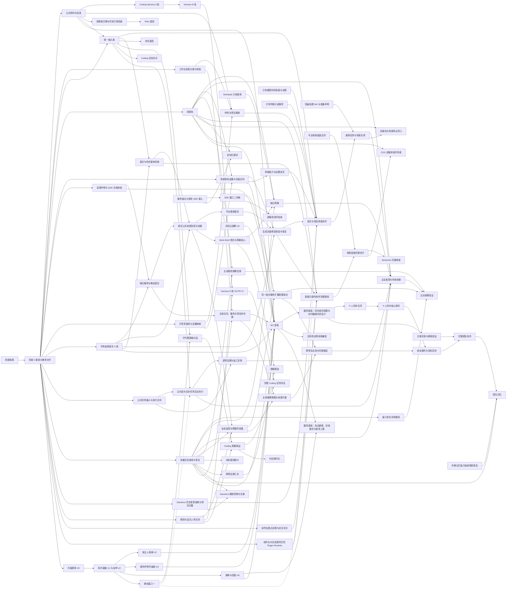

# 排期原则与依赖

[执行目录](../spec.md) · [参考分类](../spec.md#reference)

## 怎么排

**重要度**看三条，同时满足得越多越靠前：

1. **工作接得上**：中断、关掉应用、隔天、换一个入口之后，要求、进度和结果都还在，能接着做。
2. **体验**：常用路径顺、快，不露内部值，不出莫名其妙的错。
3. **易用**：第一次就能用上，不用先弄懂产品的结构。

**依赖**：被好几条线用到的东西先做。这样的地基包括公共资料与目录、统一工作台与输入框、技能包、观测和采集、已有授权与人审的明确边界、Schedule 只读查询、字体皮肤语言的文件格式，以及场景所需的角色与设置公开读写、生成交互页面的承载和恢复能力。个人同步、团队协作、团队记忆和 M2 都要服务端，整体放进[服务端批](server-batch.md#server-batch)（用户 2026-11-03 定）；批内仍是团队身份、对象版本、权限与并发修改先于个人同步合同共同设计，完整团队产品在最后。已有能力先复用，只补当前场景所需缺口。

**冲突**：按文件把工作分成七条轨道，一条轨道独占的文件同一时间只有一个会话在改，轨道之间并行（用户 2026-11-03 定）；每批由一个主会话做完，会话不再按轨道跨批（用户 2026-11-05、11-11 定，[决策记录](decisions.md#decision-26)第 26 项取代第 17 项，[第 34 项](decisions.md#decision-34)）；几批同时做，受每台机器三个构建槽、三个测试槽的额度限制（用户 2026-11-07 定，取代每台一个构建、一个测试）。同一份合同快照、同一批聚合文件和换包照旧串行。会碰到全仓的改动（换 Prologue 包、字体皮肤语言的整体切换）排进固定窗口。细则在[轨道与冲突规则](tracks.md#section-5)。

**升级与兼容起点**：库及带版本文件的升级链从统一起点开始，按 [upgrade-continuity](../../upgrade-continuity/spec.md) 的 U0～U7 落地，不等 M1；第一个装到开发机之外的版本（M1，当前仍是阶段 2 的退出条件）发出去以后，动作、Manifest、MCP 等合同按过渡期演进（[合同变更流程](../../../docs/system/CONTRACT-CHANGES.md) 第 7 节）。因此技能包、字体皮肤语言 A 段、观测采集、场景与生成页面、智能呈现及主线的必要公共合同都在 M1 前落；同步与团队的合同在服务端批里按过渡期加，带读取兼容（用户 2026-11-03 定）。M1 缩范围建议尚未决定（[决策记录](decisions.md#section-7) 第 18 项），不在排表时默认为已批准。

**不排日历。** 阶段描述能力形成顺序与阶段完成条件；独立任务的实际依赖和合同满足后可向前拿，不等待其他轨道全部完成。长期效果观察只约束对应能力的效果结论与约定发布条件，不作为全体开发的统一等待门。

## 依赖

虚线是只在阶段 1 核出当前 SDK 缺口时才成立的依赖。

### 11-05 按各批核账调整的依赖

统筹 2026-11-05 按 11-04 合入与在审的核账、设计稿重核，改了下面这些前置。全景图的手录依赖（gh-pages `tools/data.py`）同日改成一样的。「部分」指只挡其中一部分，其余可以先做。

| 交付项 | 改成 | 依据 |
| --- | --- | --- |
| 07 | 拆三项：07-1 导航本身只等 03，只有「项目资料」窗格那一块等 05 资料合同和 06-1（先按现有侧栏「文件」接）；07-2a 只等 03，07-2b（N52）等 06-1、06-3；07-3 已随 #1725 完成，BL-880 已删（用户 11-04） | [07](batches/07.md)、#1802 |
| 09 | 2026-11-08 起含能力包（9-8～9-12）：合同稿与目录页定样可先做（名称用户已定）；等 08 的 C-1、C-2 和目录服务，以及 02 交接后的 9-1 合同小 PR；改 composer 的部分排在 10 之后；9-4、9-5 里删旧路径与改存形状的片，在 09 落在 02③ 真实 Home 重建之后时不开工；`molis-coding-method` 用户 11-06 定不认也不迁，`methods:<会话>` 的存量仍等用户定 | [09](batches/09.md) 第八节 |
| 10 | 不再等 09；K0 合同等 02 交接，部分等 05② 的 C-1 | [10](batches/10.md)、#1791 |
| 12 | 12-1 执行目录先做（#1819）；接入输入、输出目录部分等 05②、06、07（BL-1035 与 12 批第 4 条）；仍等 09（只等 9-1～9-7；能力包部分卡住时从 09 拿掉、不挡 12）、11 | [12](batches/12.md)、BL-1035 |
| 13 | 合同与服务不等 12，只有「连完回原处」部分等 12 的返回能力 | [13](batches/13.md)、#1816 |
| 15-1 | S-1 不等 16，只排在 05② 的 C-2、C-3 和 14 的 TextRef（SDK 校验等 T4）之后；S-2 与接页面的片仍在 16 切换之后 | [15](batches/15.md)、#1798 |
| 16-2 | 用户 2026-11-11 决定以现有输入入口完成 C 段，K6 另行接入 | [16](batches/16.md#batch-16-item-2)、[11](batches/11.md) |
| 20 | 合同按片排：05② C-1 → 08 C-1 → 05② C-2 → P-1；08 C-2 与 10 K0 可和 P-1 并行，但同一快照仍串行；P-3a → P-2（36 层次合同之后）→ 05② C-3（14 TextRef 之后）→ P-3b/P-3c → P-4；08 C-3 不等 P-3b/P-3c，排在 08 C-1 之后，和共用 `platform/plugin.txt` 的片先准备好的先落（用户 2026-11-07 定）；36-1 的层次合同不等整个 20，采用消费者仍等对应能力 | `specs/scene-and-page-contract/spec.md` 先后表、#1806 |
| 37-1 | 原等 07、16、19、20；页面改归首页服务以后，19 是否仍等，开工前重核（#1806 统筹评论）。统筹推断还要等 15-2 的公共呈现组件，开工前一并核 | #1806、#1808 |
| 25-1 | 已随第 25 批 #2034 于 2026-11-12 合入（`3d844d493a`）；第一片 #1815 先行，其余连同「错过」数据的主人、C 轨合同、BL-108 一起完成（BL-108 已删，编号不复用） | [25](batches/25.md)、#1815、#2034 |
| 44、51 | 44 第 2 项等 20 第 2 项；GitHub 正式授权（26-2）未就绪时只挡连接那一步；官方包签名并进 26（#1794）；51 第 3 项等 44 第 2 项 | [44](batches/44.md)、[51](batches/51.md)、#1794 第 13 节 |
| 08 | 02 交接后可先落 C-1/C-2，不等 U1/SQLite 第二步；动表实现仍守 02③ 分界与 05 存储前置；C-3 排在 C-1 之后，不等 20 的 P-3b/P-3c（用户 2026-11-07 定），和共用 `platform/plugin.txt` 的片先准备好的先落；随包签名部分等 26-1 | [技能包合同稿](../../skill-packs/contract-design.md)第 11、13 节、[技能包需求第 9 节](../../skill-packs/spec.md#9-决策记录)、#1794 |
| 14 | TextRef 在 02 共享核心交接后先行，是 05② C-2、C-3 和 20 P-1、P-3b 的输入（它们的 SDK 校验等 14 的 T4）；14 的 T3 与 08 C-1 不互等，08 先合时，白名单收 `ui.locales` 这一行随 T3 补；不能硬等整个 05②。其他消费 05 的片仍逐片核输入，SDK／服务／真实消费者验收不缩减 | [14](batches/14.md)、[场景合同](../../scene-and-page-contract/spec.md)第 10 节 |
| 05-4 | 02 共享核心已交接；N14 已随 #1961 合入，N22 余片按决定 29 归 55-3 | [05](batches/05.md)、[55](batches/55.md) |
| 06 | 已合入（[#2009](https://github.com/molis-ai/molis-work/pull/2009)，`a720834a09`，2026-11-13）。Files 退役、平台资料服务、N12、SDK 共用实现、N56/N42 首片/N43/46/N44/BL-943/N45/N55、N47～51 均已交付；剩余真实 Home 采用（另授权）、本人验收、BL-local-space-process-items-adoption（高，排在下一个碰真实 Home 的批之前）与 BL-materials-object-link。N52 已随本批做完，`BL-side-files-merged-reads` 已删除 | [06 现行方案](batches/06.md#batch-06-plan-2026-11-08)、[合入记录](batches/06.md#batch-06-audit) |
| 55-3（N22 余片） | 用户 2026-11-08 定：只等 05 的 N22-02、N22-04，N22-05 还等 N14；不等别的批，也不挡 06～54；56 等它全部合入 | [决定 29](decisions.md#decision-29)、[55](batches/55.md) |
| 41、43-1 | `~31` 已核实是上游缺口（App 模式带有界子代理、Skill 自动选用、「继续这个子代理」入口），改为只挡对应的那一部分 | [24](batches/24.md) SDK 盘点 |

还没核实、开工前要再看的：35-2 的 LSP 走 SDK 还是宿主（决定 31 的去留）、15-3 是否等 20 的 P-4、14 除 TextRef 外各片需要 05 的哪些具体输入、24-3 等 09 有没有实质理由、32 的 `~31`。

几条硬依赖，排序时不能反过来：

- 先走通已有材料到项目内继续工作的基础路径：多位置、真实代码与混合文件支持、模型步骤、生成失败/改范围/重启、采用和 Coding 接续。基础路径不以团队、新交互首页或全产品治理结束为前置；场景扩展须消费这条已验证路径。
- 场景引导先定完整高保真路径与设置覆盖，再对齐技能包、角色、设置公开读写、场景与页面合同；生成页面的预览、校验、隔离运行、保存和恢复就绪后，才算首条场景闭环可交付。新交互页面不是已有卡片重排，也不等阶段 4 的完整创作台重做。
- 项目助理团在阶段 2 必须能实际承担和交付工作。先核当前运行时，必要的 SDK 缺口进换包窗口一；完整子代理入口与直接对话仍在阶段 3，不能把它们混为同一个依赖。
- 模型配置、材料导入、现有连接与工作流程先复用；只提前引导必需的只读推荐片，不把完整自动化建议或所有外部连接验收变成首条场景的前置。单次任务复用在首次/项目闭环之后，接快速创建与插件声明；持续主动工作、周期报告和完整导入导出再接上，不另开首跑。
- 基础首页与 Work Brief 先共用公开来源、呈现组件和通用挂载，平台基础首页不依赖插件安装或模型。首页是平台能力（`horizontal/home`），插件经 05② 注册卡片，按描述生成的页面归首页内容，不当插件（用户 2026-11-04，见 [20](batches/20.md) 与 #1806）；Work Brief 是注册卡片与简报的普通插件，再接每日和周期报告；停用／失败可回基础首页。普通材料进入项目与原插件工作不等待这些高级能力。
- 每日状态简报要先有 Work Brief 综合首页与简报核心、Schedule 能读待办/Inbox/日程/目标（E1）和技能包。报告涉及的变化与历史依据先由采集层接通，不能把旧内容导入算成新成果；报告、记忆使用与评测共享事实，分别验证。
- 个人助理的主对话与明确交办任务先复用统一输入、任务／执行合同及既有授权，补真实缺口并验证可视化和恢复；不等完整采集、每日简报或子代理直接对话。基于历史的主动发现与综合报告再依赖完整工作记录、技能包、每日简报，以及侧栏「打开 → 定位 → 高亮」联动，并复用同一后台任务体验。
- 事项线（2026-11-12，[决定 38](decisions.md#decision-38)）：32-3 等 11、15、24、25，32-1、32-2 的界面叠在 32-3 上；36-2 与 37-2 因此多等 32（主线服务包在 32 建）；52、57、63 的对应项只多一段衔接，前置不变。
- #1730 的逐项证据与返工复核随明确交办在 32 交付，56 验真实完整路径，不等完整采集、主动发现或 Coding 质量产品；准备／通知判断和观察试用在 63，消费获准来源、采集、有效 Skill／配置版本及预算／停止控制，试用不成为所有主动任务的前置。评测扩展 62 与主动实现 63 互不以整项结束为前置，在 75 汇合；88 的历史 Skill 效果对比保持独立。
- 服务覆盖按 60 盘点及现有接入 → 61 补 SDK 缺口 → 61 逐服务闭环验收，不再出现 60 等 61、61 又等完整 60 的互等。Coding A 期和 Harness D 只等待实际缺口；基础 Computer Use／Git 路径可先做，完整质量评估再接 65。
- 子代理的直接对话、Coding 的目标芯片、语音、情境的「放进输入框」都长在输入框上：输入框先定一个主人和一份组件，再往上加。
- Coding 质量保证需要子代理入口和已对齐的授权／人审合同；只有明确要求人审的范围才等待对应票数。已有许可直接执行，AI 低风险代批不计作真人批准；代码现代化在质量保证之后。
- 字体皮肤语言 A 段（14）先于智能呈现第一片（15），新格式的声明、读取与消费者成套验证；合入边界见 [执行目录](../spec.md#execution-batches)：现有入口在 16 一次切换之后，新格式消费者才合入，不引入新旧文字双轨。字体皮肤语言 C 段要求 PG-070、PG-071 已落地；创作台诊断、交互切片和必要合同前移，正式生成插件交付在 C 段之后，采用新的样式与文字。新能力插件完整交付不等待阶段 3 的完整质量保证产品，可复用现有评审与验证；场景组装合同在 3·C 细化、阶段 4 完成 Alchemist。它复用生成页面公共能力，不依赖 Onboarding 产品验收。
- 05② 的目录实现片（id 与路径脱钩）要早于首次外部安装：之前两台设备关联同一路径会得到相同的目录 id，同步一打开，Agent 就可能读到本机同名文件且没有提示（用户 2026-11-07 接受这个缺口，条件是这个先后，见 [05② 第 3 节](../../shared-sources-and-surfaces/spec.md)）。
- BL-023 目录模型已定。C/D 先交公共资料身份、目录授权／读写与选择器，B 接 Coding/Git，F 接材料引导；统一标签、分屏和定位在 D 落。Files 必须等消费者、历史引用、快照／选区和过程项的主人接好并回读通过后退役，不以目录 UI 完成代替。
- 个人同步、团队协作、团队记忆与 M2 都在[服务端批](server-batch.md#server-batch)，排在 M1 之后，开工由你定（用户 2026-11-03）。个人同步要按防腐收尾后的插件数据形状（声明的表、分区库、双实例）重接，同步声明按 M1 之后的合同过渡期加；身份、版本、权限及实时编辑共同设计先于同步合同；人与 AI 同改、撤权及断线恢复的关键验证先于完整团队产品，完整团队产品再等待个人同步和团队访问能力。
- 周期报告要先有跨项目的只读汇总（产品建议 D5）：system-search 明确不跨项目，汇总读的是工作记录。
- Sessions 的历史发现、读取和项目归属先进入阶段 2 的引导接续；持续跟进、控制与交接在阶段 3 完成。逐产品／入口保留全量清单，分段交付不缩小厂商范围，也不要求全部控制能力成为基础材料路径的前置。
- 合同改动多的地基排在 M1 之前（[排期原则](dependencies.md#section-2)「兼容起点」）；同步与团队的合同在服务端批里按正式兼容流程加，不为赶 M1 提前冻结。
- 创作台生成的插件要与别的插件同等待遇：新能力插件正式交付之前，先把创作台与生成插件迁到 Plugin Runtime（privileges 的 PG-083，本轮绕过的那一行），并让沙箱包拿得到 PG-017 给的服务（BL-916 一类）。图里是 PBR → PB。
- 换包窗口一只在阶段 1 核出主对话、后台任务或项目助理团缺 SDK 能力时才挡这两项（图中虚线）；核出不缺就不等窗口。
- 升级 U0 → U1 → U3／U4／U6；U2 先留统一起点的金样，U1 合入后开回放门禁。U5 与库升级链分别准备，在 M1 前会合；每次换包与发布前跑全部金样。U7 整份导出／导入排在阶段 3，不等同于在线备份（服务端批 SRV-8）。
- 智能呈现先在 05 交声明／公共校验合同，14 交文字合同，15 建组合服务并在其中完成确定组合，再做动态形态与跨插件挂载；前两片不等模型，证据链另等采集历史。助理组合等 Skill、MCP、Tool 能力；生成插件的呈现等 Plugin Runtime 迁移，保存视图复用生成页面运行时。
- 主线先与工作台共同设计，阶段 2 按合同 → 独立主线服务 → 事项切换及来源接入推进，复用智能呈现、placement 和原工作台状态；先项目内，跨项目个人视图与助理建议放阶段 3，跨设备由服务端批的个人同步承接。文案与帮助随各入口实施，不等字体皮肤整体完成。
