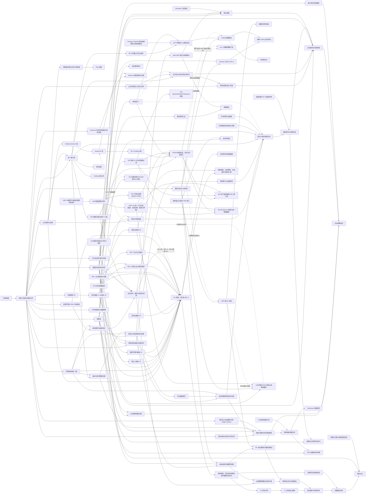
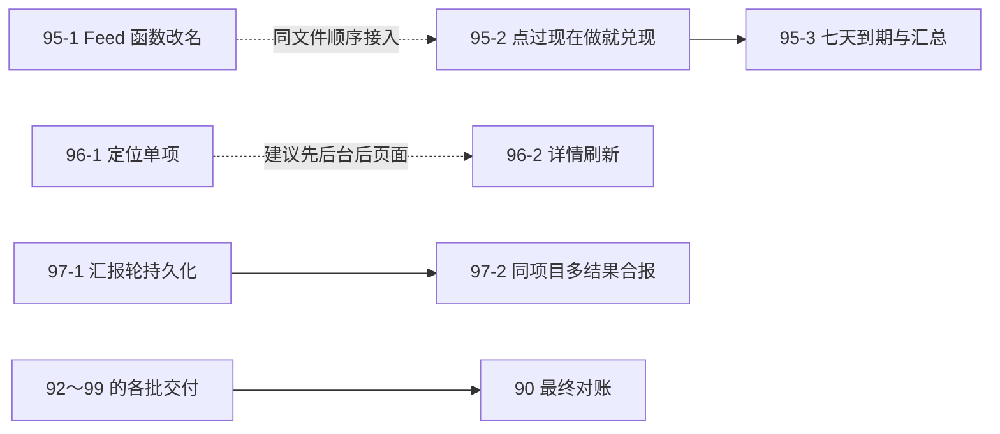
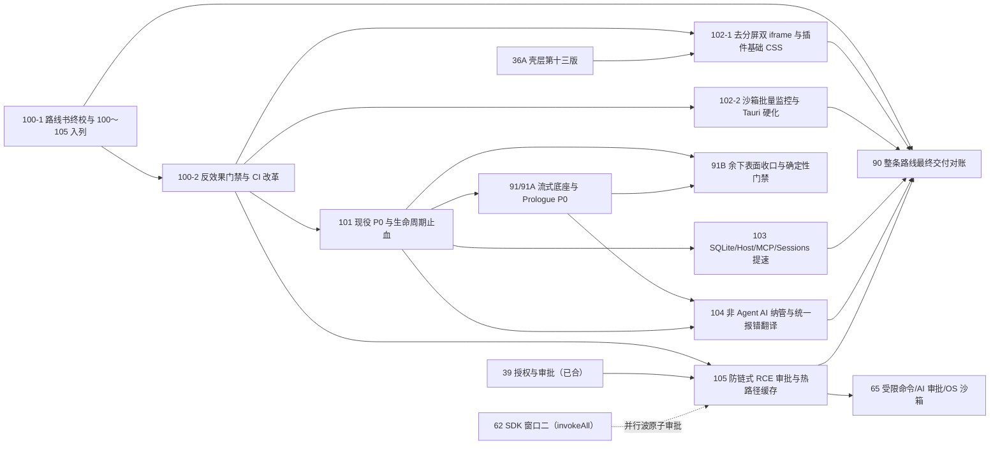
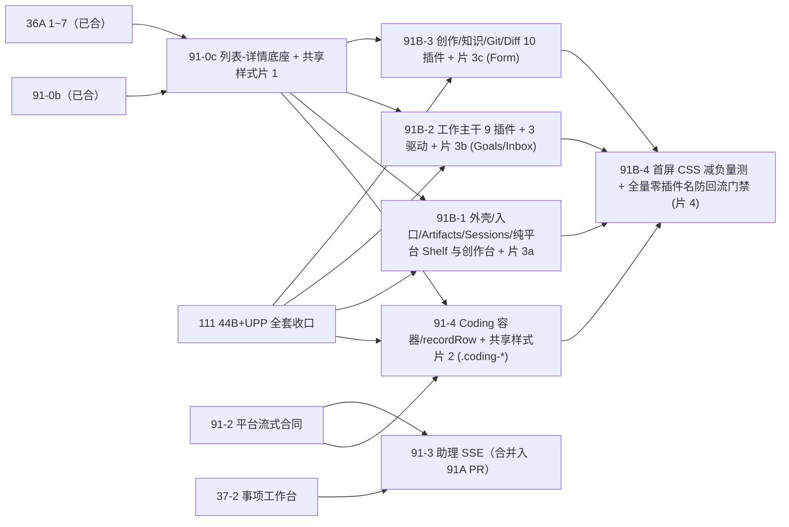
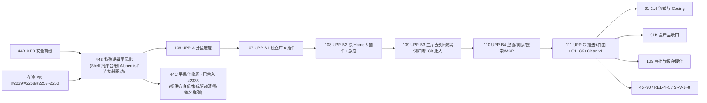

# 排期原则与依赖

[执行目录](../spec.md) · [参考分类](../spec.md#reference)

## 怎么排

**重要度**看三条，同时满足得越多越靠前：

1. **工作接得上**：中断、关掉应用、隔天、换一个入口之后，要求、进度和结果都还在，能接着做。
2. **体验**：常用路径顺、快，不露内部值，不出莫名其妙的错。
3. **易用**：第一次就能用上，不用先弄懂产品的结构。

**依赖**：被好几条线用到的东西先做。这样的地基包括公共资料与目录、统一工作台与输入框、技能包、观测和采集、已有授权与人审的明确边界、Schedule 只读查询、字体皮肤语言的文件格式，以及场景所需的角色与设置公开读写、生成交互页面的承载和恢复能力。个人同步、团队协作、团队记忆和 M2 都要服务端，整体放进[服务端批](server-batch.md#server-batch)（用户 2026-11-03 定）；批内仍是团队身份、对象版本、权限与并发修改先于个人同步合同共同设计，完整团队产品在最后。已有能力先复用，只补当前场景所需缺口。

**冲突**：按文件把工作分成七条轨道，一条轨道独占的文件同一时间只有一个会话在改，轨道之间并行（用户 2026-11-03 定）；每批由一个主会话做完，会话不再按轨道跨批（用户 2026-11-05、11-11 定，[决策记录](decisions.md#decision-26)第 26 项取代第 17 项，[第 34 项](decisions.md#decision-34)）；几批同时做，受每台机器三个构建槽、三个测试槽的额度限制（用户 2026-11-07 定，取代每台一个构建、一个测试）。同一份合同快照、同一批聚合文件和换包照旧串行。会碰到全仓的改动（换 Prologue 包、字体皮肤语言的整体切换）排进固定窗口。细则在[轨道与冲突规则](tracks.md#section-5)。

**升级与兼容起点**：库及带版本文件的升级链从统一起点开始，按 [upgrade-continuity](../../upgrade-continuity/spec.md) 的 U0～U7 落地，不等 M1；第一个装到开发机之外的版本（M1，2026-11-14 起是[发行批](release-batch.md#release-batch) REL-5 的发出，开工由用户定）发出去以后，动作、Manifest、MCP 等合同按过渡期演进（[合同变更流程](../../../docs/system/CONTRACT-CHANGES.md) 第 7 节）。因此技能包、字体皮肤语言 A 段、观测采集、场景与生成页面、智能呈现及主线的必要公共合同都在 M1 前落；同步与团队的合同在服务端批里按过渡期加，带读取兼容（用户 2026-11-03 定）。M1 缩范围建议尚未决定（[决策记录](decisions.md#section-7) 第 18 项），不在排表时默认为已批准。

**不排日历。** 阶段描述能力形成顺序与阶段完成条件；独立任务的实际依赖和合同满足后可向前拿，不等待其他轨道全部完成。长期效果观察只约束对应能力的效果结论与约定发布条件，不作为全体开发的统一等待门。

## 依赖

不带字虚线是只在阶段 1 核出当前 SDK 缺口时才成立的依赖；带字虚线表示可选并入、范围移交或非阻塞底座衔接，不作为硬前置。

### 11-05 按各批核账调整的依赖

统筹 2026-11-05 按 11-04 合入与在审的核账、设计稿重核，改了下面这些前置。全景图的手录依赖（gh-pages `tools/data.py`）同日改成一样的。「部分」指只挡其中一部分，其余可以先做。

| 交付项 | 改成 | 依据 |
| --- | --- | --- |
| 07 | 拆三项：07-1 导航本身只等 03，只有「项目资料」窗格那一块等 05 资料合同和 06-1（先按现有侧栏「文件」接）；07-2a 只等 03，07-2b（N52）等 06-1、06-3；07-3 已随 #1725 完成，BL-880 已删（用户 11-04） | [07](batches/07.md)、#1802 |
| 09 | 2026-11-08 起含能力包（9-8～9-12）：合同稿与目录页定样可先做（名称用户已定）；等 08 的 C-1、C-2 和目录服务，以及 02 交接后的 9-1 合同小 PR；改 composer 的部分排在 10 之后；9-4、9-5 里删旧路径与改存形状的片，在 09 落在 02③ 真实 Home 重建之后时不开工；`molis-coding-method` 用户 11-06 定不认也不迁，`methods:<会话>` 的存量仍等用户定 | [09](batches/09.md) 第八节 |
| 10 | 不再等 09；K0 合同等 02 交接，部分等 05② 的 C-1 | [10](batches/10.md)、#1791 |
| 12 | 12-1 执行目录先做（#1819）；接入输入、输出目录部分等 05②、06、07（BL-1035 与 12 批第 4 条）；09、11 已合入。12-2 留下的过渡字段 `onboarding.takes` 由 44-1 收进统一的接收声明（2026-11-14） | [12](batches/12.md)、BL-1035、[44](batches/44.md) |
| 13 | 合同与服务不等 12，只有「连完回原处」部分等 12 的返回能力 | [13](batches/13.md)、#1816 |
| 15-1 | S-1 不等 16，只排在 05② 的 C-2、C-3 和 14 的 TextRef（SDK 校验等 T4）之后；S-2 与接页面的片仍在 16 切换之后 | [15](batches/15.md)、#1798 |
| 16-2 | 用户 2026-11-11 决定以现有输入入口完成 C 段，K6 另行接入 | [16](batches/16.md#batch-16-item-2)、[11](batches/11.md) |
| 20 | 合同按片排：05② C-1 → 08 C-1 → 05② C-2 → P-1；08 C-2 与 10 K0 可和 P-1 并行，但同一快照仍串行；P-3a → P-2（36 层次合同之后）→ 05② C-3（14 TextRef 之后）→ P-3b/P-3c → P-4；08 C-3 不等 P-3b/P-3c，排在 08 C-1 之后，和共用 `platform/plugin.txt` 的片先准备好的先落（用户 2026-11-07 定）；36-1 的层次合同不等整个 20，采用消费者仍等对应能力 | `specs/scene-and-page-contract/spec.md` 先后表、#1806 |
| 37-1 | 原等 07、16、19、20；页面改归首页服务以后，19 是否仍等，开工前重核（#1806 统筹评论）。统筹推断还要等 15-2 的公共呈现组件，开工前一并核 | #1806、#1808 |
| 25-1 | 已随第 25 批 #2034 于 2026-11-12 合入（`3d844d493a`）；第一片 #1815 先行，其余连同「错过」数据的主人、C 轨合同、BL-108 一起完成（BL-108 已删，编号不复用） | [25](batches/25.md)、#1815、#2034 |
| 45、52 | 45 第 2 项等 20 第 2 项；GitHub 连接开发阶段用测试应用，正式授权在 REL-1（原 26-2）；官方包开发版签名在 26-9、正式签名在 REL-2（#1794；2026-11-14 改）；52 第 3 项等 45 第 2 项 | [45](batches/45.md)、[52](batches/52.md)、#1794 第 13 节 |
| 08 | 02 交接后可先落 C-1/C-2，不等 U1/SQLite 第二步；动表实现仍守 02③ 分界与 05 存储前置；C-3 排在 C-1 之后，不等 20 的 P-3b/P-3c（用户 2026-11-07 定），和共用 `platform/plugin.txt` 的片先准备好的先落；随包签名：开发版 26-9、正式 REL-2（2026-11-14 改，原为 26-1） | [技能包合同稿](../../skill-packs/contract-design.md)第 11、13 节、[技能包需求第 9 节](../../skill-packs/spec.md#9-决策记录)、#1794 |
| 14 | TextRef 在 02 共享核心交接后先行，是 05② C-2、C-3 和 20 P-1、P-3b 的输入（它们的 SDK 校验等 14 的 T4）；14 的 T3 与 08 C-1 不互等，08 先合时，白名单收 `ui.locales` 这一行随 T3 补；不能硬等整个 05②。其他消费 05 的片仍逐片核输入，SDK／服务／真实消费者验收不缩减 | [14](batches/14.md)、[场景合同](../../scene-and-page-contract/spec.md)第 10 节 |
| 05-4 | 02 共享核心已交接；N14 已随 #1961 合入，N22 余片按决定 29 归 56-3 | [05](batches/05.md)、[56](batches/56.md) |
| 06 | 已合入（[#2009](https://github.com/molis-ai/molis-work/pull/2009)，`a720834a09`，2026-11-13）。Files 退役、平台资料服务、N12、SDK 共用实现、N56/N42 首片/N43/46/N44/BL-943/N45/N55、N47～51 均已交付；剩余真实 Home 采用（另授权）、本人验收。N52 已随本批做完，`BL-side-files-merged-reads` 已删除 | [06 现行方案](batches/06.md#batch-06-plan-2026-11-08)、[合入记录](batches/06.md#batch-06-audit) |
| 56-3（N22 余片） | 用户 2026-11-08 定：只等 05 的 N22-02、N22-04，N22-05 还等 N14；不等别的批，也不挡 06～55；57 等它全部合入 | [决定 29](decisions.md#decision-29)、[56](batches/56.md) |
| 41、43-1 | `~31` 已核实是上游缺口（App 模式带有界子代理、Skill 自动选用、「继续这个子代理」入口），改为只挡对应的那一部分 | [24](batches/24.md) SDK 盘点 |

还没核实、开工前要再看的：35-2 的 LSP 走 SDK 还是宿主（决定 31 的去留）、15-3 是否等 20 的 P-4、14 除 TextRef 外各片需要 05 的哪些具体输入、24-3 等 09 有没有实质理由、32 的 `~31`。

### 11-13 按最新代码重核的依赖

统筹 2026-11-13 在 main `ef9c6fcbb5`（含第 44 批插件同等地位收口与 44～89 顺延）上，对照各批文件、认领板 #1743 与代码重核 01～90 和服务端批，改了下面这些前置；全景图（gh-pages `tools/data.py`）同日按同一份结果重建，214 个单元、没有硬环、引用都能解析到项。

| 交付项 | 改成 | 依据 |
| --- | --- | --- |
| 12-3 | 只等 04；已随第 13 批 #1952 合入，不等 06、07、09、11 | [12](batches/12.md#batch-12-item-3)、#1952 |
| 13 | 写成等 12 的第 3 项 | [13](batches/13.md) |
| 07-2b、07-3 | 07-2b（N52）已移交第 06 批，07 不再等 06；07-3 已随 #1725 完成，没有前置 | [07](batches/07.md) |
| 09-1、09-2 | 只有 09-1 等 14-2（T10 回复语言）；09-2 只等 08 | [09](batches/09.md) |
| 14 | 方向写明：14-1 不等 05②，05② C-2、C-3 的最后一片等 14-1 | [14](batches/14.md) |
| 17、19 | 14 写成 14-1 | [17](batches/17.md)、[19](batches/19.md) |
| 26-5（U4） | 05 的升级链与两类 SQLite 原生授权、25-2 的失败隔离均已合入。签名包升级随第 26 批交付 | [26](batches/26.md) |
| 33 | 12 写成 12-1、12-2；12-3 已合入 | [33](batches/33.md) |
| 42 | 已合入（[#2107](https://github.com/molis-ai/molis-work/pull/2107)，`4cf1c742e6`，2026-11-17）。前置 30（评测路径）、41（自己写的技能）均已合入，2026-11-16 开工时核过；没有后续批等它。62 的方法链与 73 的技能包导入导出不等 42：草稿只在「我的技能」包里成版，导出的仍是已采用的版本 | [42](batches/42.md) |
| 36 | 角色和主线服务已合入（[#2111](https://github.com/molis-ai/molis-work/pull/2111)，`bdfcc36454`）。前置 03、05、13、15、28、32 均已合入，层次合同已先于 20 合入；37 的事项切换与 53、64 的事项来源接主线服务。ROLE-14 待本人验收 | [36](batches/36.md) |
| 35-2、41、43-1 | SDK 缺口已由 24 核实：只有 LSP、自动选用、子代理与续跑入口那一部分等 31-1，其余先做 | [35](batches/35.md)、[41](batches/41.md)、[43](batches/43.md) |
| 37-1 | 不再写死等 19：基础首页回退已由 15-3 做完；19 的综合首页只在页面要挂上去时才等 | [37](batches/37.md) |
| 37-1、52-1 | 19 的实现给过首页主区内容（`overview.lead`，2026-11-22 已删，决定 62 ③，37-1 不再需要定它与生成页面谁优先）与简报的保存、刷新动作；52-1 用 `work-brief.briefs.save@1`、`refresh@1`，不另建存储（2026-11-14，随第 19 批的 PR） | [19](batches/19.md)、[37](batches/37.md)、[52](batches/52.md) |
| 44-6 | 加上批前置里的 41-2（删 Goals Home 半实例，已合入 [#2078](https://github.com/molis-ai/molis-work/pull/2078)）与 06 的宿主调用结论；截止说明改为片 1 与片 7 | [44](batches/44.md) |
| 47-2 | 等 26-5 的 U4、26-7 的 Manifest 状态声明、26-8 的只报告词汇检查 | [47](batches/47.md) |
| 48 | 57 只再验正式产物，不是本批前置 | [48](batches/48.md) |
| 66-3 | 32-2、39、44-3、53 | [66](batches/66.md) |
| 75-2 | 加 09-2 的能力包目录 | [75](batches/75.md) |
| SRV-8-1 | 25-3 的回到上一版、REL-4 的副本演练（原 26-6）、REL-5（M1；2026-11-14 改） | [SRV-8](batches/srv-8.md) |
| 32-2 | 沿用第 39 批先交的共用审查合同；32-2 已随 [#2093](https://github.com/molis-ai/molis-work/pull/2093) 合入，并在 [39-2](batches/39.md#batch-39-item-2) 接通通用可信决定入口（[决定 43 补充](decisions.md#decision-43-review-order)） | [32](batches/32.md#batch-32-item-2)、[39](batches/39.md#收尾检查) |
| 39 | 删去找不到出处的「02 的政策边界」，只等 13、24（用户 11-13 定）；39-1、39-2 已做完（[第 39 批收尾检查](batches/39.md#收尾检查)） | [39](batches/39.md) |
| 39 的服务消费 | 44-1、53、65-2、66-3 消费 `project-approvals`／受保护决定入口；61 消费 `automation-recommender` 只读建议；45 只以 39 为批次前置、未单列 automation；64 没有 39 依赖边（64-2 是智能组合，不是 CEX 执行器） | [39](batches/39.md#收尾检查)、[44](batches/44.md)、[53](batches/53.md)、[61](batches/61.md)、[65](batches/65.md#batch-65-item-2)、[66](batches/66.md) |
| 31-2 | Memory P0（#2020）已合入、P1 短合同已冻结，随 [31](batches/31.md#收尾检查) 完成 | [31](batches/31.md) |

上面一节「还没核实」里，41、43-1、35-2 的 SDK 缺口已由 24 核实，35-2 的 LSP 归属已于 2026-11-12 由用户定走宿主侧并在 [31-1](batches/31.md#batch-31-item-1) 落地。这次仍没写到项的：69、89-1 的「53」（图里按 53-2 推断）、68／71／72／76～78／82 等对多项批次只写批号的前置（图里按语义推断，带 `*`），以及 73-1 为什么等 46。

### 11-14 记忆整理与召回优化（11-18 确认，64-8、64-9 已移到 63A）

按[决定 46](decisions.md#decision-46)（2026-11-18 确认；落点按下文「11-18 复查」改为 63A），[Memory spec §15](../../prologue-memory-strategy/spec.md) 的方案并入后续批次，依赖变化如下：

| 交付项 | 改成 | 原因 |
| --- | --- | --- |
| 31-2 | 「空常驻不发召回」由上游 molis-ai/molis-prologue#121 做掉，已随 [31-2](batches/31.md#batch-31-item-2) 换入公开 main `3825662d` 官方包生效（不改 Agent Host）并记下 `BL-1072` 方法下的零模型诊断值；P1 短合同已补 20 版计数历史撤销窗口与每条自动改动的 `policy` + `trigger_evidence` | 同在 P1 历史与换包 |
| 62 | 加记忆与会话检索清单：上游第 1、3 项已做，第 2 项撤回（Host 侧归 64-9），第 4 项视 P2-01 合同 | 历史分工。现由 62 窗口 B 交第 2 项的 LRU／scope 列行，63A-2 消费，见[现行顺序](#recall-delivery-order) |
| 63 | 加记忆样本与逐段定位 | 64-8、64-9 的效果到 76 验 |
| 64-8（新） | 等 Memory P0（已合入）；上游关系输出若需要，等 62 | P2-01 的判断合同给 64-9 用 |
| 64-9（新） | 等 64-8、62 的清单、32-2、44-2；候选公平要 Host 能按 scope 区间列行 | 整理的证据来自认可与返工，去处建议要项目指导 |
| 64-5 | 常驻层叠在 64-9 上 | 上浮下沉由整理提议 |
| 76 | 加整理与常驻的长期观察 | 观察期满才下结论 |

### 11-13 按插件同等地位复查后续批次

用户 2026-11-13 要求把和 Goals 耦合深的后续批次都按最新设计（[插件同等地位](../../plugin-equal-standing/spec.md)，[决定 42](decisions.md#decision-42)）复查、改方案、理顺依赖。统筹分四组读了 12～90 与服务端批的批次文件和来源需求书，共 66 处冲突：多数是「默认项目里有 Goals」「要求、证据、决定存在 Goals 里」「平台合同或通用操作写死 Goal」「靠胶囊、CLI 的 Goals 命令或 `goal-advance`」。批次文件与需求书已按新设计改写（每处带出处），四个需要拍板的由用户定（[决定 43](decisions.md#decision-43)）。依赖上的变化：

| 交付项 | 改成 | 原因 |
| --- | --- | --- |
| 12-2 | 先落「插件声明可承接上手材料」的最小形式（从 44-1 前移），Coding 第一个声明 | 不在上手服务里再写死一个插件名（决定 43） |
| 31-2 | 先落记忆 `applies` 的通用对象引用 `objects`（从 44-1 的 C3 前移，已随 [31](batches/31.md#batch-31-item-2) 完成） | 导出 v2 一开始就不带 `goal_ids` |
| 32-2、39-1 | 第 39 批先交的共用审查合同已由 [#2069](https://github.com/molis-ai/molis-work/pull/2069) 合入；32-2 已随 [#2093](https://github.com/molis-ai/molis-work/pull/2093) 拥有要求、证据关联和认可等业务事实，39-2 将 `acceptance.decide@1` 与助理任务决定统一接到平台通用决定入口并完成 APR-15／16 验证 | [授权需求 §3.5](../../agent-approval/spec.md#review-contract)、[决定 43 补充](decisions.md#decision-43-review-order) |
| 46-1 | 加 44-1；覆盖门禁（W4-7）另等 44-6 | 情境焦点（C4）与外壳替 Goals、Feed 声明对象 |
| 46-2、73、SRV-2-3 | 加 44-5（SRV-2-3 另加 44-2、39-2） | 资产包、导出、同步按插件声明的段，不带固定 goals 段 |
| 53-1 | 32 改为 32-2；加 44-1；`goals.events.acknowledge` 的拆分等 39-2、44-3 | 对话输入关联用主人声明的关联类型 |
| 53-2 | 加 32-2、39-2、44-1 | 证据链、验收卡、决定卡读平台能力；等你不认 `goal_decision`（新增 C8） |
| 53-3、64-2、69-2、89-1 | 加 44-1（64-2 另加 44-5；69-2 另加 32-2；89-1 另加 39-2、44-3） | 「挂到…」「变成…」的候选取声明，不写 Goal |
| 56-3 | T01（Goals）与 S1 排在 39-2、44-2、44-3、44-4 之后 | 搬走的动作随新主人迁，不在 Goals 迁一次 |
| 57 | 加 44 全部 | 不装 Goals 的走查要用；合同兼容起点要晚于 44，2026-11-14 随 M1 移到 REL-5 |
| 64-6、66-1 | 加 32-2（64-6 另加 44-1） | 工作目标、完成标准、自检结论挂在平台要求认可能力上 |
| 68-5 | 加 44-6 | 样例插件依赖 Goals 时要能提示添加 |
| 71-2 | 加 41-2、44-7 | 方法翻译按规划技能的位置；胶囊已删 |
| 73-1、75-2 | 排在 44-7（75-2 另加 41-2）之后 | 能力包目录不再有 `goal-advance` |
| 83 | 加 44 | 各插件声明按 44 之后的归属核 |
| 84-1 | 先落「插件在 Manifest 声明命令、CLI 按已装插件生成子命令」 | 平台 CLI 不写 Coding（决定 43） |
| 26-5（U5 2026-11-14 移到 REL-4-1） | U5 过渡清单内容等 39-2、44-1，M1 当天再核 | 不为 Goal 一等字段单独写过渡 |

只改了说法、依赖不变的：17、19、26-1、26-7、28、33、36-2、37-2、45、47-2、48-4、52、56-1、63、76、85、90、SRV-1、SRV-5（都加了「没装 Goals 也完整」或改成通用引用）。删胶囊连同第 25 批的运行面板一起删，RES-12 暂时失效、52-1 不再依赖它。

几条硬依赖，排序时不能反过来：

- 先走通已有材料到项目内继续工作的基础路径：多位置、真实代码与混合文件支持、模型步骤、生成失败/改范围/重启、采用和 Coding 接续。基础路径不以团队、新交互首页或全产品治理结束为前置；场景扩展须消费这条已验证路径。
- 场景引导先定完整高保真路径与设置覆盖，再对齐技能包、角色、设置公开读写、场景与页面合同；生成页面的预览、校验、隔离运行、保存和恢复就绪后，才算首条场景闭环可交付。新交互页面不是已有卡片重排，也不等阶段 4 的完整创作台重做。
- 项目助理团在阶段 2 必须能实际承担和交付工作。先核当前运行时，必要的 SDK 缺口进换包窗口一；完整子代理入口与直接对话仍在阶段 3，不能把它们混为同一个依赖。
- 模型配置、材料导入、现有连接与工作流程先复用；只提前引导必需的只读推荐片，不把完整自动化建议或所有外部连接验收变成首条场景的前置。单次任务复用在首次/项目闭环之后，接快速创建与插件声明；持续主动工作、周期报告和完整导入导出再接上，不另开首跑。
- 基础首页与 Work Brief 先共用公开来源、呈现组件和通用挂载，平台基础首页不依赖插件安装或模型。首页是平台能力（`horizontal/home`），插件经 05② 注册卡片，按描述生成的页面归首页内容，不当插件（用户 2026-11-04，见 [20](batches/20.md) 与 #1806）；Work Brief 是注册卡片与简报的普通插件，再接每日和周期报告；停用／失败可回基础首页。普通材料进入项目与原插件工作不等待这些高级能力。
- 每日状态简报要先有 Work Brief 综合首页与简报核心、Schedule 能读待办/Inbox/日程/目标（E1）和技能包。报告涉及的变化与历史依据先由采集层接通，不能把旧内容导入算成新成果；报告、记忆使用与评测共享事实，分别验证。
- 个人助理的主对话与明确交办任务先复用统一输入、任务／执行合同及既有授权，补真实缺口并验证可视化和恢复；不等完整采集、每日简报或子代理直接对话。基于历史的主动发现与综合报告再依赖完整工作记录、技能包、每日简报，以及侧栏「打开 → 定位 → 高亮」联动，并复用同一后台任务体验。
- 事项线（2026-11-12，[决定 38](decisions.md#decision-38)）：32-3 等 11、15、24、25，32-1、32-2 的界面叠在 32-3 上；36-2 与 37-2 因此多等 32（主线服务包在 32 建）；53、58、64 的对应项只多一段衔接，前置不变。
- 事项线改方向（2026-11-14，[决定 48](decisions.md#decision-48)）：事件登记合同（插件与助理把事件放到线上）从 36-2、53-2 提前到 32 的合同子分支，36-2 在它上面加事项与下一步，53-2 只接更多登记方（日程、Inbox、工作流程、Pages），前置不变；37-2「在途任务归属不变」改用后台任务面板里每行标的事项表达；58、59 的子代理直接对话沿用 32 做的「发给」里选对话对方；32-1 多等本批自己的 Prologue 改动与换包（不等 31 之外的换包窗口）；56-1 读的「等你」统一读取、32-1 用的后台任务总表都在 32 的合同子分支。第 07 批的右侧「后台任务」页随 32 删除。
- 插件同等地位收口（2026-11-13，[决定 42](decisions.md#decision-42)）：[44](batches/44.md) 的三项跨批前置均已就位——[39-2](batches/39.md#batch-39-item-2)（可信决定合同与服务已随第 39 批完成）、[32-2](batches/32.md#batch-32-item-2)（平台要求认可能力已合入 [#2093](https://github.com/molis-ai/molis-work/pull/2093) 并在 39-2 接通通用决定入口）、[41-2](batches/41.md#batch-41-item-2)（规划方法变技能，已合入 [#2078](https://github.com/molis-ai/molis-work/pull/2078)）；45（新项目不带 Goals）、47（第三方第一次拿到的声明与合同）、66-3（依据三档落在平台能力上）等 44；44 最晚在 57（M1）前合入，否则改合同每处都要留读取兼容。
- #1730 的逐项证据与返工复核随明确交办在 32 交付，57 验真实完整路径，不等完整采集、主动发现或 Coding 质量产品；准备／通知判断和观察试用在 64，消费获准来源、采集、有效 Skill／配置版本及预算／停止控制，试用不成为所有主动任务的前置。评测扩展 63 与主动实现 64 互不以整项结束为前置，在 76 汇合；89 的历史 Skill 效果对比保持独立。
- 服务覆盖从 [61 的矩阵与现有接入](batches/61.md#batch-61-item-1)交给 [62-1 补 SDK 和逐服务验收](batches/62.md#batch-62-item-1)。[65-1](batches/65.md#batch-65-item-1)消费 61 提供的默认搜索动作和 [62-2](batches/62.md#batch-62-item-2) 的联网边界。Feed 网页查询和炼金术消费 SEL 的缺口属于 [62-1 G-01](../../assistant-service-connections/service-matrix.md#g-01)。基础 Computer Use／Git 路径可先做，完整质量评估接 66。
- 子代理的直接对话、Coding 的目标芯片、语音、情境的「放进输入框」都长在输入框上：输入框先定一个主人和一份组件，再往上加。第 58 批已按用户 2026-11-16 的定样决定复用同一输入组件，在右侧浮窗本地挂载独立子输入，底部主输入保持主助理接收者（[决定 49](decisions.md#decision-49)）。58 交公共视图与可工作的读写/控制端口；59 由 [#2115](https://github.com/molis-ai/molis-work/pull/2115) 接真实历史、原输入回执、准确执行引用和跨重启恢复；用户于 2026-11-16 将原属 43-1 的最小业务 SDK 派发接线移入 59，并授权可信子输入、原请求查询/接续去重、父子归属及回报的最小上游窗口与官方包采用；完整助理团产品仍归 43-1。Coding 的已有重试与预算沿 33 复用；59 的 SDK 重启接续复用原 Session 的已接受答案，Prologue #134/#135 提供同目录新 grant 和接受前检查（原需求 §12.10）。完整助理团的交付、其余批次的顺序与阶段退出条件沿原决策。
- Coding 质量保证需要子代理入口和已对齐的授权／人审合同；只有明确要求人审的范围才等待对应票数。已有许可直接执行，AI 低风险代批不计作真人批准；代码现代化在质量保证之后。
- 字体皮肤语言 A 段（14）先于智能呈现第一片（15），新格式的声明、读取与消费者成套验证；合入边界见 [执行目录](../spec.md#execution-batches)：现有入口在 16 一次切换之后，新格式消费者才合入，不引入新旧文字双轨。字体皮肤语言 C 段要求 PG-070、PG-071 已落地；创作台诊断、交互切片和必要合同前移，正式生成插件交付在 C 段之后，采用新的样式与文字。新能力插件完整交付不等待阶段 3 的完整质量保证产品，可复用现有评审与验证；场景组装合同在 3·C 细化、阶段 4 完成 Alchemist。它复用生成页面公共能力，不依赖 Onboarding 产品验收。
- 05② 的目录实现片（id 与路径脱钩）要早于首次外部安装：之前两台设备关联同一路径会得到相同的目录 id，同步一打开，Agent 就可能读到本机同名文件且没有提示（用户 2026-11-07 接受这个缺口，条件是这个先后，见 [05② 第 3 节](../../shared-sources-and-surfaces/spec.md)）。
- BL-023 目录模型已定。C/D 先交公共资料身份、目录授权／读写与选择器，B 接 Coding/Git，F 接材料引导；统一标签、分屏和定位在 D 落。Files 必须等消费者、历史引用、快照／选区和过程项的主人接好并回读通过后退役，不以目录 UI 完成代替。
- 个人同步、团队协作、团队记忆与 M2 都在[服务端批](server-batch.md#server-batch)，排在 M1 之后，开工由你定（用户 2026-11-03）。个人同步要按防腐收尾后的插件数据形状（声明的表、分区库、双实例）重接，同步声明按 M1 之后的合同过渡期加；身份、版本、权限及实时编辑共同设计先于同步合同；人与 AI 同改、撤权及断线恢复的关键验证先于完整团队产品，完整团队产品再等待个人同步和团队访问能力。
- 周期报告要先有跨项目的只读汇总（产品建议 D5）：system-search 明确不跨项目，汇总读的是工作记录。
- Sessions 的历史发现、读取和项目归属先进入阶段 2 的引导接续；持续跟进、控制与交接在阶段 3 完成。逐产品／入口保留全量清单，分段交付不缩小厂商范围，也不要求全部控制能力成为基础材料路径的前置。
- 合同改动多的地基排在 M1 之前（[排期原则](dependencies.md#section-2)「兼容起点」）；同步与团队的合同在服务端批里按正式兼容流程加，不为赶 M1 提前冻结。
- 创作台生成的插件要与别的插件同等待遇：新能力插件正式交付之前，先把创作台与生成插件迁到 Plugin Runtime（privileges 的 PG-083，本轮绕过的那一行），并让沙箱包拿得到 PG-017 给的服务（BL-916 一类）。图里是 PBR → PB。
- 换包窗口一只在阶段 1 核出主对话、后台任务或项目助理团缺 SDK 能力时才挡这两项（图中虚线）；核出不缺就不等窗口。
- 升级 U0 → U1 → U3／U4／U6；U2 先留统一起点的金样，U1 合入后开回放门禁。U5 与库升级链分别准备，在 M1 前会合；每次换包与发布前跑全部金样。U7 整份导出／导入排在阶段 3，不等同于在线备份（服务端批 SRV-8）。
- 智能呈现先在 05 交声明／公共校验合同，14 交文字合同，15 建组合服务并在其中完成确定组合，再做动态形态与跨插件挂载；前两片不等模型，证据链另等采集历史。助理组合等 Skill、MCP、Tool 能力；生成插件的呈现等 Plugin Runtime 迁移，保存视图复用生成页面运行时。
- 主线先与工作台共同设计，阶段 2 按合同 → 独立主线服务 → 事项切换及来源接入推进，复用智能呈现、placement 和原工作台状态；先项目内，跨项目个人视图与助理建议放阶段 3，跨设备由服务端批的个人同步承接。文案与帮助随各入口实施，不等字体皮肤整体完成。

### 11-14 平台能力审查加的依赖

[平台能力通用化审查](../../../docs/reviews/platform-capability-audit-2026-11-14.md)（在 main `9aab01f8e4` 上，只读）找出 10 处该是平台能力、现在各写一份的地方，按「平台那一份先做、消费者在后」分进还没开工的批次（[决定 44](decisions.md#decision-44)）；在途的 12、17、19、26、28、33、36、37、39 不分配。每批写了什么见各批文件的「平台能力审查分来的」一节。

| 审查项 | 平台那一份 | 要等它的 |
| --- | --- | --- |
| 1 接收与挂接的声明 | 44-1 | 44-5、46-1、53、64-2、69-2、75-3；12-2 的 `onboarding.takes` 是过渡形状，由 44-1 收进 |
| 2 对象引用与打开地址 | 32-2（合同子分支） | 32-3、44-1、53-2、56-1 |
| 3 后台工作的状态 | 32（合同子分支；后台任务面板从助理对话框右上角的图标打开，定样方案 E） | 32-1、32-3 |
| 4 「等你」与提醒 | 读侧 32-3；写侧 56-1 | 53-2 |
| 5 设置声明 `settings_entries` | [38-1 采用与主人设置读写](batches/38.md#收尾检查) | 40 的个人设置、44-6 的 H3「设置节」、52-1 的简报设置复用原声明 |
| 6 对话附件 | 35-2（附件合同子分支） | 35-2 的 Coding 图片输入、助理同批迁 |
| 7 插件数据分段 | 44-5 | 68-2、73-3、73-4 |
| 8 重复规则 | 52-1 | 55-1 |
| 9 新建与起步入口的声明 | 44-1（与第 1 项同一子分支） | 45-1、46-1、53-3 |
| 10 插件之间按角色发现 | 44-5（片 7 扩到插件之间） | — |

32 与 44 因此各多扛三项合同：32 的合同子分支要先于它的界面子分支，44-1 必须在 47 之前合入，让第三方插件作者第一次拿到的就是同一套声明。

### 11-14 发行拆成独立批后的依赖

用户 2026-11-14 定只为对外发行的事拆成[发行批](release-batch.md#release-batch)（[决定 45](decisions.md#decision-45)）。图里的「M1 发版」现在就是 REL-5；下面的改动取代 11-05、11-13 两节里对应的行：

| 批次／项 | 现在的前置 | 文件 |
| --- | --- | --- |
| 26 | 只留 26-5（U4）、26-7、26-8 和新增的 26-9；26-1～26-4、26-6 与 U5 移到 REL-1～REL-4 | [26](batches/26.md) |
| 47 | 26-5、26-7、26-8 对应库升级、状态合同及报告，三项随 [#2079](https://github.com/molis-ai/molis-work/pull/2079) 交接 | [47](batches/47.md) |
| 54 | 不再等原生组件预置（在 REL-2），开发阶段用本机已装的组件 | [54](batches/54.md) |
| 57 | 开发版上的完整路径；仍等 44 全部合入（不装 Goals 的走查要用）；合同兼容起点与决定 18 随 M1 去 REL-5 | [57](batches/57.md) |
| 45-2、52-3 | GitHub 连接开发阶段用测试应用，不等正式授权（REL-1）；官方包正式签名在 REL-2 | [45](batches/45.md)、[REL-2](batches/rel-2.md) |
| 71-2 | 字体随安装包分发的核对移到 REL-2，本项不再等第 23 项的字体分发依据 | [71](batches/71.md) |
| 75-1、75-2 | 不等 26；BL-812 日志端口原写「75 与 REL-3 谁先用到谁定」，11-18 起 75 不再依赖它，归 REL-3（见下文 75 一行） | [75](batches/75.md) |
| 44 | 截止仍是 47 开工前；最晚改为 M1（REL-5）之前 | [44](batches/44.md) |
| 56-3 | 不变：仍按决定 29 在 57 开工前全部合入，不因拆出 M1 放松 | [56](batches/56.md)、[决定 29](decisions.md#decision-29) |
| REL-1～REL-5 | REL-1 随时可做只读核查；REL-2 等 26-9、45-2／52-3 做出的包（真实签名等 REL-1，之前用开发档走通）；REL-3 等 26-9；REL-4 等 26 的 U4 与 26-7、39-2、44-1；REL-5 等 57、44 与 REL-1～REL-4 | [发行批总则](release-batch.md) |
| SRV-1、SRV-8 | 等 M1 改为等 REL-5；SRV-8-1 的副本演练等 REL-4 | [SRV-1](batches/srv-1.md)、[SRV-8](batches/srv-8.md) |

### 11-18 未开工批次复查后的依赖

用户 2026-11-18 对照 main `eaa6b47492` 与在途 PR 复查 37～90 与服务端批后定（[决定 52](decisions.md#decision-52)），依赖变化如下；各批文件的「11-18 复查」一节写了理由。

| 批次／项 | 现在的前置 | 文件 |
| --- | --- | --- |
| 36A（新） | #2103 合入；36（事项容器）；P0 由 #2110 单独修 | [36A](batches/36a.md) |
| 37-1 | 加 36A-6（第一页与正文挂载位）；回退链改为「生成页面 → 默认第一页」；**PR [#2288](https://github.com/molis-ai/molis-work/pull/2288) 交付**（解锁 45-1 的生成首页运行消费） | [37](batches/37.md) |
| 37-2 | 加 36A 的壳层（左上角「项目 › 事项」那一格，[决定 53](decisions.md#decision-53)；对齐[决定 66](decisions.md#decision-66) 个人空间置顶与 R21 右栏 IM）；没装 Goals 的验收先用夹具，真装卸等 44-6；**PR [#2288](https://github.com/molis-ai/molis-work/pull/2288) 交付**（满足 91A / 91-3 对 37-2 的前置） | [37](batches/37.md) |
| 38-1 | 提供 `horizontal/blueprints` 的采用记录、继续与撤销，内置设置经原主人写入；45 接签名场景包及三方升级 | [38](batches/38.md) |
| 40 | 加 38-1、#2120；40-2 缩为帮助入口、权限费用提示与状态词 | [40](batches/40.md) |
| 43-1 | 前置均已合入（24、31-1、32、36、59），范围缩为 ONB-20 与助理团控制 | [43](batches/43.md) |
| 43-2 | 加 44-1（通用接收声明） | [43](batches/43.md) |
| 45 | 43 改为 43-1；加 36A；生成首页在完整闭环内，等 37-1 的草稿保存、按原请求回读和本人批准（[复验](../../archive/b37-review-fixes/spec.md)）（决定 19 不拆）；采用服务用 38 的 | [45](batches/45.md) |
| 48 | 加 44-1（声明形状） | [48](batches/48.md) |
| 48 | 47 把创作台归为平台（用户 2026-11-22 定）后，原 47-1 C 的「宿主能力经动作目录提供」挪到 48（第 6 项）；它等 47 合入，不加别的批间依赖 | [47](batches/47.md)、[48](batches/48.md#batch-48-item-6) |
| 52-1 | 结果页按 36A；起点含 #2118 | [52](batches/52.md) |
| 53 | 定样按 36A；系统通知只在 56-1 | [53](batches/53.md) |
| 54 | 复用 Host 已有本机语音下载；BL-398 从 55-7 移入 | [54](batches/54.md) |
| 55-1 | 加 52-1（平台日历重复规则） | [55](batches/55.md) |
| 56-2 | 加 #2120、36A 之后 | [56](batches/56.md) |
| 63A（新） | 63（记忆样本）、44-2、44-5、BL-b42-followups ①、32-2；62 清单第 4 项视合同 | [63A](batches/63a.md) |
| 64 | 64-6 等 63A（原文查询）；64-1、64-7 等 BL-b42-followups ①；原 64-8、64-9、常驻层移到 63A | [64](batches/64.md) |
| 62 | #121 已随 31-2 换入，本批不为它换包；清单消费方改 63A | [62](batches/62.md) |
| 65 | 65-1、65-2 读 62-2 的出站边界；65-2 接 35 决定 51 移来的工具获取 | [65](batches/65.md) |
| 66 | 加 CQA PR 多代理评审一组；66-3 缩为 Coding 提交证据与外部自报 | [66](batches/66.md) |
| 67-2 | 接 GitHub 评论与浏览器余项（84-1 去掉） | [67](batches/67.md) |
| 68 | 68-1 加 26-5、42；68-2 加 44-5；68-5 定为 14 个样例 | [68](batches/68.md) |
| 72 → 77 | 72 并入 77 第一个子分支；77 前置改为 37、38、68、73-1、73-2；73-2 不再等 72 | [72](batches/72.md)、[77](batches/77.md)、[73](batches/73.md) |
| 73-1 | 去掉 46 | [73](batches/73.md) |
| 75 | 去掉 BL-812，改读 28 的记录；75-2 加 BL-b42-followups ① | [75](batches/75.md) |
| 82-2 | CGS 技能包化只等 08、41、42，可提前；本体放下（决定 14） | [82](batches/82.md) |
| 84 | 加 44-5；C3 接记忆并入 84-1 | [84](batches/84.md) |
| 85 | 84 改为 84-2 | [85](batches/85.md) |
| 86 | 加 63（实验跑在评测路径上） | [86](batches/86.md) |
| 91（91A） | 按最大号追加并合并全站体验底座与开发指引（[决定 54](decisions.md#decision-54)、[决定 55](decisions.md#decision-55)），**不等 38～89**：91-1 等 36A-7；91-2 等 31（已合，若不跨窗口换包则上游包随 62 换入）；91-3 等 91-1、91-2、36A 壳层（1～3）与 37-2；91-4 等 91-1、91-2、35-2 与 36A-4；91-5 等 91-1 与 36A | [91](batches/91.md)、[对话与执行流式体验](../../conversation-execution-ui/spec.md)、[全产品体验打磨](../../product-experience-polish/spec.md) |
| 91B（新） | 紧接 91（91A）合入（[决定 55](decisions.md#decision-55)），**不等 38～89**：91B-1／91B-2／91B-3 物理目录正交，均等 91-1 并可并行推进；91B-4 等 91B-1～3 | [91B](batches/91b.md)、[全产品体验打磨](../../product-experience-polish/spec.md) |
| 90 | 保持为整条路线最终交付对账，前置包含追加的 91、91B 与 92～99 | [90](batches/90.md) |
| SRV-1、SRV-2 | 决定 13 作废；对账与补齐 main 上已有的 #1877 实现 | [SRV-1](batches/srv-1.md)、[SRV-2](batches/srv-2.md) |

### 11-20 依赖校正（[决定 57](decisions.md#decision-57)）

| 批或项 | 变化 | 见 |
| --- | --- | --- |
| 40-2 → 45-1 | 40-2 不再把 45-1 列作前置（40 排在 45 前，原写法成环）：40-2 只交帮助入口（已随 [#2204](https://github.com/molis-ai/molis-work/pull/2204) 就位并预留固定 `nextStep` 槽位）；45-1 做「从帮助进入准备再返回」的机制并接上 40-2 的入口，45 前置加 40-2 | [40](batches/40.md)、[45](batches/45.md) |
| 43 | 批次前置补上 43-2 用的 44-1（44 已由 #2155 合入，不再等） | [43](batches/43.md) |
| 75、REL-3 | BL-812 日志端口只归 REL-3；上表「75 与 REL-3 谁先用到谁定」作废 | [REL-3](batches/rel-3.md) |
| 55、64、70 | 可按子域拆成几个 PR；依赖不变，先行的合同或平台能力那组先合 | [55](batches/55.md)、[64](batches/64.md)、[70](batches/70.md) |
| 47、48、68 | 第一个子分支先修 11-03 复现的断点，不加新的批间依赖 | [47](batches/47.md)、[48](batches/48.md)、[68](batches/68.md) |

### 22 条 Backlog 的执行依赖（2026-11-18）

按[决定 56](decisions.md#decision-56)，第一轮三个会话分别执行 [73-3 的知识卡恢复](batches/73.md#batch-73-item-3)、[95](batches/95.md)、[93](batches/93.md)。三个会话可并行，73-3 的离线切片先修，U7 与权限回归另验。

92、93、94、98、99 各从已有入口开始。92-1 先核已有图片手册 PR，其他两项能单独开展。96 与 95 只在 Schedule 存储或公用夹具上协调，98 与 47-1 只在公共合同或快照共写时串行。其余现有批次前置见各批交付行。[正式归属与逐项前置](backlog-dispatch-2026-11-18/README.md)

### 11-19 Harness 工程与 RSI 审阅后的批次与依赖调整（[决定 58](decisions.md#decision-58) ②）

用户 2026-11-19 拍板 Prologue 与 Molis Work 双仓 Harness 系统化优化及 RSI 审阅，并于 2026-11-20 经两轮红队终校补充强制护栏（决定 58 ②），按以下边界并入既有批次（只更新排期与范围，不改业务代码或提前换包）：

| 批次／项 | 调整后的关键范围与前置 | 文件 |
| --- | --- | --- |
| 91（91A） | 91-2 获准随本批（或 91A 前单开小窗口）一次完成 M5 `vendor/prologue-sdk/` 换包（消费 `#142`/`#143` + 审计后 P1 修复合入 `molis-prologue` `main` 的提交，含 KV-Cache 失效指纹、Anthropic 多断点、`edit` 防 `$` 损坏与唯一性、流式落盘解耦、OpenAI `include_usage`、熔断与钩子/凭据技能修复），并同步落 Molis 侧剩余 P0 热路径与缓存止血（去 `molis-child` 随机 UUID 且保留 Batch 59 `BUSINESS_SUBAGENT_HOST_TOOLS` 改幂等 `ensurePublishedChildRole`、`prologue-skill-reads.ts` 结构化 `SkillPick` 回执、`taskText` + `modelOrigin: "label"`、OpenAI `maxOutputTokens` 留 `undefined` 仅 Anthropic 按族夹逼、`prompt_cache` DB 留 `"off"` 仅已验证模板默认 `"best-effort"` 并放宽 `PA-24`、`runtime:clock` 保持 `developer` 层、`stop-guard` 预筛与用已有 `ActionService.discoverOne()` 禁盲整轮缓存、`ending-review` 保现状；**以下项 `[已随 #2301 落地]`**：助理技能去 `.slice(0,20)` 与父会话 `s1..sN` 短句柄、`situation` 分钟级降精度/冷到热排序/30 条上限锚定、`ending-review.ts` `promptCache` 透传、`mcpTools`/`actionTools`/`askUserReferenceKinds` 确定性排序、助理/Coding 压缩与复盘提示词及 `design-accessibility` 中英对齐） | [91](batches/91.md) |
| 62 | 承接 SDK 窗口二 Harness 升级：`openai-responses` 内置协议与 DeepSeek `reasoning_content` 回放；全面静态化工具面（过 MiniMax G1–G4 再停 `parameterBranches`、Anthropic 按需 `defer_loading`、Coding 可读命名空间短名保留 `act__` 守 `S-28`）；`apply_patch` + `read-resource`/`grep-resource` + 先修 `invokeAll` 漏传回调/信号且初期仅 `safe-read` 并行 + `code-mode` 结构化传递；`SKILL.md` Frontmatter + `FrozenCharacter.model` 子代理路由 + Cache-Safe Fork + 4 个未触发钩子；先落持久化跨轮压缩检查点再退 `history-digest.ts` + Amp 风格 Clean Handoff + Assistant Host 事实续接与附件卸载为虚拟知识件（保留 `attachments.forget()` 守 `S-conversation-attachments`）；`AuthenticatedEnvelopes` LRU + Host Scope 区间列行供 `63A` 消费 | [62](batches/62.md) |
| 63 | 增设 Piece 0 硬前置修齐观测埋点断链（补接 7 类丢弃事件、TTFT/缓存口径与前缀哈希、`agent.tool`↔`action.call` 关联与守 `S-18` 的失败分类码、Assistant `agent.skill` 与观测/证据层超预算材料裁切归因［注：`assistant-round-materials.ts` 实际为 30 条上限，锚定 `situation` 与优先保留动态安全材料已随 `#2301` 落地］、统一生产与评测漏斗词表）；随后落 Trace Bundle（收口 `BL-evaluation-read-cost`）、录制轨迹工具 Mock 回放、校准型混合裁判、三层 RRSI 门禁与 `evaluation.db` 的 `improvement_experiments`（SIM 账本，沿用 `use: "evaluation"`） | [63](batches/63.md) |
| 63A | 叠加修 `sameText()` 符号误合并、去 `MEMORY_TIDY` 的 `0.3` 字面二次过滤、消费 62 窗口 B 的 LRU 与按 scope 区间列行并复测 `BL-1072`、真实半衰期衰减、情景记忆结构、常驻热层入静态前缀、Dreaming 改动记入 63 批 SIM 账本 | [63A](batches/63a.md) |
| 64 | `horizontal/automation-recommender` 接入 `observation.db`（`use: "assistant"`）行为摩擦与返工检测，复用既有 `placeForPerson` + `automation.adoption.{adopt,undo}@1` 作为端侧本地 RSI 提案入口；主动与观察试用按 63 批统一漏斗词表落盘 | [64](batches/64.md) |
| 65 | macOS Seatbelt（`sandbox-exec`）+ Linux Bubblewrap（`bwrap`）／`seccomp` + Host 本地出站域控代理同步作为本批交付（便于 Linux CI 同步跑真实沙箱拒绝测试，替换双 Host `sandbox: "absent"`），Windows Job Object 紧随补齐；Hooks 消费 62 批完整触发链 | [65](batches/65.md) |
| 66 | 补充 LSP 增量错误诊断回传模型观察（写后即自修）、`environment-prep` 脚本摘要注入 Coding 初始上下文、简化与安全专科评审消费 62 批子代理模型路由 | [66](batches/66.md) |
| 67 | R12 真实完整任务评估样本集统一登记进 63 批 `horizontal/evaluation`（区分 `tuning`/`validation`）并落 SIM 基线 | [67](batches/67.md) |
| 68 / 83 | Builder `designer` 改为同会话多轮修复、`coder` 接通压缩器、去重 60KB 重叠指令；`studio:replay` 去重复校验并扩隔离 `smoke` 至验收闭环；首次可用率与返修评测并入 63 批统一评测与 SIM 账本 | [68](batches/68.md)、[83](batches/83.md) |
| 75 | 75-2 消费 62/63 批修齐的 `include_usage` 与 `prompt_includes_cache` 跨厂商口径，呈现缓存命中率与缓存省费估算 | [75](batches/75.md) |
| 76 | 全平台与主动效果验收基于 63 批统一漏斗与 SIM 账本执行，整改附 `validation` 零回归证明 | [76](batches/76.md) |
| 86 | 确定性 P0 缓存与热路径修复前移至 91A/62，本批升级为首个跑通 Meta-Harness + RRSI + SIM 闭环的标杆实验批次（实验入仓库 `evals/sim-ledger/`） | [86](batches/86.md) |
| 89 | 89-3 升级为「全目录触发精度（正/负样本）× 隔离工具回放 × 真实任务产出」三段式 Skill 效果比较，接 63 批统一评测与 SIM 账本 | [89](batches/89.md) |

### 11-20 精准修复入列、红队终校与 DAG 校准（[决定 58](decisions.md#decision-58)）

2026-11-20 用户拍板按正式队列新增 `100`～`105` 六个横向修复与硬化批次（不砍任何既有批次、不做大规模拆迁、100% 保留全部 AI Harness & RSI 工程优化；因 `#2155` 第 44 批已合入 `origin/main`，`103` 不再等 44 且与 `102` 并行），同步修正 6 处既有 DAG 依赖并校准 `91`/`62` 红队护栏：

| 批次／项 | 真实前置与精确范围 | 文件 |
| --- | --- | --- |
| 100（新） | 无业务前置，立即可在独立工作树 `batch/100` 开工（**不等 38～89**）：`100-1` 纯文档 PR 先落决定 57 红队终校纠偏、决定 58、`100`～`105` 及全路线书矛盾清零；`100-2` 经用户确认改动清单后松绑反效果门禁与合并 4 个碎 CI Job | [100](batches/100.md) |
| 101（新） | 等 `100-2`（**不等 38～89**）：修英文中文正则路由、记忆跳设置 `window→document`（`dom-events.ts:303-306`）、提前从 `91B` 抢修 5 个真 P0 + 4 个文档壳微交互、`browser/sites.json` fail-closed、插件恢复去 JSON、零误报死文件清理与热路径/生命周期泄漏止血 | [101](batches/101.md) |
| 102（新） | 等 `100-2`；`102-1` 另等 `36A` 壳层（`screen-polish-unified`），`102-2` 不等 `36A`（`#2155` 已删 `capsule`）；两者文件正交可并行，且与 `103` 并行（**不等 38～89**） | [102](batches/102.md) |
| 103（新） | 已合入（[#2205](https://github.com/molis-ai/molis-work/pull/2205)，`1faf24dbf0`；[#2211](https://github.com/molis-ai/molis-work/pull/2211)，`7acf6bea7a`；2026-11-21）。没新建 `catalog.db` 唤醒索引表、没改库结构（只有 `external-sessions.db` 1→2），不改变别的批次的前置；[90](batches/90.md) 对账照旧 | [103](batches/103.md) |
| 104（新） | 等 `91`（多厂商修复与 `PROVIDER_SAYS_RETRY`）、`101-1`（动作键雏形）；与 `62`、`103`、`105` 并行（**不等 38～89**） | [104](batches/104.md) |
| 105（新） | 等 `39`（已合）、`100-2`；仅 `105-1` 中「并行工具波原子审批」等 `62`（`invokeAll`），其余防链式 RCE 审批/分类跨重启/子代理缓存/Mainline/约定编辑均不等 `62`（**不等 38～89**） | [105](batches/105.md) |
| 91 / 91B / 62 / 63 / 63A / 65 / 66 / 68 / 75 / 83 | 固化 6 处精确 DAG：`61 → 62`、`Prologue 窗口 A → 窗口 B → 62`（窗口 B 含 `ModelRequestObserved` 与 `AuthenticatedEnvelopes` LRU/Scope 供 `63`/`63A` 消费）、`56-3 → 57 → 75`、`64 → 68-4`、`LSP`/`environment-prep` 归位 `66`、`76 & 82 → 83`；`91` 另等 `101`；`91B` 标明 5 个真 P0 已由 `101` 前置收口且 `91B-4` 撤脆性正则与 20 分钟 `sleep` | [91](batches/91.md)、[91B](batches/91b.md)、[62](batches/62.md)、[63](batches/63.md)、[63A](batches/63a.md)、[65](batches/65.md)、[66](batches/66.md)、[68](batches/68.md)、[75](batches/75.md)、[83](batches/83.md) |
| 90 | 最终交付对账覆盖全部非服务端批次 `01`～`105`（含 `36A`、`63A`、`91B`） | [90](batches/90.md) |

### 11-21 设计系统整理、视觉升级与全站 UI/UX 方案并入 91 批（[决定 60](decisions.md#decision-60)）

用户 2026-11-21 拍板将设计系统重塑（四套内置皮肤默认 A 净透云光、F1 Sans＋思源黑体 400/500/600、设置 30 页 P5 统一、组件板 93 节重构、`docs/design/` 59→9 归档、`skills/molis-design-ui/` 仓内 Skill 与五层防漂移门禁）与 91 批按四段拆解，解耦「不依赖 `36A-3`/`37-2`/Prologue 窗口 A 的设计底座」与「纯流式内核 91A」：

| 批次／项 | 真实前置与精确范围 | 文件 |
| --- | --- | --- |
| `91-0a`（新） | **已合入**（[#2221](https://github.com/molis-ai/molis-work/pull/2221)，`51bf5e1f02`，2026-11-22）：新增仓内 Skill `skills/molis-design-ui/` 与多代理接线；对齐 `DESIGN.md`／`taste.md`／`shell-page-exceptions` 等规范文档；`docs/design/` 59→9 归档与唯一 `docs/design/kit/` | [91](batches/91.md#batch-91-item-0a) |
| `91-0b`（新） | **已合入**（[#2222](https://github.com/molis-ai/molis-work/pull/2222)，`57a6fad615` 及补清小修，2026-11-22）：落 4 套内置皮肤＋暗色 `on-accent` 修复、F1 Sans＋思源黑体三字重、纸感边框／6px 状态标签与 CSS 漂移清扫（含 40 批 `on-demand-help.ts` 与 `im-ui` 补齐）、交付原 `91-1` 全站体验共用底座（同步纳入 `<80 KB` 插件基础样式表）、重构 `/__ui/catalog` 93 节、统一全部 30 个设置页到 P5，并同步校准 `skills/molis-design-ui/` 与 `skills/molis-plugin-dev/`（`studio:replay`＋隔离 `smoke`）；`91B` 与 `91A` 对 `91-0b` 的前置已满足 | [91](batches/91.md#batch-91-item-0b) |
| `91A`（`91-2`～`91-4`） | 经[决定 64](decisions.md#decision-64)、[决定 65](decisions.md#decision-65)与[决定 66](decisions.md#decision-66)校准：等 [`111`](batches/111.md)（`44B`+UPP 全套收口）、`91-0b`、`91-0c`（列表-详情底座与共享样式片 1）、`101`、`36A`（1～7 全量已合）、`37-2` 与 Prologue 窗口 A，基于 `109` 开放审查与 Git 随启用依赖（V9）实施纯流式内核、Assistant/Coding SSE 及 `91-4` 共享样式片 2（见下方两节 [11-22 列表-详情更新](#deps-2026-11-22-list-detail-shared-styles) 与 [11-22 决定 66 主干前置](#deps-2026-11-22-demotion-upp)） | [91](batches/91.md) |
| `91B` | 经[决定 64](decisions.md#decision-64)、[决定 65](decisions.md#decision-65)与[决定 66](decisions.md#decision-66)校准：等 [`111`](batches/111.md)、`91-0b`、`91-0c` 与 `101` 后并行推进 `91B-1`～`3`（`91B-1` 纳入纯平台 `modules/shelf`［含 `.shelf-*` 清理与宽侧栏容器］、`horizontal/plugin-studio` 与 UPP 切换器/市场，`91B-2`/`3` 对齐 20 平等内置插件 + 3 统一连接器驱动并移除已删 Alchemist/YouTube/Text Stats）；`91B-4` 等 `91B-1`～`3` 与 `91-4` 全合后收口五层防回归门禁与 `BL-b44-shared-styles-plugin-names` 片 4 | [91B](batches/91b.md) |

### 11-22 统一列表—详情底座（`91-0c`）与 `BL-b44-shared-styles-plugin-names` 编入 91／91B 批的依赖与切片（[决定 64](decisions.md#decision-64)、[决定 65](decisions.md#decision-65)）

1. **`91-0c` 零阻塞前置**：仅依赖已合入的 `91-0b`（`#2222` + `#2230`）与 `36A`（1～7 全量已合），**不等 `37-2`，亦可与 `44B` 并行/前置**；落地 `.mw-stage-list-detail`（`[data-stage-list-detail]`，显式避让设置页既有 `.mw-list-detail`）容器与标签组联动底座，并承接 `BL-b44-shared-styles-plugin-names` 片 1（将共享样式表中沿用插件名的共用写法统一改 `mw-*` 与中性属性，清零 `plugin-stage.ts`、`craft-finish.ts`、`immersive-navigation.ts` 硬编码并迁出 `Git` 专属样式；与在途 `#2258` 共享样式 `.mw-*` 泛化成果协同消费）。
2. **`BL-b44-shared-styles-plugin-names` 四段切片依赖关系（覆盖 `9 + 13 = 22` 个共享样式模块、`250+` 行；按[决定 66](decisions.md#decision-66)校准下游归属与 `111` 前置）**：
   - `91-0c`（片 1：公共 `mw-*` 更名、通用属性泛化、Git 迁出）→ 解锁下游（均在 `111` 之后实施）的 `91-4`（片 2：Coding `.coding-*` 迁出 + `recordRow`）与 `91B-1`～`91B-3`（片 3a：`capabilities.ts` `.functions-*`、`arrival-components.ts` `.mw-goal-track*`、`desktop-titlebar.ts` `.personal-new-goal` 中性化，以及收归纯平台 `modules/shelf` 后的 `.shelf-*` 迁移；片 3b：Goals 剩余 `.goal-*`/`.desktop-goal-directory`/`.navigator-goal*`/`.placement-goal-*`/`.frame-goal-actions`/`.is-editing-goal` 与 Inbox `.inbox-*` 迁回按需样式表；片 3c：迁出 Form 插件 `.form-export-panel`［非插件通用 `.form-disclosure` 保持通用或并入 `.mw-disclosure` 不搬进 `form` 插件］并核验其余创作/知识插件零残留，旧 `alchemist` 已于 `44B` 删除）。四处下游切片各自插件目录 100% 正交，仅在 `plugin-stage.ts`、`craft-finish-pages.ts`、`disclosure.ts`、`primitives-plugin.ts` 4 个共享样式模块上存在分属不同插件的选择器删除，并行拆 PR 时按先合先删、后合 rebase `origin/main` 协调；
   - **`91B-4`（片 4：首屏共享 CSS 字节压降与全量零插件名绝对防回流门禁）** 须以 **`91B-1`～`91B-3` 与 `91-4` 全部合入** 为硬前置（否则 `91-4` 尚未迁出的 `.coding-*` 会被 `plugin-styles.mjs` 绝对零门禁拦截，绝不为未迁完的切片留临时豁免）。

| 批次／切片 | 精确依赖与剥离范围（`BL-b44-shared-styles-plugin-names` / `UXP-19`，`22` 模块 `250+` 行） | 文件 |
| --- | --- | --- |
| `91-0c`（片 1） | 等 `91-0b`、`36A`（已合，**不等 `37-2` 与 `111`**）：公共 `.goal-collection-*`→`.mw-collection-*`、`.goal-status`→`.mw-status`、`[data-feed-search]`→`[data-mw-inline-search]`、`craft-finish.ts` 钩子泛化、`plugin-stage.ts` 7 处 `[data-*-delete]`/`[data-feed-stage-shell]`/`[data-work-surface="jelly"]`/`[data-lingguang-save-status]`/`.form-tabs` 与 `immersive-navigation.ts` `.immersive-goal-tools` 清零、`coding-companions.ts` `.git-*` 迁回 `git` 按需表 | [91](batches/91.md#batch-91-item-0c)、[UXP §2.4](../../product-experience-polish/spec.md) |
| `91-4`（片 2） | 等 `111`、`91-0c`、`91-2`、`35-2`、`36A-4`（整段 `91A` 合并 PR 时随 `91-3` 一并等 `37-2`）：剥离 `plugin-stage.ts`、`craft-finish-pages.ts`、`disclosure.ts`、`primitives-plugin.ts` 的 `.coding-start-mark`/`.coding-checkpoints`/`.coding-material` 至 `coding/src/styles.ts`，并补齐 Coding `recordRow` | [91](batches/91.md#batch-91-item-4) |
| `91B-1`～`91B-3`（片 3a/3b/3c） | 等 `111`、`91-0b`、`91-0c`（目录严格正交，4 个共享样式模块按合入顺序 rebase 协调）：`91B-1` 改 `capabilities.ts` `.functions-*`→`.capabilities-*`、`arrival-components.ts` `.mw-goal-track*`→`.mw-progress-track*`、`desktop-titlebar.ts` `.personal-new-goal` 中性化，并承接已收归纯平台 `modules/shelf` 的 `.shelf-*` 与宽侧栏 `.mw-stage-list-detail`；`91B-2` 迁出 Goals 剩余 `.goal-*`/`.desktop-goal-directory`/`.navigator-goal*`/`.placement-goal-*`/`.frame-goal-actions`/`.is-editing-goal`（含 `directory-ledger.ts` 48 行、`foundation.ts` 12 行、`placement.ts` 9 行）与 Inbox `.inbox-*`（含 `detail-reading.ts` 21 行）；`91B-3` 迁出 Form `.form-export-panel`（非插件通用 `.form-disclosure` 保持通用或并入 `.mw-disclosure`）并核验其余创作/知识插件零残留 | [91B](batches/91b.md) |
| `91B-4`（片 4） | 等 `91B-1`～`91B-3` 与 `91-4`：实测并收紧首屏共享 CSS 预算（`page-asset-budgets.json`），将平台共享样式模块（`apps/workbench/src/styles/` 与 `packages/design-system/src/styles/` 全目录 `.ts`，显式不误伤非插件通用 HTML 表单类 `.form-actions`/`.form-error`/`.form-disclosure`）全量零插件名检查接入 `scripts/gates/plugin-styles.mjs` 与 `tests/plugin-styles.test.ts`，配合 `44B`～`111` G1 门禁，结清删除 `BL-b44-shared-styles-plugin-names.md` | [91B](batches/91b.md#batch-91b-item-4)、[已删除的 BL（#2258 提前结清）](../../../docs/backlog-removed.md) |

### 11-22 特殊逻辑平民化（`44B`）与统一工作分区（`106`～`111`）主干前置（[决定 66](decisions.md#decision-66)）

按 V1 先加后迁再删排入 7 个正式批次（1 批 = 1 PR，每波恒绿），在途前置 PR（`#2239`、`#2258`、`#2253`～`#2255`、`#2257`、`#2250`、`#2260`）均已合入，`44B` 已随 `#2262`/`#2279`/`#2294` 合入；与 `#2259` 确立规格的 `91-0c`（[决定 64](decisions.md#decision-64)／[决定 65](decisions.md#decision-65)，代码实现 PR 仍待在 `91-4` 与 `91B` 之前合入）衔接，整体排在 **`91-2..4`、`91B`、`105`、`45`～`90`、`REL-4`、`SRV` 之前**：

| 批次 | 真实前置与范围 | 文件 |
| --- | --- | --- |
| `44B-0` | 已合入（`#2262` `de25e3090d`）：全局保留 `io.molis.work.` 前缀（`S-reserved-host-prefix`）与修两处第三方正则 | [44B](batches/44b.md#batch-44b-item-0) |
| `44B` | 已合入（`#2279` 删除旧 Alchemist、`#2294` `b57fd115ff` 收口其余全部、`#2308` 两轮复核修复）：Shelf 收归纯平台 `modules/shelf`（`always_on=0`、免重写 3,150 行 Rust）、删旧 Alchemist 与 `better-sqlite3`、D5 Clean v1 拍平、官方集成驱动化（`youtube`→`rss`、`planning-methods`→`packages/system-skills/`）、修 `#2231` Inbox 劫持、上线 G1 | [44B](batches/44b.md) |
| `44C` | 已合入（`#2333` `56a094ec0e`，2026-11-26；收尾五问随收尾 PR）：统一 `resolveActionProviderId`、`RuntimePluginDirectory`、`PLATFORM_SETTINGS_REGISTRY`，M15，集成注册表并入统一运行时与厂商分支、集成包导入清零，PSD-03 签名样例，G1 终点；范围以 44B 记录末尾两节为准（用户 2026-11-24 定）；与 `106` 并行 | [44C](batches/44c.md) |
| `106`（UPP-A） | 等 `44B`：只加不删建分区根、单张安装表、`partition_plugins`/`partitions.plugins.set@1`、`person-settings`/`evidence`/到期登记/平台定格式总览表 `overview_projection`（到期提醒从中取）、materials 全分区、IM/双层 Skill 底座 | [106](batches/106.md) |
| `107`（UPP-B1） | 等 `106`：6 个独立库插件迁 `databases.partition`，删 `databases.home.partition` 复用器（`project_rows`、`artifact_join` 归 `109`） | [107](batches/107.md) |
| `108`（UPP-B2） | 等 `107`：原 Home 5 插件迁分区，个人空间总览上线（承接原 `64-3` 跨项目视图）+ G4，删 `personal:true`/`hidden`/`project_reach`（`scope:"home"` 与 `outsideBuild` 链归 `109`） | [108](batches/108.md) |
| `109`（UPP-B3） | 等 `108`：主库插件删 `project_id`，Workspace Git+Writers 迁 `plugins/native/git`（D6=B，`S-git-plugin-command-scope`，保留 `#2244` 隔离），沙箱开放 `databases.partition`，彻底删 `dual_instance`、`scope:"home"`、`outsideBuild` 链、`project_rows`、`artifact_join` 与旧平行装配（G2/G3） | [109](batches/109.md) |
| `110`（UPP-B4） | 等 `109`：放置/同步/搜索/MCP/记忆去双轨、V4 分区启用清单独立同步、零唤醒发现、G5 | [110](batches/110.md) |
| `111`（UPP-C） | 等 `110`：星型推送（V2/V3/U6/U7/U8、>256 KiB 分片、CAS GC 保护）、先定样界面、焊死 G1～G5、清退复位白名单；作为 `91-2..4`/`91B`/`105`/`45`～`90`/`REL-4`～`5`/`SRV` 共同前置 | [111](batches/111.md) |

### 11-23 Skill、Tool、Memory 的实施与验收顺序

[共用周报样本与预期](../../proactive-assistant/spec.md#recall-workflow)可先准备。下表只排这条能力链的交接；各批已有的产品、合同、授权及 [111 分区前置](#deps-2026-11-22-demotion-upp)仍按本批文件执行。

| 顺序 | 谁先做什么 | 给下一项什么 |
| --- | --- | --- |
| 留下改前结果 | 助理技能去 `.slice(0,20)` 与父会话 `s1..sN` 短句柄`[已随 #2301 落地]`；[91-2](batches/91.md#batch-91-item-2) 补齐 `prologue-skill-reads.ts` 结构化 `SkillPick` 回执后，在现行 `s1..sN` 全量目录上记录前后位 Skill 样本验证 SKL-17 位置不变性（如需与 20 项截断旧行为对照，可取 `#2301` 之前的基线提交）；[62-1](batches/62.md#batch-62-item-1) 在改两个工具入口前记录自然中文、相邻动作与结果。两批使用现有入口，版本、模型、权限和不可测项随结果保存 | [63](batches/63.md) 收样本与旧行为证据。91A 与 62 沿窗口 A → B 的顺序；两批各自开工不依赖 63 合入 |
| 补齐观测 | 63 先登记输入、业务主人提供的预期和已有回执。Piece 0 按实际依赖接 62 的模型事件和 [104](batches/104.md) 的用量，再做正式分段比较 | [63A](batches/63a.md) 获得可恢复样本与 SIM 账本；[89-3](batches/89.md#batch-89-item-3) 获得可回放的工具记录 |
| 实现与接入 | 63A-1 做形成；63A-2 消费 62 窗口 B 的 LRU／scope 列行和 63 样本，先接获准原文，再验 Dreaming；63A-3 叠常驻。[64](batches/64.md) 按子项接入：[52-2](batches/52.md#batch-52-item-2) 交可用方法，62-3 供智能组合，63A 供工作记忆／历史接续 | 从正常助理入口得到可核对的草稿、来源与发送状态，交 [76](batches/76.md) |
| 扩大验证 | 76 跨报告周期观察；89-3 在 42、63 与适用真实样本就绪后扩到全目录，独立于 76 的观察周期。[67-2](batches/67.md#batch-67-item-2) 用 Coding 真任务验工具效果，[86](batches/86.md) 再按原前置比较逐次与程序化调用 | 各按真实产出、范围、返工和成本下结论；周报仅作首例，Coding 用自己的工作产物 |

### 11-25 全量剩余批次逐批方案优化、PR 解耦与新增第 112 批依赖校准（[决定 68](decisions.md#decision-68)）

1. **新增第 [`112`](batches/112.md) 批并入前置链**：拆为正交并行两 PR——`112-1`（删除 `jelly-whisper` 与 626 MB WhisperKit 链、更名 `molis-material` 补 `ja-JP` OCR）与 `112-2`（`Jelly` 瘦身为 4 张关系表：日历＋极简笔记，砍除私有 AI 与 `JellyCommand`），与 `44C` 并行推进（`106`、`107` 已合入 `main`），在 [`108`](batches/108.md)（Jelly 迁分区）与 [`54`](batches/54.md)（轻量语音双通道）之前合入。两 PR 均已合入（`112-1` [#2337](https://github.com/molis-ai/molis-work/pull/2337) `d866aa2b57`、`112-2` [#2338](https://github.com/molis-ai/molis-work/pull/2338) `17face2867`，2026-11-26），`108` 与 `54` 的这条前置已满足。
2. **关键批次内部 PR 拆分与解耦提速**：
   - `91`：`111 → 91-0c → 91A` 串行；`91B`：`91B-1 → (91B-2 ∥ 91B-3) → 91B-4` 四 PR；
   - `62`：`62-0`（窗口 B 换包）→ `62-1A`（Agent Host 与四策略，联动 `105-1` 波次审批）→ `62-2/3`（结清 `BL-128`）→ `62-1B`；
   - `63`：`63-1`（Piece 0 接 `91-2`＋`104-1` 不等 `62`）→ `63-2`（含图形化「`设置 › 评测`」后台）；`63A`：`63A-0`（`111` 后先行拆大文件）→ `63A-1` → `63A-2`；
   - `66` 与 `67`：`66-2` PR 评论产线化消费 `67-1A` `plugins/native/git` 公开 PR 动作；
   - `77`：`77-1`（原 `72` 组装公共合同＋定样）→ `77-2`（手动组装＋零污染试跑，仅等 `68-A/B` 与 `73-A`）；
   - `82`：`82-A`（Alchemist）∥ `82-B`（CGS 七技能包＋纯 `Blueprint` 场景）独立并行；`83`：`83-A`（通用性＋14 样例＋评测基线）与 `83-B`（全站呈现＋三语文案收口）；
   - `84` → `85`：`84` 拆为 `84-A`（CLI 合同＋`D1/D7`＋`C1～C4`）∥ `84-B`（`E7` 交互计划页），**`85` 仅等 `84-B` 与 `66`，无需等待 `84-A`**；
   - `86`：`86-A`（Coding 效率＋Prompt 剪枝，仅等 `63-2` 与 `67-2`）∥ `86-B`（创作台阶段简化，等 `83-A` 创作基线）；
   - `89`：`89-A`（情境 W7）∥ `89-B`（回执阶段 6，剔除已删 `Jelly` AI）∥ `89-C`（全目录 Skill 三段式评测进「`设置 › 评测`」）。
3. **封板与对外发布／服务端总序**：阶段 1～4 全部非服务端批次收官于 [`90`](batches/90.md)（Clean v1 `version: 1` 总核封板）→ [`REL-5`](batches/rel-5.md)（M1 `1.0.0` Apple Silicon `arm64` 首发，前置 `REL-1～4` 含 `REL-3-A→3-B` 与 `REL-4-A∥4-B`）→ [`SRV-1`～`SRV-8`](server-batch.md#server-batch)（基于 `1.0.0` 金样与 `U5`／`U1` 连续升级链推进）。
