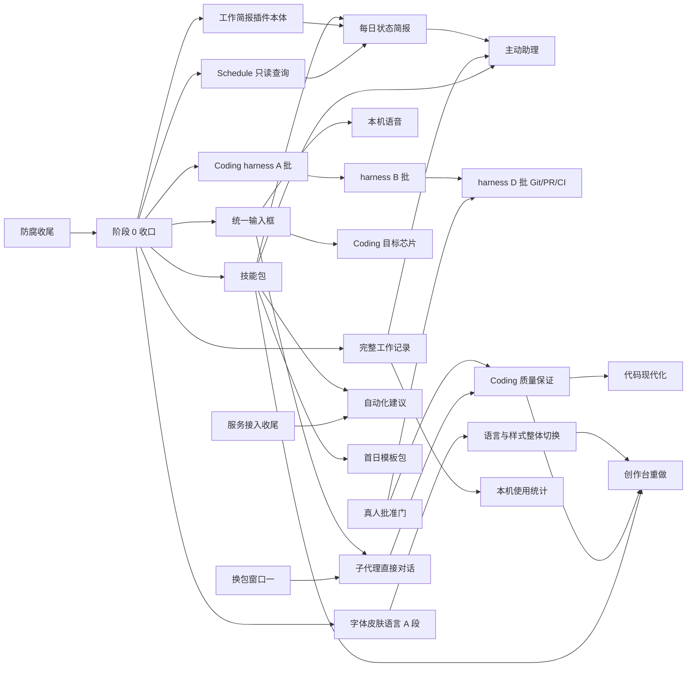

# 防腐收尾之后的实现路径

状态：规划（2026-10-26）。在防腐线（[repository-anti-corruption](../repository-anti-corruption/spec.md)）收尾之后执行；在那之前只作排期参考，不开工。本文只排先后、分轨道、定每一段的退出条件，不改任何需求的内容和验收：那些仍以各自的 spec 和 [统一待办清单](../BACKLOG.md) 为准。起草时读的是 main `0d8388b09`（batch-42，#1311）。

验收编号：不适用（排期文档；每一项的验收在它自己的 spec 里）。

## 1. 起点：防腐收尾之后的代码

防腐线的收口范围是 §1 的 2026-10-18 那一行：W5、W6 全做完，[privileges.md](../repository-anti-corruption/privileges.md) 的行全部清掉。按这个范围，后面的需求面对的是这样一份代码：

- 插件一律经 Plugin Runtime 装配，同一套 SDK、Manifest 和平台服务。Goals、Feed、Inbox 都是普通插件，构建期装配名单清空（W6-01）。新插件和新能力只有这一条路可走，没有宿主私路可抄。
- 成果库和角色是平台的一部分；Sessions 已在 SC-4 删除，重做另开（BL-177）。
- 插件样式拆成各插件按需加载的 css，英文词典随插件包、在 Manifest 里声明（PG-070、PG-071）；`workbench.css` 里不再有属于具体插件的规则。
- 项目库的表由插件声明（PG-020、PG-021）；Home 级插件可以按项目分库；同一插件可以有 Home 与项目两个实例；连接、材料、本机目录授权、沙箱服务都由平台提供。
- 目录和各种名单由各包的声明生成（W5-02）；宿主入口只导出装配接口（W5-08）；有 Home 快照命令（W5-16）。
- 插件开发 Skill 和手册按新分层重写，样例只指向迁好的插件（W6-03）。
- 例外：Alchemist 和插件创作台不迁、不删，本轮绕过，以后重做（用户 10-21、10-23；BL-376、BL-377）。

阶段 0 的第一件事，是拿真正收尾后的 main 把这一节核一遍，对不上的地方先改本文再开工。

## 2. 怎么排

**重要度**看三条，同时满足得越多越靠前：

1. **工作接得上**：中断、关掉应用、隔天、换一个入口之后，要求、进度和结果都还在，能接着做。
2. **体验**：常用路径顺、快，不露内部值，不出莫名其妙的错。
3. **易用**：第一次就能用上，不用先弄懂产品的结构。

**依赖**：被好几条线用到的东西先做。这样的地基有六件：统一输入框、技能包、完整工作记录、真人批准门、Schedule 的只读查询、字体皮肤语言的文件格式。

**冲突**：按文件把工作分成六条轨道，一条轨道同一时间只有一个写手；会碰到全仓的改动（换 Prologue 包、字体皮肤语言的整体切换）排进固定窗口。细则在第 5 节。

**不排日历。** 每一段只写退出条件，到了就进下一段；一条轨道提前做完，就从后一段同一轨道的活里往前拿。

## 3. 清单：全部未完成的需求

「去处」写的是本文第 6 节的阶段和轨道，比如「1·A」是阶段 1 的 A 轨（轨道见第 5 节）。

### 3.1 已经做完，只差核对、归档或你本人验收

| 需求 | 现状 | 去处 |
| --- | --- | --- |
| [diff-frame-performance](../diff-frame-performance/spec.md)、[long-turn-performance](../long-turn-performance/spec.md)、[attention-aggregate-performance](../attention-aggregate-performance/spec.md) | #1010、#1017、#1073 都已合入 main，状态句没跟上 | 0：核对后归档 |
| [pr-review-remediation](../pr-review-remediation/spec.md) | #901 已合入 | 0：归档，QA-017 没跑通的进 BACKLOG |
| [repository-cleanup](../repository-cleanup/spec.md) | 状态句已写「已实现」 | 0：归档 |
| [status-ring-system](../status-ring-system/spec.md) | 组件和 43 个状态已在 design-system，状态句还停在 10-13 | 0：核对后归档，视觉验收进「待你验收」 |
| [plugin-tab-groups](../plugin-tab-groups/spec.md) | PTG 用例在 main | 0：核对后归档 |
| [empty-goal-create](../empty-goal-create/spec.md)、[quiet-home-refresh](../quiet-home-refresh/spec.md)、[onboarding-intake-progress](../onboarding-intake-progress/spec.md)、[onboarding-model-link](../onboarding-model-link/spec.md)、[onboarding-folder-places](../onboarding-folder-places/spec.md) | 待验收；#1306 还开着 | 0：#1306 合入，你验收后归档 |
| [issue-home-v0](../issue-home-v0/spec.md) | V0 与首期体验按工程验证完成（用户 10-12 定）；BL-149 的分支待评审 | 0：BL-149 合入或关掉后归档 |
| [computer-use](../computer-use/spec.md) | 能力已合入，等真机（BL-325） | 0：真机验收后归档；BL-326、BL-327 留在 BACKLOG |
| [ai-development-handbook](../ai-development-handbook/spec.md) | 正文已写 | 0：BL-320 你验收；BL-321（ADH-23）随技能包在 1·C 做 |
| [prologue-memory-strategy](../prologue-memory-strategy/spec.md) | #1101、#1059 在途，P0 的形成、召回、SDK 接入未完 | 0：两个 PR 收掉；P0 余项 1·C |
| [visual-ui-experience](../visual-ui-experience/spec.md) | 一百一十一片已做 | VUX-16、VUX-17、VUX-18 并进统一输入框（1·A）；VUX-33、VUX-35 1·D；本人验收 0 |
| 防腐线自己的四份：repository-anti-corruption、[plugin-project-database](../plugin-project-database/spec.md)、[dual-instance-plugins](../dual-instance-plugins/spec.md)、[plugin-project-partition](../plugin-project-partition/spec.md) | 随 W6-06 收尾 | 防腐线自己归档 |
| BACKLOG「待你验收」BL-001～017、105、109、111、320、325、400、401 | 已合入，只差你试用 | 0：一张验收单，一次走完 |

### 3.2 做了一半、交接后停下的需求线

| 需求 | 剩什么 | 去处 |
| --- | --- | --- |
| [ai-input-receipts](../ai-input-receipts/spec.md) | Goal 页「来自对话的输入」BL-314；交付说明入口 BL-315、步骤板 BL-316；有效要求的评测 BL-317；浏览器实走 BL-319；跨轮 BL-148；补充改了哪些文件 BL-162；阶段 5、6（BL-318） | 2·A；阶段 5 并进主动助理（3·A），阶段 6 各场景各写小 spec |
| [prologue-adoption](../prologue-adoption/spec.md) | A5 重核 BL-309；写后检查进时间线 BL-301、子任务写后检查 BL-302、截图 BL-303；P5 协作 BL-307；P6 旧路径退出 BL-308；结构化生成 BL-306 | BL-309、BL-301～303 在 1·C；BL-307、BL-308 进换包窗口一（2·C）；BL-306 随 Alchemist 重做 |
| [ai-interaction-experience](../ai-interaction-experience/spec.md) | 第二批入口 BL-341（PPT、Pages、Cognia）；卡片撤销 BL-343（合同改动）；同排推荐 BL-344（你看实物）；验证 BL-345；键盘多选 BL-340；Coding 目标芯片 BL-342 | BL-343、BL-344 在 2·A；BL-341、BL-340 在 2·E；BL-342 在 2·B（用新输入框） |
| [context-program](../context-program/spec.md) 及 [context-toolbar](../context-toolbar/spec.md)、[quick-create](../quick-create/spec.md)、[side-shelf](../side-shelf/spec.md) | W4：一句话新建 BL-330、`attach` 的 `find` BL-331、批量创建 BL-332、内容站与「放进 Inbox」BL-333、无模型去处 BL-174、覆盖率门禁 BL-334；W5 拖放 BL-335；W6 Shelf 动作与材料篮 BL-336；W7 起 BL-337；实走与收尾 BL-338、BL-339 | W4 在 2·E；W5、W6 在 3·E；W7 起在阶段 4 |
| [assistant-service-connections](../assistant-service-connections/spec.md) | 37 项整体验收、ASC-38～44、真实账号 BL-060、正式 OAuth BL-062、发起者核对 BL-180、loader 名单 BL-181、导入方式核对 BL-690 | BL-062 在 1·F 先送审（审核慢）；其余 3·C |
| [coding-plugin 下一阶段](../coding-plugin/next-requirements.md) | 20 项（BL-050），其中 B 期等 Q1～Q8 拍板（BL-020） | A 期 2·B；B 期 3·B；C、D 期阶段 4；E 期的语音并进统一输入框，其余不排 |

### 3.3 需求已整理、还没开工

| 需求 | 一句话 | 去处 |
| --- | --- | --- |
| [unified-input-voice](../unified-input-voice/spec.md) | 首页、助理、Coding 一个输入框，加本机语音 | 文字部分 1·A；语音 2·A（要真机验麦克风与中文输入法） |
| [skill-packs](../skill-packs/spec.md) | 只有 Manifest 的内容插件，助理和 Coding 共用一份方法目录 | 1·C |
| [work-brief](../work-brief/spec.md) | 工作简报插件：综合结果的正文、版本、来源、修订 | 插件本体 1·E；每日状态简报 2·A；周期报告 3·A |
| [proactive-assistant](../proactive-assistant/spec.md) | 主动发现值得推进的事，按场景 Skill 处理；含平台共用的完整工作记录（§3.4） | 工作记录：设计 1·C、第一版 2·C；助理本身 3·A |
| [coding-harness-optimization](../coding-harness-optimization/spec.md) | Coding 可靠性与性能：A 批 P0、B 批闭环、C 批渲染与 Dataset、D 批 Computer Use 与 Git/PR/CI、E 批评测、F 批效率实验 | A、C 批 1·B（Dataset 那半 2·E）；B 批 2·B；D 批与 R12 3·B；R11 并进创作台重做；F 批阶段 4 |
| [agent-approval](../agent-approval/spec.md) | Agent 产出的变更要 N 个有权限的真人批准，绑定版本 | 2·C（连同审查队列的 BL-359、BL-360） |
| [subagent-interaction](../subagent-interaction/spec.md) | 助理与 Coding 里固定的子代理入口、直接对话、父任务获知变化 | Prologue 那半进换包窗口一（2·C）；产品那半 3·A、3·B |
| [coding-quality-assurance](../coding-quality-assurance/spec.md) | 自检、交叉评审、对抗评审、安全评审、批准门、有界迭代 | 3·B |
| [automation-recommender](../automation-recommender/spec.md) | 读项目，推荐值得加的 hooks、技能包、连接、角色、命令 | 3·C |
| [code-modernization](../code-modernization/spec.md) | 评估 → 地图 → 业务规则 → 计划批准 → 增量改造 → 行为等价证明 | 4·B |
| [onboarding-coverage](../onboarding-coverage/spec.md) | 引导里配模型、讲清数据边界、采用后给下一步、更新页 | 1·F |
| [font-and-skin-system](../font-and-skin-system/spec.md) | 字体、皮肤、语言三套系统；[实现方案](../font-and-skin-system/implementation-plan.md) 分 A～E 五段 | A 段 1·D；B 段与 C 段切换 2·D（C 段占窗口）；D、E 段 3·D；FSS-40、FSS-41 用户 10-23 定暂不实现 |
| [risk-plugin](../risk-plugin/spec.md) | 专门记风险的插件 | 1·E（收尾后第一个按新标准从零写的插件） |
| [prologue-skill-strategy](../prologue-skill-strategy/spec.md) | Skill 的选择、唤起、组合与观测 | 评审后 2·C，紧跟技能包 |
| [prologue-context-strategy](../prologue-context-strategy/spec.md) | 来源预算、trace、新鲜度、压缩 | 评审后 3·C，配合主动助理 |
| [prologue-mcp-strategy](../prologue-mcp-strategy/spec.md) | MCP 服务器信任、发现、健康、认证 | 评审后 3·C，配合服务接入收尾 |
| [prologue-tool-strategy](../prologue-tool-strategy/spec.md) | 工具面、搜索、结果预算 | 评审后 3·C |

### 3.4 要先写需求书的重做与新方向

| 事项 | 包含 | 去处 |
| --- | --- | --- |
| Sessions 重做（BL-177） | 回到会话、跨 Runtime 交接；产品建议 B2（Claude Code 原生会话）挂在这里 | 需求书 2·C，实现 3·C |
| 首日旅程（产品建议 A6、I1、I10） | 装好 → 配模型 → 选角色 → 拿到带内容的项目 → 做完第一件事；按角色的模板包；读本机已有的规则与 Skills 整理成草稿 | 需求书与 onboarding-coverage 合写（1·F），实现 2·F（模板包要等技能包） |
| 插件创作台重做（BL-377） | harness R11、R12，产品建议 C1～C5，字体皮肤语言 §7.2，BL-040、055、113、125、132、245、373、551 | 需求书 3·C，实现阶段 4 |
| Alchemist 重做（BL-376） | BL-306、BL-035 | 需求书 3·C，实现阶段 4 |
| 团队协作最小形态（产品建议 I8） | 两个人共用一个项目的目标与讨论；BL-071、BL-022、BL-013 | 需求书 3·C，实现阶段 4 |

### 3.5 发布就绪（C 端 M1、M2，见 [c-end-readiness](../repository-anti-corruption/c-end-readiness.md)）

| 事项 | 去处 |
| --- | --- |
| 签名与公证（BL-021；产品建议 A1） | 1·F，等你定开发者账号 |
| 数据升级链与升级前自动备份（产品建议 A2、C-2）；真实 Home 维护 BL-157、BL-413、BL-583、BL-487（每一项动手前弹窗问） | 1·F 起，2·F 收尾 |
| 运行条件：常驻、休眠后补跑、错过的怎样显示（产品建议 A5；BL-030、BL-645、BL-352） | 1·F |
| 对外许可口径（产品建议 A4，在官网仓库） | 0 |
| 原生组件随包预置与首次自检（产品建议 H14） | 2·F |
| 「需要你」的菜单栏角标与系统通知（产品建议 B3） | 2·F |
| 自动更新、定时在线备份、可选崩溃上报（M2；BL-115） | 3·F |
| 经同意、存在本机的使用统计（产品建议 I9；BL-169），建在工作记录上 | 3·F |

### 3.6 体验债与插件小功能（独立片，按批填空做）

| 批 | 内容 | 去处 |
| --- | --- | --- |
| 一 | Feed 失败提示露原码与两个提示框 BL-094、添加来源的按钮与默认源 BL-095、露内部值 BL-096、首次打开慢 BL-097、Inbox 刷新整页重画 BL-131、刷新失败少一句 BL-134、过程文字露内部标识与夹英文 BL-091、BL-103、窄屏面板盖住确认卡 BL-102、Jelly 日程被叫成文件 BL-092、搜索结果在指针下移动 BL-112、记忆开关的说明（产品建议 H23）、出网清单（H18） | 1·E |
| 二 | 按月/季/年重复（H10、J3）、在等的按人分组与等了几天（J2、J4）、Dataset 汇总行与追加行（H12、H21）、问卷存成数据表后自动追加（H15）、没连 TypeSafe 时的判断规则（H13）、Dataset 大数据性能（harness R9）、Shelf 轮盘与快捷键 BL-053 | 2·E |
| 三 | 本机规则版脱敏（H9）、Gmail 附件与全文（H11、H19）、PPT 图片与图表（H16）、Pages 个人模板（H17）、YouTube 字幕（H20）、固定版之间的逐段差异（D6）、出处一路跟到底（D3） | 3·E |

### 3.7 散在各处的平台小项

防腐收尾时，BACKLOG §7、§8 的条目会被做掉或写明不做的理由。阶段 0 把剩下的按所在包归进对应轨道，作为该轨道的填空项。现在就看得出去处的几组：

- 翻译余项（BL-118、BL-455～464、BL-545、BL-546、BL-567、BL-636）：随字体皮肤语言的 C 段切换（2·D）。
- 写后检查（BL-160、BL-171、BL-220、BL-390）：1·C，和 BL-301～303 一起。
- 要 Prologue 上游改的（BL-031、BL-137、BL-172、BL-173、BL-175、BL-176）：列进最近的换包窗口。
- 记忆的误记与默认（BL-037、BL-093）：随记忆 P0（1·C）。
- 模型能力造成的（BL-089、BL-104）：按「模型能力问题不打补丁」处理，不单独排。

## 4. 依赖

几条硬依赖，排序时不能反过来：

- 每日状态简报要先有工作简报插件本体、Schedule 能读待办/Inbox/日程/目标（产品建议 E1），还要有技能包来装「早上那一页怎么写」。
- 主动助理要先有完整工作记录、技能包、每日简报，以及侧栏「打开 → 定位 → 高亮」那条联动。
- 子代理的直接对话、Coding 的目标芯片、语音、情境的「放进输入框」都长在输入框上：输入框先定一个主人和一份组件，再往上加。
- Coding 质量保证要先有子代理入口和真人批准门；代码现代化要先有质量保证。
- 字体皮肤语言的 C 段要求防腐线的 PG-070、PG-071 已落地；创作台重做要在 C 段之后，生成的插件一开始就用新的样式与文字。
- harness R1（目录选择到真实执行）要先定 BL-023（Coding 的执行目录和 Files/Git 的浏览目录合不合）。

## 5. 冲突面与轨道

自 10-12 起合入 main 的 PR 里，改得最多的代码文件：`scripts/gates/page-assets.mjs`（127 次）、`apps/local-host/src/index.ts`（79）、`apps/workbench/src/scripts/client/assistant-island.ts`（55）、`tests/ci-product-subset.txt`（55）、`plugins/native/coding/src/client.ts`（47）、`packages/contracts/src/platform/plugin.ts`（46）、`apps/local-host/src/assistant/assistant-service.ts`（43）、`packages/design-system/src/styles/craft-finish.ts`（41）。防腐收尾后宿主入口会变薄，阶段 0 重新量一次；其余几处正是后面需求最密的地方，所以按它们分轨道：

| 轨道 | 这条轨道独占的文件 | 主要的活 | 建议谁做 |
| --- | --- | --- | --- |
| A 助理与输入 | `apps/workbench/src/scripts/client/assistant-island.ts`、`apps/local-host/src/assistant/`、`packages/contracts/src/services/assistant.ts`、共用输入组件、助理的词典 | 统一输入框、回执余项、每日简报、主动助理 | Claude（交互与视觉） |
| B Coding | `plugins/native/coding/`、`apps/local-host/src/coding-surface.ts`、Files、Git、Diff 包 | harness、下一阶段、质量保证、代码现代化 | Claude 主写，边界清楚的小片给 Codex |
| C 平台与 Prologue | `horizontal/agent-host/`、`vendor/prologue-sdk/`、`packages/contracts/src/platform/`、`packages/plugin-sdk/`、`packages/plugin-runtime/` | 技能包、工作记录、批准门、Prologue 采用与换包、记忆、各需求书 | Claude（兼管合同评审） |
| D 外观与语言 | `packages/design-system/`、`apps/workbench/src/i18n/`、ui-host、`DESIGN.md`、平台设置页 | VUX 收尾、字体皮肤语言、「授权与放行」一页（产品建议 H1） | Claude |
| E 插件 | Coding 一族以外的 `plugins/native/<插件>/`、新插件包 | 体验债、风险、工作简报本体、情境 W4～W6、插件小功能 | Codex 独立片为主，界面定样由 Claude |
| F 首次使用与发布 | `apps/desktop/`、安装器、`docs/releases/`、引导页与引导路由 | 运行条件、签名与升级、正式 OAuth、引导、首日旅程 | Codex；账号、证书、真实 Home 只能你办 |

规则：

1. **合同先行。** 要改 Manifest、SDK 或 `packages/contracts` 的，先单独开一个只改合同的小 PR（带 `pnpm api:update`、`pnpm actions:update` 的快照），C 轨评审、尽快合；功能 PR 叠在它后面。同一时间只有一个合同 PR 在途。技能包、情境 W4、卡片撤销、字体皮肤语言 A 段都要改合同，按这条排队。
2. **换包窗口。** 每个阶段最多换一次 Prologue 包，放在阶段中段。这一阶段要上游补的东西提前列进窗口清单一起提，窗口外不换包。阶段 2 的窗口一装子代理、P5 协作和记忆 SDK 余项；阶段 3 的窗口二装 Skill、Context、MCP、Tool 四份策略要的上游能力。
3. **切换窗口。** 字体皮肤语言的 C 段（全部插件的文字与样式一次切换）占一个窗口。窗口里 E 轨不改插件的界面文字和样式，只做逻辑；新插件在窗口之前就按新格式写，不留到窗口里转。
4. **同路径一起落。** 碰同一批聚合文件（`scripts/gates/page-assets.mjs`、`tests/ci-product-subset.txt`、`packages/contracts/src/platform/dom-events.ts`、`pnpm-lock.yaml`）的 PR 按批落规则合成批 PR，冲突由统筹一次解。
5. **新插件放空档。** 风险、工作简报这类新包不和任何轨道抢文件，哪条轨道闲下来就先做它们。
6. **一条轨道一个会话跨到底。** 同一条轨道在各阶段尽量由同一个会话接着做，少交接；开发本身也讲工作接得上。

## 6. 路径

### 阶段 0：收口（防腐线合完立即开始）

- 用收尾后的 main 核第 1 节；重新量第 5 节的热点。
- 归档第 3.1 节里已做完的 spec；状态句与代码对不上的（产品建议 H7 点过名的几份）一并改。
- 收掉在途 PR：#1101、#1059（记忆）、#1306（引导）、#1312（工作简报设计稿）、#784（QA 记录）、#734（CI）。
- 一张验收单给你：BACKLOG「待你验收」全部、3.1 节新增的、VUX 本人验收。你也可以像 09-30 那样委托验证，见第 7 节。
- 第 7 节要你拍板的事攒成一批弹窗问。
- 对外许可口径（A4）改官网仓库的文案。
- 重排 BACKLOG：§7、§8 剩下的条目按 3.7 节归进轨道。

**退出**：根目录只剩真正在做的 spec；验收单发出；阶段 1 要的四个决定（第 7 节第 1～4 条）有了答案。

### 阶段 1：地基与顺手

- **A**：统一输入框的文字部分（unified-input-voice §3～§5，连同 VUX-16、VUX-17、VUX-18 和送达方式的键位）。一份组件，首页、助理、Coding 三处换上。
- **B**：harness A 批（R1 目录到真实执行、R2 委派配置与诊断、R3 规则与模式，都是 P0）；C 批的 R7 Coding 渲染稳定；TaskBoard 与计划卡编号、状态一致（BL-161、BL-164）；时间线把没有退出码的命令显示成成功（BL-222）。
- **C**：技能包（含 ADH-23 BL-321 和设计内容包 BL-165 的格式）；记忆 P0 收尾；Prologue 采用 A5 重核（BL-309）与写后检查余项；完整工作记录的设计稿（只出设计、给你审，不写代码）。
- **D**：VUX-33、VUX-35 收尾；字体皮肤语言 A 段（合同、文件格式、从现有值提出的基线文件）。新插件从这里起按新格式写。
- **E**：体验债第一批；风险插件；工作简报插件本体（正文、版本、来源、修订、比较，不带任何固定流程）；Schedule 的只读查询动作（产品建议 E1）。
- **F**：运行条件（常驻、休眠补跑、错过的显示，BL-030、BL-645）；onboarding-coverage 连同首日旅程的需求书；签名与公证；正式 OAuth 应用送审（BL-062）；数据升级链开工。

**退出**：三处入口用同一个输入框；一个只有内容的技能包能装上，助理和 Coding 都看得见、用得了；harness A 批在真实目录、真实模型下实走通过；风险和工作简报两个插件能装、能用；Schedule 的任务能读待办、Inbox、日程、目标；工作记录设计稿你已审过。

### 阶段 2：工作接得上

- **A**：每日状态简报（产品建议 E0：只报变化、取不到的标过期、底部三个能点的下一步），由场景技能包驱动、Schedule 按时跑、写进工作简报；回执余项 BL-314～317、BL-148、BL-162；卡片撤销 BL-343 与同排推荐 BL-344；本机语音（真机验收麦克风、中文输入法、中英混说）。
- **B**：harness B 批（R4 上下文、R5 完成闭环、R6 环境准备、R14 估点与进度）；下一阶段 A 期（说明文件与 `/init`、斜杠命令、图片输入、代码智能，开工前先核哪些已有）；Coding 目标芯片 BL-342。
- **C**：完整工作记录第一版（先覆盖助理、Coding、插件动作、工作流与定时）；真人批准门；Skill 策略；换包窗口一（子代理的 Prologue 能力、P5 协作 BL-307、P6 旧路径退出 BL-308、记忆 SDK 余项）；Sessions 重做的需求书。
- **D**：字体皮肤语言 B 段；阶段末占窗口做 C 段整体切换，翻译余项随之清掉。
- **E**：情境 W4（BL-330～334、BL-174，要在 C 段窗口之前做完界面部分）；交互第二批入口 BL-341 与键盘多选 BL-340；插件小功能第二批；Dataset 大数据性能（harness R9）。
- **F**：首日旅程实现（模板包用阶段 1 的技能包）；签名、升级链、真实 Home 维护收尾（M1）；原生组件自检；「需要你」的角标与通知。

**退出**：连续两周每天早上有一页会刷新的简报，能点进去处理；回执在中断、换轮、重启后说得清当前要求；Coding 一个真实任务从开始到交付、中途补充和重启后都接得上；能装到第二台 Mac，升级不丢数据；语言与皮肤切换后所有插件文字、样式一致。

### 阶段 3：主动起来

- **A**：主动助理全量（判断与工作选择、场景 Skill、侧栏里点建议后打开、定位、高亮、周期报告、可点选的决定、项目首页总览），回执阶段 5 并在这里；子代理入口与直接对话（助理一侧）。
- **B**：子代理入口与直接对话（Coding 一侧）；Coding 质量保证；harness D 批（R8 Computer Use 多动作、R10 Git/PR/CI，过批准门）与 R12 完整任务评估；下一阶段 B 期（联网、沙盒与放行规则、钩子，等 Q1～Q8）。
- **C**：Sessions 重做；自动化建议；服务接入收尾（37 项、ASC-38～44、真实账号）；Context、MCP、Tool 三份策略；换包窗口二；按项目限定模型供应商（H22）；读过不可信内容后的出站闸（I6）；创作台、Alchemist、团队协作三份需求书。
- **D**：字体皮肤语言 D、E 段（自定义、导入、助理的制作 Skill、整体交付）；「授权与放行」一页（H1）。
- **E**：情境 W5（拖放）、W6（Shelf 动作、材料篮）；插件小功能第三批；依据三档（产品建议 B1，Goals）。
- **F**：M2（自动更新、定时在线备份、可选崩溃上报）；本机使用统计与每次调用的用量（I9、H8），读工作记录。

**退出**：不发消息时，助理也能拿出经你点头就能用的下一步，并在中断、重启后接着做；交出去的子任务能直接对话、能回到父任务；Coding 的改动经评审和真人批准才生效；四份 Prologue 策略各有一组省 token、提准确度的对照数据。

### 阶段 4：长出工具

- 插件创作台重做、Alchemist 重做（各按阶段 3 的需求书）。
- 代码现代化；Coding 下一阶段 C、D 期；harness F 批（先量基线，没收益就不做）。
- 情境 W7 起（BL-337）与总纲收尾（BL-339）。
- 团队协作最小形态。
- 主动助理 §17.2 的扩展（先做 Skill 效果对比）。

**退出**：由各自需求书定。

## 7. 开工前要你拍板的事

| # | 事项 | 卡住哪一步 |
| --- | --- | --- |
| 1 | Coding 的执行目录和 Files/Git 的浏览目录合不合（BL-023） | 1·B 的 R1 |
| 2 | 输入框的主人与「打断 / 转向 / 排队」三种送达的键位（产品建议 H2）；本文建议 A 轨做主人 | 1·A |
| 3 | 一句话该记进记忆、Skill 还是项目长期说明（产品建议 E3） | 1·C 技能包、2·A 每日简报 |
| 4 | 风险插件的三项待定（顾虑与风险的关系、登记册视图、复查提醒） | 1·E |
| 5 | 开发者账号与公证（BL-021）、正式 OAuth 应用的申请主体 | 1·F（外部账号与费用，审核要时间） |
| 6 | 右栏的容量规则与第七格归谁（产品建议 H3）：简报、子代理、主动建议都想占 | 2·A |
| 7 | 首页「今天的工作」怎样归属 Feed 消息（BL-098） | 2·A 每日简报 |
| 8 | 工作记录的产品参数：回看天数、报告默认时刻、保留期限与容量（proactive §17.1） | 2·C |
| 9 | 四份 Prologue 策略需求书的评审 | 2·C、3·C |
| 10 | Coding 下一阶段 Q1～Q8（BL-020：联网、沙盒档位、钩子审批等） | 3·B 的 B 期 |
| 11 | Sessions、创作台、Alchemist、团队协作的重做范围 | 各自需求书 |
| 12 | 验收方式：逐项本人试用，还是像 09-30 那样委托验证 | 阶段 0 |

## 8. 不排进本路径的

这些不是不做，是现在没有足够理由排进来；阶段 4 结束时再看一次：

- 插件市场与审核流水线（BL-058、BL-167）、团队/企业托管策略（BL-168）、MCP 服务端作者工具（BL-170）。
- 跨项目移动对象（BL-044）、问卷公网链接与 PPT 富排版（BL-045）、真实图像厂商（BL-046）、LLM Wiki 专有格式（BL-057）、浏览器自动捕获等新来源（BL-061）、群聊公网部署（BL-063）。
- 跨平台桌面（C 端 M3）、手机随手收（产品建议 I5）、本地模型模板（I4，按 Prologue 收敛口径暂缓）、用 ChatGPT 账号额度（I7，先要你确认能不能接）、国内写回飞书钉钉 WPS（I3）。
- 外部 Agent 的上一层（产品建议 B4～B6：生成 `/goal`、spec-kit 导入导出、云端 Agent 远程桥）。
- 记忆与项目资料的向量召回（BL-036、BL-399）：等工具式检索的评测真出现「换个说法就找不到」再开。
- Coding 下一阶段 E 期里语音以外的几项（Vim 与快捷键、状态栏、编辑器集成、导入配置）。

## 9. 怎样维护本文

- 每段结束时，把做完的条目从 BACKLOG 删掉（照 BACKLOG 的规矩，在提交说明里写编号），归档做完的 spec，在本文对应阶段后面写一行「完成（日期，PR 号）」。
- 新冒出来的需求先进 BACKLOG 或新 spec，再按第 2 节的三条和第 4 节的依赖插进某一段的某条轨道；不另起一份排期。
- 第 5 节的热点每段重量一次；轨道独占的文件变了就改表。
- 四段都走完，或者本文被新的排期取代时，按 [specs/README.md](../README.md) 的规则归档。
