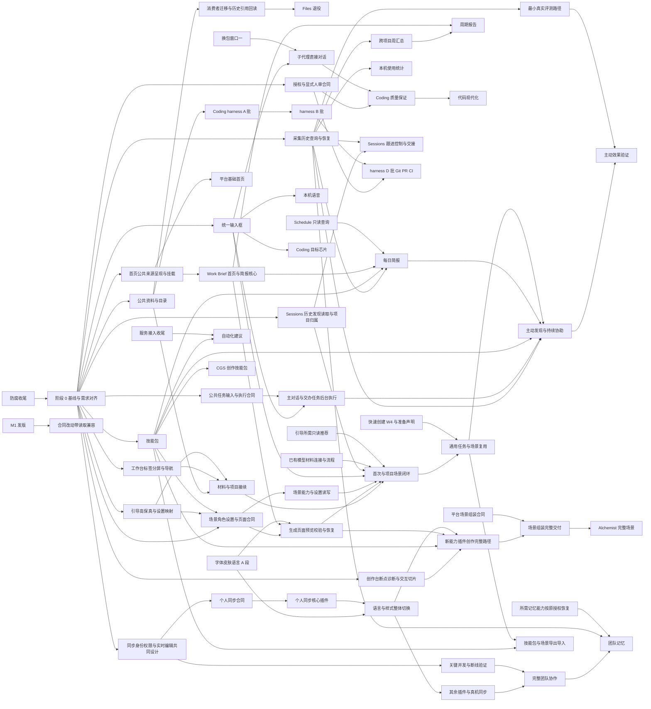

# 防腐收尾之后的实现路径

状态：规划（2026-10-28 更新）。在防腐线（[repository-anti-corruption](../repository-anti-corruption/spec.md)）收尾之后执行；在那之前只作排期参考，不开工。本文只排先后、分轨道、定每一段的退出条件，不改任何需求的内容和验收：那些仍以各自的 spec 和 [统一待办清单](../BACKLOG.md) 为准。起草时读的是 main `0d8388b09`（batch-42，#1311）。10-26 复查：补进个人云同步与 CGS 两条 main 之外的线、产品建议的余项、BACKLOG 全部条目的去处（3.8 节），字体皮肤语言按段写开，并修了几处轨道借文件和兼容起点的排序。

验收编号：不适用（排期文档；每一项的验收在它自己的 spec 里）。

10-27 本轮只更新需求与排期，不开发。[Onboarding 需求书](../onboarding-coverage/spec.md)已合并场景与能力包、动态渐进引导、全局/项目/任务设置；秘书沿用跨项目个人助理，项目可配独立助理团，首页允许 AI 生成新的交互页面。同时纳入实际反馈的材料选择、文件支持、步骤连续性、生成失败恢复及项目/Coding 接续，先贯穿基础材料路径，再扩场景。下文按此补齐前置能力与先后，轨道负责人保留；10-26 的其他线状态未在本轮全面复核。

2026-10-27 需求调整：原工作台需整体升级与体验打磨，首要解决一骏至今未完整跑通的端到端交付问题；平台场景组装能力并入[插件创作工作台升级](../plugin-builder-upgrade/spec.md)（BL-377），Alchemist 成为其中的完整落地场景，删除独立重做条目 BL-376。与场景／能力包设置、秘书与助理团引导、首次／项目／通用任务 Onboarding 三项独立；10-27 当时未重排这些引导需求；10-28 的顺序调整见下，防腐收尾前不开工的边界保留。

2026-10-27 采集需求独立：[观测和采集层](../observation-collection/spec.md)承接主动助理中共用的完整工作记录与采集维护要求，成为评测和主动助理并列依赖的平台能力。只整理需求与排期，保留 C 轨归属；阶段 1 设计，阶段 2 接通事实与消费，阶段 3 验证主动建议及整体效果。评测规则与助理设计可提前准备，采集不依赖二者运行。

2026-10-28 排期复查：公共资料、目录和工作台整合进入阶段 1；Sessions 历史接续前移到阶段 2；观测和采集、最小评测先于依赖它们的报告与理解验证；同步和实时协作在阶段 1 共同设计，关键并发／断线路径在阶段 2 验证；创作台阶段 1 诊断与定样、阶段 2～3 做通新能力插件交付，阶段 4 完成场景组装与 Alchemist。批准规则按已有授权、可选 AI 低风险审批和显式人审范围对齐。原负责人、Memory 暂停、完整产品范围及防腐收尾前不开工均保留；长期效果观察与独立开发并行。本次只更新文档。

2026-10-27 治理排期补充：[全平台产品与架构治理](../product-flow-governance/spec.md)已完成首轮静态盘点。现有各轨道实施时采用其相对顺序：先材料与已有工作恢复，再默认连接到实际使用，再同范围批准及发布启用衔接，再流程/提示词/个人设置简化，并持续补齐全部功能的真实路径。具体发现、依赖和退出条件只维护在治理需求 §6 与核查记录；这里不复制派工表，不改原负责人、Memory 暂停或防腐收尾前不开工的安排。授权规则以本轮已定需求为准：有效授权内连续执行；Coding 的可选低风险 AI 审批不替代显式要求的真人票数；团队发布等明确的人审仍保留。批准需求已同步，现有代码和仓库保护未因此改变。

## 1. 起点：防腐收尾之后的代码

防腐线的收口范围是 §1 的 2026-10-18 那一行：W5、W6 全做完，[privileges.md](../repository-anti-corruption/privileges.md) 的行全部清掉。按这个范围，后面的需求面对的是这样一份代码：

- 插件一律经 Plugin Runtime 装配，同一套 SDK、Manifest 和平台服务。Goals、Feed、Inbox 都是普通插件，构建期装配名单清空（W6-01）。新插件和新能力只有这一条路可走，没有宿主私路可抄。
- 成果库和角色是平台的一部分；Sessions 已在 SC-4 删除，重做另开（BL-177）。
- 插件样式拆成各插件按需加载的 css，英文词典随插件包、在 Manifest 里声明（PG-070、PG-071）；`workbench.css` 里不再有属于具体插件的规则。
- 项目库的表由插件声明（PG-020、PG-021）；Home 级插件可以按项目分库；同一插件可以有 Home 与项目两个实例；连接、材料、本机目录授权、沙箱服务都由平台提供。
- 目录和各种名单由各包的声明生成（W5-02）；宿主入口只导出装配接口（W5-08）；有 Home 快照命令（W5-16）。
- 插件开发 Skill 和手册按新分层重写，样例只指向迁好的插件（W6-03）。
- 例外：Alchemist 和插件创作台不迁、不删，本轮绕过（用户 10-21、10-23）；后续统一由工作台升级 BL-377 承接，Alchemist 是场景组装能力的落地场景，不再独立重做（用户 10-27）。
- main 之外还有两条没合入的线，都写在防腐收尾之前的插件数据形状上：个人云同步（`personal` 分支，比 main 多 24 个提交、少 175 个，最新 10-25，改动有四分之一在 `plugins/native/`）；CGS 自媒体创作（`codex/cgs-formal-integration-20261013`，停在 10-14，落后 main 1159 个提交）。怎样接见 3.2 节。

阶段 0 的第一件事，是拿真正收尾后的 main 把这一节核一遍，对不上的地方先改本文再开工。

## 2. 怎么排

**重要度**看三条，同时满足得越多越靠前：

1. **工作接得上**：中断、关掉应用、隔天、换一个入口之后，要求、进度和结果都还在，能接着做。
2. **体验**：常用路径顺、快，不露内部值，不出莫名其妙的错。
3. **易用**：第一次就能用上，不用先弄懂产品的结构。

**依赖**：被好几条线用到的东西先做。这样的地基包括公共资料与目录、统一工作台与输入框、技能包、观测和采集、已有授权与人审的明确边界、Schedule 只读查询、字体皮肤语言的文件格式，以及场景所需的角色与设置公开读写、生成交互页面的承载和恢复能力。团队身份、对象版本、权限与并发修改要在个人同步合同之前共同设计，完整团队产品仍在后段交付。已有能力先复用，只补当前场景所需缺口。

**冲突**：按文件把工作分成七条轨道，一条轨道同一时间只有一个写手；会碰到全仓的改动（换 Prologue 包、字体皮肤语言的整体切换）排进固定窗口。细则在第 5 节。

**兼容起点**：第一个装到开发机之外的版本（M1，阶段 2 的退出条件）发出去以后，合同改动要带读取兼容（[合同变更流程](../../docs/system/CONTRACT-CHANGES.md) 第 7 节）。所以改合同多的地基——技能包、字体皮肤语言 A 段、同步合同、观测和采集的公共合同、场景与生成页面的必要合同——都排在 M1 之前落；阶段 3 起的合同改动按兼容流程做，成本更高，排的时候算进去。

**不排日历。** 阶段描述能力形成顺序与阶段完成条件；独立任务的实际依赖和合同满足后可向前拿，不等待其他轨道全部完成。长期效果观察只约束对应能力的效果结论与约定发布条件，不作为全体开发的统一等待门。

## 3. 清单：全部未完成的需求

「去处」写的是本文第 6 节的阶段和轨道，比如「1·A」是阶段 1 的 A 轨（轨道见第 5 节）。

### 3.1 已经做完，只差核对、归档或你本人验收

| 需求 | 现状 | 去处 |
| --- | --- | --- |
| [diff-frame-performance](../diff-frame-performance/spec.md)、[long-turn-performance](../long-turn-performance/spec.md)、[attention-aggregate-performance](../attention-aggregate-performance/spec.md) | #1010、#1017、#1073 都已合入 main，状态句没跟上 | 0：核对后归档 |
| [pr-review-remediation](../pr-review-remediation/spec.md) | #901 已合入 | 0：归档，QA-017 没跑通的进 BACKLOG |
| [repository-cleanup](../repository-cleanup/spec.md) | 状态句已写「已实现」 | 0：归档 |
| [status-ring-system](../status-ring-system/spec.md) | 组件和 43 个状态已在 design-system，状态句还停在 10-13 | 0：核对后归档，视觉验收进「待你验收」 |
| [plugin-tab-groups](../plugin-tab-groups/spec.md) | PTG 用例在 main | 0：核对后归档 |
| [empty-goal-create](../empty-goal-create/spec.md)、[quiet-home-refresh](../quiet-home-refresh/spec.md)、[onboarding-intake-progress](../onboarding-intake-progress/spec.md)、[onboarding-model-link](../onboarding-model-link/spec.md)、[onboarding-folder-places](../onboarding-folder-places/spec.md) | 原列待验收；10-28 核实 #1306 已关闭、未合入 | 0：逐项核对成果是否由其他提交承接，保留未交付与待体验项；不再等待 #1306 合入 |
| [issue-home-v0](../issue-home-v0/spec.md) | V0 与首期体验按工程验证完成（用户 10-12 定）；BL-149 的分支待评审 | 0：BL-149 合入或关掉后归档 |
| [computer-use](../computer-use/spec.md) | 能力已合入，等真机（BL-325） | 0：真机验收后归档；BL-326、BL-327 留在 BACKLOG |
| [ai-development-handbook](../ai-development-handbook/spec.md) | 正文已写 | 0：BL-320 你验收；BL-321（ADH-23）随技能包在 1·C 做 |
| [prologue-memory-strategy](../prologue-memory-strategy/spec.md) | #1101、#1059 在途，P0 的形成、召回、SDK 接入未完 | 0：两个 PR 收掉；P0 余项仍属 1·C；沿原暂停边界，恢复授权前不启动 |
| [visual-ui-experience](../visual-ui-experience/spec.md) | 一百一十一片已做 | VUX-16、VUX-17、VUX-18 并进统一输入框（1·A）；VUX-33、VUX-35 1·D；本人验收 0 |
| 防腐线自己的四份：repository-anti-corruption、[plugin-project-database](../plugin-project-database/spec.md)、[dual-instance-plugins](../dual-instance-plugins/spec.md)、[plugin-project-partition](../plugin-project-partition/spec.md) | 随 W6-06 收尾 | 防腐线自己归档 |
| BACKLOG「待你验收」BL-001～017、105、109、111、320、325、400、401 | 已合入，只差你试用 | 0：一张验收单，一次走完 |
| 右栏选一段放进文稿（产品建议 F1；#712、#720） | 已合入；没用真实材料走过，落点只有 Pages | 0：真实 Shelf → Pages 走一遍，连同 #784 的 QA-030 复验；下一个落点等走完再定 |

### 3.2 做了一半、交接后停下的需求线

| 需求 | 剩什么 | 去处 |
| --- | --- | --- |
| [ai-input-receipts](../ai-input-receipts/spec.md) | Goal 页「来自对话的输入」BL-314；交付说明入口 BL-315、步骤板 BL-316；有效要求的评测 BL-317；浏览器实走 BL-319；跨轮 BL-148；补充改了哪些文件 BL-162；阶段 5、6（BL-318） | 2·A；阶段 5 并进主动助理（3·A），阶段 6 各场景各写小 spec |
| [prologue-adoption](../prologue-adoption/spec.md) | A5 重核 BL-309；写后检查进时间线 BL-301、子任务写后检查 BL-302、截图 BL-303；P5 协作 BL-307；P6 旧路径退出 BL-308；结构化生成 BL-306 | BL-309、BL-301～303 在 1·C；BL-307、BL-308 进换包窗口一（2·C）；BL-306 随工作台升级的 Alchemist 场景（阶段 4） |
| [ai-interaction-experience](../ai-interaction-experience/spec.md) | 第二批入口 BL-341（PPT、Pages、Cognia）；卡片撤销 BL-343（合同改动）；同排推荐 BL-344（你看实物）；验证 BL-345；键盘多选 BL-340；Coding 目标芯片 BL-342 | BL-343、BL-344 在 2·A；BL-341、BL-340 在 2·E；BL-342 在 2·B（用新输入框） |
| [context-program](../context-program/spec.md) 及 [context-toolbar](../context-toolbar/spec.md)、[quick-create](../quick-create/spec.md)、[side-shelf](../side-shelf/spec.md) | W4：一句话新建 BL-330、`attach` 的 `find` BL-331、批量创建 BL-332、内容站与「放进 Inbox」BL-333、无模型去处 BL-174、覆盖率门禁 BL-334；W5 拖放 BL-335；W6 Shelf 动作与材料篮 BL-336；W7 起 BL-337；实走与收尾 BL-338、BL-339 | W4 在 2·E；W5、W6 在 3·E；W7 起在阶段 4 |
| [assistant-service-connections](../assistant-service-connections/spec.md)（产品建议 A3） | 37 项整体验收、ASC-38～44、真实账号 BL-060、正式 OAuth BL-062、发起者核对 BL-180、loader 名单 BL-181、导入方式核对 BL-690 | BL-062 在 1·F 先送审（审核慢）；其余 3·C |
| [coding-plugin 下一阶段](../coding-plugin/next-requirements.md) | 保留范围见 BL-050；C5 多模型对比取消、页面沿 Character 选择；Q1 已定公开查询默认、项目/任务关闭及平台公共搜索、统一默认来源，Q2 命令默认受限且沿用项目目录、长期规则经用户明确同意保存、获准开发任务下载所需公开依赖已定，可选 AI 低风险自动审批已定，Q3 钩子首次确认、变更重新确认及停用已定，Q4 记忆沿原方案接入已定，Q5 代码分析工具按需隔离下载已定，Q6 已收口：取消多模型对比，语音沿既有本地输入方案；Q7 GitHub 复用连接与按任务授权已定，Q8 已定本阶段不做 VS Code 扩展／Tab 补全／行内编辑，ACP 仍未排期；Q1～Q8 已收口，各项只等实际依赖 | A 期 2·B；B 期 3·B；C、D 期阶段 4；E 期的语音并进统一输入框，其余不排 |
| 个人云同步（`personal` 分支上的 `specs/personal-cloud-sync/`、`plugin-sync-foundation/`、`personal-plugin-replication/` 等六份） | 账号、同步 Worker（D1、R2）、双 Home 同步与撤销，以及 Todo、Pages、Goals、Images、Alchemist、Cognia、Feed、Shelf 等的适配，已在隔离环境分项验证；整体没交付、没部署、没在两台真电脑上验过，整项目复制与项目级回收的闭环没完。下一阶段的范围你 10-17 定了：设备间自动与手动同步、全部插件、每个账号 100 MB、保留 30 天 | 见表后「个人云同步怎样接进来」：0 定合入方式，1·C 合同，2·G 核心插件，3·G 其余插件与真机 |
| CGS 自媒体创作（`codex/cgs-formal-integration-20261013` 分支的 `specs/cgs-formal-integration/`） | 10-14 的基线上做完阶段 0、1：七项创作 Skill，作者在项目里带材料讨论、比较候选、定主稿、出各平台稿；没合主线、没发布。研究、选题、栏目、发布回执、数据复盘不在已做范围 | 分支不合；技能包落地后七项 Skill 改成内容技能包（2·C 起）；插件本体按新 SDK 重做与否由你定（第 7 节） |

**个人云同步怎样接进来。** 它和防腐收尾撞在同一处：同步适配写在各插件的存储上，而防腐线把插件的表改成 Manifest 声明（PG-020、PG-021）、Home 插件按项目分库、同一插件分出 Home 与项目两个实例。所以不把分支整个变基进来，而是按收尾后的形状重接，原来的适配和用例当参照：

1. 阶段 0：拿收尾后的 main 对一遍分支，列出哪些适配还成立、哪些要重写；你定合入方式（第 7 节）。
2. 1·C/G：先与团队实时协作共同设计身份、对象版本、访问、并发与断线恢复，再定个人同步合同，避免把整对象覆盖当作所有内容的协作语义。同步合同单独一个 PR——插件在 Manifest 里声明哪些表、哪些对象要同步，平台提供同步服务，不按插件名单接（插件同等待遇）；Outbox（BL-070）随它一起定。
3. 2·G：平台同步服务、账号、Worker，加核心插件（Goals、待办、文稿、成果库）的声明。要在 C 段切换窗口之前合完，窗口里不动插件。
4. 3·G：其余插件的声明、整项目复制与回收、两台真电脑验收。部署正式 Worker、开真实账号只能你办。

完整个人同步也是团队产品的前置；共同设计与关键协作验证不等个人同步全部交付：[sync-replication](../../docs/modules/sync-replication.md) 和 [identity-team-access](../../docs/modules/identity-team-access.md) 两个模块都还没有实现，团队那份副本要建在个人同步上（3.4 节）。

### 3.3 需求已整理、还没开工

| 需求 | 一句话 | 去处 |
| --- | --- | --- |
| [unified-input-voice](../unified-input-voice/spec.md) | 平台统一输入组件的整体交互与 UI；首页、助理、Coding 首批接入，向所有适用插件／组件开放注册扩展，加本机语音（10-27 已定，§2.1～2.2） | 文字与公共扩展部分 1·A；语音 2·A（要真机验麦克风与中文输入法） |
| [skill-packs](../skill-packs/spec.md) | 只有 Manifest 的内容插件，助理和 Coding 共用一份方法目录；纯内容的包助理看得见（产品建议 G1），从 Claude Code、Codex 导入的 Skills 直接变成技能包（G2） | 1·C（`assistant-service.ts` 那处改动由 A 轨落，见第 5 节规则 7） |
| [work-brief](../work-brief/spec.md) | 可选的项目综合首页与简报插件；未安装时保留平台基础首页，共用公开来源／呈现，承接生成页面与原简报版本能力（10-27 已定） | 1·C/D 公共合同、组件与基础首页，1·E 综合首页及简报核心；2·D/E/F 生成首页接续、2·A 每日简报；3·A 周期报告 |
| [观测和采集层](../observation-collection/spec.md) | 全平台获准的用户行为、过程、结果与当时内容；公共查询、覆盖、历史证据及维护；需求已独立，尚未实现 | 1·C 盘点设计，2·C 先接通真实事实、历史读取与恢复；各轨道持续接入，不等主动助理建成 |
| [平台端到端效果评测](../proactive-assistant/spec.md#14-molis-work-的端到端效果评测) | 独立消费采集证据，负责样本、预期、判定、比较与隔离回放；覆盖手动及各类 AI 工作 | 1·C 准备案例与方法，2·C 接通最小真实评测路径，3·C 扩展整体及主动效果；Coding R12 仍在 3·B |
| [proactive-assistant](../proactive-assistant/spec.md) | 个人助理主对话持续可用、连续交办、后台任务可视化；讨论中的诉求识别、主动理解与场景 Skill，访谈初始化及持续工作记忆 | 1·A/D 交互切片、C 核公共合同；2·A 先做明确交办的后台执行，所需缺口由 C 补；3·A 主动发现复用同一体验。采集支持历史理解与评测，不作为明确交办的共同前置 |
| [coding-harness-optimization](../coding-harness-optimization/spec.md) | Coding 可靠性与性能：A 批 P0、B 批闭环、C 批渲染与 Dataset、D 批 Computer Use 与 Git/PR/CI、E 批评测、F 批效率实验 | A、C 批 1·B（Dataset 那半 2·E）；B 批 2·B；D 批与 R12 3·B；R11 并进创作台重做；F 批阶段 4 |
| [agent-approval](../agent-approval/spec.md) | 有效授权持续执行，明确需人审的范围按人员和版本校验；Coding 可选低风险 AI 审批单独记录来源 | 0 对齐新旧要求，1·C 设计公共边界，2·C 接通审查合同及 BL-359、BL-360；3·B 接 Coding 专项，不作为所有功能的共同前置 |
| [subagent-interaction](../subagent-interaction/spec.md) | 助理与 Coding 里固定的子代理入口、直接对话、父任务获知变化 | Prologue 那半进换包窗口一（2·C）；产品那半 3·A、3·B |
| [coding-quality-assurance](../coding-quality-assurance/spec.md) | 自检、交叉评审、对抗评审、安全评审、批准门、有界迭代 | 3·B |
| [automation-recommender](../automation-recommender/spec.md) | 读项目，推荐值得加的 hooks、技能包、连接、角色、命令；保持只读推荐、不自动安装 | 引导需要的读取/推荐片提前到 2·C；完整能力仍为 3·C |
| [code-modernization](../code-modernization/spec.md) | 评估 → 地图 → 业务规则 → 计划批准 → 增量改造 → 行为等价证明 | 4·B |
| [product-flow-governance](../product-flow-governance/spec.md) | 全平台配置、工作衔接与审批治理；已定公共资料／目录、Files 退役、标签分屏统一；真实整改未做 | 1·C/D 与 B/F 先接资料、目录、工作台导航及恢复；1～2 阶段迁完消费者、历史引用与过程项后退役 Files；其余沿治理 §6，全平台覆盖才算整体完成 |
| [onboarding-coverage](../onboarding-coverage/spec.md) | 先修顺多位置/真实文件支持、步骤与恢复、材料采用及 Coding 接续；再扩场景包、动态引导、全局/项目/任务设置、项目助理团与新交互首页 | 本轮完成需求整合；1·F 贯穿设计与设置映射，1～2·F 沿原主人完成材料基础路径；1～2·C/D/E 场景公共能力，2·F 场景闭环及任务复用；持续工作与完整导入导出随阶段 3 |
| [font-and-skin-system](../font-and-skin-system/spec.md) | 字体、皮肤、语言三套系统 | 分五段，跨阶段 1～3 的 D 轨，见表后 |
| [risk-plugin](../risk-plugin/spec.md) | 专门记风险的插件 | 1·E（收尾后第一个按新标准从零写的插件） |
| [prologue-skill-strategy](../prologue-skill-strategy/spec.md) | Skill 的选择、唤起、组合与观测 | 评审后 2·C，紧跟技能包 |
| [prologue-context-strategy](../prologue-context-strategy/spec.md) | 来源预算、trace、新鲜度、压缩 | 评审后 3·C，配合主动助理 |
| [prologue-mcp-strategy](../prologue-mcp-strategy/spec.md) | MCP 服务器信任、发现、健康、认证 | 评审后 3·C，配合服务接入收尾 |
| [prologue-tool-strategy](../prologue-tool-strategy/spec.md) | 工具面、搜索、结果预算 | 评审后 3·C |

**字体、皮肤与语言分五段**（[实现方案](../font-and-skin-system/implementation-plan.md) 第 11 节）：

| 段 | 做什么 | 去处 |
| --- | --- | --- |
| A 合同与共享文件工具 | 文件格式、文字引用、快照与资源协议进 UI 与插件合同；SDK `/ui` 与共享工具；从现有值提出完整的基线文件 | 1·D（合同先行，赶在 M1 之前） |
| B 基线与真实切片 | 宿主一侧、首屏、共同组件与规格板、Soft 与 Folio、字体，加一个插件的切片，在隔离 Home 的真实工作台上验 | 2·D 前半；方案里创作台那一片挪进创作台重做（阶段 4），因为创作台本轮不迁 |
| C 全入口与文案转换 | 现存插件、嵌入、稳定键、目录与状态、公开 SDK；各包分头准备，整合后一次切换 | 2·D 末的切换窗口，翻译余项一起清；前提是防腐线的 PG-070、PG-071 已落 |
| D 自定义与助理 | 编辑、导入、库、校验、预览、应用、撤销、恢复；助理的制作 Skill | 3·D |
| E 整体交付 | 全量回归、所有入口、发行物与手册；真实 Home 的存量维护（先备副本，动手前弹窗问） | 3·D 末 |

动作文字与结果摘要（FSS-40、FSS-41）你 10-23 定暂不实现。语言覆盖和翻译缺口记在该 spec 的 §6.1，随 C 段一起收。

### 3.4 重做与新方向（已合并的需求不另起文档）

| 事项 | 包含 | 去处 |
| --- | --- | --- |
| [Sessions 重做](../sessions-rebuild/spec.md)（BL-177） | 国内外主流公司的 AI 开发工具都覆盖；冷启动导入、持续了解进展、直接控制外部会话三类都做，回到会话、搜索、消息与跨 Runtime 交接均保留，逐产品／入口记录能力和缺口，不以两家通过代表整体完成；产品建议 B2 挂在这里 | 1·C 盘点来源与历史读取合同；2·C/F 做历史发现、读取、项目归属及引导接续；3·C 完成持续跟进、会话控制和跨工具交接，逐产品／入口验收完整范围 |
| 首日旅程（产品建议 A6、I1、I10） | 已合进 onboarding-coverage：目的/材料起步 → 动态补问 → 场景与配置预览 → 采用 → 真实第一件事；包含项目助理团、新交互首页与获准的规则/Skills 导入 | 不另写第二份需求；1·F 设计，公共能力就绪后 2·F 实现；新项目、已有项目增加场景和单次任务共同覆盖 |
| [插件创作工作台升级](../plugin-builder-upgrade/spec.md)（BL-377） | 原工作台从真实想法到可用插件的完整交付、体验与恢复；平台场景组装：手动／个人助理组合已有插件，与新能力插件创作共用工作台；Alchemist 为完整落地场景，承接 BL-010、035、306；保留 harness R11、R12、产品建议 C1～C5、字体皮肤语言 §7.2、BL-040、055、113、114、125、132、245、373、551、712 与 BL-341 的创作台部分 | 1·C/D/E 诊断真实断点、核能力并做交互切片；2～3·C/D/E 做通新能力插件创作、安装、独立使用和修订；3·C 细化组装合同，4 完成组装与 Alchemist；三项引导仍独立，整体未完成 |
| [团队协作首版](../team-collaboration/spec.md)（产品建议 I8） | 多成员与 AI 共用项目资料、任务和结果，首版包含实时共同编辑、成员光标与交错修改保护，整体参考 Codex Projects；BL-071、BL-013；BL-022 团队记忆已独立成文。10-28 已定按项目明确共享，个人空间、其他项目和个人外部 AI 会话不自动公开，记录与简报遵守同一范围；首版项目级查看／编辑／管理三档、后续插件／资产细化已定，统一访问入口保留资源和操作；团队记忆的发布、融合与使用转独立需求，本项负责身份和访问衔接；细粒度规则与同步交互待细化。要先有个人云同步和身份与团队权限（今天两个模块都没有实现） | 1·C/G 共同设计访问、同步与实时编辑，2·C/G/D/E 验证关键并发／断线路径；3·C 收拢剩余交互，4 交付完整团队产品；实现待分配 |
| [团队记忆](../team-memory/spec.md)（BL-022） | 像持续在线的 PMO 观察获准项目、沟通和工作，筛选可复用的决策、风险、知识、偏好和协作模式，减少三类上下文交接；助理／Skill 消费以支持主动协作、习惯和交付质量改善。成员个人发布需最终确认并告知不可撤回，管理员维护，个人与团队可采用不同策略；复用公共采集和记忆能力，不扩大原记忆 P0 | 1·C 在共同设计中核团队来源、用途与访问边界；3·C 细化形成／融合与使用方案，团队身份／同步、公共采集及所需记忆能力具备后于阶段 4 实施；未实现，不启动暂停的 Memory P0 |
| 分享做法与成品（产品建议 G3、I2） | 技能包、工作流程、生成的插件导出成一个文件，导入时展示内容与权限；带出处的报告导出成文件。公开页和市场以后再谈 | 导出导入 3·C（技能包之后）；报告导出随 D4（3·E）；公开页不排（第 8 节） |

### 3.5 发布就绪（C 端 M1、M2，见 [c-end-readiness](../repository-anti-corruption/c-end-readiness.md)）

| 事项 | 去处 |
| --- | --- |
| 签名与公证（BL-021；产品建议 A1） | 1·F；2026-10-27 已定使用现有个人 Apple Developer 账号，凭据接入与发行物验证待实施 |
| 数据升级链与升级前自动备份（产品建议 A2、C-2）；真实 Home 维护 BL-157、BL-413、BL-583、BL-487（每一项动手前弹窗问） | 1·F 起，2·F 收尾 |
| 运行条件：常驻、休眠后补跑、错过的怎样显示（产品建议 A5；BL-030、BL-645、BL-352） | 1·F |
| 对外许可口径（产品建议 A4，在官网仓库） | 0 |
| 原生组件随包预置与首次自检（产品建议 H14） | 2·F |
| 「需要你」的菜单栏角标与系统通知（产品建议 B3），连同 Attention 还没有的稍后提醒与定时唤醒（[attention-resumption](../../docs/modules/attention-resumption.md)） | 2·F；Attention 那一半在 C 轨 |
| 兼容起点：M1 发出那天把版本、日期、提交写进 [合同变更流程](../../docs/system/CONTRACT-CHANGES.md)，此后合同改动带读取兼容 | 2·F，随 M1 |
| 在别的应用里选中送进 Work：macOS App Intents、服务菜单、快捷指令（产品建议 F3） | 3·F |
| 自动更新、定时在线备份、可选崩溃上报（M2；BL-115） | 3·F |
| 经同意、存在本机的使用统计（产品建议 I9；BL-169），建在工作记录上 | 3·F |

### 3.6 体验债与插件小功能（独立片，按批填空做）

| 批 | 内容 | 去处 |
| --- | --- | --- |
| 一 | Feed 失败提示露原码与两个提示框 BL-094、添加来源的按钮与默认源 BL-095、露内部值 BL-096、首次打开慢 BL-097、Inbox 刷新整页重画 BL-131、刷新失败少一句 BL-134、过程文字露内部标识与夹英文 BL-091、BL-103、窄屏面板盖住确认卡 BL-102、Jelly 日程被叫成文件 BL-092、搜索结果在指针下移动 BL-112、记忆开关的说明（产品建议 H23）、出网清单（H18）、灵光把「不可信」声明写在用户可改的指令里 BL-183、#784 QA 记录里还开着的 QA-029～034（#784 合入时把它新加的 BL 号改到不和现有的撞） | 1·E |
| 二 | 按月/季/年重复（H10、J3）、在等的按人分组与等了几天（J2、J4）、Dataset 汇总行与追加行（H12、H21）、问卷存成数据表后自动追加（H15）、没连 TypeSafe 时的判断规则（H13）、Dataset 大数据性能（harness R9）、Shelf 轮盘与快捷键 BL-053、「以上期要求新建一期」（D1；先用现有能力连做两期，摩擦成立再做）、待办整理准确率的样本集（J1）、工作流的查询类步骤 BL-043、项目资料的旧 Office 格式与关窗不停下载 BL-397、BL-398 | 2·E |
| 三 | 本机规则版脱敏（H9）、Gmail 附件与全文（H11、H19）、PPT 图片与图表（H16）、Pages 个人模板（H17）、YouTube 字幕（H20）、固定版之间的逐段差异（D6）、出处一路跟到底（D3）、材料变了哪些结论要重看（D2；先做 Cognia 内部的只读清单）、导出 Word 与按固定版导出（D4）、规划方法扩行业 BL-056 | 3·E |

### 3.7 散在各处的平台小项

防腐收尾时，BACKLOG §7、§8 的条目会被做掉或写明不做的理由。阶段 0 把剩下的按所在包归进对应轨道，作为该轨道的填空项。现在就看得出去处的几组：

- 翻译余项（BL-118、BL-455～464、BL-545、BL-546、BL-567、BL-636）：随字体皮肤语言的 C 段切换（2·D）。
- 写后检查（BL-160、BL-171、BL-220、BL-390）：1·C，和 BL-301～303 一起。
- 要 Prologue 上游改的（BL-031、BL-137、BL-172、BL-173、BL-175、BL-176）：列进最近的换包窗口。
- 记忆的误记与默认（BL-037、BL-093）：随记忆 P0（1·C）。
- 模型能力造成的（BL-089、BL-104）：按「模型能力问题不打补丁」处理，不单独排。
- 代码改名（[术语表](../../docs/system/GLOSSARY.md) 第 5 节）：R-A 只改标识符的，按所在包作各轨道的填空；R-B 要改存量数据或合同，逐项先问你，放进真实 Home 维护（2·F）。第 6 节文档里的旧称，各轨道改到哪份文档顺手改。
- 助理里「工作 / 工作简报 / 任务 / 受托工作 / 子工作」选定对外的词（产品建议 H4），1·A 开工前定，写进术语表。
- 工程流程（统筹做，不占轨道）：产品子集并入 `Verify`（W2-16）、新成员从零上手的步骤（[并行开发](../../docs/system/PARALLEL-DEVELOPMENT.md) 第 12 节），以及 3.8 节「工程流程」一行。

### 3.8 BACKLOG 其余条目的去处

上面各节没点名的条目都在这里，按轨道和阶段分：

| 去处 | 条目 |
| --- | --- |
| 随防腐线收（收尾时逐条核；没做掉的，按所在包归进轨道） | BACKLOG §8 全部：BL-080、081、085、086、088、117、121～124、127、324、531、532、635、637～639、646、647、657、680、695；§5、§7 里挂着防腐切片或 PG 的：BL-072、130、136、178、375、378、381、382、386、500、505、507、508、520、522、525～527、530、550、568、575～577、579～582、584、586～589、616、617、619～623、625～628。其中 BL-130 随 W6-03 的 Skill 重写一起核 |
| A 助理与输入 | 1·A：BL-033（确认卡与建议卡的 Tab 顺序）、BL-393（输入法用例）随输入框；2·A：BL-032（只说不做时续做一次）、BL-042（真实模型跑搜索）；3·A：BL-038（动态交互的待定参数）、BL-101（侧栏浏览器的输入） |
| B Coding | 1·B：BL-246（问卷回执一闪而过）、BL-310～313（QA-009～012 的真实链路证明）、BL-540（判断一轮被切断的时间界限）；2·B：BL-051（子任务预算与重试）、BL-182（重试记成本人的补充）、BL-566（成果正文的读取边界）；BL-141（Coding 客户端翻译）随 2·D 的 C 段 |
| C 平台与 Prologue | 1·C：BL-323（`remember` 待认可时的工具结果）、BL-367（插件 `stop` 钩子没有时限）、BL-569（安全不变量门禁漏扫 e2e 用例）、BL-392（Runtime 显示名散在几处）、BL-070（Outbox，随同步合同）；2·C：BL-371（运行时能力加会话间发信，随子代理）、BL-034（没接的 Prologue 能力，按窗口清单逐项挑）；3·C：BL-052（五家原生 Agent 实操，随 Sessions 重做）、BL-166（技能包定制）、BL-128（引用声明的语义一致性，等你定） |
| D 外观与语言 | 1·D：BL-041（无项目时没有搜索入口）、BL-138（窄问卷卡的标题）、BL-543（设置地址把查询参数原样带过去）、BL-544（侧视图插件框没加载完就能点）；2·D：BL-139（「开始」译成 Started）随 C 段 |
| E 插件 | 2·E：BL-129（首页事项不分撤不回，随情境 W4）；3·E：BL-039（片段级动作只有四个插件提供，随 W5、W6） |
| F 首次使用与发布 | 1·F：BL-106、BL-107（引导里的项目简介与后台继续，随 onboarding-coverage）、BL-108（MCP 启动器找不到 Home 的服务）；2·F：BL-110（桌面里管理项目导航卡住）、BL-126（维护六收尾核对，随真实 Home 维护） |
| 工程流程（统筹） | BL-142、BL-143、BL-412（偶发失败的用例）、BL-565（共享核心 PR 的全量证据进 required CI）、BL-328（真实模型小评测的命令） |

## 4. 依赖

几条硬依赖，排序时不能反过来：

- 先走通已有材料到项目内继续工作的基础路径：多位置、真实代码与混合文件支持、模型步骤、生成失败/改范围/重启、采用和 Coding 接续。基础路径不以团队、新交互首页或全产品治理结束为前置；场景扩展须消费这条已验证路径。
- 场景引导先定完整高保真路径与设置覆盖，再对齐技能包、角色、设置公开读写、场景与页面合同；生成页面的预览、校验、隔离运行、保存和恢复就绪后，才算首条场景闭环可交付。新交互页面不是已有卡片重排，也不等阶段 4 的完整创作台重做。
- 项目助理团在阶段 2 必须能实际承担和交付工作。先核当前运行时，必要的 SDK 缺口进换包窗口一；完整子代理入口与直接对话仍在阶段 3，不能把它们混为同一个依赖。
- 模型配置、材料导入、现有连接与工作流程先复用；只提前引导必需的只读推荐片，不把完整自动化建议或所有外部连接验收变成首条场景的前置。单次任务复用在首次/项目闭环之后，接快速创建与插件声明；持续主动工作、周期报告和完整导入导出再接上，不另开首跑。
- 基础首页与 Work Brief 先共用公开来源、呈现组件和通用挂载，平台基础首页不依赖插件安装或模型。Work Brief 的综合首页、页面／简报核心先接通，再接 Onboarding 生成页、每日和周期报告；停用／失败可回基础首页。普通材料进入项目与原插件工作不等待这些高级能力。
- 每日状态简报要先有 Work Brief 综合首页与简报核心、Schedule 能读待办/Inbox/日程/目标（E1）和技能包。报告涉及的变化与历史依据先由采集层接通，不能把旧内容导入算成新成果；报告、记忆使用与评测共享事实，分别验证。
- 个人助理的主对话与明确交办任务先复用统一输入、任务／执行合同及既有授权，补真实缺口并验证可视化和恢复；不等完整采集、每日简报或子代理直接对话。基于历史的主动发现与综合报告再依赖完整工作记录、技能包、每日简报，以及侧栏「打开 → 定位 → 高亮」联动，并复用同一后台任务体验。
- 子代理的直接对话、Coding 的目标芯片、语音、情境的「放进输入框」都长在输入框上：输入框先定一个主人和一份组件，再往上加。
- Coding 质量保证需要子代理入口和已对齐的授权／人审合同；只有明确要求人审的范围才等待对应票数。已有许可直接执行，AI 低风险代批不计作真人批准；代码现代化在质量保证之后。
- 字体皮肤语言 C 段要求 PG-070、PG-071 已落地；创作台诊断、交互切片和必要合同前移，正式生成插件交付在 C 段之后，采用新的样式与文字。新能力插件完整交付不等待阶段 3 的完整质量保证产品，可复用现有评审与验证；场景组装合同在 3·C 细化、阶段 4 完成 Alchemist。它复用生成页面公共能力，不依赖 Onboarding 产品验收。
- BL-023 目录模型已定。C/D 先交公共资料身份、目录授权／读写与选择器，B 接 Coding/Git，F 接材料引导；统一标签、分屏和定位在 D 落。Files 必须等消费者、历史引用、快照／选区和过程项的主人接好并回读通过后退役，不以目录 UI 完成代替。
- 个人同步要按防腐收尾后的插件数据形状（声明的表、分区库、双实例）重接；核心插件的同步声明在 C 段窗口之前合完，其余插件在窗口之后。身份、版本、权限及实时编辑共同设计先于同步合同；人与 AI 同改、撤权及断线恢复的关键验证在阶段 2，完整团队产品再等待个人同步和团队访问能力。
- 周期报告要先有跨项目的只读汇总（产品建议 D5）：system-search 明确不跨项目，汇总读的是工作记录。
- Sessions 的历史发现、读取和项目归属先进入阶段 2 的引导接续；持续跟进、控制与交接在阶段 3 完成。逐产品／入口保留全量清单，分段交付不缩小厂商范围，也不要求全部控制能力成为基础材料路径的前置。
- 合同改动多的地基排在 M1 之前（第 2 节「兼容起点」）；团队未来全部合同不为赶 M1 提前冻结，后续按正式兼容流程演进。

## 5. 冲突面与轨道

自 10-12 起合入 main 的 PR 里，改得最多的代码文件：`scripts/gates/page-assets.mjs`（127 次）、`apps/local-host/src/index.ts`（79）、`apps/workbench/src/scripts/client/assistant-island.ts`（55）、`tests/ci-product-subset.txt`（55）、`plugins/native/coding/src/client.ts`（47）、`packages/contracts/src/platform/plugin.ts`（46）、`apps/local-host/src/assistant/assistant-service.ts`（43）、`packages/design-system/src/styles/craft-finish.ts`（41）。防腐收尾后宿主入口会变薄，阶段 0 重新量一次；其余几处正是后面需求最密的地方，所以按它们分轨道：

| 轨道 | 这条轨道独占的文件 | 主要的活 | 建议谁做 |
| --- | --- | --- | --- |
| A 助理与输入 | `apps/workbench/src/scripts/client/assistant-island.ts`、`apps/local-host/src/assistant/`、`packages/contracts/src/services/assistant.ts`、共用输入组件、助理的词典 | 统一输入框、个人助理的引导接点、回执余项、每日简报、主动助理 | Claude（交互与视觉） |
| B Coding | `plugins/native/coding/`、`apps/local-host/src/coding-surface.ts`、Git、Diff 及 Files 退役涉及的现有消费者 | harness、下一阶段、质量保证、代码现代化 | Claude 主写，边界清楚的小片给 Codex |
| C 平台与 Prologue | `horizontal/agent-host/`、`vendor/prologue-sdk/`、`packages/contracts/src/platform/`、`packages/plugin-sdk/`、`packages/plugin-runtime/` | 公共资料/目录合同、技能包、场景/角色/页面公共合同与运行时、采集与评测、授权及人审、Prologue 采用与换包、记忆、各需求书 | Claude（兼管合同评审） |
| D 外观与语言 | `packages/design-system/`、`apps/workbench/src/i18n/`、ui-host、`DESIGN.md`、平台设置页 | 工作台标签/分屏/导航、公共资料呈现、VUX 收尾、字体皮肤语言、生成页面承载与交互预览、「授权与放行」一页（产品建议 H1） | Claude |
| E 插件 | Coding 一族以外的 `plugins/native/<插件>/`、新插件包 | 体验债、风险、工作简报本体、创作台的插件侧实现、场景所需插件配置与结果落点、情境 W4～W6、插件小功能 | Codex 独立片为主，界面定样由 Claude |
| F 场景引导与发布 | `apps/desktop/`、安装器、`docs/releases/`、引导页与引导路由 | 首次/项目/任务引导完整路径、设置映射、首日旅程；运行条件、签名与升级、正式 OAuth | Codex；账号、证书、真实 Home 只能你办 |
| G 个人同步 | 同步 Worker（`personal` 分支上的 `apps/sync-worker/`）、平台同步服务（位置由 1·C 的合同 PR 定）；各插件 Manifest 里的同步声明按规则 4 一起落 | 同步合同、Worker、各插件接入、两台真电脑验收 | 接着 `personal` 分支原来的会话做，合同由 C 轨评审；部署和真实账号只能你办 |

规则：

1. **合同先行。** 要改 Manifest、SDK 或 `packages/contracts` 的，先单独开一个只改合同的小 PR（带 `pnpm api:update`、`pnpm actions:update` 的快照），C 轨评审、尽快合；功能 PR 叠在它后面。同一时间只有一个合同 PR 在途；共同设计可并行，写合同按实际依赖串行。技能包、场景与生成页面、情境 W4、卡片撤销、字体皮肤语言 A 段的合同改动按这条排队，先核已有合同能否复用。
2. **换包窗口。** 每个阶段最多换一次 Prologue 包，放在阶段中段。这一阶段要上游补的东西提前列进窗口清单一起提，窗口外不换包。阶段 1 不换包：记忆 P0 沿原暂停与负责人边界，恢复授权后只做不需上游的部分；要上游的仍进窗口一，排期不等于解除暂停。阶段 2 的窗口一装子代理、P5 协作；记忆 SDK 余项仅在原暂停解除后纳入，并补项目助理团、主对话与后台任务所必需且当前 SDK 尚缺的能力，已有合同直接复用；阶段 3 的窗口二装 Skill、Context、MCP、Tool 四份策略要的上游能力。
3. **切换窗口。** 字体皮肤语言的 C 段（全部插件的文字与样式一次切换）占一个窗口。窗口里 E 轨不改插件的界面文字和样式，只做逻辑；G 轨不改插件的 Manifest；新插件在窗口之前就按新格式写，不留到窗口里转。
4. **同路径一起落。** 碰同一批聚合文件（`scripts/gates/page-assets.mjs`、`tests/ci-product-subset.txt`、`packages/contracts/src/platform/dom-events.ts`、`pnpm-lock.yaml`）的 PR 按批落规则合成批 PR，冲突由统筹一次解。
5. **新插件按实际依赖安排。** 风险等独立新包可放空档；Work Brief 与首页合并后需要 C/D 先交公共来源／呈现和挂载，E 再接综合首页与简报核心，不能仍按完全独立的新包安排。各轨道只修改自己负责的部分。
6. **一条轨道一个会话跨到底。** 同一条轨道在各阶段尽量由同一个会话接着做，少交接；开发本身也讲工作接得上。
7. **借文件由主人落。** 别的轨道的需求要改某条轨道独占的文件时，由那条轨道的会话落这处改动，需求方叠在后面。阶段 1 已知两处：技能包要改助理的 `methods()`（`apps/local-host/src/assistant/assistant-service.ts`），harness R2 要改委派入口（`apps/local-host/src/assistant/assistant-executor.ts`），都在 A 轨。A 轨先落这两处小改动，再开输入框的大改。场景引导同理：F 轨负责需求与完整路径，个人助理接点由 A 落，角色/设置/Runtime 公共能力由 C 落，工作台页面与视觉由 D 落，插件配置和工作流程由 E 落；F 不横跨这些独占文件另写一套。

### 5.1 C 轨按实际依赖排队

C 轨先交共用能力，再接消费者；下面是队列，不是增加负责人或同时开启多个 writer：

1. **阶段 1 前段**：公共资料／目录及工作台所需合同、授权边界核对；B/D/F 可接入后，做技能包、首页与场景必要合同，同时核对主对话与后台任务能复用的输入、TaskBoard、执行及恢复合同。
2. **阶段 1 后段**：采集设计和评测案例、Sessions 历史合同；与 G 共同设计身份／版本／权限／并发，再定同步合同。创作台设计只补实测发现的缺口，Memory 仍遵守原暂停。
3. **阶段 2 前段**：接通采集、历史查询、Sessions 导入及最小评测，供简报与引导使用；其后完成角色／页面运行时及换包窗口所需能力。主对话与后台任务直接消费已具备的合同，发现的必要缺口按同一合同队列和换包窗口补齐，不因采集尚未完成而等待。可独立的调用方继续，不等待全部平台任务结束。
4. **阶段 2～3**：个人同步和关键协作验证、创作台新插件交付、显式人审与 Coding 专项按依赖接入；再扩展评测、Sessions 控制、服务／策略收尾及场景组装合同。

创作台、Sessions 与团队需求仍是各自的完整交付项，实现待分配的保持待分配；C/D/E/G 只标明所需平台或界面协作。共同设计与只读核查可以同时进行，合同和共享文件写入遵守单 writer 规则。

## 6. 路径

### 阶段 0：收口（防腐线合完立即开始）

- 用收尾后的 main 核第 1 节；重新量第 5 节的热点。
- 归档第 3.1 节里已做完的 spec；状态句与代码对不上的（产品建议 H7 点过名的几份）一并改。
- 按当前状态核对原在途清单 #1101、#1059（记忆）、#784（QA）、#734（CI）及其成果去向，不沿旧快照直接合并；Memory 保留暂停边界。10-28 已核实 #1306 关闭未合入，逐项找替代提交或未完成项；#1328 采集层需求已合入，本分支 #1324 的新需求尚未合入；工作简报设计稿 #1312 已合。状态在真正开工时再核。
- 对齐需求正文和验收中的授权边界：已许可工作持续执行、Coding 可选 AI 低风险审批、显式人审的版本／人员要求；不实施一刀切的全量真人批准门。
- 拿收尾后的 main 对一遍 `personal` 分支，列出还成立和要重写的同步适配；CGS 分支只取七项 Skill 的正文，不合。
- 一张验收单给你：BACKLOG「待你验收」全部、3.1 节新增的（含右栏选段放进文稿，F1）、VUX 本人验收。你也可以像 09-30 那样委托验证，见第 7 节。
- 第 7 节只处理尚未确定且影响下一项工作的决定；已定项直接使用，未定项仅暂停依赖部分，不重新询问整张表。
- 对外许可口径（A4）改官网仓库的文案。
- 重排 BACKLOG：§7、§8 剩下的条目按 3.7 节归进轨道。

**退出**：防腐收尾基线、需求与实现差距、原在途 PR 去向已核对；完成项可归档，未开始和未验收需求如实保留；验收单已备好；阶段 1 的目录、输入、用途分工与风险定位已有决定。同步分支对账完成，接入方式未定只阻塞同步实现；验收方式等未定项按实际依赖处理，不阻塞独立设计。

### 阶段 1：基础路径与共同设计

- **A**：在相关合同已具备时先落两处借给别的轨道的小改动（规则 7：技能包的 `methods()`、harness R2 的委派入口）；再做统一输入框的文字部分（unified-input-voice §3～§5，连同 VUX-16、VUX-17、VUX-18 和送达方式的键位）。一份组件，首页、助理、Coding 三处换上；与 D 做主对话持续接单和后台任务可视化的高保真交错路径，C 核输入、协作与运行合同，设计不启动后台产品实现。
- **B**：在 C/D 公共资料和目录能力后接 Coding/Git，沿统一导航处理查看与执行；harness A 批（R1 目录到真实执行、R2 委派配置与诊断、R3 规则与模式，都是 P0）；C 批的 R7 Coding 渲染稳定；TaskBoard 与计划卡编号、状态一致（BL-161、BL-164）；时间线把没有退出码的命令显示成成功（BL-222）。
- **C**：技能包（含 ADH-23 BL-321 和设计内容包 BL-165 的格式）；记忆 P0 非上游部分在原暂停解除后沿原负责人推进；Prologue 采用 A5 重核（BL-309）与写后检查余项；观测和采集的现状盘点与设计（覆盖、历史版本、公共查询、访问、保留及开销），同步准备评测案例；公共资料与目录合同先供 B/D/F 使用；与 G 共同设计个人同步及团队实时编辑的身份、版本、权限、并发和恢复，再落同步合同；Sessions 来源与历史读取盘点；根据 F 的高保真与设置映射，核现有角色/配置/页面能力，补场景和生成页面的必要公共合同，按 §5.1 的 C 轨顺序排队；创作台所需的缺口先通过真实任务核对。
- **D**：先统一标签／标签组、分屏、右栏与底栏的导航和恢复，接公共资料呈现；VUX-33、VUX-35 收尾；字体皮肤语言 A 段（合同、文件格式、从现有值提出的基线文件）。新插件从这里起按新格式写；与 C/E 先对齐首页公开来源、公共组件和通用挂载，交付不依赖 Work Brief 的基础首页；与 F 对齐生成首页的预览及新样式文字合同。
- **G**：与 C 先完成同步及实时协作的共同设计；按阶段 0 对账确认重写范围，接入方式已定、同步合同合入后，再改适配。团队关键路径验证计划同时备好，不把完整团队产品提前开建。
- **E**：与 C/D 用真实想法诊断创作台到安装／独立使用的首个断点与后续缺口，做完整主路径的交互切片；体验债第一批；风险插件；Work Brief 综合首页与简报核心（消费 C/D 公共能力，保留 Home 级范围；正文、页面绑定、版本、来源、修订、比较及停用恢复，不带固定场景流程）；Schedule 的只读查询动作（产品建议 E1）。
- **F**：运行条件（常驻、休眠补跑、错过的显示，BL-030、BL-645）；沿 onboarding-coverage 先复现并设计材料基础路径的正常、返回与失败接续，再完成完整高保真切片和逐字段设置映射，覆盖动态补问、跨项目个人助理、项目助理团、新交互首页、采用与恢复，模拟部分标清；签名与公证；正式 OAuth 应用送审（BL-062）；数据升级链开工。

**退出**：主对话与后台任务的连续交办、进展、控制及恢复已给出可操作切片，公共合同可复用部分与必要缺口清楚；三处入口用同一个输入框；一个只有内容的技能包能装上，助理和 Coding 都看得见、用得了；harness A 批在真实目录、真实模型下实走通过；风险和 Work Brief 两个插件能装、能用，基础首页在未安装 Work Brief 时可用，启用后的综合首页与停用恢复走通且共用来源／呈现；Schedule 的任务能读待办、Inbox、日程、目标；采集设计与评测案例可审阅，覆盖和缺口清楚；个人同步与实时协作的共同设计已形成，同步所需合同已定；公共资料、目录、工作台导航在 Coding 及另一消费者中接通；创作台真实断点及可操作切片已给出；引导的完整路径已有可操作高保真，所有全局/项目/插件设置有出现时机与保存主人，场景与生成页面必要合同已定，实施可进入阶段 2。

### 阶段 2：个人工作完整可用

- **A**：先接个人助理与引导的上下文、问题及继续入口；复用 C 的公共合同，接通明确交办任务的后台执行、主对话及时答复、任务可视化、输入归属、控制及恢复，按个人助理 PWA-127～140 验证，保留人工体验项。此项不等采集和简报；每日状态简报先有 C 轨的真实采集与历史查询再接（产品建议 E0：只报变化、取不到的标过期、底部三个能点的下一步），由场景技能包驱动、Schedule 按时跑、写进同一 Work Brief 并在综合首页呈现，Feed 归属及计数随公共来源核对（BL-098）；回执余项 BL-314～317、BL-148、BL-162；卡片撤销 BL-343 与同排推荐 BL-344；本机语音（真机验收麦克风、中文输入法、中英混说）。
- **B**：harness B 批（R4 上下文、R5 完成闭环、R6 环境准备、R14 估点与进度）；下一阶段 A 期（说明文件与 `/init`、斜杠命令、图片输入、代码智能，开工前先核哪些已有）；Coding 目标芯片 BL-342。
- **C**：观测和采集第一版先接通手动工作、各类 AI、动作、工作流、定时及后台与实际入口的事实、历史读取、缺口和恢复，再交报告／记忆等消费者使用；接通 Sessions 历史发现、读取、项目归属与引导接续（按完整厂商清单逐项接入），以及最小真实证据读取到判定的评测路径；随后补场景需要的角色与设置公开读写、生成页面定义／校验／隔离／保存恢复能力和引导必需的只读推荐片；按阶段 0 边界接授权与显式人审合同；Skill 策略；换包窗口一（子代理的 Prologue 能力、项目助理团与主对话／后台任务实际执行的必要缺口、P5 协作 BL-307、P6 旧路径退出 BL-308、原暂停解除后的记忆 SDK 余项）；与 G/D/E 验证真实 Pages、人与 AI 同改、撤权和断线恢复的关键协作路径，保留其他对象缺口；创作台新能力插件交付所需的公共能力；CGS 的七项创作 Skill 改成内容技能包；Attention 的稍后提醒与定时唤醒（给 F 轨的角标与通知用）。
- **D**：字体皮肤语言 B 段；沿公共合同与 E 的 Work Brief 接通生成首页的交互预览、工作台挂载、页面保存、修改与版本恢复，供 F 的首条场景使用，保留新交互能力和基础首页回退；阶段末占窗口做 C 段整体切换，翻译余项随之清掉。
- **E**：推进创作台“新能力插件创建→构建试用→安装→独立使用→修订”路径，与 C/D 协作，C 段之后验证正式产物；先补所选场景的插件公开配置/采用能力和真实结果落点；情境 W4（BL-330～334、BL-174，要在 C 段窗口之前做完界面部分），与 F 对接通用任务的准备声明；交互第二批入口 BL-341 与键盘多选 BL-340；插件小功能第二批；Dataset 大数据性能（harness R9）。
- **F**：先沿原主人修顺并实走材料基础路径，包括真实文件支持、大清单、模型往返、生成失败/改范围/重启、材料带入项目与 Coding 接续；不等场景公共能力齐备才处理这些断点。接入 Sessions 的已有外部会话背景和项目归属后，消费 C/D/E 公共能力，走通首次使用、新项目和已有项目增加场景：动态补问、个人助理与项目助理团、真实配置、新交互首页、第一件工作及中断恢复；再接快速创建和不同类型任务，共用准备过程，并支持个人场景保存/复制。复用阶段 1 的技能包与已有模型/材料/连接，完整导入导出留阶段 3；签名、升级链、真实 Home 维护收尾（M1；R-B 改名经你同意的几项随这次维护）；M1 发出时写下兼容起点；原生组件自检；「需要你」的角标与通知。
- **G**：平台同步服务、账号、Worker，加 Goals、待办、文稿、成果库的同步声明；在 C 段窗口之前合完。

**退出**：所声明覆盖的手动与 AI 工作可从实际操作追到版本、执行和结果，缺口、权限与恢复可核对，评测和其他消费者能经公共能力读取同一事实；分批接入未齐时不称采集内部完整。公共资料消费者、历史引用和过程项接好并回读通过后才退役 Files；Sessions 已有历史可发现、读取并正确归入项目，未接通来源仍列缺口；采集、历史查询和最小评测路径使用同一真实事实，报告不把导入历史算作新增工作；关键团队协作路径完成验证，缺口进入完整团队交付；真实代码与混合材料可多位置带入，返回、模型失败、改范围和重启后仍能在项目中接着工作，未处理文件有明确去处；用户能从用途或材料开始，经引导配成场景和可实际执行的项目助理团，生成新的交互首页、完成真实第一件工作，重启后继续；不同类型任务可复用同一准备过程，设置从引导与正式设置入口读写一致，关键失败/撤权可恢复；按用户设定周期生成的简报能刷新、追溯变化并点进去处理，跨重启和错过时刻可恢复；回执在中断、换轮、重启后说得清当前要求；个人助理能在 A 运行时接住 B、回答 C、把补充送回 A，任务进展和控制可见，刷新／重启无重复派出，真实操作与本人体验分别记录；Coding 一个真实任务从开始到交付、中途补充和重启后都接得上；能装到第二台 Mac，升级不丢数据；语言与皮肤切换后所有插件文字、样式一致；隔离环境里两个 Home 之间，Goals、待办、文稿、成果能同步、能撤销。

连续两周的简报效果观察从可用时启动，记录实际覆盖、失败及未完成项；与阶段 3 的独立开发并行。两周未结束不能宣称稳定性已验收，但不让所有能力共同等待。创作台的新能力插件路径可延续至阶段 3，阶段 2 的局部通过不代表 BL-377 完成。

### 阶段 3：持续工作与创作

- **A**：主动助理全量（讨论中的诉求识别、判断与工作选择、场景 Skill、侧栏里点建议后打开、定位、高亮、周期报告、可点选的决定、项目首页总览），主动产生的工作复用阶段 2 的主对话与后台任务体验；回执阶段 5 其余部分并在这里；周期报告之前先做跨项目的只读周汇总（D5，读工作记录）；子代理入口与直接对话（助理一侧）。
- **B**：子代理入口与直接对话（Coding 一侧）；Coding 质量保证；harness D 批（R8 Computer Use 多动作、R10 Git/PR/CI，按有效授权及显式人审执行）与 R12 完整任务评估；下一阶段 B 期（公开资料联网与平台公共搜索、统一默认来源已定，实际接入仍待实施；命令默认受限且沿用项目目录、长期规则经用户明确同意保存、获准任务的公开依赖下载默认已定；按已定 Q2 增加可选 AI 低风险自动审批，按已定 Q3 接通钩子首次启用、变更确认、停用与恢复，原 Q1～Q8 产品决定已收口，各项按实际依赖推进）。
- **C**：扩展平台端到端评测，与 A 用实际建议、呈现、采用、纠正及后续结果验证效果；Sessions 持续跟进、直接控制与跨工具交接，补齐国内外主流工具逐产品／入口的覆盖；自动化建议完整能力（复用阶段 2 已做片段）；服务接入收尾（37 项、ASC-38～44、真实账号）；Context、MCP、Tool 三份策略；换包窗口二；按项目限定模型供应商（H22）；读过不可信内容后的出站闸（I6）；技能包、工作流程、生成插件的导出与导入（G3），并接场景方案的完整导入导出；工作台升级的场景组装合同与 Alchemist 场景方案（产品需求已整理）；在阶段 1～2 的共同设计与关键验证上，收拢团队协作权限／同步／实时编辑的剩余交互（共享范围、首版三档、插件／资产扩展及参考 Codex Projects 的首版实时协作已定）；独立团队记忆的持续理解、价值筛选、形成／融合、管理与交接使用方案（PMO 定位、主动协作与质量改善、个人发布确认／不可撤回及管理员管理已定）；CGS 插件本体若决定重做，需求书也在这里。
- **D**：完成创作台正式交付的界面与恢复体验；字体皮肤语言 D、E 段（自定义、导入、助理的制作 Skill、整体交付）；「授权与放行」一页（H1）。
- **E**：完成创作台新能力插件从真实想法、安装到独立使用、再次修改、重启和失败恢复的完整路径，保留一骏本人试用项；情境 W5（拖放）、W6（Shelf 动作、材料篮）；插件小功能第三批；依据三档（产品建议 B1，Goals）。
- **F**：M2（自动更新、定时在线备份、可选崩溃上报）；本机使用统计与每次调用的用量（I9、H8），读工作记录；在别的应用里选中送进 Work（F3）。
- **G**：其余插件的同步声明（C 段窗口之后）、整项目复制与回收、两台真电脑验收；部署正式 Worker。

**退出**：不发消息时，助理也能拿出经你点头就能用的下一步，并在中断、重启后接着做；建议依据与实际呈现、操作、后续结果可核对，评测能区分失败、拒绝、正确不行动与未知，并追到原始证据和判定方法；交出去的子任务能直接对话、能回到父任务；Coding 按已选质量要求验证，并在有效授权或显式人审满足后生效，AI 代批不冒充真人批准；Sessions 三类场景按完整厂商清单核验，未接通项不能算完成；新能力插件创作完整路径有正式安装、独立使用、修订及恢复证据；四份 Prologue 策略各有真实任务连续性、质量与用量的对照结果，不以单纯省 token 宣称改善；同一账号的两台 Mac 上，全部插件的对象都能自动或手动同步。

阶段 3 的主动行为、周期报告、直接对话、外观制作和导入导出都接到既有场景，按需补配置，不重新做一次首跑。阶段 2 的场景闭环不代表 Onboarding 整项完成；覆盖清单与 ONB-01～46 仍以原需求书逐项验收。

### 阶段 4：团队与复杂场景

- 插件创作工作台整体升级继续完成：在阶段 2～3 的新能力插件完整交付链上，接通平台场景组装及手动／助理入口，完成 Alchemist 全路径及另一轻量场景。复用生成页面公共能力，继续验证安装、独立使用、持续修订与恢复；新能力插件片段通过不等于整个 BL-377 完成。两条创作路径与 Alchemist 全部满足原验收后才收尾，不恢复独立 Alchemist 重做。
- 代码现代化；Coding 下一阶段 C、D 期；harness F 批（先量基线，没收益就不做）。
- 情境 W7 起（BL-337）与总纲收尾（BL-339）。
- [团队协作首版](../team-collaboration/spec.md)（建在个人同步、团队权限和公共协作合同上；实现共享项目、多人实时共同编辑、人与 AI 交错修改及恢复，不以只同步结果替代）。
- [团队记忆](../team-memory/spec.md)（BL-022，独立需求；在团队身份／同步、公共采集和所需记忆能力就绪后实施持续观察、形成／融合、发布、管理、三类交接及主动辅助）。
- 主动助理 §17.2 的扩展（先做 Skill 效果对比）。
- CGS 插件本体（如果阶段 3 定了重做）。

**退出**：由各自需求书定。

## 7. 开工前要你拍板的事

| # | 事项 | 卡住哪一步 |
| --- | --- | --- |
| 1 | **已定（2026-10-27）**：多个输入目录、一个固定且用户可修改的输出目录，输入输出可相同；默认联动，临时查看不改变执行位置（BL-023）。去掉独立 Files 插件、共用文件／资料源，见[整合方案](../product-flow-governance/workspace-and-materials-design.md) | 已进入 1·C/D 公共能力及 1·B/F 消费者，1～2 阶段迁完历史引用与过程项后退役 Files；待实施，完整验证未完成 |
| 2 | **已定（2026-10-27）**：平台统一输入组件，由 [unified-input-voice](../unified-input-voice/spec.md)收口整体交互／UI，插件及组件经公共合同／SDK 自定义注册；原回执与领域 owner 不变。Command/Ctrl + Shift + Enter 排队，打断通过明确按钮或菜单（H2） | 1·A 待实施；已有 Enter 换行、Command/Ctrl + Enter 发送／默认补充、Esc 不直接停止与队列消费规则保持 |
| 3 | **已定（2026-10-27）**：执行 AI 判断是否长期保存、选择去处并调用工具；工具说明明确记忆存偏好/背景/经验、项目长期说明存项目规矩、Skill 存复用做法，沿用原主人及授权并提供可纠正回执（[用途合同](../prologue-memory-strategy/spec.md)，产品建议 E3） | 1·C 技能包、2·A 每日简报按此接入；跨入口实现与效果待验证 |
| 4 | **已定（2026-10-27）**：风险独立记录，Goal 顾虑按需引用，状态不机械同步；提供项目风险总览，与 [Work Brief](../work-brief/spec.md)接续；按需安排复查、结果并入简报，重要变化或必要决定遵守已有通知设置（[风险需求](../risk-plugin/spec.md)） | 1·E；三项产品决定已明确，总览、简报与复查须做高保真及真实路径验证，插件实现未完成 |
| 5 | **已定（2026-10-27）**：Apple 继续采用现有个人开发者账号接入签名与公证（BL-021）；正式 OAuth 应用优先由现有中国公司管理，各服务的资格与配置逐项核对，例外单独处理（[服务接入 §8.1](../assistant-service-connections/spec.md#81-常用服务的直接连接体验2026-10-27)） | 1·F；持有主体已定，凭据、服务侧发布条件、真实接入与最终发行物验证仍待完成 |
| 6 | **已定（2026-10-27）**：现有分屏、标签／标签组、右栏和底栏统一设计、共用机制；右栏是窗格布局，底栏进入与召回，沿用并统一现有切换逻辑；「＋」原地出列表菜单，现有标签页与标签组 UI 一并优化（[产品治理 §4.6](../product-flow-governance/spec.md#46-分屏标签右栏与底栏统一2026-10-27-用户已定)，H3） | 1·D 主持公共工作台统一，A/B/E/F 接入；2 阶段随场景验证；方案方向已定，统一实现与完整工作台验证未完成，不再单列「第七格归谁」 |
| 7 | **已定（2026-10-27）**：项目首页整合进可选的 [Work Brief](../work-brief/spec.md)，未安装时保留基础首页，共用公开来源、呈现和通用挂载；综合首页承接项目概览、建议、简报及生成页面。Feed 按真实关联归属，原始更新不直接计作工作（BL-098） | 1·C/D/E 基础／综合首页与公共能力；2·A/D/E/F 报告与生成页接续；尚未实现验证 |
| 8 | **已定（2026-10-27）**：主动回看范围、自动报告周期与生成时间由用户在 Onboarding 中设置，之后可在设置修改，两处共用有效配置；不固定七天或统一报告时刻。工作记录默认在本地长期保留，用户可设置自动清理期限或手动清理，说明对回溯、报告依据与评测的影响；不连带删除原业务内容与已保存简报。容量默认不设固定配额，显示实际占用并允许设置提醒线，达到提醒线不自动删除记录，已设到期清理照常执行（[观测和采集层 §2.6](../observation-collection/spec.md#26-覆盖保留与性能)、[主动助理](../proactive-assistant/spec.md)、[Onboarding §3.11](../onboarding-coverage/spec.md)） | 2·C 记录保留与容量，2·A/F 每日简报的安排与引导；3·A/F 主动回看及完整周期报告接续；产品规则已定，尚未实现验证 |
| 9 | **部分已定（2026-10-27）**：[Skill 策略](../prologue-skill-strategy/spec.md)采用启用后默认允许 AI 自动查找和选用，用户点名优先，可改为仅手动；导入/安装未启用不自动参与，已有仅手动选择保留，不逐次确认选用本身或扩大实际操作授权。多 Skill 中途失败保留已完成结果，只暂停依赖部分，授权有效且独立的工作继续，恢复核对真实结果、不重复已生效操作。[Context 策略](../prologue-context-strategy/spec.md)采用统一机制，由 AI 按用户、任务阶段、执行状态和运行条件动态取材、压缩与重读，用户可查看纠正，无需手动配 token；以真实长任务的连续性与结果验证，不只看用量。[Tool 策略](../prologue-tool-strategy/spec.md)默认按任务和执行阶段从统一目录自行查找、选择并调用已授权工具，说明按需加载，用户可点名或限制，Skill 所需能力走同一目录，发现不扩权。[MCP 策略](../prologue-mcp-strategy/spec.md)与[服务接入](../assistant-service-connections/spec.md)共用只读协助、修改前确认、授权内自动执行三种权限选项；连续工作推荐自动执行，默认授权本次工作，长期委托可明确保存持续授权，用户可查看、收窄、撤销，明确包含的外部操作不重复确认。同账号、地址与有效授权下，短暂断线自动重连并接续原工作；反复失败、需登录或权限变化才提醒，未知写入先核对、不重复生效。已同步各关联需求，四份策略其余内容仍待逐项评审 | 2·C、3·C；Skill 自动选用、部分失败恢复、上下文动态适配、工具发现与选用、权限选项及外部服务自动恢复已定，四份策略未整体评审完成，尚未实施本次决定 |
| 10 | **已定（2026-10-28）**：Coding 默认允许搜索和读取公开网页，用户可按项目或本次任务关闭，其他操作按对应授权；同一有效设置约束工具与浏览器，保留已有关闭选择。搜索作为平台公共能力，复用已连接服务、统一设置默认来源，Coding 不单独配置。见 [B1、CNW-01～06](../coding-plugin/next-requirements.md) 与 [服务接入 §8.2、ASC-54～55](../assistant-service-connections/spec.md)。Q1 已定；Q2 默认命令受限，写入复用本轮实际执行目录及必要临时／缓存位置，输入只读、临时浏览不扩权，不另配沙盒目录，获准构建／测试不重复确认（[目录 §2.1、WMD-11～12](../product-flow-governance/workspace-and-materials-design.md)、B2 CEX-01～03）。AI 可提出长期放行规则，用户明确同意后保存，当前已有授权直接继续、不等待保存；建议未采纳或保存失败不阻塞已获准工作（B2 CEX-04～05）。已授权开发任务可自动下载所需公开依赖并遵守用户联网限制，上传、登录、推送和发布等按对应授权（B2 CEX-06～07）。另增加可选 AI 低风险自动审批：用户启用后，范围内原本待确认的低风险命令可由 AI 评估并自动批准；已有许可直接复用，非低风险、范围外或评估失败交用户决定，用户可关闭，审批来源与结果可查（B2 CEX-08～10）。Q3 已定首次启用确认脚本及允许范围，之后在受限环境自动运行；脚本或权限范围改变后重新确认，用户随时可停用；有效许可与停用、待确认状态跨轮及重启保留，失败按实际触发阶段处理（B3 CHK-01～04）。Q4 已定 Coding 复用 [Prologue 记忆方案](../prologue-memory-strategy/spec.md)的配置、分类、候选批准、形成与召回，沿原 Memory P0 的负责人、依赖和验收推进，不另设保存模式或审批器。Q5 已定代码分析工具优先复用项目／本机已有适用版本，缺少时按需下载到隔离工具目录，遵守有效联网限制；失败与重启核对实际安装状态，其他独立工作继续，按 A4 CLS-01～03 验证。获取许可不改变 Harness 的收益评估与分期。Q6 多模型对比已取消，用户从页面选择 Character，底层模型沿统一配置；不改成自动多 Character 对比。语音沿既有 [统一输入与本地识别](../unified-input-voice/spec.md) 的处理、下载和验收要求，不再让 Coding 单独选服务。Q7 已定复用平台已连接 GitHub 账号，默认围绕当前项目关联仓库，推送、评论、开 PR 按任务有效授权连续执行；账号／目标变化、撤权、评论触发及未知写入按 D2 CGH-01～03 核对，不另设 Coding 登录。Q8 已定本阶段不做 VS Code 扩展、Tab 补全与行内编辑，ACP 原方向未排期。Q1～Q8 产品决定已全部收口，实现与验收仍未完成 | 3·B 的联网与权限；默认方向已定，尚未实现验证，其他条目只等待各自实际依赖；原决定待办已从 Backlog 移除 |
| 11 | **部分已定（2026-10-28）**：[Sessions](../sessions-rebuild/spec.md) 覆盖国内外主流公司的 AI 开发工具，不限 Codex／Claude Code；冷启动导入、持续了解进展、直接控制外部会话三类都要，按平台能力承接，旧插件不恢复；工具接入并获准读取后自动发现已有会话，无需逐个导入，查看历史不启动执行；已有明确且唯一的目录／仓库关系自动归入项目，不明确或多候选由 AI 建议、用户确认或改选，不自动新建项目；原会话运行中交接，由用户选择停止原任务后接手或保留并行，本次已明确选择直接复用，未选不执行；逐产品与入口验证会话能力，未接通项保留为缺口，不能以少数工具通过宣告整体完成。会话交互与技术方案继续细化；插件创作工作台升级、团队协作的详细方案仍按原范围推进，Alchemist 归入工作台落地场景；[团队共享范围](../team-collaboration/spec.md)已定为按项目明确共享，个人空间、其他项目和个人外部 AI 会话不自动公开，工作记录、简报与 AI 输出遵守目标成员的有效范围 | Sessions 需求草案已建，尚未实现或验收；工作台产品范围已按 10-27 决定归并，合同与交互按 [plugin-builder-upgrade](../plugin-builder-upgrade/spec.md) §7 细化；团队需求草案已建，共享范围、首版项目三档及后续插件／资产细化方向已定；首版需要多人实时共同编辑，整体参考 Codex Projects，含成员光标、人与 AI 修改保护与恢复，验收 TCO-11～15；首版不提前做复杂权限矩阵，[团队记忆](../team-memory/spec.md)已独立成文：持续理解获准团队工作、筛选可复用认知、减少三类上下文交接并支持主动协作与质量改善；成员个人发布前再次确认并告知不可撤回，管理员维护；形成／融合／管理／使用策略继续细化；团队细粒度规则与同步交互待细化，尚未实现 |
| 12 | 验收方式：逐项本人试用，还是像 09-30 那样委托验证 | 阶段 0 |
| 13 | 个人云同步怎样合入：按收尾后的形状重接（本文建议）、整支变基，还是先停 | 阶段 0 对账之后、1·C 同步合同之前 |
| 14 | CGS：七项 Skill 改成内容技能包之外，插件本体按新 SDK 重做还是放下 | 2·C（Skill），3·C（插件本体） |
| 15 | 术语表 R-B 的改名（改存量数据或合同的那几项）逐项做不做 | 2·F 的真实 Home 维护 |
| 16 | 引用声明之间要不要查语义一致（BL-128） | 3·C |

## 8. 不排进本路径的

这些不是不做，是现在没有足够理由排进来；阶段 4 结束时再看一次：

- 插件市场与审核流水线（BL-058、BL-167）、团队/企业托管策略（BL-168）、MCP 服务端作者工具（BL-170）。
- 跨项目移动对象（BL-044）、问卷公网链接与 PPT 富排版（BL-045）、真实图像厂商（BL-046）、LLM Wiki 专有格式（BL-057）、浏览器自动捕获等新来源（BL-061）、群聊公网部署（BL-063）。
- 跨平台桌面（C 端 M3）、手机随手收（产品建议 I5）、本地模型模板（I4，按 Prologue 收敛口径暂缓）、用 ChatGPT 账号额度（I7，先要你确认能不能接）、国内写回飞书钉钉 WPS（I3）。
- 外部 Agent 的上一层（产品建议 B4～B6：生成 `/goal`、spec-kit 导入导出、云端 Agent 远程桥）。
- 记忆与项目资料的向量召回（BL-036、BL-399）：等工具式检索的评测真出现「换个说法就找不到」再开。
- Coding 下一阶段 E 期里的 Vim 与快捷键、状态栏、导入配置及原未排期 ACP 方向。VS Code 扩展、Tab 补全与行内编辑已确定本阶段不做，不列为本期交付。
- 跨工具研究里的 O02（业务核对样例）、O03（分析、编码、回看共用一份研发说明）：先按研究里的对照任务试，成立再排（[研究](../../docs/product-operations/research/2026-10-18-跨工具多轮机会研究.md)）。O01、O04 已作为 D1、D2 排进体验债。
- 可分享产出的公开页（产品建议 I2 的后一半）：导出成文件已排（3.4 节），公开页要先有发布面。

## 9. 怎样维护本文

- 每段结束时，把做完的条目从 BACKLOG 删掉（照 BACKLOG 的规矩，在提交说明里写编号），归档做完的 spec，在本文对应阶段后面写一行「完成（日期，PR 号）」。
- 新冒出来的需求先进 BACKLOG 或新 spec，再按第 2 节的三条和第 4 节的依赖插进某一段的某条轨道；不另起一份排期。
- 第 5 节的热点每段重量一次；轨道独占的文件变了就改表。
- 四段都走完，或者本文被新的排期取代时，按 [specs/README.md](../README.md) 的规则归档。
