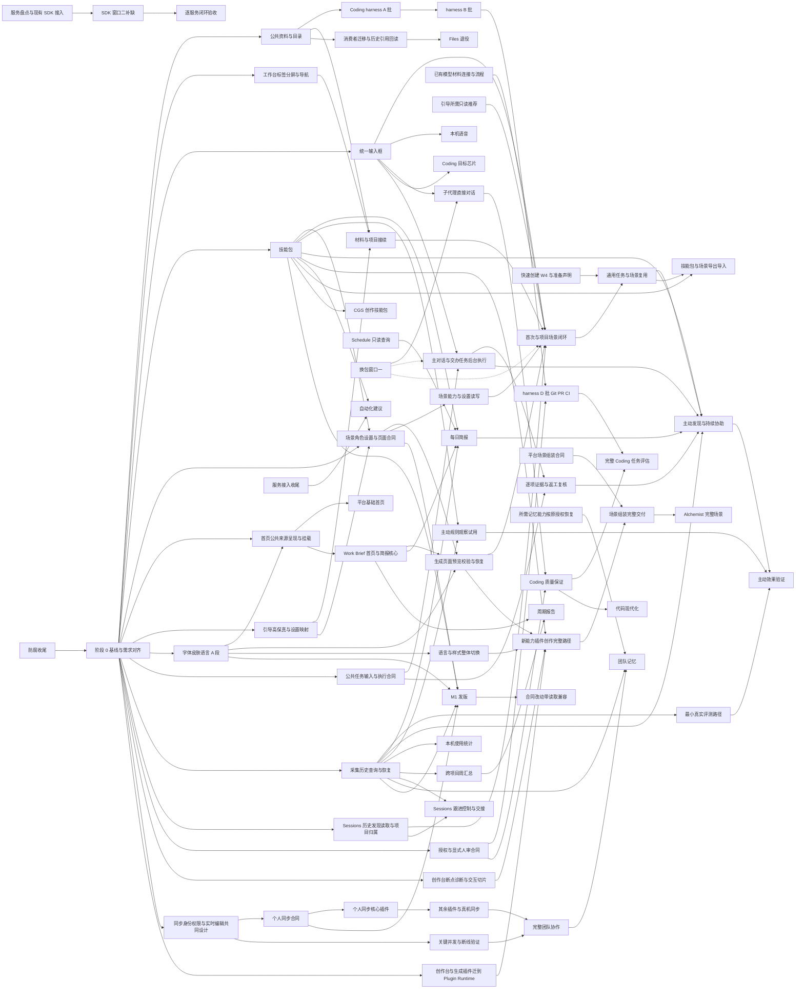

# 防腐收尾之后的实现路径

状态：规划（2026-11-03 更新；本轮需求与排期维护：Codex，实施沿原负责人及待分配状态）。在防腐线（[repository-anti-corruption](../repository-anti-corruption/spec.md)）收尾之后执行；在那之前只作排期参考，不开工。本文只排先后、分轨道、定每一段和每批的交付，不改原需求的内容和验收：那些仍以各自的 spec 和 [统一待办清单](../BACKLOG.md) 为准。起草时读的是 main `0d8388b09`（batch-42，#1311）。10-26 复查：补进个人云同步与 CGS 两条 main 之外的线、产品建议的余项、BACKLOG 全部条目的去处（3.8 节），字体皮肤语言按段写开，并修了几处轨道借文件和兼容起点的排序。

**执行入口：[第 6.1 节完整 01～89 批表](#execution-batches)。** 阶段 0～4 是总览，批次才是逐项推进的顺序。11-03 对照现行需求与 10-31 以来的改动，纳入全产品文案与引导、智能呈现、主线、升级持续可用、平台余项及开发流程；修正同步与字体切换、SDK 缺口与消费者之间的依赖。11-03 再逐 PR 复核，补入 #1730、版本归一与调用整治的具体交付，修正文字合同顺序、服务互等和评测多余等待；来源对照见 §3.10。只更新文档，未启动这些产品实现。

验收编号：不适用（排期文档；每一项的验收在它自己的 spec 里）。

10-27 本轮只更新需求与排期，不开发。[Onboarding 需求书](../onboarding-coverage/spec.md)已合并场景与能力包、动态渐进引导、全局/项目/任务设置；秘书沿用跨项目个人助理，项目可配独立助理团，首页允许 AI 生成新的交互页面。同时纳入实际反馈的材料选择、文件支持、步骤连续性、生成失败恢复及项目/Coding 接续，先贯穿基础材料路径，再扩场景。下文按此补齐前置能力与先后，轨道负责人保留；10-26 的其他线状态未在本轮全面复核。

2026-10-27 需求调整：原工作台需整体升级与体验打磨，首要解决一骏至今未完整跑通的端到端交付问题；平台场景组装能力并入[插件创作工作台升级](../plugin-builder-upgrade/spec.md)（BL-377），Alchemist 成为其中的完整落地场景，删除独立重做条目 BL-376。与场景／能力包设置、秘书与助理团引导、首次／项目／通用任务 Onboarding 三项独立；10-27 当时未重排这些引导需求；10-28 的顺序调整见下，防腐收尾前不开工的边界保留。

2026-10-27 采集需求独立：[观测和采集层](../observation-collection/spec.md)承接主动助理中共用的完整工作记录与采集维护要求，成为评测和主动助理并列依赖的平台能力。只整理需求与排期，保留 C 轨归属；阶段 1 设计，阶段 2 接通事实与消费，阶段 3 验证主动建议及整体效果。评测规则与助理设计可提前准备，采集不依赖二者运行。

2026-10-28 排期复查：公共资料、目录和工作台整合进入阶段 1；Sessions 历史接续前移到阶段 2；观测和采集、最小评测先于依赖它们的报告与理解验证；同步和实时协作在阶段 1 共同设计，关键并发／断线路径在阶段 2 验证；创作台阶段 1 诊断与定样、阶段 2～3 做通新能力插件交付，阶段 4 完成场景组装与 Alchemist。批准规则按已有授权、可选 AI 低风险审批和显式人审范围对齐。原负责人、Memory 暂停、完整产品范围及防腐收尾前不开工均保留；长期效果观察与独立开发并行。本次只更新文档。

2026-10-27 治理排期补充：[全平台产品与架构治理](../product-flow-governance/spec.md)已完成首轮静态盘点。现有各轨道实施时采用其相对顺序：先材料与已有工作恢复，再默认连接到实际使用，再同范围批准及发布启用衔接，再流程/提示词/个人设置简化，并持续补齐全部功能的真实路径。具体发现、依赖和退出条件只维护在治理需求 §6 与核查记录；这里不复制派工表，不改原负责人、Memory 暂停或防腐收尾前不开工的安排。授权规则以本轮已定需求为准：有效授权内连续执行；Coding 的可选低风险 AI 审批不替代显式要求的真人票数；团队发布等明确的人审仍保留。批准需求已同步，现有代码和仓库保护未因此改变。

11-02 只补需求：全产品文案与按需帮助并进 [visual-ui-experience](../visual-ui-experience/spec.md#copy-guidance)，引导接续并进 [Onboarding §3.15](../onboarding-coverage/spec.md#315-从页面帮助到渐进式引导)。新增 VUX-51～59、ONB-47～49 尚未实现或验收；需求维护 Codex，D/F 与各功能轨道保留原归属。视觉线移入部分完成清单，原有一百一十一片和局部验收不代表新增全产品要求已完成。

## 1. 起点：防腐收尾之后的代码

防腐线的收口范围是 §1 的 2026-10-18 那一行：W5、W6 全做完，[privileges.md](../repository-anti-corruption/privileges.md) 的行全部清掉。按这个范围，后面的需求面对的是这样一份代码：

- 插件一律经 Plugin Runtime 装配，同一套 SDK、Manifest 和平台服务。Goals、Feed、Inbox 都是普通插件，构建期装配名单清空（W6-01）。新插件和新能力只有这一条路可走，没有宿主私路可抄。
- 成果库和角色是平台的一部分；Sessions 已在 SC-4 删除，重做另开（BL-177）。
- 插件样式拆成各插件按需加载的 css，英文词典随插件包、在 Manifest 里声明（PG-070、PG-071）；`workbench.css` 里不再有属于具体插件的规则。
- 项目库的表由插件声明（PG-020、PG-021）；Home 级插件可以按项目分库；同一插件可以有 Home 与项目两个实例；连接、材料、本机目录授权、沙箱服务都由平台提供。
- 目录和各种名单由各包的声明生成（W5-02）；宿主入口只导出装配接口（W5-08）；有 Home 快照命令（W5-16）。
- 插件开发 Skill 和手册按新分层重写，样例只指向迁好的插件（W6-03）。
- 例外：Alchemist 和插件创作台不迁、不删，本轮绕过（用户 10-21、10-23）；后续统一由工作台升级 BL-377 承接，Alchemist 是场景组装能力的落地场景，不再独立重做（用户 10-27）。
- main 之外还有两条没合入的线，都写在防腐收尾之前的插件数据形状上：个人云同步（`personal` 分支，比 main 多 24 个提交、少 175 个，最新 10-25，改动有四分之一在 `plugins/native/`）；CGS 自媒体创作（`codex/cgs-formal-integration-20261013`，停在 10-14，落后 main 1159 个提交）。怎样接见 3.2 节。

阶段 0 的第一件事，是拿真正收尾后的 main 把这一节核一遍，对不上的地方先改本文再开工。

### 1.1 2026-11-02 对照代码的预核

在 main `885728c79` 上只读核了一遍；#1725 合入后，阶段 0 照此再核一次：

- 防腐线还没收尾：[privileges.md](../repository-anti-corruption/privileges.md) 的 114 行里还有 11 行待做（PG-011、017、045、046、060、064、070、078、093、094、111）；W6 收口 #1725（954 个文件）在跑全量；真实 Home 清空重建和本人验收的窗口还没开。
- PG-070 还剩 Characters 的样式留在两张共用表里（`apps/workbench/src/characters/styles.ts`、`apps/workbench/src/page-assets.ts`），字体皮肤语言 C 段的前提还没满足。
- 构建期装配名单只剩 Alchemist 与插件创作台（`tests/builtin-plugin-assembly-gate.test.ts` 的 `APPROVED_BUILD_TIME_EXCEPTIONS`）。宿主 `apps/local-host/src` 仍有 692 个文件、约 6.8 万行。
- `personal` 分支比 main 多 24 个提交、少 554 个（3.2 节的 175 是 10-26 的数）；CGS 分支少 1538 个。
- 第 5 节的独占文件变了三处：`apps/local-host/src/coding-surface.ts` 与 `plugins/native/coding/src/client.ts` 已不在；`assistant-island.ts` 已拆成 `apps/workbench/src/scripts/client/assistant-*.ts` 共 24 个文件；助理的 `methods()` 现在在 `apps/local-host/src/assistant/assistant-work-reads.ts`。第 5 节已按此改，热点也重量了。
- BACKLOG 有 23 行本文没有点名，多数是 10-28 之后新加的沙箱包与 Home 包余项；去处补在 3.8 节末行。
- 依赖图补上了原来只写在正文里的几条边（M1 之前要落的合同、换包窗口一、创作台迁到 Plugin Runtime），去掉了「核心插件同步 → 语言与样式整体切换」这条互等。C 轨按包拆成三个写手，这改了原来「C 轨一个写手」的安排，确认前按原安排执行（第 7 节第 17 项）。

## 2. 怎么排

**重要度**看三条，同时满足得越多越靠前：

1. **工作接得上**：中断、关掉应用、隔天、换一个入口之后，要求、进度和结果都还在，能接着做。
2. **体验**：常用路径顺、快，不露内部值，不出莫名其妙的错。
3. **易用**：第一次就能用上，不用先弄懂产品的结构。

**依赖**：被好几条线用到的东西先做。这样的地基包括公共资料与目录、统一工作台与输入框、技能包、观测和采集、已有授权与人审的明确边界、Schedule 只读查询、字体皮肤语言的文件格式，以及场景所需的角色与设置公开读写、生成交互页面的承载和恢复能力。团队身份、对象版本、权限与并发修改要在个人同步合同之前共同设计，完整团队产品仍在后段交付。已有能力先复用，只补当前场景所需缺口。

**冲突**：按文件把工作分成七条轨道，一条轨道同一时间只有一个写手；会碰到全仓的改动（换 Prologue 包、字体皮肤语言的整体切换）排进固定窗口。细则在第 5 节。

**升级与兼容起点**：库及带版本文件的升级链从统一起点开始，按 [upgrade-continuity](../upgrade-continuity/spec.md) 的 U0～U7 落地，不等 M1；第一个装到开发机之外的版本（M1，当前仍是阶段 2 的退出条件）发出去以后，动作、Manifest、MCP 等合同按过渡期演进（[合同变更流程](../../docs/system/CONTRACT-CHANGES.md) 第 7 节）。因此技能包、字体皮肤语言 A 段、同步、观测采集、场景与生成页面、智能呈现及主线的必要公共合同都在 M1 前落。M1 缩范围建议尚未决定（§7 第 18 项），不在排表时默认为已批准。

**不排日历。** 阶段描述能力形成顺序与阶段完成条件；独立任务的实际依赖和合同满足后可向前拿，不等待其他轨道全部完成。长期效果观察只约束对应能力的效果结论与约定发布条件，不作为全体开发的统一等待门。

## 3. 清单：全部未完成的需求

「去处」写的是本文第 6 节的阶段和轨道，比如「1·A」是阶段 1 的 A 轨（轨道见第 5 节）。

### 3.1 已经做完，只差核对、归档或你本人验收

| 需求 | 现状 | 去处 |
| --- | --- | --- |
| [diff-frame-performance](../diff-frame-performance/spec.md)、[long-turn-performance](../long-turn-performance/spec.md)、[attention-aggregate-performance](../attention-aggregate-performance/spec.md) | #1010、#1017、#1073 都已合入 main，状态句没跟上 | 0：核对后归档 |
| [pr-review-remediation](../pr-review-remediation/spec.md) | #901 已合入 | 0：归档，QA-017 没跑通的进 BACKLOG |
| [repository-cleanup](../repository-cleanup/spec.md) | 状态句已写「已实现」 | 0：归档 |
| [status-ring-system](../status-ring-system/spec.md) | 组件和 43 个状态已在 design-system，状态句还停在 10-13 | 0：核对后归档，视觉验收进「待你验收」 |
| [plugin-tab-groups](../plugin-tab-groups/spec.md) | PTG 用例在 main | 0：核对后归档 |
| [empty-goal-create](../empty-goal-create/spec.md)、[quiet-home-refresh](../quiet-home-refresh/spec.md)、[onboarding-intake-progress](../onboarding-intake-progress/spec.md)、[onboarding-model-link](../onboarding-model-link/spec.md)、[onboarding-folder-places](../onboarding-folder-places/spec.md) | 原列待验收；10-28 核实 #1306 已关闭、未合入 | 0：逐项核对成果是否由其他提交承接，保留未交付与待体验项；不再等待 #1306 合入 |
| [issue-home-v0](../issue-home-v0/spec.md) | V0 与首期体验按工程验证完成（用户 10-12 定）；BL-149 的分支待评审 | 0：BL-149 合入或关掉后归档 |
| [computer-use](../computer-use/spec.md) | 能力已合入，等真机（BL-325） | 0：真机验收后归档；BL-326、BL-327 留在 BACKLOG |
| [ai-development-handbook](../ai-development-handbook/spec.md) | 正文已写 | 0：BL-320 你验收；BL-321（ADH-23）随技能包在 1·C 做 |
| [prologue-memory-strategy](../prologue-memory-strategy/spec.md) | #1101、#1059 在途，P0 的形成、召回、SDK 接入未完 | 0：两个 PR 收掉；P0 余项仍属 1·C；沿原暂停边界，恢复授权前不启动 |
| 防腐线自己的四份：repository-anti-corruption、[plugin-project-database](../plugin-project-database/spec.md)、[dual-instance-plugins](../dual-instance-plugins/spec.md)、[plugin-project-partition](../plugin-project-partition/spec.md) | 随 W6-06 收尾 | 防腐线自己归档 |
| BACKLOG「待你验收」BL-001～017、105、109、111、320、325、400、401 | 已合入，只差你试用 | 0：一张验收单，一次走完 |
| 右栏选一段放进文稿（产品建议 F1；#712、#720） | 已合入；没用真实材料走过，落点只有 Pages | 0：真实 Shelf → Pages 走一遍，连同 #784 的 QA-030 复验；下一个落点等走完再定 |

### 3.2 做了一半、交接后停下的需求线

| 需求 | 剩什么 | 去处 |
| --- | --- | --- |
| [visual-ui-experience](../visual-ui-experience/spec.md) | 原一百一十一片记录保留；VUX-16～18、VUX-33、VUX-35 与本人验收未完；新增全产品文案与按需帮助 VUX-51～59 尚未实现 | 原输入余项 1·A、视觉/性能余项 1·D；1·D/F 共同设计文案与引导，2·D 统筹各入口落实、F 接续准备流程，各功能轨道改自己的表面；全产品逐项验收 |
| [ai-input-receipts](../ai-input-receipts/spec.md) | Goal 页「来自对话的输入」BL-314；交付说明入口 BL-315、步骤板 BL-316；有效要求的评测 BL-317；浏览器实走 BL-319；跨轮 BL-148；补充改了哪些文件 BL-162；阶段 5、6（BL-318） | 2·A；阶段 5 并进主动助理（3·A），阶段 6 各场景各写小 spec |
| [prologue-adoption](../prologue-adoption/spec.md) | A5 重核 BL-309；写后检查进时间线 BL-301、子任务写后检查 BL-302、截图 BL-303；P5 协作 BL-307；P6 旧路径退出 BL-308；结构化生成 BL-306 | BL-309、BL-301～303 在 1·C；BL-307、BL-308 进换包窗口一（2·C）；BL-306 随工作台升级的 Alchemist 场景（阶段 4） |
| [ai-interaction-experience](../ai-interaction-experience/spec.md) | 第二批入口 BL-341（PPT、Pages、Cognia）；卡片撤销 BL-343（合同改动）；同排推荐 BL-344（你看实物）；验证 BL-345；键盘多选 BL-340；Coding 目标芯片 BL-342 | BL-343、BL-344 在 2·A；BL-341、BL-340 在 2·E；BL-342 在 2·B（用新输入框） |
| [context-program](../context-program/spec.md) 及 [context-toolbar](../context-toolbar/spec.md)、[quick-create](../quick-create/spec.md)、[side-shelf](../side-shelf/spec.md) | W4：一句话新建 BL-330、`attach` 的 `find` BL-331、批量创建 BL-332、内容站与「放进 Inbox」BL-333、无模型去处 BL-174、覆盖率门禁 BL-334；W5 拖放 BL-335；W6 Shelf 动作与材料篮 BL-336；W7 起 BL-337；实走与收尾 BL-338、BL-339 | W4 在 2·E；W5、W6 在 3·E；W7 起在阶段 4 |
| [assistant-service-connections](../assistant-service-connections/spec.md)（产品建议 A3） | 37 项整体验收、ASC-38～44、真实账号 BL-060、正式 OAuth BL-062、发起者核对 BL-180、loader 名单 BL-181、导入方式核对 BL-690 | BL-062 在 1·F 先送审（审核慢）；其余 3·C |
| [coding-plugin 下一阶段](../coding-plugin/next-requirements.md) | 保留范围见 BL-050；C5 多模型对比取消、页面沿 Character 选择；Q1 已定公开查询默认、项目/任务关闭及平台公共搜索、统一默认来源，Q2 命令默认受限且沿用项目目录、长期规则经用户明确同意保存、获准开发任务下载所需公开依赖已定，可选 AI 低风险自动审批已定，Q3 钩子首次确认、变更重新确认及停用已定，Q4 记忆沿原方案接入已定，Q5 代码分析工具按需隔离下载已定，Q6 已收口：取消多模型对比，语音沿既有本地输入方案；Q7 GitHub 复用连接与按任务授权已定，Q8 已定本阶段不做 VS Code 扩展／Tab 补全／行内编辑，ACP 仍未排期；Q1～Q8 已收口，各项只等实际依赖 | A 期 2·B；B 期 3·B；C、D 期阶段 4；E 期的语音并进统一输入框，其余不排 |
| 个人云同步（`personal` 分支上的 `specs/personal-cloud-sync/`、`plugin-sync-foundation/`、`personal-plugin-replication/` 等六份） | 账号、同步 Worker（D1、R2）、双 Home 同步与撤销，以及 Todo、Pages、Goals、Images、Alchemist、Cognia、Feed、Shelf 等的适配，已在隔离环境分项验证；整体没交付、没部署、没在两台真电脑上验过，整项目复制与项目级回收的闭环没完。下一阶段的范围你 10-17 定了：设备间自动与手动同步、全部插件、每个账号 100 MB、保留 30 天 | 见表后「个人云同步怎样接进来」：0 定合入方式，1·C 合同，2·G 核心插件，3·G 其余插件与真机 |
| CGS 自媒体创作（`codex/cgs-formal-integration-20261013` 分支的 `specs/cgs-formal-integration/`） | 10-14 的基线上做完阶段 0、1：七项创作 Skill，作者在项目里带材料讨论、比较候选、定主稿、出各平台稿；没合主线、没发布。研究、选题、栏目、发布回执、数据复盘不在已做范围 | 分支不合；技能包落地后七项 Skill 改成内容技能包（2·C 起）；插件本体按新 SDK 重做与否由你定（第 7 节） |

**个人云同步怎样接进来。** 它和防腐收尾撞在同一处：同步适配写在各插件的存储上，而防腐线把插件的表改成 Manifest 声明（PG-020、PG-021）、Home 插件按项目分库、同一插件分出 Home 与项目两个实例。所以不把分支整个变基进来，而是按收尾后的形状重接，原来的适配和用例当参照：

1. 阶段 0：拿收尾后的 main 对一遍分支，列出哪些适配还成立、哪些要重写；你定合入方式（第 7 节）。
2. 1·C/G：先与团队实时协作共同设计身份、对象版本、访问、并发与断线恢复，再定个人同步合同，避免把整对象覆盖当作所有内容的协作语义。同步合同单独一个 PR——插件在 Manifest 里声明哪些表、哪些对象要同步，平台提供同步服务，不按插件名单接（插件同等待遇）；Outbox（BL-070）随它一起定。
3. 2·G：平台同步服务、账号、Worker，加核心插件（Goals、待办、文稿、成果库）的声明。要在 C 段切换窗口之前合完，窗口里不动插件。
4. 3·G：其余插件的声明、整项目复制与回收、两台真电脑验收。部署正式 Worker、开真实账号只能你办。

完整个人同步也是团队产品的前置；共同设计与关键协作验证不等个人同步全部交付：[sync-replication](../../docs/modules/sync-replication.md) 和 [identity-team-access](../../docs/modules/identity-team-access.md) 两个模块都还没有实现，团队那份副本要建在个人同步上（3.4 节）。

### 3.3 需求已整理、还没开工

| 需求 | 一句话 | 去处 |
| --- | --- | --- |
| [unified-input-voice](../unified-input-voice/spec.md) | 平台统一输入组件的整体交互与 UI；首页、助理、Coding 首批接入，向所有适用插件／组件开放注册扩展，加本机语音（10-27 已定，§2.1～2.2） | 文字与公共扩展部分 1·A；语音 2·A（要真机验麦克风与中文输入法） |
| [skill-packs](../skill-packs/spec.md) | 只有 Manifest 的内容插件，助理和 Coding 共用一份方法目录；纯内容的包助理看得见（产品建议 G1），从 Claude Code、Codex 导入的 Skills 直接变成技能包（G2） | 1·C（`assistant-service.ts` 那处改动由 A 轨落，见第 5 节规则 7） |
| [work-brief](../work-brief/spec.md) | 可选的项目综合首页与简报插件；未安装时保留平台基础首页，共用公开来源／呈现，承接生成页面与原简报版本能力（10-27 已定） | 1·C/D 公共合同、组件与基础首页，1·E 综合首页及简报核心；2·D/E/F 生成首页接续、2·A 每日简报；3·A 周期报告 |
| [观测和采集层](../observation-collection/spec.md) | 全平台获准的用户行为、过程、结果与当时内容；公共查询、覆盖、历史证据及维护；需求已独立，尚未实现 | 1·C 盘点设计，2·C 先接通真实事实、历史读取与恢复；各轨道持续接入，不等主动助理建成 |
| [平台端到端效果评测](../proactive-assistant/spec.md#14-molis-work-的端到端效果评测) | 独立消费采集证据，负责样本、预期、判定、比较与隔离回放；覆盖手动及各类 AI 工作 | 1·C 准备案例与方法，2·C 接通最小真实评测路径，3·C 扩展整体及主动效果；Coding R12 仍在 3·B |
| [proactive-assistant](../proactive-assistant/spec.md)及 [#1730 增量][PAEXT]（未合入） | 主对话、连续交办、后台可视化、场景 Skill 与工作记忆；新增逐项交付／返工、准备与通知分开判断、观察试用 | 1·A/D 设计、C 核公共能力；2·A 在 32 交明确任务和 PWA-144～147、56 验真实闭环；3·A/C 在 63 交 PWA-141～143、75 验效果。记忆沿原暂停，明确交办不等完整采集与评测 |
| [coding-harness-optimization](../coding-harness-optimization/spec.md) | Coding 可靠性与性能：A 批 P0、B 批闭环、C 批渲染与 Dataset、D 批 Computer Use 与 Git/PR/CI、E 批评测、F 批效率实验 | A、C 批 1·B（Dataset 那半 2·E）；B 批 2·B；D 批与 R12 3·B；R11 并进创作台重做；F 批阶段 4 |
| [agent-approval](../agent-approval/spec.md) | 有效授权持续执行，明确需人审的范围按人员和版本校验；Coding 可选低风险 AI 审批单独记录来源 | 0 对齐新旧要求，1·C 设计公共边界，2·C 接通审查合同及 BL-359、BL-360；3·B 接 Coding 专项，不作为所有功能的共同前置 |
| [subagent-interaction](../subagent-interaction/spec.md) | 助理与 Coding 里固定的子代理入口、直接对话、父任务获知变化 | Prologue 那半进换包窗口一（2·C）；产品那半 3·A、3·B |
| [coding-quality-assurance](../coding-quality-assurance/spec.md) | 自检、交叉评审、对抗评审、安全评审、批准门、有界迭代 | 3·B |
| [automation-recommender](../automation-recommender/spec.md) | 读项目，推荐值得加的 hooks、技能包、连接、角色、命令；保持只读推荐、不自动安装 | 引导需要的读取/推荐片提前到 2·C；完整能力仍为 3·C |
| [code-modernization](../code-modernization/spec.md) | 评估 → 地图 → 业务规则 → 计划批准 → 增量改造 → 行为等价证明 | 4·B |
| [product-flow-governance](../product-flow-governance/spec.md) | 全平台配置、工作衔接与审批治理；已定公共资料／目录、Files 退役、标签分屏统一；真实整改未做 | 1·C/D 与 B/F 先接资料、目录、工作台导航及恢复；1～2 阶段迁完消费者、历史引用与过程项后退役 Files；其余沿治理 §6，全平台覆盖才算整体完成 |
| [onboarding-coverage](../onboarding-coverage/spec.md) | 先修顺多位置/真实文件支持、步骤与恢复、材料采用及 Coding 接续；再扩场景包、动态引导、全局/项目/任务设置、项目助理团与新交互首页 | 本轮完成需求整合；1·F 贯穿设计与设置映射，1～2·F 沿原主人完成材料基础路径；1～2·C/D/E 场景公共能力，2·F 场景闭环及任务复用；持续工作与完整导入导出随阶段 3 |
| [font-and-skin-system](../font-and-skin-system/spec.md) | 字体、皮肤、语言三套系统 | 分五段，跨阶段 1～3 的 D 轨，见表后 |
| [risk-plugin](../risk-plugin/spec.md) | 专门记风险的插件 | 1·E（收尾后第一个按新标准从零写的插件） |
| [prologue-skill-strategy](../prologue-skill-strategy/spec.md) | Skill 的选择、唤起、组合与观测 | 评审后 2·C，紧跟技能包 |
| [prologue-context-strategy](../prologue-context-strategy/spec.md) | 来源预算、trace、新鲜度、压缩 | 评审后 3·C，配合主动助理 |
| [prologue-mcp-strategy](../prologue-mcp-strategy/spec.md) | MCP 服务器信任、发现、健康、认证 | 评审后 3·C，配合服务接入收尾 |
| [prologue-tool-strategy](../prologue-tool-strategy/spec.md) | 工具面、搜索、结果预算 | 评审后 3·C |
| [intelligent-surfaces](../intelligent-surfaces/spec.md) | 智能呈现与操作层（11-02 新增）：插件声明对象能怎样展示、能做什么、别人能放在它哪里；平台先做确定组合，助理再把插件内容、平台内容与 MCP、Skill 组合成此刻的操作面，注入插件内外、对话、项目讨论、等你与首页 | 分四片，跨阶段 1～4，见表后 |
| [work-mainline](../work-mainline/spec.md) | 主线（11-02 新增）：用户把手头的事项（平台的轻量容器，Goal、待办等可以变成事项）按自己的分组和顺序排好，从顶部像切换项目那样切到一件事，主区、标签、右侧、助理范围和等你一起换；事项容器与排列归新的主线服务，插件对象的内容仍归插件 | 1·D 与 PFG 的工作台统一一起设计；2·C1 合同（M1 之前）、2·C3 主线服务包、2·D 切换器与按事项的工作台状态、2·E/B Goals 与 Coding 来源；整理视图与助理范围 2～3·A/D/E；助理建议 3·A，跨设备随 G |

**字体、皮肤与语言分五段**（[实现方案](../font-and-skin-system/implementation-plan.md) 第 11 节）：

| 段 | 做什么 | 去处 |
| --- | --- | --- |
| A 合同与共享文件工具 | 文件格式、文字引用、快照与资源协议进 UI 与插件合同；SDK `/ui` 与共享工具；从现有值提出完整的基线文件 | 1·D（合同先行，赶在 M1 之前） |
| B 基线与真实切片 | 宿主一侧、首屏、共同组件与规格板、Soft 与 Folio、字体，加一个插件的切片，在隔离 Home 的真实工作台上验 | 2·D 前半；方案里创作台那一片挪进创作台重做（阶段 4），因为创作台本轮不迁 |
| C 全入口与文案转换 | 现存插件、嵌入、稳定键、目录与状态、公开 SDK；各包分头准备，整合后一次切换 | 2·D 末的切换窗口，翻译余项一起清；前提是防腐线的 PG-070、PG-071 已落 |
| D 自定义与助理 | 编辑、导入、库、校验、预览、应用、撤销、恢复；助理的制作 Skill | 3·D |
| E 整体交付 | 全量回归、所有入口、发行物与手册；真实 Home 的存量维护（先备副本，动手前弹窗问） | 3·D 末 |

动作文字与结果摘要（FSS-40、FSS-41）你 10-23 定暂不实现。语言覆盖和翻译缺口记在该 spec 的 §6.1，随 C 段一起收。

**智能呈现怎样接进来。** 按 [intelligent-surfaces](../intelligent-surfaces/spec.md) §13 的四片排，前两片只用确定组合，不等模型、技能包或采集：

1. **1·C1/D/B/E，A 落对话那处**：
   - C1 先开呈现声明的合同 PR，在 Manifest 里自成一段声明（第 5 节规则 1），连同 SDK 里的校验与确定组合（作者和平台共用的工具放在 SDK），排在 M1 之前；
   - D 做名字片、行、卡片、速览四种形态与组件板「呈现形态」一节，和 Work Brief、基础首页要的公共呈现组件是同一套，与 1·C/D 那份公共来源／呈现一起设计，不做两套；
   - Goals、Inbox 的声明在 E，Coding 的声明在 B；
   - 对话里的对象引用由 A 落（规则 7）；项目讨论（`packages/im-ui`，不归任何轨道独占）和等你随 D 落。
2. **2·D/E，A 接决定请求与验收卡**：
   - D 做活卡、嵌入、证据链、交接卡、决定请求、验收卡，以及首页、Shelf 与插件之间的挂载位；
   - E 补 Pages、Dataset、待办、Feed、工作流程的声明；
   - 决定请求与验收卡接 2·C 的显式人审合同和个人助理的逐项交付与返工，由 A 接进对话；
   - 证据链读 2·C 接通的采集与历史；
   - 声明里的显示文字从第一片起就用 `ui.messages` 的稳定键，C 段切换窗口里 E 不改这些声明（规则 3）。
3. **3·C2/C3/A/E**：
   - C3 新开组合服务的 `horizontal/` 包，助理组合经 C2 的 `horizontal/agent-host` 调模型；
   - 跨插件与 MCP、Skill 的操作面要等技能包与 MCP、Tool 两份策略，并与 3·A 主动助理用同一份交付体验；
   - 外部 Agent 读到的文本形态随动作目录一起出；
   - 3·C 的端到端评测接住「呈现、采用、纠正」；
   - 其余插件的声明在 3·E 补完。
4. **3·D/E 到阶段 4**：
   - 生成插件与创作台声明呈现，要等创作台与生成插件迁到 Plugin Runtime（图中 PBR）；
   - 操作面保存成视图或生成页面，复用 2·C 的生成页面运行时；
   - 导出形态和创作台整体升级一起在阶段 4 收尾。

每片落完，按该 spec §14 的 IUI 编号验收；`[人工]` 几条在每片末尾的本人验收单里。

### 3.4 重做与新方向（已合并的需求不另起文档）

| 事项 | 包含 | 去处 |
| --- | --- | --- |
| [Sessions 重做](../sessions-rebuild/spec.md)（BL-177） | 国内外主流公司的 AI 开发工具都覆盖；冷启动导入、持续了解进展、直接控制外部会话三类都做，回到会话、搜索、消息与跨 Runtime 交接均保留，逐产品／入口记录能力和缺口，不以两家通过代表整体完成；产品建议 B2 挂在这里 | 1·C 盘点来源与历史读取合同；2·C/F 做历史发现、读取、项目归属及引导接续；3·C 完成持续跟进、会话控制和跨工具交接，逐产品／入口验收完整范围 |
| 首日旅程（产品建议 A6、I1、I10） | 已合进 onboarding-coverage：目的/材料起步 → 动态补问 → 场景与配置预览 → 采用 → 真实第一件事；包含项目助理团、新交互首页与获准的规则/Skills 导入 | 不另写第二份需求；1·F 设计，公共能力就绪后 2·F 实现；新项目、已有项目增加场景和单次任务共同覆盖 |
| [插件创作工作台升级](../plugin-builder-upgrade/spec.md)（BL-377） | 原工作台从真实想法到可用插件的完整交付、体验与恢复；平台场景组装：手动／个人助理组合已有插件，与新能力插件创作共用工作台；Alchemist 为完整落地场景，承接 BL-010、035、306；保留 harness R11、R12、产品建议 C1～C5、字体皮肤语言 §7.2、BL-040、055、113、114、125、132、245、373、551、712 与 BL-341 的创作台部分 | 1·C/D/E 诊断真实断点、核能力并做交互切片；2～3·C/D/E 做通新能力插件创作、安装、独立使用和修订；3·C 细化组装合同，4 完成组装与 Alchemist；三项引导仍独立，整体未完成 |
| [团队协作首版](../team-collaboration/spec.md)（产品建议 I8） | 多成员与 AI 共用项目资料、任务和结果，首版包含实时共同编辑、成员光标与交错修改保护，整体参考 Codex Projects；BL-071、BL-013；BL-022 团队记忆已独立成文。10-28 已定按项目明确共享，个人空间、其他项目和个人外部 AI 会话不自动公开，记录与简报遵守同一范围；首版项目级查看／编辑／管理三档、后续插件／资产细化已定，统一访问入口保留资源和操作；团队记忆的发布、融合与使用转独立需求，本项负责身份和访问衔接；细粒度规则与同步交互待细化。要先有个人云同步和身份与团队权限（今天两个模块都没有实现） | 1·C/G 共同设计访问、同步与实时编辑，2·C/G/D/E 验证关键并发／断线路径；3·C 收拢剩余交互，4 交付完整团队产品；实现待分配 |
| [团队记忆](../team-memory/spec.md)（BL-022） | 像持续在线的 PMO 观察获准项目、沟通和工作，筛选可复用的决策、风险、知识、偏好和协作模式，减少三类上下文交接；助理／Skill 消费以支持主动协作、习惯和交付质量改善。成员个人发布需最终确认并告知不可撤回，管理员维护，个人与团队可采用不同策略；复用公共采集和记忆能力，不扩大原记忆 P0 | 1·C 在共同设计中核团队来源、用途与访问边界；3·C 细化形成／融合与使用方案，团队身份／同步、公共采集及所需记忆能力具备后于阶段 4 实施；未实现，不启动暂停的 Memory P0 |
| 分享做法与成品（产品建议 G3、I2） | 技能包、工作流程、生成的插件导出成一个文件，导入时展示内容与权限；带出处的报告导出成文件。公开页和市场以后再谈 | 导出导入 3·C（技能包之后）；报告导出随 D4（3·E）；公开页不排（第 8 节） |

### 3.5 发布就绪（C 端 M1、M2，见 [c-end-readiness](../repository-anti-corruption/c-end-readiness.md)）

| 事项 | 去处 |
| --- | --- |
| 签名与公证（BL-021；产品建议 A1） | 1·F；2026-10-27 已定使用现有个人 Apple Developer 账号，凭据接入与发行物验证待实施 |
| 数据升级链与升级前自动备份（产品建议 A2、C-2），从各库的第 1 版起算。真实 Home 按用户 10-30 的决定清空重建、不迁移（旧 Home 整个搬开，不删），由你说「开始」；BL-413 的 v8 → v9 迁移、BL-583 的改名、BL-487 的旧 Sessions 清理随重建逐行核掉，BL-157 已不在 BACKLOG | 重建随防腐收尾；升级链及其余按 [upgrade-continuity](../upgrade-continuity/spec.md) 分八片，见表后「升级后持续可用怎样接进来」 |
| 运行条件：常驻、休眠后补跑、错过的怎样显示（产品建议 A5；BL-030、BL-645、BL-352） | 1·F |
| 对外许可口径（产品建议 A4，在官网仓库） | 0 |
| 原生组件随包预置与首次自检（产品建议 H14） | 2·F |
| 「需要你」的菜单栏角标与系统通知（产品建议 B3），连同 Attention 还没有的稍后提醒与定时唤醒（[attention-resumption](../../docs/modules/attention-resumption.md)） | 2·F；Attention 那一半在 C 轨 |
| 兼容起点：M1 发出那天把版本、日期、提交写进 [合同变更流程](../../docs/system/CONTRACT-CHANGES.md)，此后合同改动带读取兼容 | 2·F，随 M1 |
| 在别的应用里选中送进 Work：macOS App Intents、服务菜单、快捷指令（产品建议 F3） | 3·F |
| 自动更新、定时在线备份、可选崩溃上报（M2；BL-115） | 3·F |
| 经同意、存在本机的使用统计（产品建议 I9；BL-169），建在工作记录上 | 3·F |

**升级后持续可用怎样接进来。** [upgrade-continuity](../upgrade-continuity/spec.md) 承诺：装上新版本后，旧 Home、库、插件和保存的引用都接着能用。用户 11-02 同意，库的升级链从统一起点（真实 Home 清空重建、各库回到第 1 版）起算，不等 M1；动作与 Manifest 仍按对抗式审查第五遍的决定，阶段一在原版本上直接改，从 M1 起开过渡期。分八片：

1. **阶段 0（C1）——U0 规则。** 与版本归一、真实 Home 重建同一批，改合同变更流程 §3 第 4 条、`AGENTS.md`、c-end-readiness C-2 的起点。
2. **阶段 0 末到 1 前段，统一起点后第一次改库结构之前必须就位：**
   - **U1 升级链机制（C1，`packages/storage`）：** 宿主启动与打开库的那几处按规则 4 一起落；
   - **U2 金样 Home 与回放（C1 写回放，F 管发版留金样）：** 与 U1 并行，门禁等 U1 合入后再打开。
3. **阶段 1 后段：**
   - **U3 按主人隔离、较新的库只拒绝这一个（C1 与 D）**；
   - **U4 插件声明升级段（C1）：** 走 Manifest 的合同快照排队，可延到阶段 2 前段。
4. **阶段 2，M1 之前就位：**
   - **U5 合同过渡期（C1；A、E 接各自的保存引用）：** M1 当天生效，与 U1～U4 并行；
   - **U6 演练与回退（F）：** M1 的前置，与签名公证同在 F 轨。
5. **阶段 3：**
   - U6 接自动更新（M2，3·F）；
   - **U7 整份导出与导入（F 与 C1）：** 和引导的完整导入导出一起。

依赖：U0 → U1 → U3、U4、U6 → M1；U2 与 U1 并行；U5 与 U1～U4 互不相干，只在 M1 前会合。换包窗口（规则 2）要先过金样回放；个人同步（G）的协议要接受上一版客户端。

### 3.6 体验债与插件小功能（独立片，按批填空做）

| 批 | 内容 | 去处 |
| --- | --- | --- |
| 一 | Feed 失败提示露原码与两个提示框 BL-094、添加来源的按钮与默认源 BL-095、露内部值 BL-096、首次打开慢 BL-097、Inbox 刷新整页重画 BL-131、刷新失败少一句 BL-134、过程文字露内部标识与夹英文 BL-091、BL-103、窄屏面板盖住确认卡 BL-102、Jelly 日程被叫成文件 BL-092、搜索结果在指针下移动 BL-112、记忆开关的说明（产品建议 H23）、出网清单（H18）、灵光把「不可信」声明写在用户可改的指令里 BL-183、#784 QA 记录里还开着的 QA-029～034（#784 合入时把它新加的 BL 号改到不和现有的撞） | 1·E |
| 二 | 按月/季/年重复（H10、J3）、在等的按人分组与等了几天（J2、J4）、Dataset 汇总行与追加行（H12、H21）、问卷存成数据表后自动追加（H15）、没连 TypeSafe 时的判断规则（H13）、Dataset 大数据性能（harness R9）、Shelf 轮盘与快捷键 BL-053、「以上期要求新建一期」（D1；先用现有能力连做两期，摩擦成立再做）、待办整理准确率的样本集（J1）、工作流的查询类步骤 BL-043、项目资料的旧 Office 格式与关窗不停下载 BL-397、BL-398 | 2·E |
| 三 | 本机规则版脱敏（H9）、Gmail 附件与全文（H11、H19）、PPT 图片与图表（H16）、Pages 个人模板（H17）、YouTube 字幕（H20）、固定版之间的逐段差异（D6）、出处一路跟到底（D3）、材料变了哪些结论要重看（D2；先做 Cognia 内部的只读清单）、导出 Word 与按固定版导出（D4）、规划方法扩行业 BL-056 | 3·E |

### 3.7 散在各处的平台小项

防腐收尾时，BACKLOG §7、§8 的条目会被做掉或写明不做的理由。阶段 0 把剩下的按所在包归进对应轨道，作为该轨道的填空项。现在就看得出去处的几组：

- 翻译余项（BL-118、BL-455～464、BL-545、BL-546、BL-567）：随字体皮肤语言的 C 段切换（2·D）。
- 写后检查（BL-160、BL-171、BL-220、BL-390）：1·C，和 BL-301～303 一起。
- 要 Prologue 上游改的（BL-031、BL-137、BL-172、BL-173、BL-175、BL-176）：列进最近的换包窗口。
- 记忆的误记与默认（BL-037、BL-093）：随记忆 P0（1·C）。
- 模型能力造成的（BL-089、BL-104）：按「模型能力问题不打补丁」处理，不单独排。
- 代码改名（[术语表](../../docs/system/GLOSSARY.md) 第 5 节）：R-A 只改标识符的，按所在包作各轨道的填空；R-B 要改存量数据或合同的，R-B1～R-B8 已定不做（2026-10-26 统筹，W5-14 只管内部名），保持原名记在术语表 R-C；R-B9 源码已改，存量随真实 Home 清空重建、不迁移（用户 2026-10-30），不再逐项问。第 6 节文档里的旧称，各轨道改到哪份文档顺手改。
- 助理里「工作 / 工作简报 / 任务 / 受托工作 / 子工作」选定对外的词（产品建议 H4），1·A 开工前定，写进术语表。
- 工程流程（统筹做，不占轨道）：产品子集并入 `Verify`（W2-16）、新成员从零上手的步骤（[并行开发](../../docs/system/PARALLEL-DEVELOPMENT.md) 第 12 节），以及 3.8 节「工程流程」一行。
- 对抗式审查（[报告](../../docs/reviews/adversarial-review-2026-11-01.md) §15～19）逐项排入：01／02 核原决定、待办和共享核心／版本归一；05 接 SQLite 第二步及必要 schema／动作合同；06 做公共工具与宿主重复调用整治，N56 和宿主首片同 PR，07 做页面请求整治；27 收宿主出口、文档／门禁和各包余项；46 在创作台迁移后清生成插件旧读取。N12 先定主人，N14 先定合同，N3／N16 等未定门禁保留待决。原报告更正及 #1727 实际采用先核回，不把已修项重做。详细交付在 §6.1，PR 去处在 §3.10。

### 3.8 BACKLOG 其余条目的去处

上面各节没点名的条目都在这里，按轨道和阶段分：

| 去处 | 条目 |
| --- | --- |
| 随防腐线收（收尾时逐条核；没做掉的，按所在包归进轨道） | BACKLOG §8 全部：BL-080、081、085、086、088、117、121～124、127、324、531、532、635、637～639、646、647、657、680、695；§5、§7 里挂着防腐切片或 PG 的：BL-072、130、136、178、375、378、381、382、386、500、505、507、508、520、522、525～527、530、550、568、575～577、579～582、584、586～589、616、617、619～623、625～628。其中 BL-130 随 W6-03 的 Skill 重写一起核 |
| A 助理与输入 | 1·A：BL-033（确认卡与建议卡的 Tab 顺序）、BL-393（输入法用例，已随 T-044 做完）；2·A：BL-032（只说不做时续做一次）、BL-042（真实模型跑搜索）；3·A：BL-038（动态交互的待定参数）、BL-101（侧栏浏览器的输入） |
| B Coding | 1·B：BL-246（问卷回执一闪而过）、BL-310～313（QA-009～012 的真实链路证明）、BL-540（判断一轮被切断的时间界限）；2·B：BL-051（子任务预算与重试）、BL-182（重试记成本人的补充）、BL-566（成果正文的读取边界）；BL-141（Coding 客户端翻译）随 2·D 的 C 段 |
| C 平台与 Prologue | 1·C：BL-323（`remember` 待认可时的工具结果）、BL-367（插件 `stop` 钩子没有时限）、BL-569（安全不变量门禁漏扫 e2e 用例）、BL-392（Runtime 显示名散在几处）、BL-070（Outbox，随同步合同）；2·C：BL-371（运行时能力加会话间发信，随子代理）、BL-034（没接的 Prologue 能力，按窗口清单逐项挑）；3·C：BL-052（五家原生 Agent 实操，随 Sessions 重做）、BL-166（技能包定制）、BL-128（引用声明的语义一致性，等你定） |
| D 外观与语言 | 1·D：BL-041（无项目时没有搜索入口）、BL-138（窄问卷卡的标题）、BL-543（设置地址把查询参数原样带过去）、BL-544（侧视图插件框没加载完就能点）；2·D：BL-139（「开始」译成 Started）随 C 段 |
| E 插件 | 2·E：BL-129（首页事项不分撤不回，随情境 W4）；3·E：BL-039（片段级动作只有四个插件提供，随 W5、W6） |
| F 首次使用与发布 | 1·F：BL-106、BL-107（引导里的项目简介与后台继续，随 onboarding-coverage）、BL-108（MCP 启动器找不到 Home 的服务）；2·F：BL-110（桌面里管理项目导航卡住）、BL-126（维护六收尾核对，随真实 Home 维护） |
| 工程流程（统筹） | BL-142、BL-143、BL-412（偶发失败的用例）、BL-565（共享核心 PR 的全量证据进 required CI）、BL-328（真实模型小评测的命令） |
| 11-03 补点名 | BL-880：07 随 Feed／工作台迁移，门禁决定只挡该片；BL-900：05 区分非持久编辑器字段与持久化结果合同后整理，原 R-B 不改决定保留；BL-925：仅第三个双实例插件出现时再评，见 §8 |
| 11-02 补点名 | 随防腐线收（用户 10-30 定 PG-011、PG-017 的余项做完再关行）：BL-491、493、710、711、713、714，以及 PG-017 关行前要核的 BL-916；1·C：BL-701、910、915、918（沙箱包的可选权限、终端、卸载、生图上限），BL-812（平台包吞掉的错误）、BL-814（Runtime 动作调用的成本）、BL-901（插件包 `./contract` 的 API 快照）、BL-911（委托调用的受众）、BL-913（终端记录的坏值）；3·C：BL-692～694（外部集成，随服务接入收尾）；1·D：BL-912（Home 包在标签条上的图标）；1·E：BL-803、819、821（Goals 认本人、读坏时的报错） |

### 3.9 按类型与决策

多人分头做时，每一项先看这里：它属于哪几类，开工前有没有要人定的事。类型和决策标记的写法见[需求开发流程](development-workflow.md)第 1.2 节；跨几类的都标，主要的在前。「要决策」写的是开工前或某一片之前要定的事；做的过程中碰到预警情形（流程第 6 节），照样发预警。新需求立项时在这里加一行，做完删行。

| 节 | 需求 | 类型 | 决策 |
| --- | --- | --- | --- |
| 3.1 | 三份性能 spec（diff-frame、long-turn、attention-aggregate） | 体验与效果（性能） | 直接做：核对后归档 |
| 3.1 | [pr-review-remediation](../pr-review-remediation/spec.md)、[repository-cleanup](../repository-cleanup/spec.md) | 底层与架构 | 直接做：归档 |
| 3.1 | [status-ring-system](../status-ring-system/spec.md) | 横向能力（公共组件）、体验与效果 | 要决策：视觉验收（你） |
| 3.1 | [plugin-tab-groups](../plugin-tab-groups/spec.md) | 产品线（工作台） | 直接做：核对后归档 |
| 3.1 | 空列表新建、首页静默刷新与三份引导小 spec | 体验与效果、产品线（引导、Goals） | 要决策：待体验项你验收 |
| 3.1 | [issue-home-v0](../issue-home-v0/spec.md) | 产品线（Issue 插件） | 直接做：BL-149 合入或关掉后归档 |
| 3.1 | [computer-use](../computer-use/spec.md) | 产品线（助理） | 要决策：真机验收（你） |
| 3.1 | [ai-development-handbook](../ai-development-handbook/spec.md) | 横向能力（AI 方法） | 要决策：BL-320 你验收 |
| 3.1 | [prologue-memory-strategy](../prologue-memory-strategy/spec.md) | 横向能力（记忆）、底层与架构 | 要决策：恢复授权前不启动（原暂停） |
| 3.1 | 防腐线自己的四份 | 底层与架构 | 直接做：随防腐线收 |
| 3.1 | BACKLOG「待你验收」各条 | 跨线 | 要决策：你一次走完验收单 |
| 3.1 | 右栏选一段放进文稿 | 产品线（工作台）、横向能力（落点） | 要决策：下一个落点等实走后定 |
| 3.2 | [visual-ui-experience](../visual-ui-experience/spec.md) | 体验与效果、横向能力（文案与按需帮助） | 要决策：本人验收；新增文案与帮助的界面定样 |
| 3.2 | [ai-input-receipts](../ai-input-receipts/spec.md) | 产品线（助理）、横向能力（回执） | 直接做；阶段 6 各场景写小 spec 时再定 |
| 3.2 | [prologue-adoption](../prologue-adoption/spec.md) | 横向能力（AI 运行时）、底层与架构 | 直接做：按换包窗口 |
| 3.2 | [ai-interaction-experience](../ai-interaction-experience/spec.md) | 产品线（助理、各插件）、横向能力（卡片撤销合同） | 要决策：同排推荐看实物（BL-344） |
| 3.2 | [context-program](../context-program/spec.md) 一组 | 产品线（工作台、各插件）、横向能力（落点、情境动作） | 要决策：W4 起各片的界面定样 |
| 3.2 | [assistant-service-connections](../assistant-service-connections/spec.md) | 横向能力（服务接入）、产品线（助理） | 要决策：正式 OAuth 与真实账号（你办） |
| 3.2 | [coding-plugin 下一阶段](../coding-plugin/next-requirements.md) | 产品线（Coding） | 直接做：Q1～Q8 已定 |
| 3.2 | 个人云同步 | 横向能力（同步）、底层与架构、产品线（同步） | 要决策：合入方式（第 7 节第 13 项）；部署与账号（你办） |
| 3.2 | CGS 自媒体创作 | 产品线（CGS 插件）、横向能力（技能包） | 要决策：插件本体重做与否（第 7 节第 14 项） |
| 3.3 | [unified-input-voice](../unified-input-voice/spec.md) | 横向能力（输入组件）、产品线（助理、Coding、首页）、体验与效果 | 要决策：界面定样；其余 10-27 已定 |
| 3.3 | [skill-packs](../skill-packs/spec.md) | 横向能力（技能包、合同） | 直接做 |
| 3.3 | [work-brief](../work-brief/spec.md) | 产品线（首页与简报）、横向能力（公共来源与呈现） | 要决策：综合首页的界面定样 |
| 3.3 | [observation-collection](../observation-collection/spec.md) | 横向能力（采集）、底层与架构 | 直接做：合同按 C1 排队 |
| 3.3 | 平台端到端效果评测 | 横向能力（评测） | 直接做 |
| 3.3 | [proactive-assistant](../proactive-assistant/spec.md) | 产品线（助理）、横向能力（后台任务） | 要决策：交互切片的界面定样 |
| 3.3 | [coding-harness-optimization](../coding-harness-optimization/spec.md) | 体验与效果（性能、可靠性）、产品线（Coding） | 直接做 |
| 3.3 | [agent-approval](../agent-approval/spec.md) | 横向能力（授权与人审）、底层与架构 | 直接做：10-28 已对齐 |
| 3.3 | [subagent-interaction](../subagent-interaction/spec.md) | 产品线（助理、Coding）、横向能力（Prologue 子代理） | 要决策：入口与动线的界面定样 |
| 3.3 | [coding-quality-assurance](../coding-quality-assurance/spec.md)、[automation-recommender](../automation-recommender/spec.md)、[code-modernization](../code-modernization/spec.md) | 产品线（Coding） | 直接做 |
| 3.3 | [product-flow-governance](../product-flow-governance/spec.md) | 跨线：体验与效果、横向能力（资料、目录、工作台） | 要决策：改变现行规则的整改 |
| 3.3 | [onboarding-coverage](../onboarding-coverage/spec.md) | 产品线（引导）、横向能力（场景与设置） | 要决策：首日旅程的界面定样 |
| 3.3 | [font-and-skin-system](../font-and-skin-system/spec.md) | 横向能力（外观与语言）、体验与效果 | 要决策：皮肤方向定样；C 段怎样切（第 7 节第 20 项） |
| 3.3 | [risk-plugin](../risk-plugin/spec.md) | 产品线（风险插件） | 要决策：总览与复查的高保真定样 |
| 3.3 | Skill、Context、MCP、Tool 四份 Prologue 策略 | 横向能力（AI 运行时） | 要决策：四份整体评审 |
| 3.3 | [intelligent-surfaces](../intelligent-surfaces/spec.md) | 横向能力（呈现与组合）、产品线（工作台、助理） | 要决策：呈现形态定样；负责人 |
| 3.3 | [work-mainline](../work-mainline/spec.md) | 产品线（工作台）、横向能力（主线服务） | 要决策：切换器的界面定样 |
| 3.4 | Sessions 重做 | 产品线（Sessions）、横向能力（会话历史与控制） | 要决策：会话交互与技术方案 |
| 3.4 | 首日旅程 | 产品线（引导） | 要决策：界面定样（随 onboarding-coverage） |
| 3.4 | [插件创作工作台升级](../plugin-builder-upgrade/spec.md) | 产品线（创作台）、横向能力（场景组装） | 要决策：合同与交互（该 spec 第 7 节） |
| 3.4 | 团队协作首版 | 产品线（团队）、横向能力（同步与实时编辑）、底层与架构（身份与访问） | 要决策：协作协议与细粒度规则 |
| 3.4 | 团队记忆 | 产品线（团队）、横向能力（记忆） | 要决策：形成、融合与使用策略 |
| 3.4 | 分享做法与成品 | 横向能力（导出导入） | 直接做 |
| 3.5 | 签名与公证 | 产品线（发布） | 要决策：凭据接入（你办） |
| 3.5 | [升级后持续可用](../upgrade-continuity/spec.md) U0～U7 与真实 Home 重建 | 底层与架构、横向能力、产品线（发布） | 升级链起点已定；要决策：真实 Home 重建由你说「开始」，更新／回退界面定样；具体门禁改动按开发流程处理 |
| 3.5 | 运行条件、原生组件预置、App Intents、使用统计 | 产品线（发布）、底层与架构 | 直接做 |
| 3.5 | 对外许可口径 | 产品线（发布） | 要决策：口径（你） |
| 3.5 | 菜单栏角标与系统通知 | 产品线（发布）、横向能力（Attention） | 要决策：界面定样 |
| 3.5 | 兼容起点 | 底层与架构 | 要决策：M1 的范围（第 7 节第 18 项） |
| 3.5 | 自动更新、在线备份、崩溃上报（M2） | 产品线（发布）、底层与架构 | 直接做；账号与服务你办 |
| 3.6 | 体验债三批 | 体验与效果、产品线（各插件） | 直接做：独立片，照组件板已有控件改 |
| 3.7 | 散在各处的平台小项 | 横向能力、底层与架构 | 直接做；助理对外用词（H4）1·A 开工前要定 |
| 3.8 | BACKLOG 其余条目 | 按所在轨道 | 直接做：按轨道填空；工程流程由统筹做 |

### 3.10 近期需求 PR 逐项复核（2026-11-03）

本轮以最新 `origin/main` 的 `3233d7bb3e` 和下列 PR 的实际差异核对，补查已关闭未合入及仍在途的需求。此表只回答来源是否有交付去处，执行顺序唯一以 §6.1 为准；需求合入、功能实现、工程验证、真实操作和本人验收分别结算。main 之后的新增 PR 仍须按 §9 接续核对。

| 原 PR／当前来源状态 | 需求与本轮核对结果 | 批次去处与关键顺序 |
| --- | --- | --- |
| [#1319](https://github.com/molis-ai/molis-work/pull/1319)，已合入 | 创作台整体升级与两条端到端交付、Alchemist 并入 BL-377 已覆盖；原阶段 4 的笼统安排已被 #1324 细化，不再另开 BL-376 | 03 真实断点与定样 → 46 Runtime 前置 → 47 试用路径 → 55／56 正式产物 → 67 持续修订；71／76～82 场景组装、Alchemist 和整项验收 |
| [#1324](https://github.com/molis-ai/molis-work/pull/1324)，已合入 | 材料与工作台、场景引导、后台持续交办、采集／评测分工、同步与团队共同设计、创作台、服务与授权；主体已覆盖，修掉阶段 0 的“本分支未合入”旧句 | 03～13 基础路径；20～24 共同合同；28～45 消费；46／47／67、71／76～82 创作；23／48～50／59／73／78～80 同步团队；32 不等采集／简报 |
| [#1328](https://github.com/molis-ai/molis-work/pull/1328)，已合入 | OCL-01～18 采集、历史内容／版本、权限、保留／清理、开销、未知与恢复已覆盖；本轮解除 63 对完整 62 的多余等待，恢复采集供两者共同消费的分工 | 21 设计 → 28 真实入口接入 → 29 历史／管理 → 30 最小评测；51／63 消费事实，62 扩评测，75 汇合验证 |
| [#1632](https://github.com/molis-ai/molis-work/pull/1632)，已合入 | PG-011／017 余项及六问已有裁定；后续实现有的在 main、有的仍在途，不能按设计稿“未实现”全量重做或重问已定项 | 01／02 按实际合入核账；07 导航图标，27 沙箱余项，46 核模型／Agent／Skill 等同等待遇并补创作台联调缺口；原防腐关行条件保留 |
| [#1729](https://github.com/molis-ai/molis-work/pull/1729)，已合入 | VUX-51～59、ONB-47～49 已覆盖；全部插件、生成页面、帮助进入准备并返回不能只在设计时点名 | 03／04 设计 → 27／40 实施 → 44／45 引导接续 → 56 核现有入口；67／75／82 随新增与生成页面复核 |
| [#1730](https://github.com/molis-ai/molis-work/pull/1730)，未合入；核固定头 `bd6090ab4` | **原 89 批表漏了 PWA-141～147。** [原需求增量][PAEXT]：安静准备、观察试用、逐项证据和返工复核；本轮排入，合入时保留该 PR 原验收正文，不复制一份产品 spec | 03 交互 → 21／24 公共能力核对 → 32 逐项交付／返工 → 56 真实闭环；63 准备／通知和观察试用 → 75 效果；88 历史 Skill 比较独立 |
| [#1726](https://github.com/molis-ai/molis-work/pull/1726)、[#1731](https://github.com/molis-ai/molis-work/pull/1731)，已合入；[#1727](https://github.com/molis-ai/molis-work/pull/1727) 实现仍在途 | R1～R8 与 N1～11 原来只有笼统工程收口；本轮补共享核心、存储两步、宿主边界、待办来源和后续证据。报告更正后的存活消费者必须保留 | 01 核 #1727 实际采用及报告原决定 → 02 核账／共享核心／驱动第一步／重建 → 05 驱动第二步；27 宿主出口／文档／门禁，各片按原依赖与决定执行 |
| [#1732](https://github.com/molis-ai/molis-work/pull/1732)，已合入 | N12～25 原表只点了四个 SDK 工具，漏了合同／类型、转发和重复内检；N12 归属仍须先定，不能默认全部下沉 SDK | 02 清未用描述符；05 版本声明／schema 输入；06 公共工具；27 按包清死导出、转发和重复内检，保留边界校验 |
| [#1733](https://github.com/molis-ai/molis-work/pull/1733)，已合入 | 同步与字体不互等、SDK 条件依赖、创作台 Runtime 前置已覆盖；六个建议未自动变成决定 | 01 重新核基线；C1／C2／C3 只是职责划分，§7 第 17 项确认前单 writer；48／59／73 与 55 仅避开文件窗口 |
| [#1734](https://github.com/molis-ai/molis-work/pull/1734)，已合入 | 智能呈现四片已覆盖；修正文字合同晚于首片的倒置，保留声明、确定组合、动态形态、智能组合、保存与评测各自边界 | 03／05 设计合同 → **14 字体文字 A → 15 确定呈现** → 52 动态及跨插件挂载 → 63 助理组合 → 67 保存视图／生成声明 → 75／82 效果与收口 |
| [#1735](https://github.com/molis-ai/molis-work/pull/1735)，已合入 | 主线三片已覆盖；事项仍是轻量容器，placement 与同一工作台状态不另造事实；项目内先行 | 03 共同设计 → 36 合同／服务 → 37 项目内切换 → 52 整理及来源扩展 → 63 跨项目个人视图／建议；59／73 跨设备 |
| [#1736](https://github.com/molis-ai/molis-work/pull/1736)，已合入 | **原表未明确 N26～41 的版本复位与兼容清理。** 产品 0.1.0、动作／Manifest 归一、id 去版本、真实 Home 同窗与直接版本检查都有明确去处；推断项 N39 须先核实 | 02 合同／消费者 → 同窗归一与重建 → 规则／检查生效；普通包 N38／40 在 27，生成插件旧读取等 46 Runtime 迁移。旧 release／tag 由用户处理，排期不是删除授权 |
| [#1737](https://github.com/molis-ai/molis-work/pull/1737)，已合入 | U0～U7 已覆盖；复核 U1 必须早于统一起点后首次改库，库升级和 M1 合同过渡的起点不同 | 02 U0 → 05 U1／U2 → 25 U3 → 26 U4／U5／U6 → 56 M1；72 U7；74 自动更新接 U6。U5 设计可先行，共享合同写入仍排队 |
| [#1738](https://github.com/molis-ai/molis-work/pull/1738)，已合入 | **原表漏了 N42～56 的明确实施顺序。** 不能以 21／28 的业务采集替代运行时重复调用整治；N56 在现行报告记录为 11-03 已同意 | 06 基线 → 宿主目录 N42／43／44／46＋N56 → N45 → 缓存 N55；N47～51 按包，07 接 N52～54 页面请求；新消费者持续复核 |
| [#1739](https://github.com/molis-ai/molis-work/pull/1739)，已合入 | 分档、类型／决策、开工前检查、UI 实物定样与预警已纳入；流程贯穿各批，不另排一个开发完成批次 | 02 核规则与已有决定；每片使用[开发流程][FLOW]及本表 UI 栏；只停依赖未决项的部分，沉默不是用户批准 |

## 4. 依赖

虚线是只在阶段 1 核出当前 SDK 缺口时才成立的依赖。

几条硬依赖，排序时不能反过来：

- 先走通已有材料到项目内继续工作的基础路径：多位置、真实代码与混合文件支持、模型步骤、生成失败/改范围/重启、采用和 Coding 接续。基础路径不以团队、新交互首页或全产品治理结束为前置；场景扩展须消费这条已验证路径。
- 场景引导先定完整高保真路径与设置覆盖，再对齐技能包、角色、设置公开读写、场景与页面合同；生成页面的预览、校验、隔离运行、保存和恢复就绪后，才算首条场景闭环可交付。新交互页面不是已有卡片重排，也不等阶段 4 的完整创作台重做。
- 项目助理团在阶段 2 必须能实际承担和交付工作。先核当前运行时，必要的 SDK 缺口进换包窗口一；完整子代理入口与直接对话仍在阶段 3，不能把它们混为同一个依赖。
- 模型配置、材料导入、现有连接与工作流程先复用；只提前引导必需的只读推荐片，不把完整自动化建议或所有外部连接验收变成首条场景的前置。单次任务复用在首次/项目闭环之后，接快速创建与插件声明；持续主动工作、周期报告和完整导入导出再接上，不另开首跑。
- 基础首页与 Work Brief 先共用公开来源、呈现组件和通用挂载，平台基础首页不依赖插件安装或模型。Work Brief 的综合首页、页面／简报核心先接通，再接 Onboarding 生成页、每日和周期报告；停用／失败可回基础首页。普通材料进入项目与原插件工作不等待这些高级能力。
- 每日状态简报要先有 Work Brief 综合首页与简报核心、Schedule 能读待办/Inbox/日程/目标（E1）和技能包。报告涉及的变化与历史依据先由采集层接通，不能把旧内容导入算成新成果；报告、记忆使用与评测共享事实，分别验证。
- 个人助理的主对话与明确交办任务先复用统一输入、任务／执行合同及既有授权，补真实缺口并验证可视化和恢复；不等完整采集、每日简报或子代理直接对话。基于历史的主动发现与综合报告再依赖完整工作记录、技能包、每日简报，以及侧栏「打开 → 定位 → 高亮」联动，并复用同一后台任务体验。
- #1730 的逐项证据与返工复核随明确交办在 32 交付，56 验真实完整路径，不等完整采集、主动发现或 Coding 质量产品；准备／通知判断和观察试用在 63，消费获准来源、采集、有效 Skill／配置版本及预算／停止控制，试用不成为所有主动任务的前置。评测扩展 62 与主动实现 63 互不以整项结束为前置，在 75 汇合；88 的历史 Skill 效果对比保持独立。
- 服务覆盖按 60 盘点及现有接入 → 61 补 SDK 缺口 → 61 逐服务闭环验收，不再出现 60 等 61、61 又等完整 60 的互等。Coding A 期和 Harness D 只等待实际缺口；基础 Computer Use／Git 路径可先做，完整质量评估再接 65。
- 子代理的直接对话、Coding 的目标芯片、语音、情境的「放进输入框」都长在输入框上：输入框先定一个主人和一份组件，再往上加。
- Coding 质量保证需要子代理入口和已对齐的授权／人审合同；只有明确要求人审的范围才等待对应票数。已有许可直接执行，AI 低风险代批不计作真人批准；代码现代化在质量保证之后。
- 字体皮肤语言 A 段（14）先于智能呈现第一片（15），新格式的声明、读取与消费者成套验证；合入边界见 §6.1，不引入新旧文字双轨。字体皮肤语言 C 段要求 PG-070、PG-071 已落地；创作台诊断、交互切片和必要合同前移，正式生成插件交付在 C 段之后，采用新的样式与文字。新能力插件完整交付不等待阶段 3 的完整质量保证产品，可复用现有评审与验证；场景组装合同在 3·C 细化、阶段 4 完成 Alchemist。它复用生成页面公共能力，不依赖 Onboarding 产品验收。
- BL-023 目录模型已定。C/D 先交公共资料身份、目录授权／读写与选择器，B 接 Coding/Git，F 接材料引导；统一标签、分屏和定位在 D 落。Files 必须等消费者、历史引用、快照／选区和过程项的主人接好并回读通过后退役，不以目录 UI 完成代替。
- 个人同步要按防腐收尾后的插件数据形状（声明的表、分区库、双实例）重接；同步声明与 C 段切换互不等待，只是窗口期间不合入改 Manifest 的同步 PR（第 5 节规则 3）。身份、版本、权限及实时编辑共同设计先于同步合同；人与 AI 同改、撤权及断线恢复的关键验证在阶段 2，完整团队产品再等待个人同步和团队访问能力。
- 周期报告要先有跨项目的只读汇总（产品建议 D5）：system-search 明确不跨项目，汇总读的是工作记录。
- Sessions 的历史发现、读取和项目归属先进入阶段 2 的引导接续；持续跟进、控制与交接在阶段 3 完成。逐产品／入口保留全量清单，分段交付不缩小厂商范围，也不要求全部控制能力成为基础材料路径的前置。
- 合同改动多的地基排在 M1 之前（第 2 节「兼容起点」）；团队未来全部合同不为赶 M1 提前冻结，后续按正式兼容流程演进。
- 创作台生成的插件要与别的插件同等待遇：新能力插件正式交付之前，先把创作台与生成插件迁到 Plugin Runtime（privileges 的 PG-083，本轮绕过的那一行），并让沙箱包拿得到 PG-017 给的服务（BL-916 一类）。图里是 PBR → PB。
- 换包窗口一只在阶段 1 核出主对话、后台任务或项目助理团缺 SDK 能力时才挡这两项（图中虚线）；核出不缺就不等窗口。
- 升级 U0 → U1 → U3／U4／U6；U2 先留统一起点的金样，U1 合入后开回放门禁。U5 与库升级链分别准备，在 M1 前会合；每次换包与发布前跑全部金样。U7 整份导出／导入排在阶段 3，不等同于在线备份。
- 智能呈现先声明、SDK 校验和确定组合，再做动态形态与跨插件挂载；前两片不等模型，证据链另等采集历史。助理组合等 Skill、MCP、Tool 能力；生成插件的呈现等 Plugin Runtime 迁移，保存视图复用生成页面运行时。
- 主线先与工作台共同设计，阶段 2 按合同 → 独立主线服务 → 事项切换及来源接入推进，复用智能呈现、placement 和原工作台状态；先项目内，跨项目个人视图与助理建议放阶段 3，跨设备由个人同步承接。文案与帮助随各入口实施，不等字体皮肤整体完成。

## 5. 冲突面与轨道

自 10-12 起合入 main 的 PR 里，改得最多的代码文件：`scripts/gates/page-assets.mjs`（127 次）、`apps/local-host/src/index.ts`（79）、`apps/workbench/src/scripts/client/assistant-island.ts`（55）、`tests/ci-product-subset.txt`（55）、`plugins/native/coding/src/client.ts`（47）、`packages/contracts/src/platform/plugin.ts`（46）、`apps/local-host/src/assistant/assistant-service.ts`（43）、`packages/design-system/src/styles/craft-finish.ts`（41）。防腐收尾后宿主入口会变薄，阶段 0 重新量一次；其余几处正是后面需求最密的地方，所以按它们分轨道：

11-02 重量（10-19 起 main 的 694 个提交，不算文档与快照）：`scripts/gates/page-assets.mjs` 118 次、`apps/local-host/src/index.ts` 65、`tests/ci-product-subset.txt` 36、`packages/contracts/src/platform/plugin.ts` 35、`pnpm-lock.yaml` 31、`apps/local-host/src/project-plugins.ts` 31、`packages/plugin-runtime/src/index.ts` 30、`apps/local-host/src/web-request.ts` 30、`scripts/workspace-packages.mjs` 28、`assistant-island.ts` 28。宿主入口仍是第二热的文件；宿主与工作台外壳的几个热文件不归任何轨道，按规则 4 一起落。

| 轨道 | 这条轨道独占的文件 | 主要的活 | 建议谁做 |
| --- | --- | --- | --- |
| A 助理与输入 | `apps/workbench/src/scripts/client/assistant-*.ts`（`assistant-island.ts` 已拆成 24 个）、`apps/local-host/src/assistant/`、`packages/contracts/src/services/assistant.ts`、共用输入组件、助理的词典 | 统一输入框、个人助理的引导接点、回执余项、每日简报、主动助理 | Claude（交互与视觉） |
| B Coding | `plugins/native/coding/`、Git、Diff 及 Files 退役涉及的现有消费者 | harness、下一阶段、质量保证、代码现代化 | Claude 主写，边界清楚的小片给 Codex |
| C1 合同与 SDK | `packages/contracts/src/platform/`、`packages/plugin-sdk/`（UI 子路径除外）、`packages/plugin-runtime/`、`tooling/gates/api/`、`tooling/gates/actions/` | 公共资料/目录、技能包、场景/角色/页面、同步、授权及人审的合同；沙箱包与 Runtime 的缺口；对抗式审查的 SDK 收拢；合同评审 | Claude（兼管合同评审） |
| C2 AI 运行时 | `horizontal/agent-host/`、`horizontal/memory/`、`vendor/prologue-sdk/` | Prologue 采用与换包窗口、记忆、Skill/Context/MCP/Tool 四份策略、子代理的 Prologue 一半 | Claude |
| C3 平台新服务 | 每项服务一个新的 `horizontal/<服务>/` 包（用户 11-01 定新的平台服务不进宿主，宿主只做装配） | 观测和采集、评测、Sessions 历史与控制、场景与生成页面的运行时、Attention 的提醒与唤醒；一个包一个写手，包之间并行 | 按包分派 |
| D 外观与语言 | `packages/design-system/`、`apps/workbench/src/i18n/`、ui-host、`packages/contracts/src/ui/` 与 `ui.ts`、`packages/plugin-sdk/src/ui.ts`（字体皮肤语言 A 段落在这里）、`DESIGN.md`、平台设置页 | 工作台标签/分屏/导航、公共资料呈现、VUX 收尾、字体皮肤语言、生成页面承载与交互预览、「授权与放行」一页（产品建议 H1） | Claude |
| E 插件 | Coding 一族以外的 `plugins/native/<插件>/`、新插件包 | 体验债、风险、工作简报本体、创作台的插件侧实现、场景所需插件配置与结果落点、情境 W4～W6、插件小功能 | Codex 独立片为主，界面定样由 Claude |
| F 场景引导与发布 | `apps/desktop/`、安装器、`docs/releases/`、引导页与引导路由 | 首次/项目/任务引导完整路径、设置映射、首日旅程；运行条件、签名与升级、正式 OAuth | Codex；账号、证书、真实 Home 只能你办 |
| G 个人同步 | 同步 Worker（`personal` 分支上的 `apps/sync-worker/`）、平台同步服务（新的 `horizontal/` 包，见 C3 一行的用户决定）；各插件 Manifest 里的同步声明按规则 4 一起落 | 同步合同、Worker、各插件接入、两台真电脑验收 | 接着 `personal` 分支原来的会话做，合同由 C 轨评审；部署和真实账号只能你办 |

本文里的「C 轨」「1·C」指 C1～C3 合起来，按所改的包落到其中一个写手。「建议谁做」一列写在 10-31 设备 A 的 Codex 全线接手之前，开工前按第 7 节第 22 项重定。

规则：

1. **合同先行。** 要改 Manifest、SDK 或 `packages/contracts` 的，先单独开一个只改合同的小 PR（带 `pnpm api:update`、`pnpm actions:update` 的快照），C 轨评审、尽快合；功能 PR 叠在它后面。合同 PR 按快照排队：`tooling/gates/api/` 下同一份子路径快照同一时间只有一个合同 PR 在途，不同子路径可以并行；Manifest（`packages/contracts/src/platform/plugin.ts`，快照 10-19 起改过 48 次）最热，C1 先把它按功能拆成几段声明，技能包、同步、场景、语言样式各改各的。共同设计可并行，写合同按实际依赖串行。技能包、场景与生成页面、情境 W4、卡片撤销、字体皮肤语言 A 段的合同改动按这条排队，先核已有合同能否复用。
2. **换包窗口。** 每个阶段最多换一次 Prologue 包，放在阶段中段。这一阶段要上游补的东西提前列进窗口清单一起提，窗口外不换包。阶段 1 不换包：记忆 P0 沿原暂停与负责人边界，恢复授权后只做不需上游的部分；要上游的仍进窗口一，排期不等于解除暂停。阶段 2 的窗口一装子代理、P5 协作；记忆 SDK 余项仅在原暂停解除后纳入，并补项目助理团、主对话与后台任务所必需且当前 SDK 尚缺的能力，已有合同直接复用；阶段 3 的窗口二装 Skill、Context、MCP、Tool 四份策略要的上游能力。
3. **切换窗口。** 字体皮肤语言的 C 段（全部插件的文字与样式一次切换）占一个窗口。窗口里 E 轨不改插件的界面文字和样式，只做逻辑；G 轨不合入改 Manifest 的 PR；新插件在窗口之前就按新格式写，不留到窗口里转。窗口只管合入的时段：阶段 2、3 的 G 行写的「C 段窗口之前合完」「窗口之后」，按「不在窗口期间合入」读，同步与切换谁先做完谁先落，不互相等待。
4. **同路径一起落。** 碰同一批聚合文件（`scripts/gates/page-assets.mjs`、`tests/ci-product-subset.txt`、`packages/contracts/src/platform/dom-events.ts`、`pnpm-lock.yaml`，以及不归任何轨道的宿主与外壳热文件：`apps/local-host/src/index.ts`、`project-plugins.ts`、`project-host.ts`、`web-request.ts`、`plugin-host-services.ts`、`home-plugin-executor.ts`，`apps/workbench/src/index.ts`、`immersive-shell.ts`，`scripts/workspace-packages.mjs`、`scripts/check-package-boundaries.mjs`，`tooling/gates/actions/*.tsv`、`giant-exceptions.json`、`error-owners.json`）的 PR 按批落规则合成批 PR，冲突由统筹一次解。
5. **新插件按实际依赖安排。** 风险等独立新包可放空档；Work Brief 与首页合并后需要 C/D 先交公共来源／呈现和挂载，E 再接综合首页与简报核心，不能仍按完全独立的新包安排。各轨道只修改自己负责的部分。
6. **一条轨道一个会话跨到底。** 同一条轨道在各阶段尽量由同一个会话接着做，少交接；开发本身也讲工作接得上。
7. **借文件由主人落。** 别的轨道的需求要改某条轨道独占的文件时，由那条轨道的会话落这处改动，需求方叠在后面。阶段 1 已知两处：技能包要改助理的 `methods()`（`apps/local-host/src/assistant/assistant-work-reads.ts`），harness R2 要改委派入口（`apps/local-host/src/assistant/assistant-executor.ts`），都在 A 轨。这两处和输入框的文件不重叠，对应合同就绪时插进来，不挡输入框的大改；阶段 1 A 行的「先……再……」按这条读。场景引导同理：F 轨负责需求与完整路径，个人助理接点由 A 落，角色/设置/Runtime 公共能力由 C 落，工作台页面与视觉由 D 落，插件配置和工作流程由 E 落；F 不横跨这些独占文件另写一套。

### 5.1 C 轨按实际依赖排队

C 轨先交共用能力，再接消费者。下面的队列由 C1～C3 三个写手按包并行推进：C1 的合同按快照排队，C2 跟换包窗口，C3 一个服务包一个写手；同一个包、同一份合同快照仍只有一个写手（第 7 节第 17 项确认前，按原来的单写手执行）：

1. **阶段 0 末至 1 前段**：统一起点的 U0 规则、U1 升级链与 U2 金样回放先就位；再交公共资料／目录、智能呈现及工作台所需合同、SDK 共用工具与授权边界。B/D/F 可接入后，做技能包、首页与场景必要合同，同时核对主对话与后台任务能复用的输入、TaskBoard、执行及恢复合同，以及 #1730 逐项要求、产物版本、证据和用户决定的关联。
2. **阶段 1 后段**：采集设计和评测案例、Sessions 历史合同，含观察试用与正式执行的记录区分；与 G 共同设计身份／版本／权限／并发，再定同步合同。创作台设计只补实测发现的缺口，Memory 仍遵守原暂停。
3. **阶段 2 前段**：接通采集、历史查询、Sessions 导入及最小评测，供简报与引导使用；其后完成角色／页面运行时及换包窗口所需能力。主对话、后台任务及逐项交付／返工复核直接消费已具备的合同，发现的必要缺口按同一合同队列和换包窗口补齐，不因采集尚未完成而等待。可独立的调用方继续，不等待全部平台任务结束。
4. **阶段 2～3**：个人同步和关键协作验证、创作台新插件交付、显式人审与 Coding 专项按依赖接入；再扩展评测、Sessions 控制、服务／策略收尾及场景组装合同；服务盘点→SDK 补缺→服务验收分出口，评测与主动实现分别推进，到效果验收汇合。

创作台、Sessions 与团队需求仍是各自的完整交付项，实现待分配的保持待分配；C/D/E/G 只标明所需平台或界面协作。共同设计与只读核查可以同时进行，合同和共享文件写入遵守单 writer 规则。

## 6. 阶段总览与执行批次

阶段总览保留各条线的目标与退出条件；实际逐批交付、依赖、可并行项及 UI 要求统一看[第 6.1 节](#execution-batches)。

### 阶段 0：收口（防腐线合完立即开始）

对应 01、02，以及跨到阶段 1 的 05 升级基础。按 U0 先对齐版本归一、库升级链与合同过渡的不同起点；真实 Home 重建、Memory 暂停及开工前移建议分别遵守 §7，不因这次排期解除。

- 用收尾后的 main 核第 1 节；重新量第 5 节的热点。
- 归档第 3.1 节里已做完的 spec；状态句与代码对不上的（产品建议 H7 点过名的几份）一并改。
- 按当前状态核对原在途清单 #1101、#1059（记忆）、#784（QA）、#734（CI）及其成果去向，不沿旧快照直接合并；Memory 保留暂停边界。10-28 已核实 #1306 关闭未合入，逐项找替代提交或未完成项；#1328 采集层需求、#1324 新需求已合入；#1730 的个人助理增量尚在途，按 §3.10 和固定头需求承接；工作简报设计稿 #1312 已合。状态在真正开工时再核。
- 对齐需求正文和验收中的授权边界：已许可工作持续执行、Coding 可选 AI 低风险审批、显式人审的版本／人员要求；不实施一刀切的全量真人批准门。
- 拿收尾后的 main 对一遍 `personal` 分支，列出还成立和要重写的同步适配；CGS 分支只取七项 Skill 的正文，不合。
- 一张验收单给你：BACKLOG「待你验收」全部、3.1 节新增的（含右栏选段放进文稿，F1）、VUX 本人验收。你也可以像 09-30 那样委托验证，见第 7 节。
- 第 7 节只处理尚未确定且影响下一项工作的决定；已定项直接使用，未定项仅暂停依赖部分，不重新询问整张表。
- 对外许可口径（A4）改官网仓库的文案。
- 重排 BACKLOG：§7、§8 剩下的条目按 3.7 节归进轨道。

**退出**：防腐收尾基线、需求与实现差距、原在途 PR 去向已核对；完成项可归档，未开始和未验收需求如实保留；验收单已备好；阶段 1 的目录、输入、用途分工与风险定位已有决定。同步分支对账完成，接入方式未定只阻塞同步实现；验收方式等未定项按实际依赖处理，不阻塞独立设计。

### 阶段 1：基础路径与共同设计

执行安排以 03～27 为主；其中 16 是可前移的阶段 2 真实切片，26 的发行准备跨阶段 1～2。主线与工作台共同定样；智能呈现第一片与基础首页共用呈现合同／组件并接前三个插件；U1/U2、SDK 共用工具先于新存储和新插件，U3/U4 接后续队列。

文案与引导：D 与 F 按 VUX-51～59、ONB-47～49 清点全产品入口，先做首次使用、再次使用和缺项/失败恢复的高保真切片，确定名称、按钮、默认内容与帮助时机。各轨道提供真实能力、状态和配置来源；新要求不阻塞 Onboarding 已有材料基础路径，也不依赖完整字体/皮肤系统才开始设计。

- **A**：在相关合同已具备时先落两处借给别的轨道的小改动（规则 7：技能包的 `methods()`、harness R2 的委派入口）；再做统一输入框的文字部分（unified-input-voice §3～§5，连同 VUX-16、VUX-17、VUX-18 和送达方式的键位）。一份组件，首页、助理、Coding 三处换上；与 D 做主对话持续接单和后台任务可视化的高保真交错路径，补 #1730 的安静准备、观察试用、逐项证据与返工三条路径；C 核输入、协作、运行与证据关联，设计不启动后台产品实现。
- **B**：在 C/D 公共资料和目录能力后接 Coding/Git，沿统一导航处理查看与执行；harness A 批（R1 目录到真实执行、R2 委派配置与诊断、R3 规则与模式，都是 P0）；C 批的 R7 Coding 渲染稳定；TaskBoard 与计划卡编号、状态一致（BL-161、BL-164）；时间线把没有退出码的命令显示成成功（BL-222）。
- **C**：技能包（含 ADH-23 BL-321 和设计内容包 BL-165 的格式）；记忆 P0 非上游部分在原暂停解除后沿原负责人推进；Prologue 采用 A5 重核（BL-309）与写后检查余项；观测和采集的现状盘点与设计（覆盖、历史版本、公共查询、访问、保留及开销），同步准备评测案例；公共资料与目录合同先供 B/D/F 使用；与 G 共同设计个人同步及团队实时编辑的身份、版本、权限、并发和恢复，再落同步合同；Sessions 来源与历史读取盘点；根据 F 的高保真与设置映射，核现有角色/配置/页面能力，补场景和生成页面的必要公共合同，按 §5.1 的 C 轨顺序排队；创作台所需的缺口先通过真实任务核对。
- **D**：先统一标签／标签组、分屏、右栏与底栏的导航和恢复，接公共资料呈现；VUX-33、VUX-35 收尾；字体皮肤语言 A 段（合同、文件格式、从现有值提出的基线文件）。新插件从这里起按新格式写，在隔离集成树验证；会造成文字新旧混用的部分等 55 成套切换，不先合半成品；与 C/E 先对齐首页公开来源、公共组件和通用挂载，交付不依赖 Work Brief 的基础首页；与 F 对齐生成首页的预览及新样式文字合同。
- **G**：与 C 先完成同步及实时协作的共同设计；按阶段 0 对账确认重写范围，接入方式已定、同步合同合入后，再改适配。团队关键路径验证计划同时备好，不把完整团队产品提前开建。
- **E**：与 C/D 用真实想法诊断创作台到安装／独立使用的首个断点与后续缺口，做完整主路径的交互切片；体验债第一批；风险插件；Work Brief 综合首页与简报核心（消费 C/D 公共能力，保留 Home 级范围；正文、页面绑定、版本、来源、修订、比较及停用恢复，不带固定场景流程）；Schedule 的只读查询动作（产品建议 E1）。
- **F**：运行条件（常驻、休眠补跑、错过的显示，BL-030、BL-645）；沿 onboarding-coverage 先复现并设计材料基础路径的正常、返回与失败接续，再完成完整高保真切片和逐字段设置映射，覆盖动态补问、跨项目个人助理、项目助理团、新交互首页、采用与恢复，模拟部分标清；签名与公证；正式 OAuth 应用送审（BL-062）；数据升级链开工。

**退出**：主对话与后台任务的连续交办、进展、控制及恢复已给出可操作切片，#1730 的三条新增路径可操作且模拟部分标明，公共合同可复用部分与必要缺口清楚；三处入口用同一个输入框；一个只有内容的技能包能装上，助理和 Coding 都看得见、用得了；harness A 批在真实目录、真实模型下实走通过；风险和 Work Brief 两个插件能装、能用，基础首页在未安装 Work Brief 时可用，启用后的综合首页与停用恢复走通且共用来源／呈现；Schedule 的任务能读待办、Inbox、日程、目标；采集设计与评测案例可审阅，覆盖和缺口清楚；个人同步与实时协作的共同设计已形成，同步所需合同已定；公共资料、目录、工作台导航在 Coding 及另一消费者中接通；创作台真实断点及可操作切片已给出；引导的完整路径已有可操作高保真，所有全局/项目/插件设置有出现时机与保存主人，场景与生成页面必要合同已定，实施可进入阶段 2。

### 阶段 2：个人工作完整可用

主要对应 28～56，消费前面已交付的 16 与 26；#1730 的逐项交付与返工实操在 32／56 形成退出证据，未合入不等于取消需求。新增主线前两片、智能呈现第二片均在本阶段接通；U4～U6 与其他 M1 前置在 56 会合。第 7 节关于缩小 M1、拆首条场景退出条件和分批切换字体的建议仍待决定。

D 统筹全产品文案与按需帮助，各功能轨道在所属表面落实，F 接通从当前缺项进入准备并返回原任务的路径。复用现有语言系统与配置/进度，不另建事实来源；已实现入口逐项验收，后续新增或生成页面随所属功能采用同一规则。覆盖与体验未完成时不把这项归为“只差本人验收”。

- **A**：先接个人助理与引导的上下文、问题及继续入口；复用 C 的公共合同，接通明确交办任务的后台执行、主对话及时答复、任务可视化、输入归属、控制及恢复，按个人助理 PWA-127～140 及 [#1730 增量][PAEXT] PWA-144～147 验证逐项证据与返工复核，保留人工体验项。此项不等采集和简报；每日状态简报先有 C 轨的真实采集与历史查询再接（产品建议 E0：只报变化、取不到的标过期、底部三个能点的下一步），由场景技能包驱动、Schedule 按时跑、写进同一 Work Brief 并在综合首页呈现，Feed 归属及计数随公共来源核对（BL-098）；回执余项 BL-314～317、BL-148、BL-162；卡片撤销 BL-343 与同排推荐 BL-344；本机语音（真机验收麦克风、中文输入法、中英混说）。
- **B**：harness B 批（R4 上下文、R5 完成闭环、R6 环境准备、R14 估点与进度）；下一阶段 A 期（说明文件与 `/init`、斜杠命令、图片输入、代码智能，开工前先核哪些已有）；Coding 目标芯片 BL-342。
- **C**：观测和采集第一版先接通手动工作、各类 AI、动作、工作流、定时及后台与实际入口的事实、历史读取、缺口和恢复，再交报告／记忆等消费者使用；接通 Sessions 历史发现、读取、项目归属与引导接续（按完整厂商清单逐项接入），以及最小真实证据读取到判定的评测路径；随后补场景需要的角色与设置公开读写、生成页面定义／校验／隔离／保存恢复能力和引导必需的只读推荐片；按阶段 0 边界接授权与显式人审合同；Skill 策略；换包窗口一（子代理的 Prologue 能力、项目助理团与主对话／后台任务实际执行的必要缺口、P5 协作 BL-307、P6 旧路径退出 BL-308、原暂停解除后的记忆 SDK 余项）；与 G/D/E 验证真实 Pages、人与 AI 同改、撤权和断线恢复的关键协作路径，保留其他对象缺口；创作台新能力插件交付所需的公共能力；CGS 的七项创作 Skill 改成内容技能包；Attention 的稍后提醒与定时唤醒（给 F 轨的角标与通知用）。
- **D**：字体皮肤语言 B 段；沿公共合同与 E 的 Work Brief 接通生成首页的交互预览、工作台挂载、页面保存、修改与版本恢复，供 F 的首条场景使用，保留新交互能力和基础首页回退；阶段末占窗口做 C 段整体切换，翻译余项随之清掉。
- **E**：推进创作台“新能力插件创建→构建试用→安装→独立使用→修订”路径，与 C/D 协作，C 段之后验证正式产物；先补所选场景的插件公开配置/采用能力和真实结果落点；情境 W4（BL-330～334、BL-174，要在 C 段窗口之前做完界面部分），与 F 对接通用任务的准备声明；交互第二批入口 BL-341 与键盘多选 BL-340；插件小功能第二批；Dataset 大数据性能（harness R9）。
- **F**：先沿原主人修顺并实走材料基础路径，包括真实文件支持、大清单、模型往返、生成失败/改范围/重启、材料带入项目与 Coding 接续；不等场景公共能力齐备才处理这些断点。接入 Sessions 的已有外部会话背景和项目归属后，消费 C/D/E 公共能力，走通首次使用、新项目和已有项目增加场景：动态补问、个人助理与项目助理团、真实配置、新交互首页、第一件工作及中断恢复；再接快速创建和不同类型任务，共用准备过程，并支持个人场景保存/复制。复用阶段 1 的技能包与已有模型/材料/连接，完整导入导出留阶段 3；签名、升级链、真实 Home 维护收尾（M1；R-B 改名经你同意的几项随这次维护）；M1 发出时写下兼容起点；原生组件自检；「需要你」的角标与通知。
- **G**：平台同步服务、账号、Worker，加 Goals、待办、文稿、成果库的同步声明；与 C 段不互相等待，仅不在切换窗口期间合入改 Manifest 的 PR。

**退出**：所声明覆盖的手动与 AI 工作可从实际操作追到版本、执行和结果，缺口、权限与恢复可核对，评测和其他消费者能经公共能力读取同一事实；分批接入未齐时不称采集内部完整。公共资料消费者、历史引用和过程项接好并回读通过后才退役 Files；Sessions 已有历史可发现、读取并正确归入项目，未接通来源仍列缺口；采集、历史查询和最小评测路径使用同一真实事实，报告不把导入历史算作新增工作；关键团队协作路径完成验证，缺口进入完整团队交付；真实代码与混合材料可多位置带入，返回、模型失败、改范围和重启后仍能在项目中接着工作，未处理文件有明确去处；用户能从用途或材料开始，经引导配成场景和可实际执行的项目助理团，生成新的交互首页、完成真实第一件工作，重启后继续；不同类型任务可复用同一准备过程，设置从引导与正式设置入口读写一致，关键失败/撤权可恢复；按用户设定周期生成的简报能刷新、追溯变化并点进去处理，跨重启和错过时刻可恢复；回执在中断、换轮、重启后说得清当前要求；个人助理能在 A 运行时接住 B、回答 C、把补充送回 A，任务进展和控制可见，刷新／重启无重复派出，真实操作与本人体验分别记录；Coding 一个真实任务从开始到交付、中途补充和重启后都接得上；能装到第二台 Mac，升级不丢数据；语言与皮肤切换后所有插件文字、样式一致；隔离环境里两个 Home 之间，Goals、待办、文稿、成果能同步、能撤销。

连续两周的简报效果观察从可用时启动，记录实际覆盖、失败及未完成项；与阶段 3 的独立开发并行。两周未结束不能宣称稳定性已验收，但不让所有能力共同等待。创作台的新能力插件路径可延续至阶段 3，阶段 2 的局部通过不代表 BL-377 完成。

### 阶段 3：持续工作与创作

个人助理同时交初始可用场景 Skill／默认配置、准备与通知分开判断及观察试用（[#1730 PWA-141～143][PAEXT]）；复用阶段 2 的逐项交付，访谈与每日／每周工作记忆沿原暂停和能力条件接入。完整服务按 60 盘点、61 补缺和逐项验收收口；62 评测扩展与 63 主动实现没有整项互等，75 汇合。同步 48 先有附件／大对象与冲突基础，59 扩 owner 和独立插件，73 再验真实设备、正式环境与运维恢复。

主要对应 57～75。智能呈现第三片接助理组合、外部文本形态及其余插件，第四片开始接生成插件与保存视图；主线第三片接助理建议、跨项目个人视图和跨设备同步。升级 U7 随完整导入导出交付，U6 接 M2 自动更新；长期效果观察随已可用能力启动。

- **A**：主动助理全量（讨论中的诉求识别、判断与工作选择、场景 Skill、侧栏里点建议后打开、定位、高亮、周期报告、可点选的决定、项目首页总览），主动产生的工作复用阶段 2 的主对话与后台任务体验；回执阶段 5 其余部分并在这里；周期报告之前先做跨项目的只读周汇总（D5，读工作记录）；子代理入口与直接对话（助理一侧）。
- **B**：子代理入口与直接对话（Coding 一侧）；Coding 质量保证；harness D 批（R8 Computer Use 多动作、R10 Git/PR/CI，按有效授权及显式人审执行）与 R12 完整任务评估；下一阶段 B 期（公开资料联网与平台公共搜索、统一默认来源已定，实际接入仍待实施；命令默认受限且沿用项目目录、长期规则经用户明确同意保存、获准任务的公开依赖下载默认已定；按已定 Q2 增加可选 AI 低风险自动审批，按已定 Q3 接通钩子首次启用、变更确认、停用与恢复，原 Q1～Q8 产品决定已收口，各项按实际依赖推进）。
- **C**：扩展平台端到端评测，与 A 用实际建议、呈现、采用、纠正及后续结果验证效果；Sessions 持续跟进、直接控制与跨工具交接，补齐国内外主流工具逐产品／入口的覆盖；自动化建议完整能力（复用阶段 2 已做片段）；服务接入收尾（37 项、ASC-38～44、真实账号）；Context、MCP、Tool 三份策略；换包窗口二；按项目限定模型供应商（H22）；读过不可信内容后的出站闸（I6）；技能包、工作流程、生成插件的导出与导入（G3），并接场景方案的完整导入导出；工作台升级的场景组装合同与 Alchemist 场景方案（产品需求已整理）；在阶段 1～2 的共同设计与关键验证上，收拢团队协作权限／同步／实时编辑的剩余交互（共享范围、首版三档、插件／资产扩展及参考 Codex Projects 的首版实时协作已定）；独立团队记忆的持续理解、价值筛选、形成／融合、管理与交接使用方案（PMO 定位、主动协作与质量改善、个人发布确认／不可撤回及管理员管理已定）；CGS 插件本体若决定重做，需求书也在这里。
- **D**：完成创作台正式交付的界面与恢复体验；字体皮肤语言 D、E 段（自定义、导入、助理的制作 Skill、整体交付）；「授权与放行」一页（H1）。
- **E**：完成创作台新能力插件从真实想法、安装到独立使用、再次修改、重启和失败恢复的完整路径，保留一骏本人试用项；情境 W5（拖放）、W6（Shelf 动作、材料篮）；插件小功能第三批；依据三档（产品建议 B1，Goals）。
- **F**：M2（自动更新、定时在线备份、可选崩溃上报）；本机使用统计与每次调用的用量（I9、H8），读工作记录；在别的应用里选中送进 Work（F3）。
- **G**：其余插件及个人主线的同步、整项目复制与回收、两台真电脑验收；部署正式 Worker。相关 Manifest 合入避开 C 段窗口，开发不以 C 段完成为前置。

**退出**：不发消息时，助理也能拿出经你点头就能用的下一步，并在中断、重启后接着做；建议依据与实际呈现、操作、后续结果可核对，评测能区分失败、拒绝、正确不行动与未知，并追到原始证据和判定方法；交出去的子任务能直接对话、能回到父任务；Coding 按已选质量要求验证，并在有效授权或显式人审满足后生效，AI 代批不冒充真人批准；Sessions 三类场景按完整厂商清单核验，未接通项不能算完成；新能力插件创作完整路径有正式安装、独立使用、修订及恢复证据；四份 Prologue 策略各有真实任务连续性、质量与用量的对照结果，不以单纯省 token 宣称改善；同一账号的两台 Mac 上，全部插件的对象都能自动或手动同步。

阶段 3 的主动行为、周期报告、直接对话、外观制作和导入导出都接到既有场景，按需补配置，不重新做一次首跑。阶段 2 的场景闭环不代表 Onboarding 整项完成；覆盖清单与 ONB-01～49 仍以原需求书逐项验收。

### 阶段 4：团队与复杂场景

主要对应 76～89；75 的长期观察只约束相关效果结论。智能呈现第四片随创作台完成导出、评测及全部插件覆盖，文案与引导复查包含新场景和生成入口；89 对整条路线核对完成程度。

- 插件创作工作台整体升级继续完成：在阶段 2～3 的新能力插件完整交付链上，接通平台场景组装及手动／助理入口，完成 Alchemist 全路径及另一轻量场景。复用生成页面公共能力，继续验证安装、独立使用、持续修订与恢复；新能力插件片段通过不等于整个 BL-377 完成。两条创作路径与 Alchemist 全部满足原验收后才收尾，不恢复独立 Alchemist 重做。
- 代码现代化；Coding 下一阶段 C、D 期；harness F 批（先量基线，没收益就不做）。
- 情境 W7 起（BL-337）与总纲收尾（BL-339）。
- [团队协作首版](../team-collaboration/spec.md)（建在个人同步、团队权限和公共协作合同上；实现共享项目、多人实时共同编辑、人与 AI 交错修改及恢复，不以只同步结果替代）。
- [团队记忆](../team-memory/spec.md)（BL-022，独立需求；在团队身份／同步、公共采集和所需记忆能力就绪后实施持续观察、形成／融合、发布、管理、三类交接及主动辅助）。
- 主动助理 §17.2 的扩展（先做 Skill 效果对比）。
- CGS 插件本体（如果阶段 3 定了重做）。

**退出**：由各自需求书定。

### 6.1 完整执行批次（01～89）

本表是执行顺序的唯一清单，**从 01 往下做**；前面的阶段 0～4 保留为能力与退出条件的总览。保留 01～89 的连续编号；本次将 14 调整为字体皮肤语言 A 段、15 调整为首页公共呈现，使合同先于消费者，相关依赖一并改号。新增需求并进对应批次，不另起聊天版排期。批次不是一个 PR：同批的合同、服务、界面和验收仍按原需求拆片，先交前置，再接消费者；各子项分别满足前置即可推进，不把同批无关子项串成新的阻塞。

- **范围与状态**：每行保留原需求书作为验收依据。全产品文案与引导、智能呈现四片、主线三片、升级 U0～U7、11-02 的平台余项和 11-03 的开发流程已纳入。已有实现先核回，只做缺口；表中有交付位置不等于已实现、已验收或已获发布授权。在途防腐 PR 的成果与需求变更在 01、02 按实际合入结果核回；近期需求 PR 的逐项去处见 [§3.10](#recent-requirement-prs)，#1730 的新增验收仍以该 PR 固定头的需求为准，未宣称已在 main。
- **阶段与决策**：阶段表示所属能力，不要求其他轨道整段结束才开始；16 的真实切片可以前移，但仍按 B 段验收。类型沿 §3.9；前置栏和 UI 栏合起来写决策，未列待决的部分沿原需求直接做。§7 第 17～22 项仍待决定，暂按单 writer、现有 M1 范围、含生成首页的场景闭环、一次 C 段切换及原开工边界执行。Memory 的原暂停、同步接入方式、CGS 本体与真实 Home 操作各按原边界。
- **可并行项**：表内列可穿插的设计、只读核查、评审、外部审核与长期观察；并行仍需符合当前人员与机器额度。C1/C2/C3 是职责分工，不在第 17 项确认前自动增加写手。共享合同、同路径与换包串行；同步与 C 段只避开相关文件的合入窗口，互不等待完成。明确交办和助理团只有核实缺 SDK 能力时才等 31。
- **字体切换边界**：14 交完整 A 段，15 的稳定键呈现再消费它，16 验真实切片。14～16 及 17／19 等新格式消费者可在同一隔离集成树验证；凡会让现行 translator／renderer 混用新旧文字格式的部分，留到 55 成套切换后才合入，不合入稳定键配旧 EN 的半成品，也不新增兼容读取。阶段 1 的插件可用性在该集成树验证，主线全入口与发行物由 55／56 证明；07 等已有格式的独立工作可正常合入。
- **UI 沟通**：“先定样”是按[开发流程 §5](development-workflow.md#5-界面先定样)做可操作高保真，覆盖正常与异常状态，用户本人看实物定下后实施；“复用”沿已定交互，新增差异再定样；“无需”没有新增界面。普通文案、已有控件与缺陷修复直接做，不重复定样。各片均应用 VUX-51～59、ONB-47～49，生成页面与后续新入口也在覆盖内。
- **升级顺序**：U0 在 02，U1/U2 在 05，U3 在 25，U4/U5/U6 在 26，U7 在 72，U6 接自动更新在 74。统一起点之后首次改库结构前先有 U1；换 Prologue 包与发布前过全部金样回放。动作／Manifest／MCP 的过渡期从 M1 实际外发起算，与库的统一起点分开。

| 批次 | 阶段／类型 | 具体交付 | 原始需求书／来源 | 前置依赖与待决项 | 可并行项 | UI 沟通要求 |
| --- | --- | --- | --- | --- | --- | --- |
| **01** | 0；底层与架构；横向能力 | **防腐基线核准**：核最终 main、旧 PR、未交付成果及在途需求变更；盘点个人同步、CGS 分支；明确桌面 WebKit、双实例可选权限及真实验收去向；核 #1727 的实际采用、#1730 的需求增量和对抗式审查原决定，不能把在途 PR 当成已合入 | [防腐需求][AC]、[路线图][R]、[个人同步][SYNC]、[CGS][CGS]、[WebKit 修复][WK]、[近期 PR 对照](#recent-requirement-prs)、[对抗式审查 §13～19][REV] | 防腐收尾条件满足；§7 第 21 项未决定前不提前启动阶段 0 | 主线核查与两个旧分支只读盘点 | 无需 |
| **02** | 0；底层与架构；横向能力 | **需求、版本与工程收口**：①按 R1／R8、N5／N6／N9 核回遗留 PR、风险与零碎单，补主人和唯一待办；②按 R2／R3 交共享核心收口、SQLite 驱动归 storage 的第一步及合同复位；③同真实 Home 重建窗口完成 N4、N30～34、N36／N37 的归一与清理；④规则 N35／N41 与 U0 同批生效，留统一起点，接 05 升级链。各片具体范围见报告 §15、§18，不把整批当一个 PR；保留许可文案与遗留验收清单 | [路线图 §3][R]、[Backlog][BL]、[Memory][MEM]、[升级 U0][UPG]、[需求开发流程][FLOW]、[对抗式审查 R1～R3／R8、N4～7／9／26～41][REV] | 01；共享核心等 #1724／1725 的相关成果实际合入，N26～29、已核实的 N39 与消费者一次改完；N34 需用户先处理旧 release／tag 后才复位 0.1.0；真实 Home 仍等原维护授权。报告转述的决定先核原记录，N3／N16 等未定门禁不自动批准；Memory 原暂停保留 | 核账／验收准备与独立设计可穿插；核心、版本、规则与重建按上述顺序串行，外部删 release／tag 的等待只挡依赖项 | 无需 |
| **03** | 1；产品线（工作台）；横向能力 | **基础交互共同设计**：依次定资料／目录／工作台、主线顶部事项切换、智能呈现四种基础形态、连续对话／后台任务和创作台主路径；清点全产品文案与按需帮助，定位真实创作失败断点；按 #1730 定安静准备→必要提醒、观察试用→反馈启用、多项交付→部分退回→复核三条路径 | [产品治理][PFG]、[资料整合][WMD]、[主线第一片][MLN]、[智能呈现第一片][IUI]、[视觉 VUX-51～59][VUX]、[主动助理][PAST]、[创作台升级][PBU]、[个人助理新增验收 PWA-141～147（#1730）][PAEXT] | 02 | 创作台只读复现与能力盘点 | 先定样：导航、事项、呈现、帮助、任务控制和创作路径；新增三条助理路径标明模拟部分 |
| **04** | 1；产品线（引导、Coding）；体验与效果 | **Onboarding 全程设计**：材料起步、返回改范围、模型／连接返回、动态补问、场景配置、助理团、生成首页、设置映射和恢复；从页面帮助进入准备时保留对象、输入与配置，完成后返回原任务 | [Onboarding §3、§7、ONB-47～49][ONB]、[视觉 VUX-51～59][VUX] | 03 的工作台方向 | 24 所需现有 SDK 能力盘点 | 先定样：完整引导与失败恢复 |
| **05** | 0～1；底层与架构；横向能力 | **升级基础与公共合同**：先交 U1 库及带版本文件的升级链、快照／失败恢复，留 U2 首份金样并接回放（U1 就绪后启门禁）；再交资料身份、多输入／单输出目录、浏览／执行与撤权合同，以及智能呈现声明、SDK 校验和确定组合；SQLite 第二步在 02 驱动收拢和重建后单独切换，与 U1 按 storage 共用文件串行；按 N14 决定版本字段的公共声明、N22 从 schema 推导输入类型。BL-900 先区分编辑器非持久字段与已存结果合同，只整理前者，后者沿原 R-B 边界 | [升级 U1～U2][UPG]、[资料整合 §2～3][WMD]、[Harness R1][CHO]、[智能呈现第一片][IUI]、[对抗式审查 R3／N14／N22][REV]、[BL-900][BL] | 升级：02 的 U0 与统一起点；资料／呈现：03、04；统一起点后首次改库结构前 U1 必须就位；SQLite 按报告原决定核准后实施，Alchemist 例外保留；N14 要先定合同归属，BL-900 不默许存量合同改名 | U2 样本与回放设计、22 来源盘点可并行；共享核心实现串行 | 复用 03、04；升级基础无新增界面 |
| **06** | 1；横向能力 | **公共资料、SDK 工具与调用成本整治**：交目录选择／读取、消费者及历史引用／快照／选区／过程项迁移清单；N12 先由统筹定文档记录协议归属，再与 N13／N15／N16 接唯一公共实现。调用整治按“记录基线→N42／43／44／46 与 N56 同 PR→N45→核 N55 缓存”推进；N47～51 按包补齐，N47 由 Runtime 主人裁定，后续新增入口沿同一预算核对 | [资料整合][WMD]、[产品治理 §4.3][PFG]、[对抗式审查 §15／17／19，N12～16／42～51／55～56][REV] | 05；N12 的归属与 N16 门禁按原待决处理，不预定都归 SDK；N56 记录为 11-03 已同意，核原决定后按已定范围落，不扩大门禁。宿主／SDK／Runtime 共用文件逐片串行；每片保留原授权拒绝与可用性语义 | 07 的导航交互细化 | 无需新增 |
| **07** | 1；产品线（工作台）；横向能力 | **工作台导航与资料接入**：统一标签／标签组、分屏、侧栏、底栏、选择／定位／恢复；接已安装 Home 插件的导航与图标；落实 N52～54：侧栏合并读取、消除必然失败请求、前后台及 404 停轮询；BL-880 将 Feed 投影模型迁回原插件，由 D/E 同片协调枢纽 | [产品治理 §4.6][PFG]、[标签组][PTG]、[资料整合][WMD]、[BL-713／912][BL]、[对抗式审查 N52～54][REV]、[BL-880][BL] | 03、06；BL-880 涉及门禁修改先沿原要求取得决定，独立导航不受阻 | 08 的技能安装／启用交互设计 | 复用 03；导航新增差异先定样 |
| **08** | 1；横向能力 | **技能包基础能力**：公共格式、普通插件安装、外部 Skills 导入、启用／仅手动、版本／停用／卸载、共同目录；纳入设计与无障碍内容包 | [技能包][SKP]、[产品建议 G1／G2][P]、[BL-165][BL] | 02、05 中涉及存储的基础；现有插件安装基座 | 10 的统一输入交互细化 | 先定样：安装预览、启用和管理 |
| **09** | 1；产品线（助理、Coding）；横向能力 | **助理与 Coding 接点**：接共同技能目录及精确版本、修正委派入口；真实验证同一技能在两处使用，完成手册 ADH-23 对应接入 | [技能包][SKP]、[Harness R2][CHO]、[AI 开发手册][ADH] | 08 | 12 的目录／委派调用链核查 | 复用 08 |
| **10** | 1；产品线（助理、Coding）；横向能力 | **统一输入公共组件**：文字、附件、发送／补充／排队／打断、目标、焦点及插件扩展；统一对外术语和已定键位 | [统一输入][UIP]、[视觉体验 VUX-16～18][VUX]、[产品建议 H2／H4][P] | 03 的输入设计与现有组件基座；09 的借文件接点按需接入，不成为输入框整体前置；要决策：对外术语 H4 | 13 的连接与返回交互设计 | 先定样：输入完整状态与送达语义 |
| **11** | 1；产品线（助理、Coding）；横向能力 | **三入口接入统一输入**：首页、个人助理、Coding 使用同一组件，完成附件失败、队列、补充、打断和目标保持验证 | [统一输入][UIP] | 10 | 12 的真实材料案例核查 | 复用 10 |
| **12** | 1；产品线（引导、Coding）；体验与效果 | **基础工作路径贯通**：Coding 目录执行、委派、规则／模式、渲染、计划／TaskBoard 与命令状态；真实材料进入项目、返回并交给 Coding；落实未知结果核对 | [Harness A／R7][CHO]、[Onboarding §3.14][ONB]、[治理 PF-A01／02／09][PFG] | 04、06、07、09、11 | 13 的服务资格与当前接入能力核查 | 先定样：目录／规则／恢复；复用 03、04 |
| **13** | 1；产品线（服务连接）；横向能力 | **服务与模型基础连接**：默认连接、必要字段、保存与健康状态、取消／失效／换账号恢复、连接后回到原工作；先覆盖基础路径所需服务 | [服务接入 ASC-45～53][ASC]、[治理 PF-A03～07][PFG] | 12 的草稿与返回能力 | 26 的账号、证书及服务审核条件核查 | 先定样：直接连接、高级配置与返回 |
| **14** | 1；体验与效果；横向能力 | **字体皮肤语言 A 段**：格式、文字引用、资源／快照协议、SDK 工具与完整基线文件；提供真实 Host／浏览器消费者及公开两包样例，不能只交类型或空 API | [字体皮肤语言][FSS]、[实施方案 A 段][FSSP] | 03 的共同设计、05 的基础合同；从设计确定公共呈现边界，不等待 15 实现 | 22 的来源只读盘点 | 先定样：外观选择与应用规则；合同实现不另起界面 |
| **15** | 1；产品线（工作台）；横向能力 | **首页公共能力与智能呈现第一片**：共用来源、呈现和挂载；交名字片、行、卡片、速览及组件板，接 Goals／Inbox／Coding 声明与插件内、对话、项目讨论、等你；确定组合不等模型、技能包或采集；基础首页可独立使用，修正 Feed 归属与计数；前三个插件声明从首片使用稳定文字键 | [Work Brief §1.1～1.4][WBR]、[产品治理 §4.7][PFG]、[智能呈现第一片][IUI] | 03、05 的呈现合同、07、14 的文字合同与可运行读取；稳定键声明与实际消费者成套验证，按下文切换边界合入 | 17 的风险总览设计 | 先定样：基础首页、四种形态、跨位置操作与降级 |
| **16** | 2（切片可前移）；体验与效果；横向能力 | **字体皮肤语言 B 段**：在真实工作台验证宿主、首屏、公共组件、规格板、字体／皮肤及一个插件切片 | [实施方案 B 段][FSSP] | 07、14 | 24 的 SDK 采用审计 | 先定样：真实视觉与切换体验 |
| **17** | 1；产品线（风险） | **风险插件基础完整路径**：记录、项目总览、Goal 引用、状态与复查；提供给 Work Brief 的公开来源 | [风险插件][RISK] | 06 的 SDK 共用工具、14、15；复用 03 定样；16 的切片可供视觉验证，不把 B 段整体结束当作前置 | 18 的查询接口核查 | 先定样：风险记录、总览与复查 |
| **18** | 1；横向能力 | **Schedule 查询前置**：真实查询待办、Inbox、日程和目标，为场景 Skill 与报告提供统一事实 | [产品建议 E1][P]、[主动助理 §5.4][PAST] | 02；相关插件公开查询可用 | 19 的简报交互设计 | 无需；本批是查询能力 |
| **19** | 1；产品线（首页、简报） | **Work Brief 首页与简报核心**：Home 级范围、综合首页、可刷新状态页、固定版本、来源、修订／比较、风险接续及停用回退 | [Work Brief][WBR]、[风险插件][RISK] | 15 的公共呈现、14 的格式、17 的风险来源；16 已验证部分可复用 | 21 的事实覆盖盘点 | 先定样：首页、版本、来源与下一步 |
| **20** | 1；横向能力 | **场景与生成页面公共合同**：角色、设置、场景定义、页面运行、保存／恢复及插件采用边界 | [Onboarding §3.8～3.12][ONB]、[Work Brief §1.3][WBR] | 04、08、14、15 | 22 的历史读取能力核查 | 复用 04；影响交互的合同差异先定样 |
| **21** | 1；横向能力 | **观测采集设计与评测案例**：盘点全部事实来源、历史内容／版本、权限、保留、覆盖缺口与负载；把主线操作及智能呈现的候选／选择／纠正列入后续接入点，提前定独立预期与判定方法；核观察试用的候选／不行动样本、Skill／配置版本、用量与停止记录，和正式执行分开 | [观测采集][OCL]、[主动助理 §14][PAST]、[主线 MLN-18][MLN]、[智能呈现 IUI-23][IUI]、[PWA-142～143（#1730）][PAEXT] | 02、03 | 24 的 SDK 只读审计 | 先定样：范围告知、清理、容量和缺口 |
| **22** | 1；横向能力 | **Sessions 来源与历史合同**：完整厂商／入口矩阵、获准后发现、历史读取／搜索、项目归属与能力缺口 | [Sessions 重做][SES] | 02 | 23 的同步旧分支核查 | 先定样：发现、归属建议与历史查看 |
| **23** | 1；产品线（同步、团队）；底层与架构 | **个人同步与团队共同设计**：身份、版本、三档访问、并发、撤权、离线／冲突、项目退出；确定同步合同及 Outbox，协议接受上一版客户端，明确个人主线随后同步的边界 | [个人同步][SYNC]、[同步基础][SYNCF]、[团队协作][TEAM]、[升级持续可用][UPG]、[主线第三片][MLN]、[BL-070][BL] | 01、02 的分支盘点、21 的使用边界；要决策：同步接入方式（§7 第 13 项）与协作协议 | 26 的发行资格核查 | 先定样：同步、共享、冲突与实时协作切片 |
| **24** | 1；底层与架构；横向能力 | **Prologue 采用余项与任务合同核准**：重核 A5、写后检查／时间线／截图余项；核清输入、TaskBoard、Run、恢复及 SDK 缺口；Memory P0 非上游余项仅在解除原暂停后沿原负责人推进；核逐项要求、产物版本、证据和用户决定能否由原主人关联，只补缺口，不另建任务中心或验收事实库 | [Prologue 采用][PAD]、[输入回执][RCPT]、[Memory][MEM]、[Backlog][BL]、[PWA-144～147（#1730）][PAEXT] | 02、09 | 25 的常驻与启动路径核查 | 既有呈现复用；新增诊断交互先定样 |
| **25** | 1；底层与架构；横向能力 | **持续运行与升级隔离**：常驻、关窗／退出、休眠补跑／错过状态、按需启动、正确 Home／端口、单 Home 执行进程及恢复；完成升级 U3，平台库失败或版本较新时只停对应主人并给出出路 | [路线图 §3.5][R]、[主动助理 §13][PAST]、[升级 U3][UPG]、[BL-030／108／352／645][BL] | 02、24；升级隔离另依赖 05 的 U1 | 26 的安装／恢复交互设计 | 先定样：运行状态、主人暂不可用、更新与回退入口 |
| **26** | 1～2；产品线（发布）；底层与架构 | **M1 发行准备与升级 U4～U6**：签名／公证、正式 OAuth、组件预置／自检、诊断导出和安装说明；按合同队列交插件升级段 U4、合同过渡与保存引用改写 U5；交副本演练、上一版程序／数据回退 U6；U5 在 M1 当天生效 | [C 端就绪 M1][CEND]、[升级 U4～U6][UPG]、[服务接入 §8.1][ASC]、[产品建议 A1～5／H14][P] | 01、05、25；要决策：账号／凭据及发布条件；本批准备能力，实际发行在 56，M1 范围仍看 §7 第 18 项 | 外部审核等待期间可做 27～30；U4/U5 同份合同快照串行，独立设计可并行 | 先定样：安装、自检、升级失败与恢复 |
| **27** | 1；体验与效果；横向能力 | **基础体验债与平台余项**：修 Feed／Inbox、搜索跳动、窄屏、内部值、设置返回及未就绪点击；按 VUX-51～59 清理首批文案；逐项核 §3.8 的 Runtime 成本、错误、终端、委托受众、Goals 及沙箱可选权限／卸载／生图余项，已交付只核回；BL-812 先定日志方案，74 接统计；承接 R4／R6／R7、N1～3／10～11／18～25、N38／40：宿主出口与测试入口、文档和门禁去热点、各包死代码／转发／重复内检清理；HTTP 写入先登记再逐组改动作。N21 按边界逐项核实，保留不可信输入检查；生成插件三处旧读取留给 46 | [路线图 §3.6～3.8][R]、[产品建议][P]、[Backlog BL-701、803、812、814、819、821、901、910、911、913、915、918][BL]、[视觉体验][VUX]、[对抗式审查 §12～19][REV] | 02、07；新文案／帮助消费 03、04；要决策：BL-701、901、910、915 等原待决与门禁方案，不擅自改变合同；R4／R7 避开在途大批，R6 等 W6-06；N3 等未批准的门禁单独等原决定，不能为删检查改变安全语义 | 28 的记录样本只读核查 | 既有控件、文案和缺陷直接做；新增交互先定样 |
| **28** | 2；横向能力 | **采集事实接入**：手动操作、动作、各类 AI、工作流、定时及后台执行逐入口接入；区分真实、模拟、历史导入与新变化；主线与智能呈现的新入口随 36、52、63 接入同一记录能力 | [观测采集 §2][OCL] | 21、24、25 | 29 的记录管理界面设计 | 无需新增；新增入口随对应功能接入 |
| **29** | 2；横向能力 | **历史查询与记录管理**：当时版本、权限、覆盖缺口、增量恢复、保留／清理、实际占用及提醒；清理不连带删除业务内容 | [观测采集 §2.4～3][OCL] | 28 | 30 的预期与样本审阅 | 先定样：记录管理及清理影响 |
| **30** | 2；横向能力 | **最小真实评测路径**：读取真实证据、独立预期与判定、可追溯结果；失败／未知保留，建立最小可复现运行方式 | [主动助理 §14][PAST]、[观测采集][OCL]、[BL-328][BL] | 29 | 31 的换包清单评审 | 无需新增产品 UI |
| **31** | 2；底层与架构；横向能力 | **SDK 窗口一**：仅按 24 核出的缺口补后台协作、子代理、任务关联／恢复、LSP 及首批 Skill 自动选用；接 Agent Host、退出旧路径，通过全部金样回放；Memory SDK 余项须先解除原暂停 | [Prologue 采用][PAD]、[子代理][SUB]、[Coding 下一阶段 A4][CN]、[Skill 策略][SKL]、[升级 U2][UPG] | 08、20、24 与 05 的金样回放；要决策：具体换包／上游范围；现有 SDK 可做的消费者不等本窗口 | 32 的既有高保真只读走查；不并发换包／共享实现 | 无需新增；消费者交互分别确认 |
| **32** | 2；产品线（助理、Coding）；横向能力 | **明确交办与后台任务**：主对话持续接单，A 执行时可交 B、问 C、补充／停止 A；真实进展、等待、结果、控制及重启恢复；交 PWA-144～147 的逐项要求→具体产物版本／证据→用户决定→返工复核，保留未受影响的认可与历史结论；执行成功、要求核验、产品实操和本人验收分开 | [主动助理 §7.5／§12.8][PAST]、[输入回执][RCPT]、[逐项交付与返工 PWA-144～147（#1730）][PAEXT] | 11、24、25；31 仅在核实存在所需 SDK 缺口时成立；不等采集、简报或子代理直接对话；证据关联用 24 核准的公共能力，在 M1 前落必要合同；不等 39 的管理页或 65 的完整 Coding 质量产品 | 33 的失败案例核查 | 复用 03、10；先定样完整交错路径；逐项证据、部分退回和再次复核 |
| **33** | 2；产品线（引导、Coding）；体验与效果 | **Coding 与材料恢复闭环**：上下文、完成判断、环境准备、工作树、进度、子任务预算／重试来源；混合材料、大清单、改范围、模型失败和重启接续 | [Harness B／R14][CHO]、[Onboarding ONB-35～46][ONB]、[Backlog][BL] | 12、13、25；用到的 SDK 缺口由 31 补，其他已具备的路径可先做 | 34 的历史来源样本核查 | 先定样：环境、失败、未知结果与恢复 |
| **34** | 2；产品线（Sessions）；横向能力 | **Sessions 历史实现**：按全量来源清单实现发现、读取、搜索、明确关系自动归属和不明确关系建议；保留未接通缺口 | [Sessions 重做][SES] | 22、29 | 35 的语言工具／Runtime 可用性核查 | 复用 22；具体来源差异先定样 |
| **35** | 2；产品线（Coding）；体验与效果 | **已有工作接续与 Coding A 期**：引导接 Sessions；Coding 完成说明文件／`init`、命令模板、图片输入、声明式 LSP、工具获取、诊断及审查前格式化 | [Onboarding][ONB]、[Sessions][SES]、[Coding 下一阶段 A 期][CN] | 引导：33、34；Coding：08、11、33；A4／LSP 等仅在 24 核出所需 SDK 缺口时等 31，说明文件、模板和图片等现有能力先接通 | 36 的角色／设置交互细化 | 先定样：命令、图片、工具准备与诊断 |
| **36** | 2；产品线（工作台）；横向能力 | **角色设置与主线服务**：角色的公开读写、继承／覆盖、固定版本、一次使用／启用、生效和恢复；另按合同先行落主线第一片的事项容器、来源声明、系统动作与独立服务包，只存容器、引用和排列，关联走 placement，操作接工作记录 | [Onboarding §3.9／3.11～12][ONB]、[治理 PF-A11][PFG]、[主线第一片、MLN-12～14／18／22][MLN] | 角色：13、20；主线：03、05、15、28，公共合同先于服务实现并在 M1 前就位 | 37 的生成页面交互细化 | 先定样：角色作用范围；主线合同复用 03 |
| **37** | 2；产品线（工作台）；横向能力 | **生成页面与事项工作台**：交页面校验／隔离、真实动作、版本／恢复、预览／采用／挂载、人工修改保护与基础首页回退；主线第一片接顶部切换器、创建／放进事项、分组排序固定完成、按事项保存工作台、Goals／Coding 来源与「这件事的东西」，切换不改在途任务归属 | [Onboarding §3.10][ONB]、[Work Brief §1.3][WBR]、[主线第一片][MLN] | 页面：07、16、19、20；主线：07、15、36；两个子项按各自合同推进 | 39 的统一授权页设计 | 先定样：页面采用／恢复与事项切换；复用 03，轻量事项的空态也要可操作 |
| **38** | 2；产品线（各插件、设置）；体验与效果 | **插件配置采用**：场景配置真实写入原主人、结果落点正确；部分采用、取消／撤权、重试和恢复不重复生效 | [Onboarding §3.8／3.11～13][ONB] | 20、36；现有有效授权 | 40 的工作流／设置交互设计 | 先定样：采用范围、部分成功与继续 |
| **39** | 2；横向能力 | **授权、人审与统一管理页**：有效委托跨轮／等待／重启复用；显式人审、AI 批准来源、查看／收窄／撤销；接引导只读推荐，并提供智能呈现决定请求与验收卡使用的同一审查合同 | [Agent 批准][APP]、[服务接入][ASC]、[自动化建议][AUTO]、[智能呈现第二片][IUI]、[产品建议 H1][P] | 02 的政策边界、13、24 | 41 的 Skill 选用案例核查 | 先定样：权限选择、授权管理与审批来源 |
| **40** | 2；产品线（各插件、设置）；体验与效果 | **产品治理与全产品文案落地**：角色／判断普通使用、工作流交接结果、提示词和个人设置简化；按 VUX-51～59 覆盖现有平台、设置与全部插件，名称／按钮表达结果，背景帮助按需出现，权限／费用／删除后果在相关时刻保留；帮助到引导共用配置与进度 | [产品治理 PF-A11～15][PFG]、[视觉 VUX-51～59][VUX]、[Onboarding ONB-47～49][ONB] | 03、04、13、33、36、39；按所属表面实施；后续新增及生成页面随本批规则接入 | 42 的 Skill 作者流程设计 | 复用 03、04；普通文案直接做，新增帮助或准备动线先定样 |
| **41** | 2；横向能力 | **Skill 选用与 CGS 内容迁入**：点名优先、自动／仅手动、选择依据和基础恢复；迁入七项 CGS 内容 Skill，完整上游策略由 61 收口 | [Skill 策略][SKL]、[技能包][SKP]、[CGS 原需求][CGS] | 08、31 | 43 的 Dataset 功能设计 | 先定样：选用解释、改选与停用 |
| **42** | 2；横向能力 | **Skill 创作与改进完整路径**：从真实过程生成、编辑／参数、校验、已知答案回放、试用、版本采用／恢复、通用包定制和跨入口效果验证 | [技能包 SKP-11][SKP]、[主动助理 §5.9／§6][PAST]、[AI 手册][ADH]、[BL-166／321][BL] | 30、41 | 44 的引导完整路径走查准备 | 先定样：生成、试用、比较、采用及恢复 |
| **43** | 2；产品线（助理、Coding）；横向能力 | **助理团与 Dataset 能力**：助理团真实承担任务并交付；Dataset 完成汇总行、追加、问卷结果自动追加及代表性规模性能 | [Onboarding][ONB]、[主动助理][PAST]、[Harness R9][CHO]、[产品建议 H12／15／21][P] | 助理团：24、32、36，31 仅挡已核实的 SDK 缺口；Dataset：16 与既有数据接口 | 45 的快速创建交互设计 | 先定样：助理团控制；Dataset 编辑与追加 |
| **44** | 2；产品线（引导、Coding）；体验与效果 | **首次／项目场景闭环**：动态补问、个人助理／项目助理团、真实配置、新首页、第一件工作；新项目、已有项目、中断及从帮助进入准备后返回均走通，复用原输入、材料与配置 | [Onboarding §3、§7、ONB-47～49][ONB]、[视觉 VUX-51～59][VUX] | 33、34、36～39、43；40 的已涉及表面规则；§7 第 19 项未决定前保留生成首页在完整闭环内 | 46 的插件权限及包能力方案评审 | 复用 04；先定样：组合后的完整路径，普通材料路径不等本批 |
| **45** | 2；产品线（引导、Coding）；体验与效果 | **情境 W4 与通用任务复用**：一句话／批量／无模型创建、attach/find、内容站／Inbox、准备声明与覆盖；接任务引导、场景保存／复制，补问后返回当前任务，保留材料和有效配置 | [情境总纲 W4][CP]、[快速创建][QC]、[Onboarding §3.13、§3.15][ONB] | W4：11、20；任务复用：44 与本批 W4 | 47 的创作台主路径只读走查 | 先定样：创建、落点、批量与任务准备 |
| **46** | 2；横向能力 | **正式插件交付的平台前置**：核回防腐已交付的包服务；承接 27 尚需创作台联调的可选权限、Home 范围、升级／卸载和损坏恢复；把创作台与生成插件迁到 Plugin Runtime（PG-083），让模型、材料、后台、图片及真实包服务走普通插件同一通路；迁移后清掉 N38 中生成插件的三处旧读取，不能在 02 提前删未迁消费者 | [创作台升级][PBU]、[防腐 PG-083][AC]、[Backlog BL-701、710～714、491、493、915、916、918][BL]、[对抗式审查 N38][REV] | 14、26 的插件升级能力、27、31 的实际 SDK 缺口、39；各原待决先解决 | 48 的旧同步实现只读核查 | 先定样：范围、权限、安装／升级／恢复 |
| **47** | 2；产品线（创作台）；横向能力 | **新插件创作试用路径**：真实想法→生成→构建→隔离试用→修正→普通安装及独立使用预演；接回执、搜索／注意规则，明确旧专用通道去向；C 段之后在 56 验正式产物、67 完成持续修订 | [创作台升级][PBU]、[Harness R11／R12][CHO]、[输入回执][RCPT] | 03、08、37、46；正式产物仍以 55 切换后的验证为准 | 48 的同步交互走查 | 复用 03；新增试用／安装差异先定样 |
| **48** | 2；产品线（同步、团队）；底层与架构 | **个人同步核心实现**：先交独立服务、账号、Worker、Outbox／回执与撤权；再交附件实际字节、大对象分片／一致提交、丢回执和重启续传、冲突版本保留；随后接 Goals／待办／Pages／成果库，落实配额／保留与跨版本接入。附件未就绪不得显示全部已同步，核心成果库验收必须有字节往返 | [个人同步][SYNC]、[同步基础][SYNCF]、[插件复制][SYNCP]、[升级持续可用][UPG] | 14、23，02 的接入方式已定；按本批传输→附件／冲突→owner 接入顺序；与 55 互不等待，仅避开其 Manifest 合入窗口 | 49 的关键协作切片走查 | 复用 23；账号／同步状态差异先定样 |
| **49** | 2；产品线（同步、团队）；底层与架构 | **团队关键路径最小实现**：真实成员身份、项目访问拒绝、Pages 并发合并、人与 AI 交错、撤权、断线与持久恢复 | [团队协作 §2.5][TEAM] | 23、48 | 51 的简报配置与结果交互设计 | 先定样：共同编辑、权限变化及恢复 |
| **50** | 2；产品线（同步、团队）；底层与架构 | **关键协作真实验证**：两个独立身份验证 Pages 同改、AI 修改、广播撤权、断网／重启、最终持久结果；明确对象覆盖缺口 | [团队协作 TCO-11～15][TEAM] | 49；实际身份／客户端条件具备 | 53 的语音交互设计 | 复用 49 |
| **51** | 2；产品线（首页、简报） | **每日状态简报**：真实采集／历史＋技能包＋Schedule＋Work Brief；范围／周期／时刻设置、变化追溯、下一步、错过及重启恢复；接必要 Schedule 回执；交可直接选用的日报／工作接续场景 Skill、可查正文／工具依赖／试用结果和默认配置，不只交 Skill 框架；访谈初始化与每日／每周工作记忆更新在 63 按原暂停条件接续 | [主动助理 §5.3／5.7／9、PWA-88／96～97][PAST]、[Work Brief][WBR]、[输入回执][RCPT] | 18、19、25、29、32、41 | 启动长期观察，后续独立开发继续 | 先定样：报告配置、结果与处理入口 |
| **52** | 2；产品线（工作台）；横向能力 | **回执、智能呈现第二片与主线第二片**：Goal 对话输入、交付说明、步骤板、跨轮要求、代写来源、撤销／推荐／多选／插件入口／目标芯片；交活卡、嵌入、证据链、交接／决定／验收卡，插件之间、Shelf、首页的挂载及 Pages／Dataset／待办／Feed／工作流程声明；主线接整理视图、变成插件对象、待办／Issues／Inbox 来源、助理范围、等你排序、讨论关联及快捷键 | [输入回执][RCPT]、[AI 交互体验][AIX]、[智能呈现第二片][IUI]、[主线第二片][MLN] | 回执：11、24、32、45；呈现：15、29、39、43；主线：36、37；只补各子项已核实的 SDK 缺口 | 53 的设备／模型可用性核查 | 先定样：动态卡、证据／决定／验收、主线整理和助理范围；采用 40 的文案规则 |
| **53** | 2；产品线（助理、Coding）；横向能力 | **本机语音**：资源下载、麦克风、识别／修改／发送、取消和恢复；真机验证中文输入法、中英混说及离线行为 | [统一输入与语音][UIP] | 11、25、26 的原生组件准备 | 54 的插件功能交互设计 | 先定样：下载、录音、转写与失败恢复 |
| **54** | 2；产品线（各插件、设置）；体验与效果 | **第二批插件功能**：周期重复、等待分组／时长、待办整理样本、TypeSafe 未连接、Shelf 快捷、工作流查询／映射、旧 Office、下载／转写恢复及连续两期场景 | [产品建议 H10／13、J1～4、D1][P]、[Backlog][BL] | 12、40、43、45，按各子项取实际依赖 | 55 的切换差异只读评审 | 先定样：各插件新增操作与关键状态 |
| **55** | 2；体验与效果；横向能力 | **提醒通知与字体语言整体切换**：接 Attention 稍后提醒／唤醒、角标／系统通知；按 C 段统一转换全入口文字／样式／声明，含主线与智能呈现并清翻译余项；FSS-40／41 保持暂不实现 | [Attention 方案][ATT]、[产品建议 B3][P]、[字体实施方案 C 段][FSSP] | 16、25、45、52～54；PG-070／071 已落地；不依赖 48；§7 第 20 项未决定前仍一次切换，期间冻结相应写入 | 56 验收准备等只读工作；同步可继续不碰本窗口文件的工作，Manifest PR 等窗口结束再合 | 通知先定样；字体复用 16 |
| **56** | 2；产品线（发布）；底层与架构 | **个人工作完整路径与 M1 交付**：验正式插件产物、资料消费者／历史回读后退役 Files，实走引导／助理／Coding、主线前两片、智能呈现前两片及文案帮助；核第二台 Mac、WebKit、安装、金样回放、U4～U6 演练与回退，实际外发时记录合同兼容起点；含 #1730 的 PWA-144～147 多项交付、部分认可／退回、补证据与真实返工复核；只检查表格存在不能结项 | [资料整合][WMD]、[Onboarding][ONB]、[主动助理][PAST]、[Harness][CHO]、[创作台][PBU]、[M1][CEND]、[升级][UPG]、[主线][MLN]、[智能呈现][IUI]、[视觉][VUX]、[PWA-144～147（#1730）][PAEXT] | 06 的迁移回读；26、28～55 中阶段 2 的退出项（31 按实际 SDK 缺口）；§7 第 18 项未决定前保留完整退出范围；发布按已有有效授权办理 | 57 的子代理设计；外部发行等待不挡独立工作 | 复用已确认交互；整改新增差异先定样 |
| **57** | 3；产品线（助理、Coding）；横向能力 | **子代理公共交互组件**：稳定入口、父子关系、直接对话、输入归属、控制、反馈与恢复 | [子代理交互][SUB] | 11、31、32 | 59 的 Sessions 控制交互设计 | 先定样：父子导航与直接对话 |
| **58** | 3；产品线（助理、Coding）；横向能力 | **子代理双入口接入**：助理、Coding 消费同一组件，完成两个真实入口的控制与恢复验证 | [子代理交互][SUB] | 57 | 60 的服务目录及缺口核查 | 复用 57 |
| **59** | 3；产品线（同步、团队）；底层与架构 | **Sessions 控制与其余个人数据同步**：持续跟进、恢复／消息／控制、运行中交接；同步接剩余插件及个人主线，逐工具／入口／插件列出覆盖与缺口；同步逐 owner 验完整历史／附件、关联删除与冲突，按原覆盖表接 Work／Coding／Workflows／Schedule 等且接收不执行；用只装公开包的独立插件验证安装、停用、注销和重新发现，不用内置名单冒充扩展能力 | [Sessions][SES]、[个人同步][SYNC]、[插件复制][SYNCP]、[主线第三片][MLN] | Sessions：29、31 的实际 SDK 缺口、34；同步：48、主线数据在 36／37／52 就绪；与 55 无完成依赖，合入避开切换窗口 | 61 的策略及 SDK 差距评审 | 先定样：交接选择、控制、同步异常 |
| **60** | 3；横向能力 | **服务覆盖盘点、现有接入与自动化建议**：按 ASC-38～55、BL-692～694 列全服务矩阵，先交当前 SDK 可完成的目录、真实连接／复用／恢复及统一搜索来源；推荐有依据、可保存且不自动安装。明确哪些缺口须 61 改 SDK，形成输入清单；本批不以这些缺口的最终闭环为退出条件，完整覆盖验收在 61 | [服务接入][ASC]、[自动化建议][AUTO]、[Backlog BL-692～694][BL] | 13、39、41 | 64 的 Coding 权限／Hooks 设计 | 先定样：服务差异、推荐及采用 |
| **61** | 3；底层与架构；横向能力 | **四策略、SDK 窗口二与服务闭环**：消费 60 的缺口清单，补 Skill／Context／MCP／Tool 平台与上游缺口，过金样并逐服务完成真实连接／断线／撤权／恢复验收；落实项目模型限制与出站边界；给智能组合同一候选动作、MCP 与 Skill 目录，BL-128 按决定处理。逐项保留不可用、外部资格和未验证范围 | [Skill][SKL]、[Context][CTX]、[MCP][MCP]、[Tool][TOOL]、[Prologue 采用][PAD]、[智能呈现第三片][IUI]、[升级 U2][UPG]、[产品建议 H22／I6][P]、[BL-128][BL] | 31 的相关基座、39、41、60 的盘点／现有接入结果；不要求 60 已完成待补 SDK 的服务。要决策：四策略余项、换包／上游范围及 §7 第 16 项；外部资格仅挡对应服务验收 | 62 的评测操作设计；不并发共享实现／换包 | 先定样：可见策略、纠正、权限和恢复 |
| **62** | 3；横向能力 | **全平台评测扩展**：样本／预期、版本比较、证据追溯、纠正、隔离重评／回放、覆盖／分母／未知和权限；加入智能呈现的候选、选择、采用与纠正评测，63 实现后由 75 验真实效果 | [主动助理 §14][PAST]、[观测采集][OCL]、[智能呈现 IUI-23／第四片][IUI] | 29、30；仅所评测场景依赖 61 的对应接口，样本／预期／记录路径可先做；与 63 是共同消费采集的两条线，到 75 汇合 | 63 的主动交互与观察试用设计；两个实现仍共用单 writer 和共享合同队列 | 先定样操作方式；不默认新建用户后台 |
| **63** | 3；产品线（助理、工作台）；横向能力 | **主动助理、智能组合与主线第三片**：周汇总→主动发现／持续工作→周期报告；接前门路由、讨论诉求、跨源搜索、理解纠正、Skill 改进、侧栏定位高亮、暂缓／免打扰与预算；独立组合服务经 Agent Host 在获准候选中组合跨插件／MCP／Skill，接文本形态与其余插件声明；主线接放进／排序／切换建议及跨项目个人视图；补齐 PWA-88 初始场景 Skill／默认配置及 PWA-96～97 访谈初始化、每日／每周更新；Memory 写入／召回只在原暂停解除且能力具备后接，其他路径继续。落实 PWA-141～143：准备与通知分别判断，观察试用只记录获准样本及实际用量，停止后不续跑、启用前重核当前事实，不整批补执行 | [主动助理][PAST]、[Work Brief][WBR]、[智能呈现第三片][IUI]、[主线第三片][MLN]、[产品建议 D5][P]、[PWA-141～143（#1730）][PAEXT] | 29、32、41、42、45、51；主线／呈现另依赖 36、37、52 及 61 的组合能力；具体服务只等 60／61 对应项，不等 62 全部完成。试用另需来源、Skill／配置版本、预算与停止控制，不是所有主动任务的前置；Memory 沿原暂停，跨设备由 59、73 验 | 64 的既定交互走查 | 先定样：主动干预、组合理由与纠正、跨项目主线；切换建议须用户采纳；访谈、安静准备、观察试用及反馈启用 |
| **64** | 3；产品线（Coding）；体验与效果 | **Coding B 期**：公共搜索、项目／任务联网设置、受限命令、依赖下载、长期规则、可选 AI 低风险审批、Hooks 启用／变更／停用和恢复 | [Coding 下一阶段 B 期][CN]、[Agent 批准][APP]、[服务接入][ASC] | 35、39；联网与 Hooks 按 60／61 的相关公共能力接入，不等无关服务全覆盖；缺 SDK 的子项单独标明 | 65 的质量选择／评审交互设计 | 先定样：权限、规则、审批来源与 Hooks |
| **65** | 3；产品线（Coding）；体验与效果 | **Coding 质量保证与依据核验**：自检、交叉／安全评审、独立复核、有界迭代及显式人审；Goals 的外部 Agent 自报／机器核过／人验收三档实际落地，消费同一证据链与验收卡 | [Coding 质量保证][CQA]、[Agent 批准][APP]、[智能呈现第二片][IUI]、[产品建议 B1][P] | 39、52、58、64；外部依据消费 59 | 67 的已安装插件修订交互设计 | 先定样：质量选择、评审、依据与生效 |
| **66** | 3；产品线（Coding）；体验与效果 | **Harness D 与完整任务评估**：Computer Use、Git／PR／CI、评论处理；先落实提交身份／签名、可信配置和注入清洗，再验证真实完整任务 | [Harness R8／R10／R12][CHO]、[Coding D2／D5／D6][CN] | 基础 Computer Use／Git 可在 33、39 及所需 60／61 接口具备后前移；评论与完整任务质量评估再接 65。真实账号／设备按对应授权，不把 65 整项当作全部实现前置 | 68 的拖放／材料篮设计 | 先定样：电脑过程、PR 状态、评论与恢复 |
| **67** | 3；产品线（创作台）；横向能力 | **新插件交付后半与智能呈现第四片**：从已安装版本持续修订、重新采用、升级及数据保持，验证包缺失／损坏／卸载、重启与恢复；生成插件和创作台带呈现声明，操作面可保存成视图或生成页面，接公共运行时与同一校验，补齐生成页面文案帮助 | [创作台升级][PBU]、[Harness R11／R12][CHO]、[智能呈现第四片][IUI]、[视觉 VUX-51～59][VUX]、[BL-711／915][BL] | 37、40、46、47、55；助理组合保存另用 63；Plugin Runtime 迁移已验证 | 69 的内容工具新增交互设计 | 复用 03、46、47；修订／恢复差异先定样 |
| **68** | 3；产品线（工作台）；横向能力 | **情境 W5／W6**：拖放、Shelf 动作与材料篮、片段动作扩展、键盘／原生手势；明确落点、拒绝、预览及撤销 | [情境总纲][CP]、[情境浮条][CT]、[Side Shelf][SHELF] | 07、45、52 | 70 的外观制作交互设计 | 先定样：拖放与跨表面操作 |
| **69** | 3；体验与效果；横向能力 | **第三批插件功能**：本机脱敏、Gmail 全文／附件、YouTube 字幕、PPT 图片／图表、Pages 模板、固定版差异、出处追溯、结论重看、Word／固定版导出及规划扩行业；新增对象与动作同步补呈现声明 | [产品建议 H9／11／16～20、D2～4／D6][P]、[Backlog][BL]、[智能呈现各插件清单][IUI] | 43、55、60、68，按子项消费实际依赖 | 71 的场景组装／团队设计准备 | 先定样：新增内容操作、比较与导出 |
| **70** | 3；体验与效果；横向能力 | **字体皮肤语言 D／E 段**：自定义、导入、库、校验、预览／应用／撤销／恢复、助理制作；全入口和发行物交付 | [字体皮肤语言][FSS]、[实施方案 D／E 段][FSSP] | 14、16、42、55 | 71 的团队记忆交互设计 | 先定样：编辑、制作、应用和恢复 |
| **71** | 3；产品线（创作台）；横向能力 | **复杂场景与团队设计定稿**：依次确定场景组装合同、团队剩余覆盖／交互、团队记忆形成／融合／管理／使用方案及高保真 | [创作台升级][PBU]、[团队协作][TEAM]、[团队记忆][TMEM] | 23、37、50、67；要决策：组装合同、团队剩余协议与记忆策略；复用已验证核心 | 73 的同步证据只读盘点 | 先定样：组装、团队完整路径及团队记忆 |
| **72** | 3；横向能力 | **完整导入导出与升级 U7**：技能包、工作流、生成插件、场景方案和稳定带版本的整份 Home 导出／导入；内容／权限预览、依赖／版本、冲突／部分失败及恢复；保存操作面与后续组装产物用同一格式，整份导出与在线备份分开验 | [产品建议 G3／I2][P]、[技能包][SKP]、[Onboarding §3.13][ONB]、[创作台升级][PBU]、[升级 U7][UPG]、[智能呈现第四片][IUI] | 05 的 U1、08、42、45、67；场景产物依赖 71 的格式；整份导出按自己的依赖推进 | 74 的更新／备份交互设计 | 先定样：分享范围、导入采用与恢复 |
| **73** | 3；产品线（同步、团队）；底层与架构 | **个人同步完整交付**：全插件与个人主线自动／手动同步、整项目复制／回收、异常恢复、配额／保留／删除；两台真实 Mac 验跨版本客户端、主线顺序及工作接续，并完成正式服务交付；验完整附件与大对象、损坏／丢回执／断点恢复、冲突双方历史及删除回收；正式环境验真实限额与负载、告警、配对数据备份、只读止损和恢复演练，和本机模拟证据分开 | [个人同步][SYNC]、[插件复制][SYNCP]、[主线第三片][MLN]、[升级持续可用][UPG] | 48、59；主线跨项目视图按 63 覆盖；真实设备／账号条件具备；55 仅限制相关合入窗口 | 74 的安装与恢复说明走读 | 复用 23、48；项目生命周期差异先定样 |
| **74** | 3；产品线（发布）；底层与架构 | **M2 实现与交付**：U6 副本演练／回退接自动更新，留各发布版金样；在线备份／恢复、可选崩溃上报、本机统计、调用用量／费用、其他应用送入 Work；按 27 确认的 BL-812 日志端口方案实施 | [C 端就绪 M2][CEND]、[升级 U2／U6][UPG]、[观测采集][OCL]、[产品建议 I9／H8／F3][P]、[BL-812][BL] | 26、29、56；日志与上报待决已处理 | 75 的真实效果数据只读核查 | 先定样：更新、备份、诊断、统计和系统入口 |
| **75** | 3（观察可跨阶段）；体验与效果；横向能力 | **全平台与主动效果验收**：核真实建议、智能组合的呈现／采用／纠正、主线建议与跨项目范围、返工、正确不行动、来源定位、失败／未知、版本对照与长期稳定性；新增或生成表面的文案帮助随实际路径复核；专项核准备／通知是否分别生效、观察试用无正式副作用、反馈采用后重新判断、逐项返工闭环及初始 Skill 真可用；历史 Skill 批量效果比较仍在 88 | [主动助理 §14／§16][PAST]、[观测采集 §5～6][OCL]、[Harness R12][CHO]、[智能呈现][IUI]、[主线][MLN]、[视觉][VUX]、[PWA-141～147（#1730）][PAEXT] | 51、62、63、65、66；观察周期满足对应结论 | 长期观察期间可做 76～85 中已满足各自依赖的项；82 仍等本批与其相关的效果证据，不能提前验收；单 writer／构建／浏览器额度不变 | 复用；发现体验整改回到对应需求 |
| **76** | 4；产品线（创作台）；横向能力 | **手动场景组装**：选择真实插件、配置、连接、页面／角色、试跑、修正、普通安装和独立使用；接同一导入导出能力 | [创作台 PBU-01～06][PBU] | 37、67、71、72 | 78 的成员／项目权限交互走查 | 复用 71；先定样手动完整路径 |
| **77** | 4；产品线（创作台）；横向能力 | **个人助理场景组装入口**：助理调用同一组装能力；手动与 AI 接续同一草稿，保护人工修改，支持局部修正和恢复 | [创作台 PBU-01／06][PBU] | 32、42、76 | 78 的真实权限案例核查 | 先定样：AI 修改、接管与手动接续 |
| **78** | 4；产品线（同步、团队）；底层与架构 | **团队身份与访问完整实现**：项目共享、成员邀请／退出、查看／编辑／管理三档、统一资源访问、项目讨论；保护未共享信息 | [团队协作 §2～2.3][TEAM]、[身份与访问方案][IDENT] | 49、71、73 | 81 的 Alchemist 业务交互设计 | 先定样：共享、邀请、权限和讨论 |
| **79** | 4；产品线（同步、团队）；底层与架构 | **团队实时协作覆盖扩展**：将已验证并发核心接到首版内容清单；成员光标／选区／在线状态、人与 AI 交错修改、任务与结果接续 | [团队协作 §2.5][TEAM] | 50、78 | 81 的研究样本与来源核查 | 先定样：各类内容共同编辑差异 |
| **80** | 4；产品线（同步、团队）；底层与架构 | **团队保护、恢复与首版验收**：在途撤权、广播、离线／重连、AI 旧版本保护、跨客户端持久结果；两名真实成员完成真实项目 | [团队协作 TCO-01～15][TEAM] | 78、79；63 的相关共享消费能力 | 81 的业务规则／证据只读核查 | 复用 78、79；恢复缺口先修再验 |
| **81** | 4；产品线（创作台）；横向能力 | **Alchemist 完整场景**：方向、候选、Brief、两条 Lens、结构化生成、真实证据、同版本决策、偏好／研究做法边界、讨论／注释、活动与导出 | [创作台 §4／PBU-07～08][PBU]、[Prologue 结构化生成][PAD] | 61、76、77；记忆依赖仅在原边界允许时接入 | 83 的 Coding 交互计划设计 | 先定样：完整研究与决策旅程 |
| **82** | 4；产品线（创作台）；横向能力 | **创作台整项与智能呈现收口**：另一轻量场景验证通用性；两条创作路径、Alchemist、呈现导出形态与评测完整验收；核各插件声明及生成界面的文案／引导覆盖，明确旧例外、旧数据、回放／CI 和既有产物的切换去向 | [创作台 PBU-09～15][PBU]、[智能呈现第四片、IUI-21～26][IUI]、[视觉 VUX-51～59][VUX]、[Onboarding ONB-47～49][ONB] | 67、72、75 的相关效果证据、76、77、81 | 83 的交互方案走查 | 复用；另一场景的新交互先定样 |
| **83** | 4；产品线（Coding）；体验与效果 | **Coding C／D 期余项与交互计划页**：分叉、受控导出、旁问、CLI／MCP、结构化 JSON、GitHub 评论跟进、浏览器余项；E7 计划页复用公共页面能力 | [Coding 下一阶段 C／D／E7][CN]、[Memory][MEM] | 35、37、64～66；C3 记忆沿原暂停 | 84 的现代化计划／进度设计 | 先定样：会话操作、交互计划与接续 |
| **84** | 4；产品线（Coding）；体验与效果 | **代码现代化完整流程**：评估、业务规则与改造地图、获准计划、增量改造、逐段行为等价证明及报告 | [代码现代化][MOD]、[质量保证][CQA] | 65、83 | 85 的实验基线与指标审阅 | 先定样：计划决定、进度与结果审阅 |
| **85** | 4；体验与效果；横向能力 | **Harness 效率实验**：固定环境与基线，对照缓存、仓库概览、按需加载、写后诊断和流程简化；只采用质量与效率有实际收益的方案 | [Harness F／R13][CHO] | 66；对应实验场景已稳定 | 86 的团队记忆方案只读核查 | 无需；若改变操作路径则先定样 |
| **86** | 4；产品线（团队）；横向能力 | **团队记忆形成与融合**：必要合同、获准来源采集、价值筛选、形成／融合、来源及纠正；不复制业务事实或另建个人记忆规则 | [团队记忆 §3～4][TMEM]、[观测采集][OCL]、[Memory][MEM] | 29、71、80；**所需 Memory 能力已具备且原暂停解除** | 不依赖记忆的 88 项可继续 | 复用 71；形成／融合差异先定样 |
| **87** | 4；产品线（团队）；横向能力 | **团队记忆发布、管理与效果**：发布前确认及不可撤回说明、管理员维护、助理消费、三类交接、主动协作与质量改善验证 | [团队记忆][TMEM]、[主动助理][PAST] | 63、86 | 88 的独立情境／回执工作 | 先定样：发布、管理、纠正与使用 |
| **88** | 4；产品线（各场景）；横向能力 | **情境及其他场景余项**：W7 与总纲收口；回执阶段 6 按原顺序补齐各场景；主动扩展先做 Skill 效果比较；CGS 本体仅在明确决定重做后实施 | [情境总纲][CP]、[输入回执阶段 6][RCPT]、[主动助理 §17.2][PAST]、[CGS][CGS] | 52、68、81、83；各条件性项目分别满足决定与依赖 | 各独立余项的只读核查；暂停项不阻塞其他项 | 先定样：每个新增入口／动作；已确认部分复用 |
| **89** | 全程收口；体验与效果；横向能力 | **整条路线最终交付对账**：逐项对照全部原需求、Backlog、实际功能目录及近期新增需求；核实现、工程验证、真实操作、本人验收、全部插件／入口覆盖与保留缺口；未完成项继续归原任务，暂停或未批准项保留原状态，不以排期表填满结项；按 §3.10 的 PR 对照逐项核最终合入内容，条件项 BL-925 未触发则保持待触发，不冒充漏做或完成 | [路线图 §9][R]、[Backlog][BL]、[产品治理][PFG]、[文案帮助][VUX]、[引导][ONB]、[智能呈现][IUI]、[主线][MLN]、[升级持续可用][UPG]及各原需求书 | 所有已纳入交付的批次完成；暂停／未批准条件项明确保留状态 | 无 | 无需新设计；未解决交互缺口仍算未完成 |

[AC]: ../repository-anti-corruption/spec.md
[R]: spec.md
[BL]: ../BACKLOG.md
[P]: ../../docs/product-operations/产品优化建议.md
[PFG]: ../product-flow-governance/spec.md
[WMD]: ../product-flow-governance/workspace-and-materials-design.md
[ONB]: ../onboarding-coverage/spec.md
[UIP]: ../unified-input-voice/spec.md
[SKP]: ../skill-packs/spec.md
[CHO]: ../coding-harness-optimization/spec.md
[WBR]: ../work-brief/spec.md
[FSS]: ../font-and-skin-system/spec.md
[FSSP]: ../font-and-skin-system/implementation-plan.md
[RISK]: ../risk-plugin/spec.md
[OCL]: ../observation-collection/spec.md
[SES]: ../sessions-rebuild/spec.md
[SYNC]: https://github.com/molis-ai/molis-work/blob/personal/specs/personal-cloud-sync/spec.md
[SYNCF]: https://github.com/molis-ai/molis-work/blob/personal/specs/plugin-sync-foundation/spec.md
[SYNCP]: https://github.com/molis-ai/molis-work/blob/personal/specs/personal-plugin-replication/spec.md
[PAD]: ../prologue-adoption/spec.md
[CEND]: ../repository-anti-corruption/c-end-readiness.md
[RCPT]: ../ai-input-receipts/spec.md
[APP]: ../agent-approval/spec.md
[AUTO]: ../automation-recommender/spec.md
[SKL]: ../prologue-skill-strategy/spec.md
[CTX]: ../prologue-context-strategy/spec.md
[MCP]: ../prologue-mcp-strategy/spec.md
[TOOL]: ../prologue-tool-strategy/spec.md
[CGS]: https://github.com/molis-ai/molis-work/blob/codex/cgs-formal-integration-20261013/specs/cgs-formal-integration/spec.md
[TEAM]: ../team-collaboration/spec.md
[TMEM]: ../team-memory/spec.md
[PBU]: ../plugin-builder-upgrade/spec.md
[CP]: ../context-program/spec.md
[QC]: ../quick-create/spec.md
[SHELF]: ../side-shelf/spec.md
[CT]: ../context-toolbar/spec.md
[AIX]: ../ai-interaction-experience/spec.md
[CN]: ../coding-plugin/next-requirements.md
[CQA]: ../coding-quality-assurance/spec.md
[SUB]: ../subagent-interaction/spec.md
[ATT]: ../../docs/modules/attention-resumption.md
[MOD]: ../code-modernization/spec.md
[MEM]: ../prologue-memory-strategy/spec.md
[VUX]: ../visual-ui-experience/spec.md
[ADH]: ../ai-development-handbook/spec.md
[WK]: ../plugin-frame-desktop-load/spec.md
[PTG]: ../plugin-tab-groups/spec.md
[PAST]: ../proactive-assistant/spec.md
[PAEXT]: https://github.com/molis-ai/molis-work/blob/bd6090ab468522ce57092e3d240e7e8254cd0b16/specs/proactive-assistant/spec.md
[IDENT]: ../../docs/modules/identity-team-access.md
[ASC]: ../assistant-service-connections/spec.md
[UPG]: ../upgrade-continuity/spec.md
[MLN]: ../work-mainline/spec.md
[IUI]: ../intelligent-surfaces/spec.md
[FLOW]: development-workflow.md
[REV]: ../../docs/reviews/adversarial-review-2026-11-01.md

## 7. 开工前要你拍板的事

| # | 事项 | 卡住哪一步 |
| --- | --- | --- |
| 1 | **已定（2026-10-27）**：多个输入目录、一个固定且用户可修改的输出目录，输入输出可相同；默认联动，临时查看不改变执行位置（BL-023）。去掉独立 Files 插件、共用文件／资料源，见[整合方案](../product-flow-governance/workspace-and-materials-design.md) | 已进入 1·C/D 公共能力及 1·B/F 消费者，1～2 阶段迁完历史引用与过程项后退役 Files；待实施，完整验证未完成 |
| 2 | **已定（2026-10-27）**：平台统一输入组件，由 [unified-input-voice](../unified-input-voice/spec.md)收口整体交互／UI，插件及组件经公共合同／SDK 自定义注册；原回执与领域 owner 不变。Command/Ctrl + Shift + Enter 排队，打断通过明确按钮或菜单（H2） | 1·A 待实施；已有 Enter 换行、Command/Ctrl + Enter 发送／默认补充、Esc 不直接停止与队列消费规则保持 |
| 3 | **已定（2026-10-27）**：执行 AI 判断是否长期保存、选择去处并调用工具；工具说明明确记忆存偏好/背景/经验、项目长期说明存项目规矩、Skill 存复用做法，沿用原主人及授权并提供可纠正回执（[用途合同](../prologue-memory-strategy/spec.md)，产品建议 E3） | 1·C 技能包、2·A 每日简报按此接入；跨入口实现与效果待验证 |
| 4 | **已定（2026-10-27）**：风险独立记录，Goal 顾虑按需引用，状态不机械同步；提供项目风险总览，与 [Work Brief](../work-brief/spec.md)接续；按需安排复查、结果并入简报，重要变化或必要决定遵守已有通知设置（[风险需求](../risk-plugin/spec.md)） | 1·E；三项产品决定已明确，总览、简报与复查须做高保真及真实路径验证，插件实现未完成 |
| 5 | **已定（2026-10-27）**：Apple 继续采用现有个人开发者账号接入签名与公证（BL-021）；正式 OAuth 应用优先由现有中国公司管理，各服务的资格与配置逐项核对，例外单独处理（[服务接入 §8.1](../assistant-service-connections/spec.md#81-常用服务的直接连接体验2026-10-27)） | 1·F；持有主体已定，凭据、服务侧发布条件、真实接入与最终发行物验证仍待完成 |
| 6 | **已定（2026-10-27）**：现有分屏、标签／标签组、右栏和底栏统一设计、共用机制；右栏是窗格布局，底栏进入与召回，沿用并统一现有切换逻辑；「＋」原地出列表菜单，现有标签页与标签组 UI 一并优化（[产品治理 §4.6](../product-flow-governance/spec.md#46-分屏标签右栏与底栏统一2026-10-27-用户已定)，H3） | 1·D 主持公共工作台统一，A/B/E/F 接入；2 阶段随场景验证；方案方向已定，统一实现与完整工作台验证未完成，不再单列「第七格归谁」 |
| 7 | **已定（2026-10-27）**：项目首页整合进可选的 [Work Brief](../work-brief/spec.md)，未安装时保留基础首页，共用公开来源、呈现和通用挂载；综合首页承接项目概览、建议、简报及生成页面。Feed 按真实关联归属，原始更新不直接计作工作（BL-098） | 1·C/D/E 基础／综合首页与公共能力；2·A/D/E/F 报告与生成页接续；尚未实现验证 |
| 8 | **已定（2026-10-27）**：主动回看范围、自动报告周期与生成时间由用户在 Onboarding 中设置，之后可在设置修改，两处共用有效配置；不固定七天或统一报告时刻。工作记录默认在本地长期保留，用户可设置自动清理期限或手动清理，说明对回溯、报告依据与评测的影响；不连带删除原业务内容与已保存简报。容量默认不设固定配额，显示实际占用并允许设置提醒线，达到提醒线不自动删除记录，已设到期清理照常执行（[观测和采集层 §2.6](../observation-collection/spec.md#26-覆盖保留与性能)、[主动助理](../proactive-assistant/spec.md)、[Onboarding §3.11](../onboarding-coverage/spec.md)） | 2·C 记录保留与容量，2·A/F 每日简报的安排与引导；3·A/F 主动回看及完整周期报告接续；产品规则已定，尚未实现验证 |
| 9 | **部分已定（2026-10-27）**：[Skill 策略](../prologue-skill-strategy/spec.md)采用启用后默认允许 AI 自动查找和选用，用户点名优先，可改为仅手动；导入/安装未启用不自动参与，已有仅手动选择保留，不逐次确认选用本身或扩大实际操作授权。多 Skill 中途失败保留已完成结果，只暂停依赖部分，授权有效且独立的工作继续，恢复核对真实结果、不重复已生效操作。[Context 策略](../prologue-context-strategy/spec.md)采用统一机制，由 AI 按用户、任务阶段、执行状态和运行条件动态取材、压缩与重读，用户可查看纠正，无需手动配 token；以真实长任务的连续性与结果验证，不只看用量。[Tool 策略](../prologue-tool-strategy/spec.md)默认按任务和执行阶段从统一目录自行查找、选择并调用已授权工具，说明按需加载，用户可点名或限制，Skill 所需能力走同一目录，发现不扩权。[MCP 策略](../prologue-mcp-strategy/spec.md)与[服务接入](../assistant-service-connections/spec.md)共用只读协助、修改前确认、授权内自动执行三种权限选项；连续工作推荐自动执行，默认授权本次工作，长期委托可明确保存持续授权，用户可查看、收窄、撤销，明确包含的外部操作不重复确认。同账号、地址与有效授权下，短暂断线自动重连并接续原工作；反复失败、需登录或权限变化才提醒，未知写入先核对、不重复生效。已同步各关联需求，四份策略其余内容仍待逐项评审 | 2·C、3·C；Skill 自动选用、部分失败恢复、上下文动态适配、工具发现与选用、权限选项及外部服务自动恢复已定，四份策略未整体评审完成，尚未实施本次决定 |
| 10 | **已定（2026-10-28）**：Coding 默认允许搜索和读取公开网页，用户可按项目或本次任务关闭，其他操作按对应授权；同一有效设置约束工具与浏览器，保留已有关闭选择。搜索作为平台公共能力，复用已连接服务、统一设置默认来源，Coding 不单独配置。见 [B1、CNW-01～06](../coding-plugin/next-requirements.md) 与 [服务接入 §8.2、ASC-54～55](../assistant-service-connections/spec.md)。Q1 已定；Q2 默认命令受限，写入复用本轮实际执行目录及必要临时／缓存位置，输入只读、临时浏览不扩权，不另配沙盒目录，获准构建／测试不重复确认（[目录 §2.1、WMD-11～12](../product-flow-governance/workspace-and-materials-design.md)、B2 CEX-01～03）。AI 可提出长期放行规则，用户明确同意后保存，当前已有授权直接继续、不等待保存；建议未采纳或保存失败不阻塞已获准工作（B2 CEX-04～05）。已授权开发任务可自动下载所需公开依赖并遵守用户联网限制，上传、登录、推送和发布等按对应授权（B2 CEX-06～07）。另增加可选 AI 低风险自动审批：用户启用后，范围内原本待确认的低风险命令可由 AI 评估并自动批准；已有许可直接复用，非低风险、范围外或评估失败交用户决定，用户可关闭，审批来源与结果可查（B2 CEX-08～10）。Q3 已定首次启用确认脚本及允许范围，之后在受限环境自动运行；脚本或权限范围改变后重新确认，用户随时可停用；有效许可与停用、待确认状态跨轮及重启保留，失败按实际触发阶段处理（B3 CHK-01～04）。Q4 已定 Coding 复用 [Prologue 记忆方案](../prologue-memory-strategy/spec.md)的配置、分类、候选批准、形成与召回，沿原 Memory P0 的负责人、依赖和验收推进，不另设保存模式或审批器。Q5 已定代码分析工具优先复用项目／本机已有适用版本，缺少时按需下载到隔离工具目录，遵守有效联网限制；失败与重启核对实际安装状态，其他独立工作继续，按 A4 CLS-01～03 验证。获取许可不改变 Harness 的收益评估与分期。Q6 多模型对比已取消，用户从页面选择 Character，底层模型沿统一配置；不改成自动多 Character 对比。语音沿既有 [统一输入与本地识别](../unified-input-voice/spec.md) 的处理、下载和验收要求，不再让 Coding 单独选服务。Q7 已定复用平台已连接 GitHub 账号，默认围绕当前项目关联仓库，推送、评论、开 PR 按任务有效授权连续执行；账号／目标变化、撤权、评论触发及未知写入按 D2 CGH-01～03 核对，不另设 Coding 登录。Q8 已定本阶段不做 VS Code 扩展、Tab 补全与行内编辑，ACP 原方向未排期。Q1～Q8 产品决定已全部收口，实现与验收仍未完成 | 3·B 的联网与权限；默认方向已定，尚未实现验证，其他条目只等待各自实际依赖；原决定待办已从 Backlog 移除 |
| 11 | **部分已定（2026-10-28）**：[Sessions](../sessions-rebuild/spec.md) 覆盖国内外主流公司的 AI 开发工具，不限 Codex／Claude Code；冷启动导入、持续了解进展、直接控制外部会话三类都要，按平台能力承接，旧插件不恢复；工具接入并获准读取后自动发现已有会话，无需逐个导入，查看历史不启动执行；已有明确且唯一的目录／仓库关系自动归入项目，不明确或多候选由 AI 建议、用户确认或改选，不自动新建项目；原会话运行中交接，由用户选择停止原任务后接手或保留并行，本次已明确选择直接复用，未选不执行；逐产品与入口验证会话能力，未接通项保留为缺口，不能以少数工具通过宣告整体完成。会话交互与技术方案继续细化；插件创作工作台升级、团队协作的详细方案仍按原范围推进，Alchemist 归入工作台落地场景；[团队共享范围](../team-collaboration/spec.md)已定为按项目明确共享，个人空间、其他项目和个人外部 AI 会话不自动公开，工作记录、简报与 AI 输出遵守目标成员的有效范围 | Sessions 需求草案已建，尚未实现或验收；工作台产品范围已按 10-27 决定归并，合同与交互按 [plugin-builder-upgrade](../plugin-builder-upgrade/spec.md) §7 细化；团队需求草案已建，共享范围、首版项目三档及后续插件／资产细化方向已定；首版需要多人实时共同编辑，整体参考 Codex Projects，含成员光标、人与 AI 修改保护与恢复，验收 TCO-11～15；首版不提前做复杂权限矩阵，[团队记忆](../team-memory/spec.md)已独立成文：持续理解获准团队工作、筛选可复用认知、减少三类上下文交接并支持主动协作与质量改善；成员个人发布前再次确认并告知不可撤回，管理员维护；形成／融合／管理／使用策略继续细化；团队细粒度规则与同步交互待细化，尚未实现 |
| 12 | 验收方式：逐项本人试用，还是像 09-30 那样委托验证 | 阶段 0 |
| 13 | 个人云同步怎样合入：按收尾后的形状重接（本文建议）、整支变基，还是先停 | 阶段 0 对账之后、1·C 同步合同之前 |
| 14 | CGS：七项 Skill 改成内容技能包之外，插件本体按新 SDK 重做还是放下 | 2·C（Skill），3·C（插件本体） |
| 15 | **已定（2026-10-26）**：R-B1～R-B8 不做（W5-14 只管内部名），保持原名记在[术语表](../../docs/system/GLOSSARY.md) R-C；R-B9 源码已改，存量随真实 Home 清空重建、不迁移（用户 2026-10-30） | 不再卡住任何步骤；真实重建另等用户“开始” |
| 16 | 引用声明之间要不要查语义一致（BL-128） | 3·C |
| 17 | C 轨按包拆成 C1 合同与 SDK、C2 AI 运行时、C3 平台新服务三个写手（本文 11-02 已按此写）：C 轨在阶段 1～3 各有 9、11、13 项，第 3 节的去处有 36% 落在 C，单写手加「一次一个合同 PR」会让其他轨道等它。建议拆 | 阶段 1 起的 C 轨 |
| 18 | M1 的范围：现在 M1 等于阶段 2 的整个退出条件（约二十条，含两个 Home 之间的同步、团队关键协作验证、Sessions 全部厂商、语言与皮肤整体切换），1·F 做好的签名与公证要等最慢的那条。建议 M1 只要：能装到第二台 Mac、升级不丢数据、材料基础路径、统一输入框、技能包，其余在 M1 之后按兼容流程接；读取兼容仍按[合同变更流程](../../docs/system/CONTRACT-CHANGES.md)从 M1 起算 | 2·F、兼容起点 |
| 19 | 首条场景闭环要等 7 个上游（含生成首页的整套能力与 Sessions 历史）。建议先交不带 AI 生成首页的基础闭环，生成首页随后接上；需求不变，只拆退出条件 | 2·F |
| 20 | 字体皮肤语言 C 段：维持一次整体切换（窗口里冻结 E、G），还是 PG-070、PG-071 落地后按插件逐个切（切换期间平台同时认新旧两种文字格式，属于过渡机制，要你批准并写进防腐线的保留机制） | 2·D 末 |
| 21 | 阶段 0 能不能在 #1725 合入后就开始，不等真实 Home 重建与本人验收窗口（这两项照常进行，只挡依赖它们的步骤） | 阶段 0 |
| 22 | 各轨道由谁做：第 5 节「建议谁做」写在 10-31 Codex 全线接手之前；每台机器同时只跑一个构建、一个测试，七条轨道同时开工要靠 CI 或多台设备 | 阶段 0 |

## 8. 不排进本路径的

这些不是不做，是现在没有足够理由排进来；阶段 4 结束时再看一次。条件触发项单独保留：BL-925 仅在第三个双实例插件出现时重评 Manifest 是否按实例分节，当前不预建分节，也不作为前面任何批次的前置。

- 插件市场与审核流水线（BL-058、BL-167）、团队/企业托管策略（BL-168）、MCP 服务端作者工具（BL-170）。
- 跨项目移动对象（BL-044）、问卷公网链接与 PPT 富排版（BL-045）、真实图像厂商（BL-046）、LLM Wiki 专有格式（BL-057）、浏览器自动捕获等新来源（BL-061）、群聊公网部署（BL-063）。
- 跨平台桌面（C 端 M3）、手机随手收（产品建议 I5）、本地模型模板（I4，按 Prologue 收敛口径暂缓）、用 ChatGPT 账号额度（I7，先要你确认能不能接）、国内写回飞书钉钉 WPS（I3）。
- 外部 Agent 的上一层（产品建议 B4～B6：生成 `/goal`、spec-kit 导入导出、云端 Agent 远程桥）。
- 记忆与项目资料的向量召回（BL-036、BL-399）：等工具式检索的评测真出现「换个说法就找不到」再开。
- Coding 下一阶段 E 期里的 Vim 与快捷键、状态栏、导入配置及原未排期 ACP 方向。VS Code 扩展、Tab 补全与行内编辑已确定本阶段不做，不列为本期交付。
- 跨工具研究里的 O02（业务核对样例）、O03（分析、编码、回看共用一份研发说明）：先按研究里的对照任务试，成立再排（[研究](../../docs/product-operations/research/2026-10-18-跨工具多轮机会研究.md)）。O01、O04 已作为 D1、D2 排进体验债。
- 可分享产出的公开页（产品建议 I2 的后一半）：导出成文件已排（3.4 节），公开页要先有发布面。

## 9. 怎样维护本文

- 每批按原需求记录实现、工程验证、真实操作和本人验收，不能互相替代；只完成同批一部分时保留其余交付。做完的条目从 BACKLOG 删掉（在提交说明里写编号），归档做完的 spec，在第 6.1 节对应批次补日期、PR 和剩余项；整段完成后再更新阶段总览。
- 新需求先进 BACKLOG 或原 spec，再按第 2 节的三条和第 4 节的依赖并入第 6.1 节对应批次，同步来源、前置、并行和 UI 栏，以及阶段总览和第 3.9 节的类型／决策。需要调整顺序时在这张完整表内调整，并核对所有批次引用，不另起补充编号或聊天排期。一项需求从立项到收尾怎样走，见[需求开发流程](development-workflow.md)。原需求完成后才移除第 3.9 节对应行。
- 第 5 节的热点每段重量一次；轨道独占的文件变了就改表。
- 四段都走完，或者本文被新的排期取代时，按 [specs/README.md](../README.md) 的规则归档。
